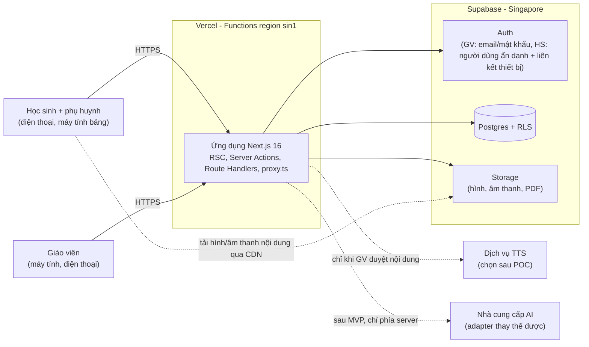
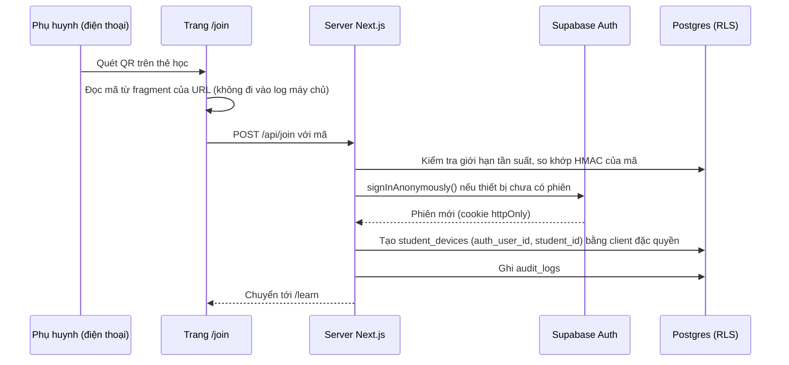

# ReadMate AI — Kiến trúc kỹ thuật

> **Phiên bản:** 0.2 — cập nhật sau Giai đoạn 2 (nền tảng kỹ thuật: §3.1, AD-19 → AD-24, §5.1, §6.1, §18, §19, §20, §22)
> **Ngày cập nhật:** 2026-10-14
> **Trạng thái:** GĐ1 đã được nghiệm thu; phần GĐ2 chờ người điều phối đánh giá
> **Tài liệu liên quan:** [PRD.md](PRD.md) · [DATA_MODEL.md](DATA_MODEL.md) · [TASKS.md](../TASKS.md) · [CLAUDE.md](../CLAUDE.md)

## Mục lục

1. [Tổng quan và nguyên tắc kiến trúc](#1-tổng-quan-và-nguyên-tắc-kiến-trúc)
2. [Sơ đồ ngữ cảnh hệ thống](#2-sơ-đồ-ngữ-cảnh-hệ-thống)
3. [Ngăn xếp công nghệ đã xác minh](#3-ngăn-xếp-công-nghệ-đã-xác-minh)
4. [Các quyết định kiến trúc chính](#4-các-quyết-định-kiến-trúc-chính)
5. [Cấu trúc thư mục](#5-cấu-trúc-thư-mục)
6. [Frontend](#6-frontend)
7. [Backend và API](#7-backend-và-api)
8. [Xác thực và phân quyền](#8-xác-thực-và-phân-quyền)
9. [Cơ sở dữ liệu và lưu trữ tệp](#9-cơ-sở-dữ-liệu-và-lưu-trữ-tệp)
10. [Kho tri thức Tiếng Việt](#10-kho-tri-thức-tiếng-việt)
11. [Bộ máy bài tập](#11-bộ-máy-bài-tập)
12. [Bộ máy phân hóa](#12-bộ-máy-phân-hóa)
13. [Hệ thống âm thanh](#13-hệ-thống-âm-thanh)
14. [Giao bài và theo dõi kết quả](#14-giao-bài-và-theo-dõi-kết-quả)
15. [Dashboard giáo viên](#15-dashboard-giáo-viên)
16. [Sinh phiếu PDF](#16-sinh-phiếu-pdf)
17. [AI hỗ trợ tạo bài (sau MVP)](#17-ai-hỗ-trợ-tạo-bài-sau-mvp)
18. [Bảo mật](#18-bảo-mật)
19. [Triển khai trên Vercel](#19-triển-khai-trên-vercel)
20. [Kiểm thử và chất lượng](#20-kiểm-thử-và-chất-lượng)
21. [Hiệu năng và chi phí](#21-hiệu-năng-và-chi-phí)
22. [Rủi ro kỹ thuật và các POC cần làm](#22-rủi-ro-kỹ-thuật-và-các-poc-cần-làm)

---

## 1. Tổng quan và nguyên tắc kiến trúc

ReadMate AI là **một ứng dụng Next.js duy nhất (modular monolith)** triển khai trên Vercel, dùng **Supabase** cho PostgreSQL, xác thực và lưu trữ tệp. Không có backend riêng, không có dịch vụ hàng đợi riêng (tác vụ nền dùng bảng `background_jobs` + Vercel Cron khi cần), không có vector database ở MVP.

| Nguyên tắc | Ý nghĩa |
|---|---|
| **Đơn giản trước** | Một repo, một ứng dụng, một CSDL. Chỉ thêm thành phần khi có nhu cầu đo được |
| **Hoạt động không cần AI** | Mọi luồng học tập chạy bằng nội dung đã duyệt; AI chỉ là công cụ soạn nháp cho GV (sau MVP) |
| **Quy tắc xác định trước, AI sau** | Kiểm tra ngôn ngữ, decodability, chống lộ đáp án là mã xác định (deterministic), có kiểm thử |
| **Phòng thủ nhiều lớp** | RLS trên mọi bảng + kiểm tra quyền trong từng Server Function + secret chỉ ở server |
| **Một nguồn sự thật cho mỗi dạng bài** | Lược đồ, giao diện tương tác, giao diện phiếu, hàm chấm, bộ kiểm tra nằm cùng một module |
| **Nội dung bất biến theo phiên bản** | Bài giao và kết quả luôn trỏ tới đúng phiên bản nội dung học sinh đã thấy |
| **Tối thiểu hóa dữ liệu trẻ em** | Không lưu thông tin định danh không cần thiết; dữ liệu học tập chỉ khi có đồng ý |
| **Chi phí thấp** | Âm thanh/PDF sinh trước và lưu đệm; chấm điểm tại máy học sinh và chấm lại ở server |

## 2. Sơ đồ ngữ cảnh hệ thống



Ghi chú: học sinh **không bao giờ** gọi trực tiếp dịch vụ TTS hay AI; mọi lời gọi ra ngoài đều đi từ server với secret nằm trong biến môi trường của Vercel.

## 3. Ngăn xếp công nghệ đã xác minh

### 3.1 Phiên bản đang cài đặt (GĐ2, theo `package-lock.json`)

Kiểm tra lại bằng `npm view` ngay trước khi cài (2026-10-12) — mọi gói cài **không** cần `--force`/`--legacy-peer-deps`.

| Nhóm | Gói | Phiên bản cài | Ghi chú |
|---|---|---|---|
| Framework | `next` · `react` · `react-dom` | 16.4.0 · 19.3.0 · 19.3.0 | Ghim chính xác như template `create-next-app@16.4.0` |
| Ngôn ngữ | `typescript` | 5.9.3 (`^5`) | `typescript-eslint` 8.71.1 chỉ hỗ trợ TypeScript `<6.1` → chưa thể dùng TS 7 |
| CSS | `tailwindcss` · `@tailwindcss/turbopack` | 4.3.3 · 4.3.3 | Tailwind chạy qua loader Turbopack (không có `postcss.config`) — mặc định của template |
| Biểu tượng | `lucide-react` | 1.55.0 | Giấy phép ISC |
| Lint/format | `eslint` · `eslint-config-next` · `prettier` | 9.39.5 · 16.4.0 · 3.9.10 | npm báo ESLint 9 hết hỗ trợ, nhưng `eslint-plugin-react`/`import`/`jsx-a11y` trong `eslint-config-next` chưa khai báo hỗ trợ ESLint 10 |
| Unit test | `vitest` · `vite` · `@vitejs/plugin-react` · `jsdom` | 5.0.3 · 8.3.4 · 6.1.2 · 30.1.2 | `vite` là peer bắt buộc của Vitest 5; `jsdom` 30 yêu cầu Node `^24.15` |
| Testing Library | `@testing-library/react` · `dom` · `jest-dom` | 16.3.3 · 10.4.2 · 7.0.1 | |
| E2E | `@playwright/test` | 1.64.0 | Trình duyệt: Chromium 156 (Chrome for Testing), WebKit 27.2 |
| Kiểu Node | `@types/node` | 24.19.2 (`^24`) | Template mặc định `^20` lệch peer của Vitest 5 |

### 3.2 Đánh giá công nghệ cho các giai đoạn sau

Phiên bản được kiểm tra ngày **2026-10-12** bằng `npm view` (npm registry), `create-next-app@16.4.0` và tài liệu chính thức. Không chọn phiên bản theo trí nhớ; kiểm tra lại khi cài.

| Thành phần | Lựa chọn | Phiên bản | Ghi chú xác minh |
|---|---|---|---|
| Runtime | Node.js | Máy: 24.18.0 · Vercel: **24.x** (mặc định), 22.x | `@supabase/supabase-js`, `ai`, Vitest yêu cầu Node ≥ 22; Vercel ngừng hỗ trợ Node 20 từ 2026-10-01 → đặt `engines.node: "24.x"` |
| Framework | Next.js (App Router) | 16.4.0 | `engines.node >= 20.9.0`; từ v16 **`middleware.ts` đổi thành `proxy.ts`**, chạy Node.js runtime |
| UI | React, React DOM | 19.3.0 | |
| Ngôn ngữ | TypeScript | **^5 (5.9.3)** | npm `latest` là 7.0.2 (bản native) nhưng `create-next-app` 16.4 vẫn ghim `typescript: "^5"` → dùng 5.9.x, đánh giá TS 7 sau |
| CSS | Tailwind CSS | 4.3.3 | Kèm `@tailwindcss/postcss` hoặc `@tailwindcss/turbopack` 4.3.3 (template chọn theo bundler) |
| Validation | Zod | 4.6.6 | Dùng chung client/server; `ai` chấp nhận zod `^3.25.76 \|\| ^4.1.8` |
| Supabase | `@supabase/supabase-js` 2.117.3 · `@supabase/ssr` 0.12.7 · CLI `supabase` 2.120.0 | | Dùng khóa mới `sb_publishable_…` / `sb_secret_…`; khóa `anon`/`service_role` cũ bị khai tử **cuối 2026** |
| PDF | `@react-pdf/renderer` | 4.9.0 | peer `react ^19` hợp lệ |
| Kiểm thử | Vitest 5.0.3 · Playwright 1.64.0 | | Vitest yêu cầu `@types/node ^22 \|\| >=24` → dùng `@types/node@^24` (template mặc định `^20` sẽ lệch) |
| Lint/format | ESLint **^9** (9.39.5) + `eslint-config-next` 16.4.0 · Prettier 3.9.10 | | ESLint 10.12 đã phát hành nhưng template Next ghim `^9` |
| PWA (ứng viên) | `@serwist/next` | 9.5.13 | Cần POC với Turbopack; phương án dự phòng: service worker viết tay |
| AI (sau MVP) | `@anthropic-ai/sdk` 0.133.0 (adapter đầu tiên) · `ai` 7.0.137 (phương án đa nhà cung cấp) | | Chọn cách hiện thực adapter khi bắt đầu GĐ11 |
| TTS (ứng viên) | `@google-cloud/text-to-speech` 7.1.1 · `microsoft-cognitiveservices-speech-sdk` 1.52.0 · nhà cung cấp Việt Nam | | Google Cloud TTS có nhiều giọng `vi-VN` (Standard, WaveNet, Neural2, Chirp3-HD) — đã xác minh; các nhà cung cấp khác cần POC |
| Font | Andika (SIL, OFL) cho phần đọc · Be Vietnam Pro cho giao diện | | Đã xác minh cả hai có subset `vietnamese` trên Google Fonts; Andika có chữ *a*, *g* một tầng, thiết kế cho người mới học đọc |
| Triển khai | Vercel | CLI `vercel` 63.1.2 (**chưa cài**) | |
| Trình quản lý gói | npm | 11.16.0 | pnpm/yarn không có trên máy |

## 4. Các quyết định kiến trúc chính

Trạng thái: **Chốt** = áp dụng cho MVP · **POC** = cần thử nghiệm trước khi chốt · **Hoãn** = quyết định ở giai đoạn sau.

| Mã | Quyết định | Lý do | Phương án đã cân nhắc | Trạng thái |
|---|---|---|---|---|
| AD-01 | Modular monolith Next.js App Router trên Vercel; không tách backend | Ít thành phần vận hành, phù hợp đội nhỏ, triển khai một lệnh | API riêng (NestJS/Express) — thêm hạ tầng, thêm chi phí | Chốt |
| AD-02 | Supabase (Postgres + Auth + Storage + RLS), region Singapore | Đủ chức năng trong một dịch vụ, SQL mạnh cho phân tích, RLS gắn với JWT người dùng, gói miễn phí cho phát triển | Neon + Auth.js (tự làm nhiều hơn); Firebase (NoSQL, yếu cho phân tích); Convex (khóa nhà cung cấp); tự host (gánh vận hành — xem lại nếu luật yêu cầu lưu trữ trong nước) | Chốt |
| AD-03 | Không dùng ORM; `supabase-js` + kiểu TypeScript sinh từ CSDL + SQL migrations (Supabase CLI) | ORM kết nối bằng vai trò đặc quyền và bỏ qua RLS; `supabase-js` giữ JWT người dùng để RLS có hiệu lực | Prisma/Drizzle — phải tự đặt vai trò/claims cho từng giao dịch | Chốt |
| AD-04 | Mọi thao tác **ghi** của học sinh và **nội dung phiên luyện** (chỉ phiên bản `approved`) đi qua "student gateway" phía server; học sinh chỉ có quyền **đọc** dữ liệu của mình qua RLS | Server suy ra danh tính từ phiên, chấm lại đáp án, cập nhật dữ liệu dẫn xuất; client không thể giả mạo kết quả; một điểm duy nhất bảo đảm "chỉ nội dung đã duyệt" | Cho phép INSERT trực tiếp + trigger chấm điểm bằng PL/pgSQL (khó kiểm thử) | Chốt |
| AD-05 | Học sinh đăng nhập bằng **người dùng ẩn danh của Supabase + liên kết thiết bị qua mã QR/mã dự phòng** | Không cần email/mật khẩu cho trẻ; RLS dùng `auth.uid()` tự nhiên; thu hồi thiết bị có hiệu lực ngay | Mỗi HS một tài khoản Supabase với email giả + đổi mã lấy phiên (phức tạp khi thu hồi, anh chị em dùng chung máy); phiên cookie tự quản lý (mất RLS) | POC (GĐ5) |
| AD-06 | **Exercise Type Module**: mỗi dạng bài là một module gồm lược đồ, Player, Paper, `grade()`, `validate()`, thang gợi ý, chính sách âm thanh | Bảo đảm bản tương tác và bản phiếu luôn tương đương; dễ thêm dạng mới | Mã rời rạc theo màn hình | Chốt |
| AD-07 | Kho tri thức lõi (chữ, âm, vần, thanh, quy tắc, thứ tự bài) lưu **dạng dữ liệu trong repo** (seed-as-code) có kiểm thử, nạp vào CSDL; từ vựng/câu/hình quản lý trong CSDL có duyệt | Dữ kiện ngôn ngữ ổn định cần review như mã; nội dung mở rộng cần giao diện cho GV | Toàn bộ trong CSDL (khó review, khó kiểm thử) | Chốt |
| AD-08 | Phiên bản nội dung **bất biến** sau khi gửi duyệt; bài giao/kết quả tham chiếu phiên bản cụ thể | Truy vết chính xác, phân tích lỗi đúng nội dung | Sửa tại chỗ (mất lịch sử) | Chốt |
| AD-09 | Âm thanh **sinh trước** (TTS) hoặc **ghi âm GV**, lưu Storage + CDN; không TTS thời gian thực khi học sinh học | Chi phí, độ trễ, độ tin cậy, kiểm duyệt được | TTS theo yêu cầu; Web Speech API của trình duyệt (chất lượng không đồng đều) | Chốt (nhà cung cấp TTS: POC GĐ6) |
| AD-10 | PDF bằng `@react-pdf/renderer` trong Route Handler Node.js; nhúng font Andika | Nhẹ, không cần Chromium, cùng mô hình React với Player | Puppeteer + Chromium (gói lớn, khởi động chậm); in bằng CSS trình duyệt (khác nhau giữa trình duyệt) | Chốt (POC kỹ thuật GĐ8) |
| AD-11 | Phân hóa **dựa trên luật** có tham số, giải thích được | Minh bạch với GV, dễ kiểm thử, không cần dữ liệu lớn | BKT/IRT/ML (cần dữ liệu, khó giải thích) | Chốt cho MVP |
| AD-12 | AI qua cổng `StructuredLlm` + adapter; adapter đầu tiên dùng SDK chính thức `@anthropic-ai/sdk`, mô hình mặc định `claude-opus-5-5` cấu hình bằng biến môi trường; adapter `fixture` cho kiểm thử | Thay nhà cung cấp không ảnh hưởng nghiệp vụ; luôn có chế độ không-AI | Gọi thẳng SDK trong nghiệp vụ (khóa nhà cung cấp); AI SDK đa nhà cung cấp (`ai`) — có thể dùng để hiện thực adapter | Hoãn tới GĐ11 |
| AD-13 | Vercel Functions đặt region **`sin1`**, Supabase **Singapore** | Mặc định Vercel là `iad1` (Mỹ) → độ trễ mỗi truy vấn CSDL cao nếu không đổi | | Chốt |
| AD-14 | npm làm trình quản lý gói | Có sẵn, Vercel tự nhận diện qua `package-lock.json` | pnpm (phải cài thêm) | Chốt |
| AD-15 | TypeScript 5.9.x | Template chính thức của Next 16.4 ghim `^5` | TypeScript 7.0 native | Chốt (xem lại sau) |
| AD-16 | Tương tác **chạm để chọn** thay vì kéo–thả | Vận động tinh của trẻ 6 tuổi; kéo trên điện thoại dễ lỗi | Thư viện DnD | Chốt |
| AD-17 | Không dùng vector DB/RAG ở MVP; truy xuất kho tri thức có cấu trúc bằng SQL | Kho tri thức nhỏ, có cấu trúc rõ; SQL chính xác hơn tìm kiếm ngữ nghĩa | pgvector | Chốt |
| AD-18 | `Permissions-Policy` tắt microphone/camera/geolocation ở khu vực học sinh | Bảo đảm "không ghi âm mặc định" ở tầng trình duyệt | | Chốt |
| AD-19 | Giữ `cacheComponents: true` + `partialPrefetching: true` (mặc định của `create-next-app` 16.4) | Tài liệu Next 16.4: cả hai sẽ được bật cố định ở bản major tiếp theo; trang tĩnh được prerender, điều hướng giữ trạng thái bằng `<Activity>` | Tắt để giữ mô hình cũ (phải chuyển đổi lại sau) | Chốt (GĐ2) |
| AD-20 | CSP **không dùng nonce**, đặt bằng `headers()` trong `next.config.ts`; `script-src 'self' 'unsafe-inline'` (thêm `'unsafe-eval'` + `ws:` chỉ khi dev) | Theo tài liệu Next 16.4: nonce buộc mọi trang render động và không tương thích Partial Prerendering; ứng dụng không có script bên thứ ba và không hiển thị HTML do người dùng nhập | Nonce qua `proxy.ts`; SRI (thử nghiệm) — xem lại khi có dữ liệu nhạy cảm (GĐ5+) | Chốt (GĐ2) |
| AD-21 | Font qua `next/font/google` (Be Vietnam Pro 400/600/700/800, Andika 400/700; subset `vietnamese` + `latin`) | Tự host lúc build, trình duyệt không gọi Google; Google Fonts đã chia subset nên tệp nhỏ | Font cục bộ (`next/font/local`) — sẽ dùng TTF cục bộ cho PDF ở GĐ8 | Chốt (GĐ2) |
| AD-22 | Kiểm thử: Vitest (jsdom) + Testing Library cho unit/component; Playwright chạy trên **bản production** vừa build (webServer: build + `next start`), 4 cấu hình Chromium/WebKit × desktop/điện thoại | Kiểm tra đúng hành vi thật (prerender, header, CSP); hai engine phổ biến của phụ huynh (Android Chrome, iPhone Safari) | Chạy E2E trên `next dev` (khác production) | Chốt (GĐ2) |
| AD-23 | `typedRoutes: true`; script `typecheck` = `next typegen && tsc --noEmit` | Liên kết nội bộ được kiểm tra kiểu; `next-env.d.ts` (bị gitignore) được sinh trước khi `tsc` chạy, kể cả trên CI | | Chốt (GĐ2) |
| AD-24 | Tách module header bảo mật `src/config/security-headers.ts`, nạp từ `next.config.ts` với đuôi `.ts` tường minh | Node 24 nạp `next.config.ts` bằng bộ phân giải TypeScript gốc → cần đuôi tệp, chỉ cú pháp "xóa được" (`erasableSyntaxOnly`); module có unit test riêng | Viết thẳng trong `next.config.ts` (khó kiểm thử) | Chốt (GĐ2) |

## 5. Cấu trúc thư mục

### 5.1 Đã tạo ở GĐ2

Chỉ tạo các thư mục có mã thật — không tạo sẵn module rỗng cho giai đoạn sau.

```text
ReadMateAI/
├── .github/workflows/ci.yml      # lint → typecheck → unit test → build
├── src/
│   ├── app/
│   │   ├── (site)/               # route group có header/footer: / · /demo · /join
│   │   ├── teacher/              # /teacher — layout có sidebar (chưa xác thực)
│   │   ├── learn/                # /learn — layout cho trẻ, điều hướng dưới cùng
│   │   ├── layout.tsx · fonts.ts · globals.css · icon.svg
│   │   └── error.tsx · not-found.tsx
│   ├── components/
│   │   ├── ui/                   # button, card, badge, container, section-heading, notice, empty-state, loading-state, tabs
│   │   ├── layout/               # logo, skip-link, nav-link, mobile-nav, site-header, site-footer, teacher-sidebar, student-bottom-nav
│   │   ├── learning/visuals.tsx  # biểu tượng hướng dẫn + màu/biểu tượng lộ trình
│   │   └── illustrations/        # minh họa ghép tiếng "bà", linh vật cú
│   ├── config/                   # site.ts (điều hướng), security-headers.ts (nạp bởi next.config.ts)
│   ├── features/
│   │   ├── exercises/catalog.ts       # 6 dạng bài (mô tả, chưa có Player/grade)
│   │   ├── learning-paths/catalog.ts  # 3 lộ trình ↔ 3 nhóm năng lực
│   │   └── demo/demo-data.ts          # dữ liệu minh họa hư cấu
│   ├── lib/                      # cn.ts, vietnamese/normalize.ts
│   ├── strings/vi.ts             # toàn bộ câu chữ giao diện (NFC)
│   ├── styles/tokens.css         # design tokens Tailwind 4 (@theme)
│   └── types/learning.ts
├── tests/unit/                   # Vitest: strings, normalize, security-headers, catalog, components, pages, repo-hygiene
├── tests/e2e/                    # Playwright: routes, navigation, responsive, vietnamese, security-headers, privacy
└── next.config.ts · vitest.config.mts · playwright.config.ts · eslint.config.mjs · vercel.json · .env.example
```

Khác với dự kiến ở §5.2: route giáo viên và học sinh là thư mục thường `teacher/`, `learn/` (mỗi khu vực một layout riêng nên không cần route group); trang công khai nằm trong `(site)/`; `/demo` dùng chung header/footer công khai. Thành phần giao diện cho trẻ hiện dùng `components/ui` với cỡ `kid` (nút ≥ 64 px) — sẽ tách `components/kid` khi có Player ở GĐ4.

### 5.2 Định hướng cho các giai đoạn sau

Có thể điều chỉnh khi triển khai; chỉ tạo thư mục khi có mã thật.

```text
ReadMateAI/
├── CLAUDE.md · PROGRESS.md · TASKS.md
├── docs/                         # PRD, ARCHITECTURE, DATA_MODEL, adr/ (về sau)
├── content/                      # Dữ liệu tri thức lõi dạng mã (seed-as-code), có kiểm thử
│   ├── kb/                       # letters, phonemes, rimes, tones, rules, vocabulary
│   └── curriculum/               # <bộ-sách>.json: thứ tự bài học + đơn vị giới thiệu
├── public/                       # manifest, biểu tượng, âm thanh giao diện mặc định
├── src/
│   ├── app/
│   │   ├── (public)/             # trang giới thiệu, /join (liên kết thiết bị)
│   │   ├── (student)/learn/      # khu vực học sinh
│   │   ├── (teacher)/teacher/    # khu vực giáo viên
│   │   ├── (admin)/admin/        # quản trị kho tri thức (sau)
│   │   ├── demo/                 # chơi thử với dữ liệu mẫu, không lưu dữ liệu
│   │   └── api/                  # Route Handlers: đồng bộ kết quả, PDF, cron
│   ├── proxy.ts                  # làm mới phiên Supabase, chặn route thô (Next 16)
│   ├── features/
│   │   ├── exercises/            # registry + types/<code>/{schema,grade,validate,hints,audio-policy,Player,Paper,fixtures}
│   │   ├── session/              # bộ chạy phiên luyện tập
│   │   ├── adaptivity/           # mastery, review queue, support level, band suggestion, config
│   │   ├── content-authoring/    # soạn, kiểm tra, duyệt
│   │   ├── assignments/
│   │   ├── worksheets/
│   │   ├── dashboard/
│   │   ├── audio/
│   │   └── ai/                   # sau MVP
│   ├── lib/
│   │   ├── vietnamese/           # normalize, syllable, spelling-rules, tone, decodability
│   │   ├── supabase/             # browser.ts, server.ts, admin.ts (server-only)
│   │   └── security/             # tokens, rate-limit, headers
│   ├── server/                   # chỉ chạy phía server: student-gateway, tts, pdf, jobs
│   ├── components/               # ui/ (GV), kid/ (HS)
│   └── strings/vi.ts             # toàn bộ câu chữ giao diện tiếng Việt
├── supabase/                     # config.toml, migrations/, seed/, tests/ (RLS)
└── tests/e2e/                    # Playwright
```

Quy ước: `features/*` chứa nghiệp vụ theo miền; `lib/*` là thư viện thuần không phụ thuộc giao diện; `server/*` và `lib/supabase/admin.ts` có `import 'server-only'` để không thể lọt vào bundle client.

## 6. Frontend

### 6.1 Bản đồ route

| Route | Đối tượng | Mô tả | Giai đoạn |
|---|---|---|---|
| `/` | Mọi người | Giới thiệu ngắn, liên kết đăng nhập GV; không có công cụ theo dõi | GĐ2 ✅ |
| `/demo` | Mọi người | GĐ2 ✅: giới thiệu 3 lộ trình, buổi luyện mẫu, H3→H0, 6 dạng bài (dữ liệu hư cấu). GĐ4: chơi thử 6 dạng bài, không đăng nhập, không gửi dữ liệu | GĐ2 / GĐ4 |
| `/join` | Phụ huynh | GĐ2 ✅: giao diện bị khóa, không nhận mã. GĐ5: liên kết thiết bị bằng mã QR (mã nằm ở phần fragment của URL) hoặc mã dự phòng | GĐ2 / GĐ5 |
| `/learn` | HS | GĐ2 ✅: khung giao diện (lời chào, nhiệm vụ, khu bài tập, thành tích — chưa có dữ liệu). GĐ7: chọn hồ sơ, "Bài hôm nay" | GĐ2 / GĐ7 |
| `/learn/session/[id]` | HS | Bộ chạy phiên luyện | GĐ7 |
| `/learn/parents` | Phụ huynh | Góc phụ huynh | GĐ7 |
| `/teacher` | GV | GĐ2 ✅: khung bảng điều khiển (chưa xác thực, không dữ liệu). GĐ5–GĐ9: tổng quan lớp | GĐ2 / GĐ5–GĐ9 |
| `/teacher/classes/[id]/students` | GV | Học sinh, thẻ học, thiết bị, đồng ý, nhóm | GĐ5 |
| `/teacher/content` · `/teacher/review` | GV | Soạn và duyệt bài | GĐ6 |
| `/teacher/audio` | GV | Ghi âm, quản lý âm thanh (chỉ route này được bật microphone) | GĐ6 |
| `/teacher/assignments` | GV | Giao bài theo nhóm | GĐ7 |
| `/teacher/worksheets` · `/teacher/observations` | GV | Phiếu PDF, ghi nhận tự lực | GĐ8 |
| `/teacher/dashboard` | GV | Dashboard | GĐ9 |

### 6.2 Khu vực học sinh

- **Một nhiệm vụ trên một màn hình**, nút lớn (≥ 64 px), ít chữ; nút loa và nút gợi ý luôn ở vị trí cố định.
- **Mở khóa âm thanh:** trình duyệt di động (đặc biệt iOS) chặn tự phát âm thanh khi chưa có thao tác của người dùng → nút "Bắt đầu" khởi tạo audio trước khi phát câu lệnh đầu tiên.
- **Chấm tại máy** để phản hồi tức thì (hàm `grade()` thuần, dùng chung với server); kết quả được xếp hàng trong bộ nhớ cục bộ (IndexedDB) và gửi theo lô, kèm UUID do client tạo để chống trùng.
- **Không** script bên thứ ba, **không** liên kết ra ngoài, **không** ô nhập văn bản tự do.
- Font: Andika cho phần chữ cần đọc; Be Vietnam Pro cho giao diện (tải qua `next/font`, subset `vietnamese`).
- Trạng thái: React state/`useReducer` cho bộ chạy phiên; không cần thư viện quản lý trạng thái toàn cục ở MVP.

### 6.3 Khu vực giáo viên

- Ưu tiên máy tính nhưng dùng được trên điện thoại (đặc biệt màn hình ghi nhận tự lực tại lớp).
- Đọc dữ liệu bằng Server Components (client Supabase mang JWT của GV → RLS áp dụng); thao tác ghi bằng Server Actions có kiểm tra zod và kiểm tra quyền.
- Bảng, biểu mẫu, biểu đồ đơn giản (heatmap bằng CSS/SVG); thư viện biểu đồ chỉ thêm khi cần (GĐ9).

### 6.4 Hệ thống thiết kế

- Design tokens trong Tailwind 4 (`@theme`): màu, cỡ chữ, khoảng cách, bo góc; hai bộ thành phần: `components/kid` (BigButton, OptionCard, AudioButton, HintButton, ProgressStars) và `components/ui` (cho GV).
- **Bộ biểu tượng hướng dẫn** (Nghe, Nhìn, Chọn, Nối, Ghép, Điền, Sắp xếp, Đọc) dạng SVG, có bản đen trắng cho phiếu — dùng chung app và PDF.
- Trợ năng: tương phản cao, không truyền tin chỉ bằng màu, hỗ trợ bàn phím ở khu vực GV, `prefers-reduced-motion`.
- Toàn bộ câu chữ giao diện nằm trong `src/strings/vi.ts` để GV dễ rà soát và để sinh âm thanh câu lệnh.

### 6.5 PWA và ngoại tuyến

- MVP: web app manifest (cài lên màn hình chính) + hàng đợi kết quả cục bộ; tải trước âm thanh/hình của phiên.
- Service worker cache âm thanh/hình: POC giữa `@serwist/next` và service worker viết tay (tương thích Turbopack của Next 16 cần kiểm chứng).

## 7. Backend và API

| Cơ chế | Dùng cho | Ghi chú |
|---|---|---|
| **Server Components** | Đọc dữ liệu cho trang GV/HS | Client Supabase phía server mang JWT người dùng → RLS áp dụng |
| **Server Actions** | Thao tác của GV (tạo lớp, duyệt bài, giao bài…) | Mỗi action tự kiểm tra danh tính và quyền; không dựa vào `proxy.ts` |
| **Route Handlers** | `POST /api/join`, `POST /api/student/attempts` (đồng bộ kết quả theo lô), `GET /api/worksheets/[id]/pdf`, `/api/cron/*` | Xác thực + zod + giới hạn tần suất; cron bảo vệ bằng `CRON_SECRET` |
| **`proxy.ts`** | Làm mới phiên Supabase (`getClaims()`), chuyển hướng thô khi chưa đăng nhập | Theo tài liệu Next.js: luôn xác thực lại trong từng Server Function |
| **Tác vụ nền** | Sinh TTS, PDF, (sau này) AI theo lô | `after()`/`waitUntil` cho việc nhỏ; bảng `background_jobs` + Vercel Cron khi cần thử lại; giới hạn thời gian hàm: Hobby 300 s, Pro tối đa 800 s |

**Ba client Supabase** (tách file rõ ràng):

- `lib/supabase/browser.ts` — khóa publishable, dùng ở client (hạn chế; chủ yếu cho xác thực).
- `lib/supabase/server.ts` — đọc/ghi cookie phiên, mang JWT người dùng → mọi truy vấn chịu RLS.
- `lib/supabase/admin.ts` — **khóa secret, bỏ qua RLS**, có `import 'server-only'`; chỉ được gọi từ `server/student-gateway`, xử lý `/join`, tác vụ nền và script quản trị. Mọi hàm dùng client này phải tự xác định phạm vi dữ liệu (lớp/học sinh) từ phiên, **không** lấy từ dữ liệu client gửi lên.

**Xử lý lỗi và nhật ký:** trả kết quả có kiểu (`{ ok: true, data } | { ok: false, code }`) cho Server Actions; log chỉ chứa UUID và mã lỗi, không chứa biệt danh, câu trả lời hay nội dung nhạy cảm.

## 8. Xác thực và phân quyền

### 8.1 Vai trò

| Vai trò | Cách xác thực | Phạm vi |
|---|---|---|
| `admin` | Supabase Auth email/mật khẩu; hồ sơ `staff_profiles.role = 'admin'` | Quản trị hệ thống, kho tri thức chung |
| `teacher` | Supabase Auth email/mật khẩu (tài khoản do admin tạo; tắt tự đăng ký) | Lớp mà mình là thành viên (`class_staff`) |
| Thiết bị học sinh | Người dùng **ẩn danh** của Supabase (`is_anonymous = true`) + bản ghi `student_devices` còn hiệu lực | Chỉ dữ liệu của học sinh đã liên kết |
| Ẩn danh chưa liên kết / khách | Không có hoặc chưa liên kết | Không đọc được dữ liệu nào |
| Server (service) | Khóa secret | Bỏ qua RLS — chỉ trong module đã nêu ở §7 |

Lưu ý: SMTP mặc định của Supabase chỉ phù hợp thử nghiệm; production cần SMTP riêng cho email đặt lại mật khẩu của GV (GĐ10).

### 8.2 Luồng liên kết thiết bị học sinh



**Thiết kế mã truy cập**

- Mã QR: 32 byte ngẫu nhiên (base64url) đặt trong **fragment** `…/join#c=<mã>` → không xuất hiện trong log máy chủ hay header Referer; trang đặt `Referrer-Policy: no-referrer`.
- Mã dự phòng: 8 ký tự Crockford Base32 (≈ 40 bit) để gõ tay khi không quét được QR.
- CSDL chỉ lưu **HMAC-SHA256(mã, pepper)**; pepper nằm trong biến môi trường server → lộ CSDL không đủ để dò mã.
- Giới hạn tần suất theo IP (băm) và theo lớp; khóa tạm sau nhiều lần sai.
- GV cấp lại mã (mã cũ bị thu hồi), xem danh sách thiết bị, **thu hồi thiết bị** — RLS kiểm tra `revoked_at` nên có hiệu lực ngay ở truy vấn kế tiếp.
- Supabase khuyến nghị mạnh bật CAPTCHA (Cloudflare Turnstile) cho đăng nhập ẩn danh (mặc định giới hạn 30 yêu cầu/giờ/IP). Đề xuất: bật Turnstile **chỉ trên trang `/join`** trước khi chạy production; không đặt script bên thứ ba ở khu vực học sinh.
- Người dùng ẩn danh không liên kết thành công sẽ được xóa định kỳ (cron hằng ngày qua Admin API).

### 8.3 Chiến lược RLS

- **Bật RLS cho 100% bảng** trong schema `public`; bảng không có policy nghĩa là không ai (ngoài server) truy cập được.
- Hàm trợ giúp đặt trong schema `private` (không phơi qua API), `security definer`, `set search_path = ''`: `private.my_class_ids()`, `private.my_student_ids()`, `private.is_admin()`.
- Policy viết dạng `class_id in (select private.my_class_ids())` và `(select auth.uid())` để Postgres tính một lần cho mỗi câu lệnh; đánh chỉ mục các cột dùng trong policy.
- Các bảng dữ liệu học sinh **lưu kèm `class_id`** (phi chuẩn hóa có chủ đích) để policy không phải join nhiều bảng.
- Học sinh **không có policy INSERT/UPDATE/DELETE** trên bất kỳ bảng nào; ghi qua student gateway (AD-04).
- Học sinh **không đọc trực tiếp** các bảng bài tập; nội dung của phiên luyện do student gateway cung cấp và chỉ gồm phiên bản `approved`.
- Học sinh **không bao giờ** đọc được nhóm năng lực, thẻ học, đồng ý, ghi nhận tại lớp.
- Bộ kiểm thử RLS là điều kiện nghiệm thu bắt buộc (§20). Chi tiết ma trận quyền: [DATA_MODEL.md §7](DATA_MODEL.md#7-ma-trận-phân-quyền-rls).

### 8.4 Quản lý secret

| Biến môi trường | Phạm vi | Ghi chú |
|---|---|---|
| `NEXT_PUBLIC_SUPABASE_URL` | Client + server | Công khai |
| `NEXT_PUBLIC_SUPABASE_PUBLISHABLE_KEY` | Client + server | Công khai theo thiết kế; quyền thấp, RLS bảo vệ |
| `SUPABASE_SECRET_KEY` | **Chỉ server** | Bỏ qua RLS; Supabase trả 401 nếu dùng từ trình duyệt |
| `LOGIN_CODE_PEPPER` | **Chỉ server** | Pepper cho HMAC mã truy cập |
| `CRON_SECRET` | **Chỉ server** | Bảo vệ `/api/cron/*` |
| `TTS_PROVIDER`, khóa/credential TTS | **Chỉ server** | GĐ6 |
| `AI_PROVIDER`, `AI_MODEL`, `ANTHROPIC_API_KEY` | **Chỉ server** | GĐ11; thiếu khóa ⇒ tính năng AI tự ẩn |
| `TURNSTILE_SECRET_KEY` | **Chỉ server** | Khi bật CAPTCHA |

Quy tắc: không đặt secret trong biến có tiền tố `NEXT_PUBLIC_`; repo chỉ chứa `.env.example`; CI quét thư mục build để chắc chắn không có chuỗi khóa secret (GĐ2/GĐ5).

## 9. Cơ sở dữ liệu và lưu trữ tệp

- **Postgres của Supabase**, schema `public` cho bảng nghiệp vụ, `private` cho hàm trợ giúp RLS. Mô hình chi tiết: [DATA_MODEL.md](DATA_MODEL.md).
- **Migrations** SQL trong `supabase/migrations/` (tạo bằng Supabase CLI qua `npx supabase`), commit vào git; mỗi giai đoạn chỉ thêm migration mới, không sửa migration đã áp dụng.
- **Kiểu TypeScript** sinh bằng `supabase gen types` và commit; CI kiểm tra kiểu khớp với migrations.
- **Môi trường:** CSDL cục bộ (Supabase CLI + Docker) cho phát triển và kiểm thử RLS; dự án Supabase *dev* cho Preview; dự án *prod* riêng cho Production (gói Free cho phép 2 dự án hoạt động).
- **Storage buckets:** `content-media` (hình/âm thanh nội dung đã duyệt — không chứa dữ liệu cá nhân học sinh), `teacher-recordings` (riêng tư, bản ghi chờ duyệt), `worksheets` (riêng tư, tải bằng signed URL). Học sinh không tải tệp lên.
- **Sao lưu:** gói Free **không có** sao lưu và **tạm dừng sau 1 tuần không hoạt động**; gói Pro có sao lưu hằng ngày giữ 7 ngày → production thí điểm nên dùng Pro (GĐ10).

## 10. Kho tri thức Tiếng Việt

Kho tri thức gồm bốn lớp:

1. **Thư viện ngôn ngữ xác định** `src/lib/vietnamese/` — mã thuần TypeScript, kiểm thử dày đặc:
   - `normalize`: chuẩn hóa **NFC**, chuẩn hóa vị trí dấu thanh theo quy ước cấu hình ("hoà"/"hòa"), phát hiện văn bản dán từ bảng mã cũ (TCVN3, VNI) để cảnh báo.
   - `syllable`: phân tích tiếng → âm đầu, âm đệm, âm chính, âm cuối, thanh; vần = âm đệm + âm chính + âm cuối. Quy ước nhà trường (ví dụ coi "qu", "gi" là âm đầu) là tham số cấu hình, cần GV xác nhận.
   - `spelling-rules`: c/k/q; g/gh; ng/ngh (k, gh, ngh đứng trước i, e, ê); iê/ia/yê/ya, uô/ua, ươ/ưa theo có/không âm cuối; tiếng có âm cuối p, t, c, ch chỉ mang thanh sắc hoặc nặng.
   - `decodability`: `component_units(word)` và `isDecodable(word, taughtSet)`.
2. **Dữ liệu lõi dạng mã** `content/kb/*`, `content/curriculum/*` — chữ cái, âm (kèm cách gọi khi dạy), vần, thanh, quy tắc (dạng máy đọc được), thứ tự bài học theo bộ sách; được kiểm tra bằng lệnh `content:check` trong CI rồi nạp vào CSDL bằng script seed.
3. **Bảng CSDL** `kb_units`, `kb_unit_relations`, `kb_rules`, `curriculum_*`, `media_assets` — thêm từ vựng, câu, hình, âm thanh qua giao diện có duyệt.
4. **Truy vấn có cấu trúc** (không vector DB): "các từ đọc được ở bài N có vần *an* và có hình" là một truy vấn SQL.

**Decodability (chỉ dùng điều đã học):**

- `taught_set(lớp)` = các đơn vị (âm, vần, thanh) được giới thiệu ở các bài có thứ tự ≤ bài hiện tại của lớp (Nhóm 3 mặc định tính đến bài trước).
- Mỗi từ lưu `component_unit_ids` (do parser tính, có `parser_version`); từ **đọc được** khi `component_unit_ids ⊆ taught_set` — truy vấn bằng toán tử mảng `<@` với chỉ mục GIN.
- Bản quyền: chỉ lưu **thứ tự bài và đơn vị kiến thức** của sách giáo khoa (dữ kiện), không sao chép bài đọc, hình ảnh.

## 11. Bộ máy bài tập

### 11.1 Exercise Type Module

Mỗi dạng bài (6 dạng ở [PRD §9](PRD.md#9-sáu-dạng-bài-tập-mvp)) là một thư mục `src/features/exercises/types/<code>/`. Phác thảo giao diện (minh họa, sẽ hiện thực ở GĐ4):

```ts
// Phác thảo — không phải mã cuối cùng
export interface ExerciseTypeModule<Item, Response> {
  code: ExerciseTypeCode;                 // 'letter_sound' | 'build_syllable' | ...
  schemaVersion: number;
  itemSchema: z.ZodType<Item>;            // lược đồ nội dung một câu
  responseSchema: z.ZodType<Response>;    // lược đồ câu trả lời
  audioPolicy: AudioPolicy;               // vai trò âm thanh được phát trước/sau khi chấm, theo mức H3..H0
  hintLadder: HintStep[];                 // gợi ý theo bậc (ưu tiên hình ảnh)
  grade(item: Item, res: Response): { correct: boolean; errorTags: string[] };  // hàm thuần, dùng chung client/server
  validate(item: Item, ctx: ValidationContext): ValidationIssue[];             // kiểm tra riêng của dạng bài
  instruction: { icon: InstructionIcon; text: string };                         // câu lệnh chuẩn, dùng cho app và phiếu
}
// Player.tsx (client) và Paper.tsx (react-pdf, server-only) nằm cùng thư mục, đăng ký riêng theo môi trường.
```

### 11.2 Vòng đời nội dung

`draft` → (bộ kiểm tra không còn lỗi) → `in_review` (nội dung bị khóa, ghi `content_hash`) → `approved` | `changes_requested` | `rejected`; `approved` → `retired` khi ngừng dùng. Sửa bài đã duyệt = tạo **phiên bản mới**. Sơ đồ trạng thái: [DATA_MODEL.md §6](DATA_MODEL.md#6-trạng-thái-kiểm-duyệt).

### 11.3 Chuỗi kiểm tra tự động (validation pipeline)

Chạy khi lưu nháp và bắt buộc trước khi gửi duyệt; kết quả lưu vào `exercise_versions.validation_report`.

| Bước | Mã lỗi ví dụ |
|---|---|
| 1. Lược đồ (zod) | `SCHEMA_INVALID` |
| 2. Unicode NFC, bảng mã cũ | `NOT_NFC`, `LEGACY_ENCODING` |
| 3. Chính tả và quy tắc thanh | `SPELLING_RULE_VIOLATION`, `TONE_RULE_VIOLATION` |
| 4. Chỉ dùng điều đã học (theo bài của lớp và nhóm) | `NOT_DECODABLE` |
| 5. Đáp án duy nhất, phương án nhiễu hợp lệ, không trùng | `AMBIGUOUS_ANSWER`, `DUPLICATE_OPTIONS`, `DISTRACTOR_IS_CORRECT` |
| 6. Chống lộ đáp án: lời đọc **và** văn bản hiển thị không chứa đáp án/nội dung trẻ phải tự đọc (ví dụ không hiện chữ "bò" khi hỏi âm đầu của hình con bò) | `AUDIO_LEAKS_ANSWER`, `TEXT_LEAKS_ANSWER` |
| 7. Đủ hình/âm thanh đã duyệt | `MISSING_IMAGE`, `MISSING_AUDIO` |
| 8. Ràng buộc theo nhóm (số phương án, độ dài câu…) | `BAND_CONSTRAINT` |
| 9. Từ ngữ phù hợp trẻ em (danh sách chặn + GV duyệt) | `CHILD_SAFETY` |

### 11.4 Tạo bài theo quy tắc (không AI)

Với dạng bài *T*, mục tiêu *U* (ví dụ vần "an"), lớp ở bài *N*, nhóm *B*: lấy các từ đọc được có chứa *U* và có hình → chọn phương án nhiễu từ quan hệ `confusable_*` trong kho tri thức (an–ang, b–d…) → gắn thẻ lỗi cho từng phương án nhiễu → chạy chuỗi kiểm tra → tạo bản nháp chờ GV duyệt. Cùng cơ chế này sinh "bài sinh đôi" cho phiếu (§16).

### 11.5 Chấm điểm và thẻ lỗi

`grade()` là hàm thuần: so sánh câu trả lời đã chuẩn hóa NFC với đáp án; nếu học sinh chọn phương án nhiễu có thẻ (ví dụ `confusion:b-d`, `spelling:c-k`, `tone:hoi-nga`) thì trả về thẻ đó. Client chấm để phản hồi tức thì; server **chấm lại** khi nhận kết quả và chỉ tin kết quả của server.

## 12. Bộ máy phân hóa

Toàn bộ tham số nằm trong `src/features/adaptivity/config.ts` (có `version`), được kiểm thử bằng lịch sử mô phỏng; mỗi phiên lưu phiên bản cấu hình đã dùng.

1. **Lập kế hoạch phiên** (lưu vào `practice_sessions.plan` để truy vết): tối đa 2 câu ôn đến hạn → các bài trong biến thể được giao (theo mức hỗ trợ hiện tại của từng dạng) → giới hạn khoảng 12 câu / 15 phút.
2. **Điều chỉnh trong phiên:** sai 2 câu liên tiếp cùng dạng → chèn câu bắc cầu (dạng tiên quyết, cùng mục tiêu) và tăng hỗ trợ 1 bậc trong phiên; đúng ≥ 90% → mời "Thử thách".
3. **Mức thành thạo đơn vị** (`student_unit_mastery`): trung bình trượt có trọng số (α ≈ 0,3); câu đúng độc lập = 1,0, đúng sau gợi ý = 0,5; trạng thái `new → learning → reviewing → mastered` theo ngưỡng và số ngày đúng khác nhau.
4. **Ôn tập lặp lại có khoảng cách** (`student_review_items`): hộp Leitner 1–5 với khoảng 1, 2, 4, 7, 14 ngày; sai → về hộp 1; đúng độc lập → lên hộp; cặp nhầm lẫn tạo mục ôn riêng (ví dụ phân biệt b–d).
5. **Mức hỗ trợ theo dạng** (`student_type_support`): luật lên/xuống bậc và "sẵn sàng tự làm ở lớp" như [PRD §11](PRD.md#11-mức-hỗ-trợ-và-cơ-chế-giảm-dần); GV ghi đè được.
6. **Đề xuất đổi nhóm** (`band_suggestions`): tính hằng tuần, kèm bằng chứng; chỉ có hiệu lực khi GV chấp nhận.

Mọi đề xuất đều **giải thích được** cho GV (ví dụ: "Đề xuất ôn âm b vì 3/5 lần gần nhất nhầm b–d").

## 13. Hệ thống âm thanh

| Vai trò | Ví dụ | Nguồn ưu tiên |
|---|---|---|
| `instruction` | "Con nhìn hình rồi chọn chữ ghi âm đầu." | Ghi âm GV hoặc TTS (câu lệnh chuẩn theo dạng bài) |
| `stimulus` | Tên hình "bò" trong dạng 1 | TTS hoặc ghi âm GV |
| `model` | Đọc mẫu "quả na" sau khi chấm | TTS hoặc ghi âm GV |
| `feedback` | "Đúng rồi!", "Con thử lại nhé." | Bộ cố định, ghi một lần |
| Âm/vần đơn lẻ | "bờ", "an", "oang" | **Bắt buộc ghi âm GV** (PRD A7) |

**Luồng sinh âm thanh khi duyệt bài:** lấy danh sách "khe âm thanh" theo chính sách của dạng bài → với mỗi khe, tính khóa `sha256(vai trò + văn bản NFC + giọng)` → dùng lại tệp đã có hoặc sinh mới qua `TtsProvider` (adapter) → tải lên `content-media` → tạo `media_assets` (lưu `spoken_text` để kiểm tra chống lộ đáp án) → GV có thể nghe và thay bằng bản ghi âm của mình.

**Phát âm thanh:** `HTMLAudioElement`, tải trước câu kế tiếp, mở khóa bằng thao tác "Bắt đầu"; định dạng nén mono. **Ghi âm của GV:** trình duyệt khác nhau cho ra định dạng khác nhau (WebM/Opus hoặc MP4/AAC) — khả năng phát trên iOS cần POC ở GĐ6 (phương án: GV tải tệp ghi sẵn trên điện thoại).

**Chống lộ đáp án:** `audioPolicy` của dạng bài quyết định khe nào được phát ở mức H3–H0 và trước/sau khi chấm; bộ kiểm tra `AUDIO_LEAKS_ANSWER` so khớp `spoken_text` với đáp án và nội dung cần đọc.

## 14. Giao bài và theo dõi kết quả

1. GV tạo `assignment` cho lớp → các `assignment_variants` theo nhóm → mỗi biến thể là danh sách **phiên bản bài đã duyệt**.
2. Khi phát hành, hệ thống chụp danh sách người nhận (`assignment_recipients`) theo nhóm hiện tại; đổi nhóm sau đó không làm thay đổi bài đã giao.
3. Học sinh mở bài → server lập kế hoạch phiên (§12) và trả về nội dung các câu (chỉ phiên bản `approved`, kèm URL hình/âm thanh) → client chạy phiên.
4. Client gửi kết quả theo lô tới `POST /api/student/attempts`: `{ sessionId, attempts: [{ id (UUID client), itemId, response, hintsUsed, supportLevel, … }] }`.
5. Student gateway: xác thực phiên → lấy `student_id` từ `student_devices` (không tin dữ liệu client) → kiểm tra **đã có đồng ý** → kiểm tra câu thuộc bài được giao → **chấm lại** → ghi `item_attempts` (bỏ qua bản trùng theo `id`) → cập nhật mastery, hàng ôn, mức hỗ trợ.
6. GV xem tiến độ theo thời gian gần thực trên dashboard.

## 15. Dashboard giáo viên

- Truy vấn qua **SQL view/hàm** (security invoker, chịu RLS) trên `item_attempts`, `student_unit_mastery`, `student_type_support`, `class_task_observations`; tổng hợp theo tuần.
- Quy mô MVP nhỏ (một lớp khoảng 40 học sinh) → truy vấn trực tiếp với chỉ mục phù hợp; chỉ thêm bảng tổng hợp/materialized view khi đo thấy chậm (mục tiêu < 1 giây/trang).
- Không có xếp hạng; không hiển thị dữ liệu lớp khác; xuất dữ liệu (sau MVP) có nhật ký.

## 16. Sinh phiếu PDF

1. GV chọn biến thể bài giao → bộ sinh "bài sinh đôi" (§11.4) tạo phiên bản bài dạng phiếu cùng dạng, cùng mục tiêu, cùng độ khó, **không trùng câu** với bài ở nhà.
2. Tạo `worksheet_version` (nháp) → GV xem trước → duyệt.
3. Route Handler (Node.js runtime) dựng PDF bằng `@react-pdf/renderer` từ các component `Paper.tsx` của từng dạng bài; font **Andika** nhúng từ tệp trong repo (không tải CDN lúc chạy); văn bản luôn chuẩn hóa NFC trước khi dựng.
4. Lưu PDF vào bucket riêng tư `worksheets`, ghi `pdf_sha256`; tải về bằng signed URL; dựng lại khi phiên bản thay đổi.
5. Bố cục: A4 dọc, chữ đọc ≥ 20 pt, biểu tượng hướng dẫn bản đen trắng, hình đen trắng/thang xám, dòng trống để viết tên.

## 17. AI hỗ trợ tạo bài (sau MVP)

> Chỉ triển khai ở GĐ11. Ứng dụng phải chạy đầy đủ khi không có khóa API.

**Kiến trúc cổng – adapter:**

```ts
// Phác thảo — không phải mã cuối cùng
interface StructuredLlm {
  generate<T>(req: {
    purpose: 'exercise_draft' | 'distractor_review';
    system: string;            // ổn định → tận dụng prompt caching
    input: string;             // lát cắt kho tri thức + yêu cầu của GV (không có dữ liệu học sinh)
    schema: z.ZodType<T>;
  }): Promise<{ data: T; usage: TokenUsage; provider: string; model: string }>;
}
// Adapter: anthropic.ts (mặc định), fixture.ts (kiểm thử/không có khóa); adapter khác thêm sau khi cần.
```

**Adapter mặc định (Anthropic)** — thông tin tham chiếu từ tài liệu SDK chính thức (cập nhật 2026-09-25, kiểm tra lại khi hiện thực):

- SDK `@anthropic-ai/sdk`; structured output bằng `client.messages.parse()` với `output_config: { format: zodOutputFormat(schema) }` (helper `@anthropic-ai/sdk/helpers/zod`) → nhận đối tượng đã kiểm tra lược đồ.
- Mô hình mặc định `claude-opus-5-5` (giá tham chiếu: 4 USD/1 triệu token vào, 20 USD/1 triệu token ra); đặt `effort` tường minh (mặc định của mô hình này là `medium`). Việc chuyển sang mô hình rẻ hơn (ví dụ `claude-sonnet-5-5`: 2 USD/10 USD) là **quyết định của chủ dự án**, chỉ thực hiện sau khi đo chất lượng bằng bộ đánh giá do GV xây dựng.
- Bật cơ chế dự phòng khi mô hình từ chối (server-side fallback) theo hướng dẫn hiện hành của API; luôn kiểm tra `stop_reason` trước khi đọc kết quả.
- **Prompt caching** cho phần system + mô tả lược đồ + ví dụ đã duyệt (ổn định giữa các lần gọi); **Message Batches API** (chi phí 50%) cho việc sinh nháp hàng loạt không cần ngay.

**Quy trình:** GV chọn mục tiêu (bài, đơn vị, dạng, nhóm, số câu) → server dựng ngữ cảnh từ kho tri thức (tập đơn vị đã học, từ đọc được có hình, lược đồ dạng bài, ví dụ đã duyệt) → gọi LLM → zod → chuỗi kiểm tra §11.3 → lưu `exercise_versions` với `origin = 'ai'`, trạng thái `draft` → GV duyệt. Mỗi lần gọi ghi `ai_generation_runs` (mô hình, token, chi phí ước tính, phiên bản prompt). Giới hạn chi phí/ngày bằng biến môi trường.

**Bảo đảm:** không gửi dữ liệu học sinh; không tự duyệt; học sinh không gọi AI; có thể tắt toàn bộ bằng `AI_PROVIDER=none`.

## 18. Bảo mật

| Mối đe dọa | Biện pháp |
|---|---|
| HS đọc dữ liệu của HS khác | RLS theo `private.my_student_ids()`; server suy ra danh tính từ phiên; kiểm thử RLS tự động |
| Lộ thẻ học/mã QR | Phạm vi hẹp (chỉ dữ liệu luyện tập của một em, không có thông tin định danh); GV thu hồi/cấp lại; giới hạn tần suất |
| Lộ khóa secret | Chỉ ở biến môi trường server; `server-only`; quét bundle trong CI; GitHub secret scanning (repo đang public) |
| Nội dung chưa duyệt đến tay HS | Student gateway chỉ phục vụ phiên bản `approved`; trigger CSDL chặn gắn phiên bản chưa duyệt vào bài giao/phiếu; HS không đọc trực tiếp bảng bài tập; AI không tự duyệt |
| XSS từ nội dung | React tự thoát ký tự; cấm `dangerouslySetInnerHTML` cho nội dung; CSP |
| Lạm dụng đăng nhập ẩn danh | Giới hạn tần suất của Supabase + Turnstile ở `/join` (production) + dọn người dùng ẩn danh không liên kết |
| Tài khoản GV bị chiếm | Phạm vi theo lớp; nhật ký; mật khẩu mạnh; MFA (TOTP) khuyến nghị sau MVP |
| Preview lộ dữ liệu thật | Preview chỉ nối CSDL dev và dữ liệu giả; bật Deployment Protection (Vercel Authentication — kiểm tra khả dụng theo gói khi triển khai; Password Protection không có ở gói Hobby) |
| Log chứa dữ liệu cá nhân | Log chỉ chứa UUID/mã lỗi; không gửi dữ liệu HS cho dịch vụ giám sát bên thứ ba |
| Theo dõi bên thứ ba | Không analytics/quảng cáo ở khu vực HS; CSP chặn script ngoài |

**Tiêu đề HTTP** (đặt trong `next.config` / `proxy.ts`): `Content-Security-Policy` (nonce khi cần), `Permissions-Policy: camera=(), microphone=(), geolocation=()` (ngoại lệ: `/teacher/audio` cho phép microphone), `Referrer-Policy: no-referrer` cho `/join` và `strict-origin-when-cross-origin` cho phần còn lại, `X-Content-Type-Options: nosniff`, `frame-ancestors 'none'`.

**Đã triển khai ở GĐ2** (`src/config/security-headers.ts`, áp dụng cho mọi route qua `headers()` của `next.config.ts`; kiểm thử bằng Vitest và Playwright trên bản production):

| Header | Giá trị |
|---|---|
| `Content-Security-Policy` | `default-src 'self'; script-src 'self' 'unsafe-inline'; style-src 'self' 'unsafe-inline'; img-src 'self' data: blob:; font-src 'self'; connect-src 'self'; media-src 'self' blob:; object-src 'none'; base-uri 'self'; form-action 'self'; frame-ancestors 'none'; manifest-src 'self'; worker-src 'self' blob:` — khi `next dev` thêm `'unsafe-eval'` (React dev) và `ws: wss:` (HMR) |
| `Permissions-Policy` | `camera=(), microphone=(), geolocation=(), payment=(), usb=()` |
| `Referrer-Policy` | `strict-origin-when-cross-origin`; riêng `/join`: `no-referrer` |
| `X-Content-Type-Options` · `X-Frame-Options` | `nosniff` · `DENY` |
| `X-Powered-By` | Tắt (`poweredByHeader: false`) |

Không dùng `upgrade-insecure-requests` (Vercel đã ép HTTPS; directive này có thể khiến trình duyệt, nhất là WebKit, chuyển tài nguyên sang HTTPS khi chạy `next start` qua HTTP cục bộ để kiểm thử). `'unsafe-inline'` cho script là đánh đổi có chủ đích của CSP không nonce (AD-20) — xem lại khi có dữ liệu thật.

**Khác:** bảng `audit_logs` cho thao tác nhạy cảm; cập nhật phụ thuộc định kỳ (`npm audit`, Dependabot); kiểm tra bảo mật trước thí điểm (GĐ10).

## 19. Triển khai trên Vercel

| Môi trường | Ứng dụng | CSDL | Ghi chú |
|---|---|---|---|
| Local | `npm run dev` | Supabase CLI + Docker (hoặc dự án dev) | Docker Desktop đã cài nhưng daemon chưa chạy |
| Preview | Mỗi pull request | Dự án Supabase **dev** | Dữ liệu giả; bật Deployment Protection nếu gói hỗ trợ |
| Production | Nhánh `main` | Dự án Supabase **prod** | Chỉ nhận dữ liệu thật sau GĐ10 |

- Liên kết dự án Vercel với GitHub `ThaiTaka/ReadMateAI` (chưa làm — cần quyết định của chủ dự án).
- Thiết lập: Node.js **24.x**; region Functions **`sin1`** (`vercel.json`); biến môi trường theo §8.4 cho từng môi trường; Preview không bao giờ dùng khóa của Production.
- **CI (GitHub Actions):** `.github/workflows/ci.yml` (GĐ2) chạy `npm ci` → lint → typecheck → unit test → build trên `ubuntu-latest`, Node theo `.nvmrc`, quyền `contents: read`, `persist-credentials: false`; thêm `content:check` khi có script đó (GĐ3); E2E trên Preview khi cần. Migration CSDL chạy thủ công có kiểm soát (`supabase db push`) — không tự động trên mọi lần push.
- **Cron:** dọn người dùng ẩn danh, tính đề xuất đổi nhóm, thu hồi thiết bị không dùng, áp dụng thời hạn lưu giữ (kiểm tra giới hạn cron theo gói khi triển khai).
- **Giám sát:** log của Vercel; cảnh báo lỗi cho khu vực GV (cân nhắc dịch vụ giám sát có lọc dữ liệu cá nhân — quyết định ở GĐ10).
- **Rollback:** dùng tính năng promote/rollback deployment của Vercel; migration viết theo hướng tương thích ngược (thêm trước, xóa sau).
- **Điều khoản gói:** gói Hobby chỉ dành cho **sử dụng cá nhân phi thương mại**; định nghĩa "thương mại" của Vercel bao gồm cả trường hợp người viết mã là nhân viên được trả lương → cần chủ dự án/nhà trường xác nhận, hoặc dùng gói Pro cho production.

## 20. Kiểm thử và chất lượng

| Tầng | Công cụ | Phạm vi | Giai đoạn bắt đầu |
|---|---|---|---|
| Unit | Vitest | `lib/vietnamese` (hàng trăm ca: gi, qu, ngh, oa/oe/uy, iê/yê/ia/ya, uô/ua, ươ/ưa, thanh), `grade()`, `validate()`, phân hóa | GĐ2–GĐ4 |
| Component | Vitest + Testing Library | Player của 6 dạng bài | GĐ4 |
| Nội dung | `npm run content:check` | Toàn bộ seed và nội dung mẫu | GĐ3 |
| CSDL/RLS | pgTAP (`supabase test db`) hoặc Vitest tích hợp với nhiều người dùng | Cách ly lớp, cách ly học sinh, thiết bị bị thu hồi, ẩn danh chưa liên kết | GĐ5 |
| Vệ sinh repo | Vitest (`tests/unit/repo-hygiene.test.ts`) | Không secret/token, không email/số điện thoại trong `src`/`tests`/`public`, không URL ngoài trong `src`, mọi tệp văn bản ở dạng NFC, `.env.example` không chứa giá trị secret, `.gitignore` chặn `.env*` | GĐ2 ✅ |
| E2E | Playwright: Pixel (Android Chrome), iPhone (WebKit), iPad, desktop | GĐ2 ✅: route, điều hướng, 360 px không tràn ngang, tiếng Việt/NFC/font, header bảo mật, quyền riêng tư (chỉ request cùng nguồn). GĐ4+: luồng HS, luồng GV, chính sách âm thanh | GĐ2 / GĐ4 |
| Trợ năng | axe (Playwright) | Trang GV và HS | GĐ4 |
| Thủ công | GV + quan sát học sinh (có đồng ý) | Khả dụng của `/demo` | GĐ4 |

**Definition of Done** của mỗi nhiệm vụ: lint + typecheck + test xanh; có test cho logic mới; không secret trong mã; RLS cho bảng mới kèm test; tài liệu và `PROGRESS.md` được cập nhật.

## 21. Hiệu năng và chi phí

**Ngân sách hiệu năng:** JS cho route học sinh ≤ khoảng 200 KB (gzip); mở "Bài hôm nay" ≤ 3 giây trên 4G; mỗi tệp âm thanh ngắn ≤ 50 KB; ảnh dạng SVG/WebP đã định cỡ.

**Chi phí** (giá kiểm tra ngày 2026-10-12, có thể thay đổi):

| Hạng mục | Phát triển | Thí điểm production (đề xuất) |
|---|---|---|
| Vercel | Hobby: 0 USD (phi thương mại; giới hạn tháng: 100 GB truyền tải, 1 triệu lần gọi hàm, 4 giờ Active CPU) | Pro: 20 USD/tháng/thành viên (kèm 20 USD tín dụng sử dụng) nếu không đủ điều kiện Hobby |
| Supabase | Free: 0 USD (500 MB CSDL, 1 GB tệp, 5 GB egress, 50.000 MAU, tạm dừng sau 1 tuần không hoạt động, không sao lưu) | Pro: từ 25 USD/tháng (kèm 10 USD tín dụng compute; 8 GB đĩa, 100 GB tệp, sao lưu hằng ngày 7 ngày, không tạm dừng) |
| TTS | Gói miễn phí của nhà cung cấp (kiểm tra ở POC) | Nhỏ — chỉ sinh khi duyệt bài, có dùng lại tệp |
| AI (GĐ11) | — | Ước tính thô: ~0,01–0,02 USD/câu nháp với `claude-opus-5-5` (≈ 6k token vào, ≈ 5k token ra cho 6–10 câu); giảm khoảng 50% với Batch API; đo lại bằng `usage` thực tế |
| Tên miền | Dùng `*.vercel.app` | Tùy chọn (khoảng 10–15 USD/năm) |

## 22. Rủi ro kỹ thuật và các POC cần làm

| Mã | Rủi ro / điểm chưa chắc chắn | Hành động | Giai đoạn |
|---|---|---|---|
| T-01 | `create-next-app` từ chối scaffold vào thư mục đã có `CLAUDE.md`, `TASKS.md`, `PROGRESS.md` (chỉ cho phép `.git`, `.gitignore`, `.gitattributes`, `docs`, `LICENSE`, …) | ✅ Đã xử lý ở GĐ2: scaffold vào thư mục tạm rồi hợp nhất | GĐ2 |
| T-02 | Phiên bản "latest" không khớp hệ sinh thái (TypeScript 7, ESLint 10, `@types/node` 20 vs Vitest 5) | ✅ Đã xử lý ở GĐ2: ghim TypeScript `^5`, ESLint `^9`, `@types/node` `^24` (§3.1) | GĐ2 |
| T-12 | ESLint 9 bị npm đánh dấu hết hỗ trợ; `npm audit` báo 5 lỗ hổng mức cao (ReDoS trong `braces` qua chuỗi phụ thuộc của `eslint-config-next`, chưa có bản vá) — chỉ ở công cụ dev, không vào bundle | Theo dõi bản phát hành `eslint-config-next`/plugin hỗ trợ ESLint 10; không dùng `npm audit fix --force` (sẽ hạ `eslint-config-next` xuống 14.x) | GĐ3+ |
| T-13 | `next.config.ts` được Node 24 nạp bằng bộ phân giải TypeScript gốc: import nội bộ phải có đuôi `.ts`, không dùng alias `@/`, không dùng cú pháp TypeScript cần biên dịch (enum, namespace) | Giữ cấu hình tối giản; logic đặt trong module có unit test (AD-24) | GĐ2+ |
| T-03 | Luồng đăng nhập ẩn danh + liên kết thiết bị + Turnstile với `@supabase/ssr` và `proxy.ts` | POC trước khi xây giao diện | GĐ5 |
| T-04 | Serwist/service worker với Turbopack của Next 16 | POC; dự phòng service worker viết tay | GĐ4/GĐ7 |
| T-05 | `@react-pdf/renderer` trong Route Handler Next 16 + font Andika + dấu tiếng Việt | POC dựng 1 trang mẫu, kiểm tra trích xuất văn bản | GĐ8 (có thể sớm hơn) |
| T-06 | Chất lượng TTS tiếng Việt cho từ/câu lớp 1; giọng vùng miền | POC so sánh 2–3 nhà cung cấp, GV nghe đánh giá | GĐ6 |
| T-07 | Định dạng ghi âm của GV và khả năng phát trên iOS | POC ghi/phát trên Android + iPhone | GĐ6 |
| T-08 | Tự phát âm thanh trên iOS/Android | Thiết kế nút "Bắt đầu" mở khóa; E2E trên WebKit | GĐ4 |
| T-09 | Quy ước phân tích tiếng ("qu", "gi", vị trí dấu thanh) khác nhau giữa bộ sách | Tham số hóa trong `lib/vietnamese`; GV xác nhận | GĐ3 |
| T-10 | Khóa `anon`/`service_role` cũ bị khai tử cuối 2026 | Dùng khóa publishable/secret ngay từ đầu | GĐ5 |
| T-11 | Docker daemon chưa chạy; `LongPathsEnabled = 0` trên Windows | Bật Docker Desktop khi cần Supabase local; bật long paths nếu gặp lỗi đường dẫn | GĐ5 |
