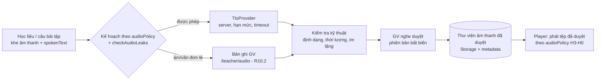

# ReadMate AI — Audio Engine (R10.1 thiết kế + R10.2 thư viện bản ghi giáo viên)

> **Phiên bản:** 1.0 — R10.1 (2026-10-26). **Phạm vi:** thiết kế + nghiên cứu tài liệu + adapter `TtsProvider` kiểm thử bằng mock. **Chưa** có âm thanh nào được tạo, ghi hay phát; `AudioSlot` vẫn khóa (AD-39). R10.2–R10.7 chưa làm.
> Liên quan: [ARCHITECTURE §13](ARCHITECTURE.md#13-hệ-thống-âm-thanh), [EXERCISE_ENGINE §5](EXERCISE_ENGINE.md), [PRD §12](PRD.md), [AUDIO_RECORDING_PLAN](AUDIO_RECORDING_PLAN.md).

## 1. Trạng thái thật (đọc trước)

| Hạng mục | Trạng thái |
|---|---|
| Interface `TtsProvider`, chế độ `none`, mock, kiểm tra đầu vào, hạn mức, timeout, kế hoạch theo `audioPolicy` | **Đã hiện thực + unit test** (`src/server/tts/`, `tests/unit/tts/`) |
| Adapter Google Cloud TTS | **Skeleton** theo tài liệu REST; chỉ kiểm thử bằng `fetch` giả. **Chưa gọi API thật** |
| Adapter Azure / FPT.AI | **Chưa viết** (chỉ đánh giá tài liệu; hợp đồng interface đã đủ để thêm) |
| Gọi API thật, nghe thử chất lượng giọng Việt | **BLOCKED — chờ chủ dự án cấp phép tạo tài khoản/khóa thử nghiệm.** Chưa đánh giá chất lượng tổng hợp |
| Bảng/migration thư viện âm thanh, giao diện GV `/teacher/audio`, Storage riêng tư, quy trình duyệt | **R10.2 đã có** (§12); kiểm thử với dữ liệu giả trên local/CI. **Phát trong Player: chưa làm (R10.3)** |
| Bản ghi âm GV | **Chưa có bản thật nào, chưa bản nào được duyệt**; cờ hệ thống ghi âm TẮT mặc định; chưa GV nào đồng ý dùng giọng |

## 2. Hai nguồn âm thanh

| Nguồn | Dùng cho | Không dùng cho |
|---|---|---|
| **A. Bản ghi GV** | Âm đơn lẻ, vần đơn lẻ (PRD A7). Một bản ghi dùng lại ở mọi bài | — |
| **B. TTS** | Câu lệnh chuẩn của 17 biến thể, tên tranh/từ/câu *khi chính sách cho phép*, lời khen/động viên, âm thanh mẫu **sau** khi chấm | Âm/vần đơn lẻ; bất kỳ lời đọc nào bị `checkAudioLeaks` chặn |

Cấm: Web Speech API (đã có test quét `speechSynthesis`), TTS theo yêu cầu lúc học sinh mở bài, TTS từ trường nhập của học sinh.

## 3. Đánh giá nhà cung cấp (truy cập 2026-10-26)

> Thông tin lấy từ trang tài liệu chính thức qua công cụ đọc trang; các ô ghi **"chưa xác minh"** không được suy đoán. Chưa có tài khoản nên **không có kết quả nghe thử**.

### 3.1 So sánh

| Tiêu chí | Google Cloud TTS | Azure AI Speech | FPT.AI TTS |
|---|---|---|---|
| 1. Tiếng Việt | Có, `vi-VN` | Có, `vi-VN` | Có |
| Giọng | Standard A–D, WaveNet A–D, Neural2 A (nữ)/D (nam), Chirp 3 HD (nhiều giọng, tên thiên thể) — liệt kê theo trang; cần `ListVoices` để xác nhận | `HoaiMyNeural` (nữ), `NamMinhNeural` (nam), `Linh:MAI-Voice-2-Flash` (nữ, HD Flash); có thể còn giọng khác ở phần trang chưa đọc hết | `banmai`, `lannhi`, `linhsan`, `thuminh` (nữ), `leminh`, `giahuy` (nam), `myan` (nữ) |
| 3. Vùng miền | Không thấy ghi vùng miền (chưa xác minh) | Không thấy ghi vùng miền (chưa xác minh) | **Có ghi** Bắc (banmai, leminh, thuminh), Trung (myan, giahuy), Nam (lannhi, linhsan) |
| 4. Tốc độ chậm | `speakingRate` cho Standard/WaveNet/Neural2; **Chirp 3 HD không hỗ trợ speaking rate/pitch/SSML** | SSML `prosody` (nói chung; riêng tiếng Việt chưa xác minh) | `speed` −3…+3 |
| 5–6. Chi phí / gói thử | Chirp 3 HD 30 USD/1 triệu ký tự (miễn phí 1 triệu/tháng); Neural2 16 USD (miễn phí 1 triệu); Standard, WaveNet 4 USD (miễn phí 4 triệu theo bảng giá; một nguồn khác ghi WaveNet 1 triệu — **mâu thuẫn, kiểm lại**). **Phải bật thanh toán** | Bậc F0 miễn phí 0,5 triệu ký tự/tháng (giọng Neural); **đơn giá trả phí không đọc được từ trang** (chưa xác minh) | Miễn phí 100.000 ký tự (giọng v5), hàng đợi, giới hạn yêu cầu/ngày; gói trả phí bằng VND (500.000đ = +1,5 triệu ký tự … 5.000.000đ = +27 triệu); chưa rõ theo tháng hay một lần |
| 7. Giới hạn API | 5.000 byte/yêu cầu; 200 yêu cầu/phút (Chirp 3 HD), 1.000 (Neural2/khác) mỗi dự án | Chưa xác minh | 5.000 ký tự/yêu cầu (tối thiểu 3); phía miễn phí có giới hạn ngày |
| 8. Định dạng | MP3, LINEAR16, OGG_OPUS… (chưa đối chiếu đủ danh sách) | Nhiều định dạng (chưa đối chiếu) | `mp3`, `wav` |
| Cơ chế | Đồng bộ (JSON `audioContent` base64) | Đồng bộ (REST/SDK) | **Bất đồng bộ**: trả liên kết `async`, chờ 5 giây–2 phút, hoặc `callback_url`; thời hạn liên kết **không ghi** → phải tải về ngay |
| 9. Giấy phép tái dùng/phân phối tệp | **Chưa xác minh** (không tìm thấy điều khoản chính thức; chỉ có ý kiến cộng đồng — không dùng làm căn cứ) | **Chưa xác minh** | **Chưa xác minh** (không tìm thấy điều khoản của FPT.AI) |
| 10–11. Lưu nội dung gửi tới | "Google không ghi log văn bản/âm thanh TTS của khách; dịch vụ stateless" ([data-logging](https://docs.cloud.google.com/text-to-speech/docs/data-logging)) | API thời gian thực: "Microsoft không lưu văn bản và không lưu âm thanh" ([data-privacy-security](https://learn.microsoft.com/en-us/legal/cognitive-services/speech-service/text-to-speech/data-privacy-security)); batch có lưu ở Azure Storage, xóa được | **Chưa xác minh** (không tìm thấy chính sách của FPT.AI); âm thanh được lưu ở S3 một thời gian không rõ |
| 12. Thay nhà cung cấp | Dễ: giữ tệp đã duyệt, đổi adapter | Dễ | Dễ, nhưng cần tải tệp ngay (liên kết tạm) |

Nguồn: Google [bảng giá](https://cloud.google.com/text-to-speech/pricing) (số liệu qua tóm tắt tìm kiếm của trang chính thức — trang đầy đủ không đọc được), [hạn mức](https://docs.cloud.google.com/text-to-speech/quotas), [danh sách giọng](https://docs.cloud.google.com/text-to-speech/docs/list-voices-and-types); Azure [language support](https://learn.microsoft.com/en-us/azure/ai-services/speech-service/language-support?tabs=tts), [bảng giá](https://azure.microsoft.com/en-us/pricing/details/cognitive-services/speech-services/); FPT.AI [API](https://docs.fpt.ai/docs/en/speech/api/text-to-speech), [giá](https://docs.fpt.ai/docs/en/speech/documentation/tts-pricing).

### 3.2 Đề xuất (chưa phải quyết định mua)

**Ứng viên ưu tiên cho POC: Google Cloud TTS, giọng `vi-VN-Neural2-A/D`** (chế độ tốc độ chậm có tham số, gói miễn phí lớn so với nhu cầu, không ghi log, đồng bộ nên đơn giản, quota rõ). **Phương án thứ hai: FPT.AI** — lợi thế giọng bản địa có ghi vùng Bắc/Trung/Nam (phù hợp Q-03 về giọng vùng miền) nhưng thiếu điều khoản lưu trữ/giấy phép và bất đồng bộ. Azure là phương án dự phòng (cần đọc đủ danh sách giọng/giá).

Lý do không chọn theo chất lượng: **chưa nghe thử bất kỳ giọng nào** — đề xuất dựa trên tính năng, chi phí, quyền riêng tư và độ đơn giản; GV phải nghe và quyết định.

### 3.3 Chi phí ước tính (chỉ tính phần TTS; phép tính của dự án)

Ngữ liệu hiện có: 17 câu lệnh chuẩn ≈ 1.100 ký tự, 60 từ ≈ 230, 31 câu ≈ 410 → < 2.000 ký tự; thêm lời khen/lời nhắc cỡ vài nghìn. Kể cả nhân 10–20 lần cho kho thật, vẫn **< 100.000 ký tự**, nằm trong mọi gói miễn phí ở bảng trên; nếu phải trả theo Neural2 (16 USD/1 triệu) thì ~1,6 USD cho 100.000 ký tự. Rủi ro chi phí chủ yếu là **bật thanh toán** (Google bắt buộc) và gọi lặp — đã giảm bằng cache khóa nội dung và hạn mức lô (§6).

### 3.4 Điều kiện còn phải xác minh trước khi chọn

1. Điều khoản chính thức về **lưu trữ lâu dài và phân phối lại tệp đã tổng hợp** trong ứng dụng cho học sinh (cả ba nhà cung cấp).
2. Danh sách giọng vi-VN thực tế (`ListVoices`/Voice Gallery) và đơn giá Azure.
3. **Nghe thử** (POC): phát âm dấu thanh, từ dễ nhầm (b/d, ch/tr, s/x), câu 4–6 tiếng, tốc độ chậm; giọng Bắc hay Nam hợp lớp (Q-03).
4. Bản quyền/nhãn "giọng tổng hợp" và yêu cầu ghi nguồn.
5. Điều kiện thanh toán cụ thể và đặt trần chi phí/cảnh báo ngân sách.
6. (FPT.AI) thời hạn liên kết âm thanh, điều khoản dữ liệu.

### 3.5 Kết quả POC

**Chưa thực hiện.** Không gọi API thật, không có mẫu âm thanh, không có đánh giá chất lượng. Mọi kiểm thử adapter dùng mock/`fetch` giả.

## 4. Kiến trúc và luồng dữ liệu



Nguyên tắc: **sinh trước → kiểm tra → GV duyệt → mới phát**. Học sinh chỉ nhận URL của tệp *đã duyệt* qua server; không có đường nào từ học sinh tới nhà cung cấp.

## 5. Interface `TtsProvider` (đã hiện thực)

```ts
interface TtsProvider {
  readonly id: "none" | "mock" | "google";
  readonly external: boolean;
  synthesize(request: TtsRequest, options: { signal: AbortSignal }): Promise<TtsOutcome>;
}
type TtsRequest = { text: string; purpose: "instruction"|"feedback"|"picture_name"|"word"|"sentence"|"model";
                    voiceKey: "vi-female-1"|"vi-male-1"; speed: "slow"|"normal" };
type TtsOutcome = { ok: true; data: { bytes: Uint8Array; mimeType: string } } | { ok: false; code: TtsErrorCode };
```

- `purpose` **không có** `phoneme`/`rime` → âm/vần đơn lẻ không thể đi qua TTS (kiểm bằng schema + `planSlotSynthesis` → `TEACHER_RECORDING_REQUIRED`).
- `voiceKey` là khóa nội bộ; adapter ánh xạ sang giọng nhà cung cấp → đổi nhà cung cấp không đổi dữ liệu bài.
- Mã lỗi: `NO_PROVIDER, INVALID_INPUT, PERSONAL_DATA_REJECTED, TEACHER_RECORDING_REQUIRED, AUDIO_ROLE_FORBIDDEN, AUDIO_LEAKS_ANSWER, BUDGET_EXCEEDED, TIMEOUT, PROVIDER_ERROR` — không mang nội dung yêu cầu, khóa hay phản hồi thô.
- `synthesizeSpeech()` (`service.ts`): zod → từ chối dữ liệu giống cá nhân → bỏ qua nếu `none` → trừ hạn mức ký tự (`CharBudget`, mặc định 3.000/lô) → timeout 8 giây → bắt mọi ngoại lệ.
- `createTtsProvider(env)`: `TTS_PROVIDER` = `none` (mặc định) | `mock` | `google`; `google` thiếu `TTS_GOOGLE_API_KEY` → `none`. Mô-đun `import "server-only"`; khóa chỉ đọc ở đây, đã thêm vào `check:bundle`.
- `ttsCacheKey()` = sha256(nhà cung cấp, mục đích, giọng, tốc độ, văn bản NFC) để dùng lại tệp, không chứa dữ liệu học sinh.
- Không có mã nào gọi `synthesizeSpeech` ở R10.1: **không có route, không tác vụ nền, không gọi hàng loạt**.

## 6. Bảo mật và quyền riêng tư

- Chỉ server; khóa nằm ở biến môi trường server (`TTS_GOOGLE_API_KEY`, không `NEXT_PUBLIC_`); không `fetch` từ trình duyệt; `redirect: "error"`.
- Văn bản gửi đi chỉ là học liệu/chuỗi cố định do GV duyệt; schema `strictObject` không nhận trường lạ (không `studentId`, `alias`…); chặn email, số điện thoại, URL, mã thẻ học, ký tự ẩn, `<`/`>` (chặn chèn SSML).
- Log chỉ UUID/mã lỗi (không văn bản, không khóa).
- Hạn mức ký tự mỗi lô, timeout, không thử lại tự động (tránh nhân chi phí); R10.2 thêm trần theo ngày/tháng và quyền GV `owner`.
- Chủ dự án quyết định trước khi gửi bất kỳ văn bản nào tới nhà cung cấp ngoài (PRIVACY_AND_SECURITY).

## 7. Chống lộ đáp án (giữ AD-35)

`planSlotSynthesis({ role, slot, policy, exposure })` dùng lại `checkAudioLeaks` và `audioPolicy` của biến thể, nên **không tạo logic thứ hai**:

| Tình huống | Kết quả (đã có test) |
|---|---|
| Kích thích là âm đơn lẻ (`listen_letter`) | `TEACHER_RECORDING_REQUIRED` |
| Bài đọc từ có `stimulus` đọc từ cần đọc | `AUDIO_ROLE_FORBIDDEN` |
| Câu lệnh chứa từ cần đọc | `AUDIO_LEAKS_ANSWER` |
| Câu lệnh chuẩn; âm thanh mẫu sau chấm (`modelAfterGrading`) | Được phép |
| Gợi ý (`hint`) | Chính sách H3–H0 quyết định lúc *phát* (R10.3): chỉ khi trẻ bấm, tính là gợi ý |

Không tạo khe âm thanh mới ngoài 5 vai trò (`instruction, stimulus, options, model, feedback`). `MISSING_AUDIO` của bài nghe âm giữ nguyên (test); mock không làm đổi kết quả kiểm tra. **R10.1 không mở khóa `AudioSlot`.**

## 8. Quy định bản ghi GV, giấy phép, duyệt

- Bản ghi GV là nguồn bắt buộc cho âm/vần đơn lẻ; GV chỉ ghi giọng của mình; **không ghi âm trẻ** (CLAUDE.md §6.6); `/teacher/audio` là route duy nhất bật micro.
- Mỗi tệp có: mã asset, văn bản đọc (NFC), loại (`phoneme|rime|instruction|word|sentence|feedback`), nguồn (`teacher_recording`|`tts`), người ghi/nhà cung cấp + giọng, định dạng, thời lượng, hash nội dung, phiên bản, giấy phép/nguồn, trạng thái (`draft → pending_review → approved|rejected`), `reviewedBy`, `reviewedAt`, `contentHash`.
- **Không bao giờ tự đặt `approved`.** Phiên bản đã gửi duyệt là bất biến; sửa = phiên bản mới. TTS cũng phải được GV nghe duyệt.
- Mở rộng `content/media/licenses.json` hiện chỉ có hình/phông (`kind`) — phần âm thanh dùng bảng riêng ở R10.2 vì tệp âm thanh không nằm trong repo công khai (CLAUDE.md §6.9).
- **46 tệp Piper** (nhánh `local/gd5-audio-wip`) chưa xác minh quyền sử dụng: **không** đưa vào repo, test, assets hay danh mục.

## 9. Lưu trữ, định dạng, bộ nhớ đệm, lỗi, offline (đề xuất cho R10.2–R10.3, chưa làm)

- **Lưu trữ:** Supabase Storage bucket riêng tư (không trong git); học sinh nhận URL ký ngắn hạn qua gateway; metadata trong bảng `audio_assets` (+ `audio_asset_versions`) — migration và RLS thuộc R10.2.
- **Định dạng:** MP3 mono 22,05–24 kHz (~32–48 kbps) cho TTS; bản ghi GV chuẩn hóa về MP3/AAC mono (iOS không phát WebM/Opus chắc chắn → cần POC; phương án: GV tải tệp ghi sẵn).
- **Kiểm tra kỹ thuật tự động (trước khi gửi duyệt):** thời lượng 0,3–10 giây (âm đơn lẻ ≤ 2 giây), không im lặng/cắt cụt, âm lượng chuẩn hóa, kích thước tối đa.
- **Bộ nhớ đệm:** khóa `ttsCacheKey`; tải trước câu kế tiếp; Cache-Control dài cho URL bất biến theo phiên bản.
- **Lỗi/offline:** thiếu tệp → bài vẫn làm được nhờ chữ và hình (câu lệnh luôn có bản chữ); riêng bài nghe âm bắt buộc có bản ghi → không phát câu đó (`MISSING_AUDIO`), không giả lập, không dùng giọng trình duyệt. Không có chế độ offline ở R10.
- **iOS:** mở khóa audio bằng thao tác "Bắt đầu" (R10.3).

## 10. Quyết định cần chủ dự án / GV xác nhận

| # | Ai | Quyết định |
|---|---|---|
| D1 | Chủ dự án | Cho phép tạo tài khoản/khóa thử nghiệm (Google trước) và đặt trần chi phí; chấp nhận bật thanh toán nếu bắt buộc |
| D2 | Chủ dự án | Đọc/chấp thuận điều khoản về lưu trữ và phân phối lại tệp TTS |
| D3 | GV | Nghe mẫu và chọn giọng (nữ/nam, Bắc/Nam) — Q-03 |
| D4 | GV | Xưng hô "con/em" trong lời đọc — Q-08 |
| D5 | GV | Cách gọi âm, tên chữ cái, vần cần ghi (xem [AUDIO_RECORDING_PLAN](AUDIO_RECORDING_PLAN.md) §6) — Q-01/Q-02 |
| D6 | Chủ dự án | Chấp nhận cho lời khen/câu lệnh chuẩn dùng TTS hay GV ghi hết |

## 11. Điều kiện chuyển R10.2

1. D1–D2 được chấp thuận (hoặc quyết định bỏ TTS, chỉ dùng bản ghi GV — thiết kế vẫn dùng được).
2. Kết quả nghe thử (nếu dùng TTS) được GV ghi lại.
3. GV xác nhận danh sách §6 của kế hoạch ghi âm (ít nhất nhóm P0).
4. Chủ dự án cho phép migration `audio_assets` và bucket Storage.
5. Q-03 (người ghi, giọng vùng) có trả lời.

R10.1 **không** tự chuyển sang R10.2.

## 12. R10.2 — Thư viện bản ghi giáo viên (đã hiện thực, kiểm thử bằng dữ liệu giả)

> Quyết định chủ dự án: **phương án kết hợp** — GV ghi âm/vần đơn lẻ; TTS dùng cho câu hướng dẫn, lời khen và nội dung chính sách cho phép. R10.2 **không** gọi TTS thật, không tạo tài nguyên Cloud, không yêu cầu GV ghi âm thật. Hướng dẫn GV: [TEACHER_AUDIO_GUIDE](TEACHER_AUDIO_GUIDE.md).

### 12.1 Thành phần

| Lớp | Mã | Ghi chú |
|---|---|---|
| Trang | `/teacher/audio` (`src/app/teacher/(console)/audio/`) | Tổng quan, danh sách P0 (38, đọc từ `content/kb/phonemes.json`), lọc/tìm, đồng ý dùng giọng, xác nhận cách đọc, ghi âm (`MediaRecorder`), tải tệp, nghe lại, gửi duyệt, duyệt/ghi lại/thu hồi |
| Lõi thuần | `src/features/audio-library/` | `inspect.ts` (nhận định dạng + thời lượng theo NỘI DUNG), `limits.ts`, `p0-catalog.ts`, `unit-state.ts`, `review-rules.ts`, `recorder.ts` |
| Máy chủ | `src/server/audio-library/`, `src/app/api/teacher/audio/**` | Tải lên (Route Handler multipart — Server Action giới hạn thân ~1 MB), phát lại qua proxy có `Range`, Server Actions cho các thao tác trạng thái |
| CSDL | `supabase/migrations/20261031090000_r10_teacher_audio.sql` | `audio_voice_consents`, `audio_assets`, `audio_asset_versions`; 11 hàm `teacher_*`; cờ `teacher_audio_recording_approved` (TẮT) |
| Storage | bucket `teacher-audio` (`supabase/config.toml`) | **Riêng tư**, 2 MiB, 5 MIME âm thanh; không policy `storage.objects` cho anon/authenticated |

### 12.2 Vòng đời phiên bản

`draft → pending_review → approved | rejected`; `approved → superseded | revoked`; `draft → discarded | revoked`; `pending_review → revoked`. Trigger `guard_audio_version` (áp dụng cả với `service_role`): chèn luôn là `draft`; nội dung (khóa đối tượng, hash, thời lượng, nhãn đọc…) bất biến; dấu vết gửi/duyệt/thu hồi đặt một lần; không xóa. **Chỉ `teacher_review_audio_version` đặt `approved`**, và chỉ khi: cờ bật; bản đang `pending_review`; người duyệt **đã nghe** (xác nhận); **cách đọc đã được GV xác nhận** và **khớp** nhãn ghi trên bản; người ghi **còn đồng ý** dùng giọng. Duyệt bản mới → bản đang dùng cũ thành `superseded` và `audio_assets.active_version_id` trỏ bản mới; bản mới **không đụng** bản đã duyệt cho tới lúc được duyệt. Từ chối bắt buộc ghi chú. `reviewed_by/at` trống tới khi có thao tác duyệt thật. Người duyệt có thể là chính người ghi (trường có thể chỉ một GV) — hệ thống ghi cả hai.

### 12.3 Lưu trữ và quyền

- Khóa đối tượng do máy chủ sinh: `{school_id}/{asset_id}/{version_id}.{đuôi theo định dạng thật}` (chỉ UUID; không tên GV, tên tệp client, nội dung học sinh). CSDL kiểm tra khóa **đúng** dạng này nên không thể trỏ vào đối tượng của người khác. Tải lên `upsert:false` — không ghi đè.
- Thứ tự: kiểm tra tệp → tiền kiểm (cờ, đồng ý) → tải lên Storage → ghi metadata. Ghi metadata lỗi → máy chủ gỡ tệp vừa tải; tải lỗi → không có metadata. Phần còn sót (gỡ lỗi) đối soát bằng `npm run audio:reconcile` (báo cáo; `--delete` chỉ local).
- Phạm vi = **trường**. RLS: tài nguyên cùng trường; **bản nháp chỉ người tạo (và quản trị trường)** thấy; đồng ý chỉ của chính GV. `authenticated` chỉ SELECT. Thiết bị học sinh bị `FORBIDDEN` ở mọi hàm; không có đường tải âm thanh từ khu vực học sinh.
- Ba lớp: proxy (chuyển hướng thô) → DAL `teacherOrFail` + zod + cùng nguồn + giới hạn tần suất (60/giờ) → hàm CSDL/RLS. Khóa lưu trữ không bao giờ được `select` xuống giao diện.

### 12.4 Kiểm tra tệp (theo nội dung)

`inspectAudio`: ≤ 2 MiB, 0,3–10 giây; WAV PCM; Ogg Opus/Vorbis (granule); WebM Opus/Vorbis (kể cả kích thước "không biết" và không có Duration của Chrome); MP4/M4A AAC (kể cả MP4 phân đoạn mvhd=0 của Safari); MP3 lớp III. Từ chối rỗng, quá lớn, không nhận ra, ảnh/PDF/HTML đổi đuôi, có luồng hình, codec lạ, hỏng/cắt cụt, quá ngắn/dài. **Không giải mã** nên không phát hiện tệp im lặng — GV nghe lại trước khi gửi. Thời lượng WebM Opus ước tính khung 20 ms cuối.

### 12.5 Micro

`Permissions-Policy: microphone=(self)` **chỉ** cho `/teacher/audio` (`next.config.ts`, quy tắc đặt sau cùng; đã xác minh trên bản build thật và bằng unit/E2E); mọi route khác giữ `microphone=()`. Chỉ xin quyền sau khi GV bấm *Bắt đầu ghi*; tắt micro khi dừng/lỗi/rời trang; thiết bị ngắt giữa chừng → bỏ bản ghi dở; kết quả chỉ là bản nghe thử cho tới khi bấm *Lưu bản nháp*. Không Web Speech API. Định dạng ghi chọn theo `MediaRecorder.isTypeSupported` (WebM/Opus → MP4 → Ogg); không hỗ trợ → hướng dẫn tải tệp.

### 12.6 Giới hạn đã biết (trung thực)

- **Chưa kiểm thử trên Safari/iPhone thật** và chưa có micro thật trong CI; ghi trực tiếp trong E2E chưa chạy (chỉ tải tệp tổng hợp).
- Bản ghi lưu **đúng định dạng đã ghi**; Safari cũ có thể không phát WebM/Opus → R10.3 cần chuẩn hóa (chuyển mã) hoặc yêu cầu tệp M4A/MP3 trước khi phát cho học sinh.
- Xóa hẳn tệp theo yêu cầu là quy trình quản trị riêng (trigger chặn xóa); chưa có nút tự xóa.
- Chưa kiểm tra tệp im lặng/ồn; chưa chuẩn hóa âm lượng.
- Toàn bộ kiểm thử dùng tệp tổng hợp; **không bản ghi nào được duyệt thật**.

### 12.7 Điều kiện chuyển R10.3

Ít nhất các âm P0 cần thiết có bản ghi **được GV duyệt thật** với cách đọc đã xác nhận; GV đồng ý dùng giọng; chủ dự án bật cờ; kiểm tra phát trên Safari/iPhone thật; quyết định D1–D6 (§10) về TTS. Không tự chuyển sang R10.3.
