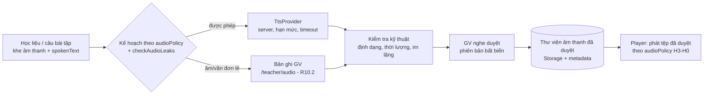
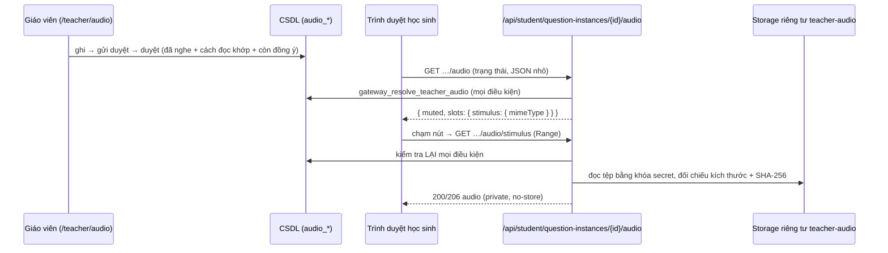
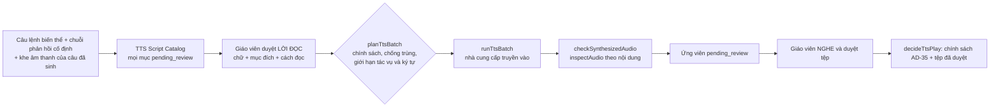

# ReadMate AI — Audio Engine (R10.1 thiết kế + R10.2 thư viện bản ghi giáo viên + R10.3a phát bản ghi đã duyệt cho học sinh + R10.3b1 chuẩn bị TTS)

> **Phiên bản:** 1.0 — R10.1 (2026-10-26). **Phạm vi:** thiết kế + nghiên cứu tài liệu + adapter `TtsProvider` kiểm thử bằng mock. **Chưa** có âm thanh nào được tạo, ghi hay phát; `AudioSlot` vẫn khóa (AD-39). R10.2–R10.7 chưa làm.
> Liên quan: [ARCHITECTURE §13](ARCHITECTURE.md#13-hệ-thống-âm-thanh), [EXERCISE_ENGINE §5](EXERCISE_ENGINE.md), [PRD §12](PRD.md), [AUDIO_RECORDING_PLAN](AUDIO_RECORDING_PLAN.md).

## 1. Trạng thái thật (đọc trước)

| Hạng mục | Trạng thái |
|---|---|
| Interface `TtsProvider`, chế độ `none`, mock, kiểm tra đầu vào, hạn mức, timeout, kế hoạch theo `audioPolicy` | **Đã hiện thực + unit test** (`src/server/tts/`, `tests/unit/tts/`) |
| Adapter Google Cloud TTS | **Skeleton** theo tài liệu REST; chỉ kiểm thử bằng `fetch` giả. **Chưa gọi API thật** |
| Adapter Azure / FPT.AI | **Chưa viết** (chỉ đánh giá tài liệu; hợp đồng interface đã đủ để thêm) |
| Gọi API thật, nghe thử chất lượng giọng Việt | **BLOCKED — chờ chủ dự án cấp phép tạo tài khoản/khóa thử nghiệm.** Chưa đánh giá chất lượng tổng hợp |
| Bảng/migration thư viện âm thanh, giao diện GV `/teacher/audio`, Storage riêng tư, quy trình duyệt | **R10.2 đã có** (§12); kiểm thử với dữ liệu giả trên local/CI |
| Phát bản ghi GV đã duyệt cho học sinh (bài Nghe âm – chọn chữ) | **R10.3a đã có về kỹ thuật** (§13) dưới cờ `student_teacher_audio_playback_approved` **TẮT**; kiểm thử bằng sóng tổng hợp. **R10.3 CHƯA nghiệm thu**: chưa bản ghi thật, chưa thử iPhone/Android thật, chưa chọn TTS |
| Chuẩn bị TTS cho câu hướng dẫn/lời động viên (danh mục lời đọc, kế hoạch lô, phiên bản, điều kiện phát, trang xem trước) | **R10.3b1 đã có về kỹ thuật** (§14) với nhà cung cấp `none`/mock; **không** gọi TTS thật, không tệp âm thanh TTS, không migration, không đường phát cho học sinh. Chờ quyết định ở [TTS_APPROVAL_CHECKLIST](TTS_APPROVAL_CHECKLIST.md) |
| Bản ghi âm GV | **Chưa có bản thật nào, chưa bản nào được duyệt**; cờ hệ thống ghi âm TẮT mặc định; chưa GV nào đồng ý dùng giọng |

## 2. Hai nguồn âm thanh

| Nguồn | Dùng cho | Không dùng cho |
|---|---|---|
| **A. Bản ghi GV** | Âm đơn lẻ, vần đơn lẻ (PRD A7). Một bản ghi dùng lại ở mọi bài | — |
| **B. TTS** | Câu lệnh chuẩn của 17 biến thể, tên tranh/từ/câu *khi chính sách cho phép*, lời khen/động viên, âm thanh mẫu **sau** khi chấm | Âm/vần đơn lẻ; bất kỳ lời đọc nào bị `checkAudioLeaks` chặn |

Cấm: Web Speech API (đã có test quét `speechSynthesis`), TTS theo yêu cầu lúc học sinh mở bài, TTS từ trường nhập của học sinh.

## 3. Đánh giá nhà cung cấp (truy cập 2026-10-26)

> Thông tin lấy từ trang tài liệu chính thức qua công cụ đọc trang; các ô ghi **"chưa xác minh"** không được suy đoán. Chưa có tài khoản nên **không có kết quả nghe thử**.

### 3.1 So sánh

| Tiêu chí | Google Cloud TTS | Azure AI Speech | FPT.AI TTS |
|---|---|---|---|
| 1. Tiếng Việt | Có, `vi-VN` | Có, `vi-VN` | Có |
| Giọng | Standard A–D, WaveNet A–D, Neural2 A (nữ)/D (nam), Chirp 3 HD (nhiều giọng, tên thiên thể) — liệt kê theo trang; cần `ListVoices` để xác nhận | `HoaiMyNeural` (nữ), `NamMinhNeural` (nam), `Linh:MAI-Voice-2-Flash` (nữ, HD Flash); có thể còn giọng khác ở phần trang chưa đọc hết | `banmai`, `lannhi`, `linhsan`, `thuminh` (nữ), `leminh`, `giahuy` (nam), `myan` (nữ) |
| 3. Vùng miền | Không thấy ghi vùng miền (chưa xác minh) | Không thấy ghi vùng miền (chưa xác minh) | **Có ghi** Bắc (banmai, leminh, thuminh), Trung (myan, giahuy), Nam (lannhi, linhsan) |
| 4. Tốc độ chậm | `speakingRate` cho Standard/WaveNet/Neural2; **Chirp 3 HD không hỗ trợ speaking rate/pitch/SSML** | SSML `prosody` (nói chung; riêng tiếng Việt chưa xác minh) | `speed` −3…+3 |
| 5–6. Chi phí / gói thử | Chirp 3 HD 30 USD/1 triệu ký tự (miễn phí 1 triệu/tháng); Neural2 16 USD (miễn phí 1 triệu); Standard, WaveNet 4 USD (miễn phí 4 triệu theo bảng giá; một nguồn khác ghi WaveNet 1 triệu — **mâu thuẫn, kiểm lại**). **Phải bật thanh toán** | Bậc F0 miễn phí 0,5 triệu ký tự/tháng (giọng Neural); **đơn giá trả phí không đọc được từ trang** (chưa xác minh) | Miễn phí 100.000 ký tự (giọng v5), hàng đợi, giới hạn yêu cầu/ngày; gói trả phí bằng VND (500.000đ = +1,5 triệu ký tự … 5.000.000đ = +27 triệu); chưa rõ theo tháng hay một lần |
| 7. Giới hạn API | 5.000 byte/yêu cầu; 200 yêu cầu/phút (Chirp 3 HD), 1.000 (Neural2/khác) mỗi dự án | Chưa xác minh | 5.000 ký tự/yêu cầu (tối thiểu 3); phía miễn phí có giới hạn ngày |
| 8. Định dạng | MP3, LINEAR16, OGG_OPUS… (chưa đối chiếu đủ danh sách) | Nhiều định dạng (chưa đối chiếu) | `mp3`, `wav` |
| Cơ chế | Đồng bộ (JSON `audioContent` base64) | Đồng bộ (REST/SDK) | **Bất đồng bộ**: trả liên kết `async`, chờ 5 giây–2 phút, hoặc `callback_url`; thời hạn liên kết **không ghi** → phải tải về ngay |
| 9. Giấy phép tái dùng/phân phối tệp | **Chưa xác minh** (không tìm thấy điều khoản chính thức; chỉ có ý kiến cộng đồng — không dùng làm căn cứ) | **Chưa xác minh** | **Chưa xác minh** (không tìm thấy điều khoản của FPT.AI) |
| 10–11. Lưu nội dung gửi tới | "Google không ghi log văn bản/âm thanh TTS của khách; dịch vụ stateless" ([data-logging](https://docs.cloud.google.com/text-to-speech/docs/data-logging)) | API thời gian thực: "Microsoft không lưu văn bản và không lưu âm thanh" ([data-privacy-security](https://learn.microsoft.com/en-us/legal/cognitive-services/speech-service/text-to-speech/data-privacy-security)); batch có lưu ở Azure Storage, xóa được | **Chưa xác minh** (không tìm thấy chính sách của FPT.AI); âm thanh được lưu ở S3 một thời gian không rõ |
| 12. Thay nhà cung cấp | Dễ: giữ tệp đã duyệt, đổi adapter | Dễ | Dễ, nhưng cần tải tệp ngay (liên kết tạm) |

Nguồn: Google [bảng giá](https://cloud.google.com/text-to-speech/pricing) (số liệu qua tóm tắt tìm kiếm của trang chính thức — trang đầy đủ không đọc được), [hạn mức](https://docs.cloud.google.com/text-to-speech/quotas), [danh sách giọng](https://docs.cloud.google.com/text-to-speech/docs/list-voices-and-types); Azure [language support](https://learn.microsoft.com/en-us/azure/ai-services/speech-service/language-support?tabs=tts), [bảng giá](https://azure.microsoft.com/en-us/pricing/details/cognitive-services/speech-services/); FPT.AI [API](https://docs.fpt.ai/docs/en/speech/api/text-to-speech), [giá](https://docs.fpt.ai/docs/en/speech/documentation/tts-pricing).

### 3.2 Đề xuất (chưa phải quyết định mua)

**Ứng viên ưu tiên cho POC: Google Cloud TTS, giọng `vi-VN-Neural2-A/D`** (chế độ tốc độ chậm có tham số, gói miễn phí lớn so với nhu cầu, không ghi log, đồng bộ nên đơn giản, quota rõ). **Phương án thứ hai: FPT.AI** — lợi thế giọng bản địa có ghi vùng Bắc/Trung/Nam (phù hợp Q-03 về giọng vùng miền) nhưng thiếu điều khoản lưu trữ/giấy phép và bất đồng bộ. Azure là phương án dự phòng (cần đọc đủ danh sách giọng/giá).

Lý do không chọn theo chất lượng: **chưa nghe thử bất kỳ giọng nào** — đề xuất dựa trên tính năng, chi phí, quyền riêng tư và độ đơn giản; GV phải nghe và quyết định.

### 3.3 Chi phí ước tính (chỉ tính phần TTS; phép tính của dự án)

Ngữ liệu hiện có: 17 câu lệnh chuẩn ≈ 1.100 ký tự, 60 từ ≈ 230, 31 câu ≈ 410 → < 2.000 ký tự; thêm lời khen/lời nhắc cỡ vài nghìn. Kể cả nhân 10–20 lần cho kho thật, vẫn **< 100.000 ký tự**, nằm trong mọi gói miễn phí ở bảng trên; nếu phải trả theo Neural2 (16 USD/1 triệu) thì ~1,6 USD cho 100.000 ký tự. Rủi ro chi phí chủ yếu là **bật thanh toán** (Google bắt buộc) và gọi lặp — đã giảm bằng cache khóa nội dung và hạn mức lô (§6).

### 3.4 Điều kiện còn phải xác minh trước khi chọn

1. Điều khoản chính thức về **lưu trữ lâu dài và phân phối lại tệp đã tổng hợp** trong ứng dụng cho học sinh (cả ba nhà cung cấp).
2. Danh sách giọng vi-VN thực tế (`ListVoices`/Voice Gallery) và đơn giá Azure.
3. **Nghe thử** (POC): phát âm dấu thanh, từ dễ nhầm (b/d, ch/tr, s/x), câu 4–6 tiếng, tốc độ chậm; giọng Bắc hay Nam hợp lớp (Q-03).
4. Bản quyền/nhãn "giọng tổng hợp" và yêu cầu ghi nguồn.
5. Điều kiện thanh toán cụ thể và đặt trần chi phí/cảnh báo ngân sách.
6. (FPT.AI) thời hạn liên kết âm thanh, điều khoản dữ liệu.

### 3.5 Kết quả POC

**Chưa thực hiện.** Không gọi API thật, không có mẫu âm thanh, không có đánh giá chất lượng. Mọi kiểm thử adapter dùng mock/`fetch` giả.

## 4. Kiến trúc và luồng dữ liệu



Nguyên tắc: **sinh trước → kiểm tra → GV duyệt → mới phát**. Học sinh chỉ nhận URL của tệp *đã duyệt* qua server; không có đường nào từ học sinh tới nhà cung cấp.

## 5. Interface `TtsProvider` (đã hiện thực)

```ts
interface TtsProvider {
  readonly id: "none" | "mock" | "google";
  readonly external: boolean;
  synthesize(request: TtsRequest, options: { signal: AbortSignal }): Promise<TtsOutcome>;
}
type TtsRequest = { text: string; purpose: "instruction"|"feedback"|"picture_name"|"word"|"sentence"|"model";
                    voiceKey: "vi-female-1"|"vi-male-1"; speed: "slow"|"normal" };
type TtsOutcome = { ok: true; data: { bytes: Uint8Array; mimeType: string } } | { ok: false; code: TtsErrorCode };
```

- `purpose` **không có** `phoneme`/`rime` → âm/vần đơn lẻ không thể đi qua TTS (kiểm bằng schema + `planSlotSynthesis` → `TEACHER_RECORDING_REQUIRED`).
- `voiceKey` là khóa nội bộ; adapter ánh xạ sang giọng nhà cung cấp → đổi nhà cung cấp không đổi dữ liệu bài.
- Mã lỗi: `NO_PROVIDER, INVALID_INPUT, PERSONAL_DATA_REJECTED, TEACHER_RECORDING_REQUIRED, AUDIO_ROLE_FORBIDDEN, AUDIO_LEAKS_ANSWER, BUDGET_EXCEEDED, TIMEOUT, PROVIDER_ERROR` — không mang nội dung yêu cầu, khóa hay phản hồi thô.
- `synthesizeSpeech()` (`service.ts`): zod → từ chối dữ liệu giống cá nhân → bỏ qua nếu `none` → trừ hạn mức ký tự (`CharBudget`, mặc định 3.000/lô) → timeout 8 giây → bắt mọi ngoại lệ.
- `createTtsProvider(env)`: `TTS_PROVIDER` = `none` (mặc định) | `mock` | `google`; `google` thiếu `TTS_GOOGLE_API_KEY` → `none`. Mô-đun `import "server-only"`; khóa chỉ đọc ở đây, đã thêm vào `check:bundle`.
- `ttsCacheKey()` = sha256(nhà cung cấp, mục đích, giọng, tốc độ, văn bản NFC) để dùng lại tệp, không chứa dữ liệu học sinh.
- Không có mã nào gọi `synthesizeSpeech` ở R10.1: **không có route, không tác vụ nền, không gọi hàng loạt**.

## 6. Bảo mật và quyền riêng tư

- Chỉ server; khóa nằm ở biến môi trường server (`TTS_GOOGLE_API_KEY`, không `NEXT_PUBLIC_`); không `fetch` từ trình duyệt; `redirect: "error"`.
- Văn bản gửi đi chỉ là học liệu/chuỗi cố định do GV duyệt; schema `strictObject` không nhận trường lạ (không `studentId`, `alias`…); chặn email, số điện thoại, URL, mã thẻ học, ký tự ẩn, `<`/`>` (chặn chèn SSML).
- Log chỉ UUID/mã lỗi (không văn bản, không khóa).
- Hạn mức ký tự mỗi lô, timeout, không thử lại tự động (tránh nhân chi phí); R10.2 thêm trần theo ngày/tháng và quyền GV `owner`.
- Chủ dự án quyết định trước khi gửi bất kỳ văn bản nào tới nhà cung cấp ngoài (PRIVACY_AND_SECURITY).

## 7. Chống lộ đáp án (giữ AD-35)

`planSlotSynthesis({ role, slot, policy, exposure })` dùng lại `checkAudioLeaks` và `audioPolicy` của biến thể, nên **không tạo logic thứ hai**:

| Tình huống | Kết quả (đã có test) |
|---|---|
| Kích thích là âm đơn lẻ (`listen_letter`) | `TEACHER_RECORDING_REQUIRED` |
| Bài đọc từ có `stimulus` đọc từ cần đọc | `AUDIO_ROLE_FORBIDDEN` |
| Câu lệnh chứa từ cần đọc | `AUDIO_LEAKS_ANSWER` |
| Câu lệnh chuẩn; âm thanh mẫu sau chấm (`modelAfterGrading`) | Được phép |
| Gợi ý (`hint`) | Chính sách H3–H0 quyết định lúc *phát* (R10.3): chỉ khi trẻ bấm, tính là gợi ý |

Không tạo khe âm thanh mới ngoài 5 vai trò (`instruction, stimulus, options, model, feedback`). `MISSING_AUDIO` của bài nghe âm giữ nguyên (test); mock không làm đổi kết quả kiểm tra. **R10.1 không mở khóa `AudioSlot`.**

## 8. Quy định bản ghi GV, giấy phép, duyệt

- Bản ghi GV là nguồn bắt buộc cho âm/vần đơn lẻ; GV chỉ ghi giọng của mình; **không ghi âm trẻ** (CLAUDE.md §6.6); `/teacher/audio` là route duy nhất bật micro.
- Mỗi tệp có: mã asset, văn bản đọc (NFC), loại (`phoneme|rime|instruction|word|sentence|feedback`), nguồn (`teacher_recording`|`tts`), người ghi/nhà cung cấp + giọng, định dạng, thời lượng, hash nội dung, phiên bản, giấy phép/nguồn, trạng thái (`draft → pending_review → approved|rejected`), `reviewedBy`, `reviewedAt`, `contentHash`.
- **Không bao giờ tự đặt `approved`.** Phiên bản đã gửi duyệt là bất biến; sửa = phiên bản mới. TTS cũng phải được GV nghe duyệt.
- Mở rộng `content/media/licenses.json` hiện chỉ có hình/phông (`kind`) — phần âm thanh dùng bảng riêng ở R10.2 vì tệp âm thanh không nằm trong repo công khai (CLAUDE.md §6.9).
- **46 tệp Piper** (nhánh `local/gd5-audio-wip`) chưa xác minh quyền sử dụng: **không** đưa vào repo, test, assets hay danh mục.

## 9. Lưu trữ, định dạng, bộ nhớ đệm, lỗi, offline (đề xuất cho R10.2–R10.3, chưa làm)

- **Lưu trữ:** Supabase Storage bucket riêng tư (không trong git); học sinh nhận URL ký ngắn hạn qua gateway; metadata trong bảng `audio_assets` (+ `audio_asset_versions`) — migration và RLS thuộc R10.2.
- **Định dạng:** MP3 mono 22,05–24 kHz (~32–48 kbps) cho TTS; bản ghi GV chuẩn hóa về MP3/AAC mono (iOS không phát WebM/Opus chắc chắn → cần POC; phương án: GV tải tệp ghi sẵn).
- **Kiểm tra kỹ thuật tự động (trước khi gửi duyệt):** thời lượng 0,3–10 giây (âm đơn lẻ ≤ 2 giây), không im lặng/cắt cụt, âm lượng chuẩn hóa, kích thước tối đa.
- **Bộ nhớ đệm:** khóa `ttsCacheKey`; tải trước câu kế tiếp; Cache-Control dài cho URL bất biến theo phiên bản.
- **Lỗi/offline:** thiếu tệp → bài vẫn làm được nhờ chữ và hình (câu lệnh luôn có bản chữ); riêng bài nghe âm bắt buộc có bản ghi → không phát câu đó (`MISSING_AUDIO`), không giả lập, không dùng giọng trình duyệt. Không có chế độ offline ở R10.
- **iOS:** mở khóa audio bằng thao tác "Bắt đầu" (R10.3).

## 10. Quyết định cần chủ dự án / GV xác nhận

| # | Ai | Quyết định |
|---|---|---|
| D1 | Chủ dự án | Cho phép tạo tài khoản/khóa thử nghiệm (Google trước) và đặt trần chi phí; chấp nhận bật thanh toán nếu bắt buộc |
| D2 | Chủ dự án | Đọc/chấp thuận điều khoản về lưu trữ và phân phối lại tệp TTS |
| D3 | GV | Nghe mẫu và chọn giọng (nữ/nam, Bắc/Nam) — Q-03 |
| D4 | GV | Xưng hô "con/em" trong lời đọc — Q-08 |
| D5 | GV | Cách gọi âm, tên chữ cái, vần cần ghi (xem [AUDIO_RECORDING_PLAN](AUDIO_RECORDING_PLAN.md) §6) — Q-01/Q-02 |
| D6 | Chủ dự án | Chấp nhận cho lời khen/câu lệnh chuẩn dùng TTS hay GV ghi hết |

## 11. Điều kiện chuyển R10.2

1. D1–D2 được chấp thuận (hoặc quyết định bỏ TTS, chỉ dùng bản ghi GV — thiết kế vẫn dùng được).
2. Kết quả nghe thử (nếu dùng TTS) được GV ghi lại.
3. GV xác nhận danh sách §6 của kế hoạch ghi âm (ít nhất nhóm P0).
4. Chủ dự án cho phép migration `audio_assets` và bucket Storage.
5. Q-03 (người ghi, giọng vùng) có trả lời.

R10.1 **không** tự chuyển sang R10.2.

## 12. R10.2 — Thư viện bản ghi giáo viên (đã hiện thực, kiểm thử bằng dữ liệu giả)

> Quyết định chủ dự án: **phương án kết hợp** — GV ghi âm/vần đơn lẻ; TTS dùng cho câu hướng dẫn, lời khen và nội dung chính sách cho phép. R10.2 **không** gọi TTS thật, không tạo tài nguyên Cloud, không yêu cầu GV ghi âm thật. Hướng dẫn GV: [TEACHER_AUDIO_GUIDE](TEACHER_AUDIO_GUIDE.md).

### 12.1 Thành phần

| Lớp | Mã | Ghi chú |
|---|---|---|
| Trang | `/teacher/audio` (`src/app/teacher/(console)/audio/`) | Tổng quan, danh sách P0 (38, đọc từ `content/kb/phonemes.json`), lọc/tìm, đồng ý dùng giọng, xác nhận cách đọc, ghi âm (`MediaRecorder`), tải tệp, nghe lại, gửi duyệt, duyệt/ghi lại/thu hồi |
| Lõi thuần | `src/features/audio-library/` | `inspect.ts` (nhận định dạng + thời lượng theo NỘI DUNG), `limits.ts`, `p0-catalog.ts`, `unit-state.ts`, `review-rules.ts`, `recorder.ts` |
| Máy chủ | `src/server/audio-library/`, `src/app/api/teacher/audio/**` | Tải lên (Route Handler multipart — Server Action giới hạn thân ~1 MB), phát lại qua proxy có `Range`, Server Actions cho các thao tác trạng thái |
| CSDL | `supabase/migrations/20261031090000_r10_teacher_audio.sql` | `audio_voice_consents`, `audio_assets`, `audio_asset_versions`; 11 hàm `teacher_*`; cờ `teacher_audio_recording_approved` (TẮT) |
| Storage | bucket `teacher-audio` (`supabase/config.toml`) | **Riêng tư**, 2 MiB, 5 MIME âm thanh; không policy `storage.objects` cho anon/authenticated |

### 12.2 Vòng đời phiên bản

`draft → pending_review → approved | rejected`; `approved → superseded | revoked`; `draft → discarded | revoked`; `pending_review → revoked`. Trigger `guard_audio_version` (áp dụng cả với `service_role`): chèn luôn là `draft`; nội dung (khóa đối tượng, hash, thời lượng, nhãn đọc…) bất biến; dấu vết gửi/duyệt/thu hồi đặt một lần; không xóa. **Chỉ `teacher_review_audio_version` đặt `approved`**, và chỉ khi: cờ bật; bản đang `pending_review`; người duyệt **đã nghe** (xác nhận); **cách đọc đã được GV xác nhận** và **khớp** nhãn ghi trên bản; người ghi **còn đồng ý** dùng giọng. Duyệt bản mới → bản đang dùng cũ thành `superseded` và `audio_assets.active_version_id` trỏ bản mới; bản mới **không đụng** bản đã duyệt cho tới lúc được duyệt. Từ chối bắt buộc ghi chú. `reviewed_by/at` trống tới khi có thao tác duyệt thật. Người duyệt có thể là chính người ghi (trường có thể chỉ một GV) — hệ thống ghi cả hai.

### 12.3 Lưu trữ và quyền

- Khóa đối tượng do máy chủ sinh: `{school_id}/{asset_id}/{version_id}.{đuôi theo định dạng thật}` (chỉ UUID; không tên GV, tên tệp client, nội dung học sinh). CSDL kiểm tra khóa **đúng** dạng này nên không thể trỏ vào đối tượng của người khác. Tải lên `upsert:false` — không ghi đè.
- Thứ tự: kiểm tra tệp → tiền kiểm (cờ, đồng ý) → tải lên Storage → ghi metadata. Ghi metadata lỗi → máy chủ gỡ tệp vừa tải; tải lỗi → không có metadata. Phần còn sót (gỡ lỗi) đối soát bằng `npm run audio:reconcile` (báo cáo; `--delete` chỉ local).
- Phạm vi = **trường**. RLS: tài nguyên cùng trường; **bản nháp chỉ người tạo (và quản trị trường)** thấy; đồng ý chỉ của chính GV. `authenticated` chỉ SELECT. Thiết bị học sinh bị `FORBIDDEN` ở mọi hàm; không có đường tải âm thanh từ khu vực học sinh.
- Ba lớp: proxy (chuyển hướng thô) → DAL `teacherOrFail` + zod + cùng nguồn + giới hạn tần suất (60/giờ) → hàm CSDL/RLS. Khóa lưu trữ không bao giờ được `select` xuống giao diện.

### 12.4 Kiểm tra tệp (theo nội dung)

`inspectAudio`: ≤ 2 MiB, 0,3–10 giây; WAV PCM; Ogg Opus/Vorbis (granule); WebM Opus/Vorbis (kể cả kích thước "không biết" và không có Duration của Chrome); MP4/M4A AAC (kể cả MP4 phân đoạn mvhd=0 của Safari); MP3 lớp III. Từ chối rỗng, quá lớn, không nhận ra, ảnh/PDF/HTML đổi đuôi, có luồng hình, codec lạ, hỏng/cắt cụt, quá ngắn/dài. **Không giải mã** nên không phát hiện tệp im lặng — GV nghe lại trước khi gửi. Thời lượng WebM Opus ước tính khung 20 ms cuối.

### 12.5 Micro

`Permissions-Policy: microphone=(self)` **chỉ** cho `/teacher/audio` (`next.config.ts`, quy tắc đặt sau cùng; đã xác minh trên bản build thật và bằng unit/E2E); mọi route khác giữ `microphone=()`. Chỉ xin quyền sau khi GV bấm *Bắt đầu ghi*; tắt micro khi dừng/lỗi/rời trang; thiết bị ngắt giữa chừng → bỏ bản ghi dở; kết quả chỉ là bản nghe thử cho tới khi bấm *Lưu bản nháp*. Không Web Speech API. Định dạng ghi chọn theo `MediaRecorder.isTypeSupported` (WebM/Opus → MP4 → Ogg); không hỗ trợ → hướng dẫn tải tệp.

### 12.6 Giới hạn đã biết (trung thực)

- **Chưa kiểm thử trên Safari/iPhone thật** và chưa có micro thật trong CI; ghi trực tiếp trong E2E chưa chạy (chỉ tải tệp tổng hợp).
- Bản ghi lưu **đúng định dạng đã ghi**; Safari cũ có thể không phát WebM/Opus → R10.3 cần chuẩn hóa (chuyển mã) hoặc yêu cầu tệp M4A/MP3 trước khi phát cho học sinh.
- Xóa hẳn tệp theo yêu cầu là quy trình quản trị riêng (trigger chặn xóa); chưa có nút tự xóa.
- Chưa kiểm tra tệp im lặng/ồn; chưa chuẩn hóa âm lượng.
- Toàn bộ kiểm thử dùng tệp tổng hợp; **không bản ghi nào được duyệt thật**.

### 12.7 Điều kiện chuyển R10.3

Ít nhất các âm P0 cần thiết có bản ghi **được GV duyệt thật** với cách đọc đã xác nhận; GV đồng ý dùng giọng; chủ dự án bật cờ; kiểm tra phát trên Safari/iPhone thật; quyết định D1–D6 (§10) về TTS. Không tự chuyển sang R10.3.

## 13. R10.3a — Phát bản ghi giáo viên đã duyệt cho học sinh (nền tảng kỹ thuật, cờ TẮT)

> **Phạm vi:** chỉ **một bản ghi đã duyệt** của **âm đơn lẻ (P0)** trong bài **Nghe âm – chọn chữ** (`listen_letter`). Chưa có TTS, chưa đọc cả từ/câu/đoạn, chưa tự ghép chuỗi đánh vần (xem §13.9). Kiểm thử bằng **sóng tổng hợp** — không phải bản ghi giáo viên thật. **R10.3 chưa nghiệm thu.**

### 13.1 Luồng



### 13.2 Các điều kiện phát (kiểm lại ở **mỗi** yêu cầu, không lưu bộ nhớ đệm)

| # | Điều kiện | Nơi kiểm | Mã khi thiếu (nội bộ → trả cho trình duyệt) |
|---|---|---|---|
| 1 | Cờ `student_teacher_audio_playback_approved` bật | CSDL | `AUDIO_PLAYBACK_DISABLED` |
| 2 | Thiết bị học sinh đã liên kết, hồ sơ và lớp còn hoạt động; câu thuộc đúng học sinh đó | CSDL (`require_linked_device`) + `ownedQuestion` | `FORBIDDEN` / `NOT_FOUND` |
| 3 | Đồng ý `learning_data` của học sinh còn hiệu lực | CSDL | `CONSENT_REQUIRED` |
| 4 | Học sinh không tắt âm thanh trong cài đặt (`sound_preference`) | Máy chủ | `AUDIO_NOT_PERMITTED` (trạng thái báo `muted: true`) |
| 5 | Chính sách chống lộ đáp án AD-35 cho phép khe này ở mức hỗ trợ hiện tại (§13.5) | Máy chủ (`decidePlayback`) | `AUDIO_NOT_PERMITTED` |
| 6 | Tài nguyên đúng **trường** của lớp, đúng đơn vị kiến thức (suy từ câu, không từ trình duyệt) | CSDL | `AUDIO_NOT_AVAILABLE` |
| 7 | Phiên bản là `active_version_id`, trạng thái `approved`, đã nghe + có người duyệt (không bị `draft/pending_review/rejected/superseded/revoked/discarded`) | CSDL | `AUDIO_NOT_AVAILABLE` |
| 8 | Cách đọc GV đã xác nhận **và** khớp nhãn bản ghi **và** khớp cách đọc mà câu khai báo (kho tri thức) | CSDL | `PRONUNCIATION_UNCONFIRMED` / `LABEL_MISMATCH` → `AUDIO_NOT_AVAILABLE` |
| 9 | Người ghi còn đồng ý dùng giọng (đúng chứng từ gắn vào phiên bản) | CSDL | `VOICE_CONSENT_REQUIRED` → `AUDIO_NOT_AVAILABLE` |
| 10 | Tệp còn trong Storage, kích thước và SHA-256 khớp metadata đã duyệt (≤ 2 MiB) | Máy chủ | `AUDIO_NOT_AVAILABLE` (tệp thay/mất/hỏng) |

Trẻ không nhìn thấy **vì sao** chưa có âm thanh (GV chưa duyệt, rút đồng ý, cách đọc lệch…): mọi nguyên nhân về nội dung gộp thành `AUDIO_NOT_AVAILABLE` (`publicAudioCode`). Mã chi tiết chỉ có ở hàm CSDL để kiểm thử.

### 13.3 API (Student Gateway)

| Route | Việc | Ghi chú |
|---|---|---|
| `GET /api/student/question-instances/{id}/audio` | Khe nào phát được **ngay bây giờ**: `{ muted, slots: { stimulus?: { mimeType }, model?: { mimeType } } }` | Giới hạn `read`; cờ tắt / chưa có bản ghi → `slots` rỗng (không lỗi). **Không** trả mã tài nguyên, khóa lưu trữ, tên GV, băm |
| `GET /api/student/question-instances/{id}/audio/{role}` (`role` = `stimulus` \| `model`) | Phát tệp | Giới hạn **40 lần/phút/thiết bị**; chỉ **cùng nguồn** (Sec-Fetch-Site/Origin); `Range` → `206`/`416`; `Cache-Control: private, no-store`, `nosniff`, `Cross-Origin-Resource-Policy: same-origin`, CSP `default-src 'none'; sandbox` |

- Trình duyệt **không** gửi mã tài nguyên/phiên bản/đường dẫn: máy chủ suy ra âm từ chính câu (`bindingFor`: phương án đúng → `phoneme:x`) — không có cách tải bản ghi tùy ý.
- Máy chủ đọc Storage bằng khóa secret; **không** URL công khai, **không** URL ký, `storageKey` chỉ tồn tại trong mã máy chủ (kiểm bằng test quét + E2E).
- Không log nội dung hay đường dẫn; mã lỗi là chuỗi máy đọc.

### 13.4 Thu hồi

- GV thu hồi bản ghi hoặc rút đồng ý ⇒ **yêu cầu phát mới bị từ chối ngay** (CSDL kiểm lại ở mỗi lần; phản hồi `no-store` nên trình duyệt phải hỏi máy chủ cho mỗi lần nghe lại). `AudioSlot` đặt `src` ngay trong thao tác chạm, không giữ blob/URL đối tượng.
- **Không hứa** thu hồi dữ liệu mà trình duyệt đã tải về trước đó (đoạn đang phát hoặc đã nằm trong bộ nhớ của thẻ audio): máy chủ không thể xóa thứ đã gửi đi. Thu hồi chỉ chặn các lần tải **sau**.

### 13.5 Chống lộ đáp án (AD-35) — không thêm logic thứ hai

`decidePlayback` dùng lại **chính** `decideBeforeGrading`/`decideAfterGrading` và `VARIANTS[...].audioPolicy`:

| Khe | Điều kiện phát | Ghi chú |
|---|---|---|
| `stimulus` (nghe âm) | `beforeGrading.stimulus` là `allowed` ở mức hỗ trợ của câu (nghe âm: H3–H0) | Đó là nhiệm vụ của bài, không phải lộ đáp án |
| `stimulus` loại `hint` | **Từ chối** (`HINT_ONLY`) | Chưa có đường ghi nhận "đã dùng gợi ý"; fail-closed. Không biến thể nào có bản ghi GV ở khe `hint` hiện nay |
| `model` (đọc mẫu) | Câu đã **đóng** (đúng hoặc hết lượt) **và** `modelAfterGrading` | Trước khi chấm → `AUDIO_NOT_PERMITTED` |
| Bài đọc từ/câu (dạng 5, 6), tên tranh H0… | Không có ràng buộc bản ghi GV (`variantHasRecording`) ⇒ **không đi qua đường này** | Test quét: bài `reading` không phát kích thích trước chấm ở mọi mức |

Việc bấm nghe **không** được coi là hoàn thành câu: điểm chỉ đến từ câu trả lời được nộp và chấm ở máy chủ; quy tắc chấm/điểm không đổi.

### 13.6 Câu bắt buộc nghe mà chưa có âm thanh → không tính điểm

`submitAttempt` (câu `scorable` mà biến thể yêu cầu khe `stimulus` bản ghi GV) kiểm tra việc nghe được trước khi chấm: nếu chưa có bản ghi đã duyệt phát được (kể cả **cờ tắt**) ⇒ `AUDIO_NOT_AVAILABLE`, **không** ghi lượt, **không** điểm; giao diện hiện lời nhắn nhẹ nhàng và giữ nguyên câu. Gửi lại cùng `clientAttemptId` của lượt đã ghi **không** bị chặn (trả đúng kết quả cũ). Cài đặt tắt âm thanh không làm câu mất điểm (chỉ kiểm sự tồn tại của bản ghi). Hiện chưa có câu nghe âm nào được duyệt ở môi trường thật (validate `production` vẫn báo `MISSING_AUDIO` vì thư viện media tĩnh chưa nối với thư viện GV — xem §13.9), nên quy tắc này là lớp bảo vệ thứ hai.

### 13.7 Trình phát `AudioSlot` (`src/components/kid/audio-slot.tsx`)

| Trạng thái | Giao diện |
|---|---|
| Không có nguồn / cờ tắt / chưa duyệt | Nút khóa "…: Chưa có âm thanh" (như trước) |
| Đang hỏi máy chủ | Khóa, "Đang tải âm thanh…" |
| Học sinh tắt âm thanh | Khóa, "Âm thanh đang tắt…" |
| Định dạng không phát được | Khóa + lời nhắn "Máy này chưa phát được…" (**không chuyển mã, không đổi sang giọng khác**) |
| Sẵn sàng | Nút ≥ 64 px "Nghe" — **không tự phát**; chỉ phát trong hàm xử lý chạm (đáp ứng hạn chế autoplay của iOS/Safari) |
| Đang tải/đang phát | Chạm lại để dừng |
| Phát xong | "Nghe lại" (mỗi lần là một yêu cầu mới tới máy chủ) |
| Lỗi mạng / bị từ chối | "Chưa nghe được. Con chạm để thử lại nhé." |

Một âm tại một thời điểm (`claimAudio`: phát cái mới thì dừng cái cũ); đổi câu / rời trang / thoát bài ⇒ gỡ thành phần ⇒ dừng và nhả tài nguyên. Khả năng phát định dạng kiểm bằng `canPlayType` (`mimeSupported`). Không dùng `speechSynthesis`/Web Speech API (test quét). Không có animation riêng ⇒ tôn trọng giảm chuyển động.

### 13.8 Định dạng và giới hạn iPhone/Safari

- Máy chủ phát **đúng định dạng đã lưu** (không chuyển mã ở R10.3a). Safari/iPhone **chắc chắn** phát được M4A (AAC), MP3, WAV; **WebM/Opus có thể không** (tùy phiên bản iOS). Chrome ghi trực tiếp ra WebM/Opus ⇒ bản ghi đó có thể **không nghe được trên iPhone của học sinh**.
- Khi trình duyệt báo không phát được định dạng, nút khóa kèm lời nhắn; giáo viên cần cung cấp bản **M4A hoặc MP3** (xem [TEACHER_AUDIO_GUIDE §4](TEACHER_AUDIO_GUIDE.md)). Chưa có hệ thống chuyển mã.
- **Chưa kiểm thử trên iPhone/Safari thật hay Android thật.** CI chỉ có WebKit trên Linux (có thể thiếu codec) nên E2E WebKit chỉ khẳng định yêu cầu mạng đúng (200/206, tiêu đề riêng tư); việc phát ra tiếng chỉ khẳng định trên Chromium.
- `Cache-Control: no-store` với thẻ audio của Safari **chưa được thử trên thiết bị thật**; nếu Safari phát lỗi vì `no-store`, đổi sang `private, no-cache, max-age=0, must-revalidate` (vẫn buộc hỏi máy chủ ở mỗi lần).

### 13.9 Hạng mục kế tiếp (KHÔNG làm ở R10.3a, không tuyên bố đã hỗ trợ)

1. **R10.3b — khe TTS** (câu lệnh, lời khen, tên tranh) sau khi chủ dự án chọn nhà cung cấp và quyền dùng tệp tổng hợp (D1–D6, §10).
2. Nối **validate chế độ `production`** với thư viện bản ghi GV (hiện `MISSING_AUDIO` vẫn đúng vì `assetId` trỏ vào thư viện media tĩnh) để câu nghe âm có thể được duyệt khi bản ghi thật đã được duyệt.
3. **Ghép chuỗi đánh vần** kiểu "bờ – a – ba – huyền – bà": cần **quy tắc đánh vần do GV duyệt** (Q-01/Q-02) và thư viện âm thanh riêng cho tiếng cơ sở, dấu thanh, tiếng hoàn chỉnh. **Chưa triển khai**; R10.3a chỉ phát một bản ghi đã duyệt.
4. Đường ghi nhận "đã dùng gợi ý" cho khe `hint` bằng âm thanh; vần đơn lẻ (P1/P2); lọc câu nghe âm khỏi buổi luyện/game khi chưa có âm thanh (hiện chặn ở bước chấm).
5. Chuẩn hóa/chuyển mã định dạng cho iPhone nếu bản ghi thật là WebM/Opus.

### 13.10 Điều kiện BẮT BUỘC trước khi bật cờ cho học sinh thật

Đủ **tất cả**: (1) GV xác nhận Q-01/Q-02/Q-03 và các cách đọc cần dùng; (2) có sự đồng ý dùng giọng hợp lệ của người ghi; (3) có **bản ghi thật được duyệt** cho các âm sử dụng; (4) chủ dự án chấp thuận bật cờ (đổi bằng migration, không bằng mã); (5) đã kiểm thử phát trên **iPhone/Safari thật và ít nhất một thiết bị Android thật**; (6) quyết định TTS và quyền dùng âm tổng hợp nếu triển khai khe TTS. Cờ `student_teacher_audio_playback_approved` và `teacher_audio_recording_approved` luôn **TẮT** trong mọi môi trường cho tới khi đủ điều kiện; chỉ kiểm thử local/CI bật tạm rồi trả về TẮT (pgTAP kiểm).

### 13.11 Kiểm thử R10.3a

| Lớp | Nội dung |
|---|---|
| pgTAP `14_student_audio_playback` | Cờ mặc định tắt, quyền hàm (chỉ `service_role`), `security definer` + `search_path` rỗng, hàm chỉ đọc, không mở quyền bảng |
| Tích hợp CSDL + Storage (`tests/db/student-audio-playback.test.ts`) | Chỉ bản `approved` đang dùng; draft/pending/rejected/superseded/revoked bị chặn; rút đồng ý; cách đọc chưa xác nhận/không khớp; i/y; trường khác; thiết bị lạ/bị thu hồi; học sinh rút đồng ý; tệp bị thay/mất; không đọc được bảng/hàm bằng JWT thiết bị/GV; chấm điểm không có âm thanh |
| Unit | `bindingFor`, `decidePlayback` (mọi mức H3–H0), `mimeSupported`, `AudioSlot`/`QuestionAudio` (không tự phát, một âm, dừng khi đổi câu, lỗi, không hỗ trợ, không Web Speech), Route Handler (Range, cùng nguồn, tần suất, 401/403/404), quét an toàn mã + migration |
| E2E có CSDL (`tests/e2e-db/student-audio.spec.ts`) | Nghe fixture tổng hợp ở Chromium/WebKit (yêu cầu mạng đúng, tiêu đề riêng tư, không lộ khóa/URL Storage, không TTS/Web Speech), đọc mẫu chỉ sau chấm, thu hồi khi đang mở trang, cờ tắt không gọi API phát và không tính điểm, 360 px + bàn phím + giảm chuyển động + axe |

## 14. R10.3b1 — Chuẩn bị TTS: danh mục lời đọc, kế hoạch lô, phiên bản, điều kiện phát (KHÔNG gọi TTS thật, KHÔNG phát cho học sinh)

> **Phạm vi:** chỉ phần **lập danh mục, kiểm tra chính sách, chống trùng, định danh phiên bản, điều kiện phát và giao diện xem trước**. Dùng nhà cung cấp `none`/mock; **không** gọi Google/Azure/FPT.AI, không tạo khóa API hay tài khoản, không migration, không route phát, không bật cờ. **Chưa có âm thanh TTS thật nào; R10.3 chưa nghiệm thu.** Các quyết định còn thiếu: [TTS_APPROVAL_CHECKLIST](TTS_APPROVAL_CHECKLIST.md).

### 14.1 Luồng



Hai lần duyệt tách biệt: **(1) lời đọc** (`script-review.ts`) trước khi được phép sinh; **(2) tệp âm thanh** (`versions.ts`) sau khi giáo viên nghe. Chưa qua cả hai thì không phát. Mã nằm ở `src/server/tts/`; **chỉ giao diện xem trước của giáo viên** (`/teacher/tts-script`) import các mô-đun này — không route API, không tác vụ nền, không mã học sinh (test quét `tests/unit/tts/safety-scan.test.ts`).

### 14.2 TTS Script Catalog (`catalog.ts`)

Nguồn (không bịa nội dung giáo dục): **17 câu lệnh chuẩn** của biến thể (`VARIANTS[…].instruction.spoken`), **17 chuỗi phản hồi cố định** (`vi.practice.feedback`: lời khen, lời nhắc thử lại, tiêu đề xem đáp án — câu có phần động như "Đáp án đúng là …" **không** vào danh mục), và (tùy chọn) khe âm thanh của **câu bài tập đã sinh** (tên tranh, từ, câu, đọc mẫu). Mỗi mục:

| Trường | Ý nghĩa |
|---|---|
| `id` | Ổn định theo vị trí nguồn: `instruction:<biến thể>`, `feedback:<khóa>`; mục từ câu bài tập: `<mục đích>:<16 ký tự đầu của hash>` |
| `purpose` / `role` | Sáu mục đích TTS (`instruction, feedback, picture_name, word, sentence, model`) / vai trò âm thanh (`instruction, stimulus, options, model, feedback`) |
| `text` | Lời đọc chuẩn NFC (đã qua cổng `checkTtsRequest`: không dữ liệu cá nhân/SSML) |
| `usageNote`, `usages[]` | Mục đích sử dụng bằng tiếng Việt; dạng bài/biến thể áp dụng và **mức khả dụng H3→H0** (`auto, tap, hint_locked, forbidden, after_grading`) lấy từ `audioPolicy` |
| `source` | `{ kind, ref, version }` — `version` = `c<phiên bản danh mục>.<12 ký tự hash>` |
| `voice` | Giọng/tốc độ **dự kiến** + `configVersion`; `provisional-0` = **chưa chọn giọng** |
| `contentHash` | sha256(phiên bản danh mục, mục đích, chữ NFC) — nhận biết thay đổi và tái sử dụng. Không gồm giọng (giọng thuộc khóa tệp) và vai trò |
| `attention` | Cờ nhắc giáo viên: `ADDRESSING_UNDECIDED` (xưng "con/em" chờ Q-08), `NEGATIVE_WORDING` (ví dụ "Chưa đúng rồi") |
| `reviewStatus` | **Luôn `pending_review` khi dựng**; trạng thái thật chỉ suy ra từ bản duyệt của giáo viên |

Khe bị chính sách chặn vào `excluded` (kèm mã lỗi, **không lưu chữ** — lời đọc làm lộ đáp án không bị nhân bản): âm/vần đơn lẻ → `TEACHER_RECORDING_REQUIRED`; chính sách cấm khe → `AUDIO_ROLE_FORBIDDEN`; lời đọc chứa dạng đáp án → `AUDIO_LEAKS_ANSWER`. Việc phân xử dùng lại **`planSlotSynthesis`** (→ `checkAudioLeaks`, `audioPolicy`) — không có bộ luật thứ hai. Tính chất: `buildTtsScriptCatalog` là hàm thuần, thứ tự cố định, hai lần dựng cho kết quả giống hệt.

Trạng thái duyệt lời đọc (`scriptStatusOf`): chỉ bản duyệt **khớp `entryId` + `contentHash` hiện tại**, có `reviewedBy` (UUID), `reviewedAt`, **`pronunciationConfirmed = true`** mới cho `approved`; `rejected` nếu bản mới nhất là từ chối; mọi trường hợp còn lại (không có bản duyệt, hash cũ, thiếu xác nhận, dữ liệu sai dạng) là `pending_review`. **Không có hàm nào tạo bản duyệt.**

### 14.3 Phiên bản tệp và điều kiện dùng (`versions.ts`)

`TtsAudioVersion` (zod strict): `status` ∈ `pending_review, approved, rejected, superseded, revoked`; `reviewedBy/At`, `listened`, `pronunciationConfirmed`; `audio` (sha256, kích thước, MIME, thời lượng, `inspected: true` — chỉ có thể là `true`); `provider`, `voice`, `assetKey`, `contentHash`, `testOnly`. Chưa có bảng CSDL (không migration ở R10.3b1) — đây là hợp đồng kiểu cho R10.3b2.

`checkVersionUsable` đòi **tất cả**, theo thứ tự cố định: không phải `mock`/`none`/`testOnly` (`TEST_ONLY`) → trạng thái `approved` (`REVOKED`/`SUPERSEDED`/`NOT_APPROVED`) → giáo viên đã nghe + xác nhận cách đọc (`NOT_REVIEWED`) → **lời đọc đã duyệt** (`SCRIPT_NOT_APPROVED`) → `contentHash` khớp mục hiện tại (`CONTENT_CHANGED`) → khóa tệp tính lại khớp (`ASSET_MISMATCH`, chống dữ liệu giả mạo) → giọng đã được chọn (`VOICE_NOT_CHOSEN`) và trùng cấu hình hiện hành (`VOICE_CHANGED`). Bản ghi hỏng hoặc có trường lạ → `INVALID_RECORD`. **Phiên bản đã duyệt không bao giờ bị sửa**: đổi chữ, giọng, tốc độ, phiên bản cấu hình hoặc nhà cung cấp tạo **khóa tệp mới** và phải duyệt lại.

### 14.4 Khóa tái sử dụng (`hash.ts`) và kiểm tra kỹ thuật (`audio-check.ts`)

- `assetKeyOf` = sha256(nhà cung cấp, mục đích, mã giọng, tốc độ, **phiên bản cấu hình giọng**, chữ NFC). `ttsCacheKey` (R10.1) nay gọi chính hàm này (tham số thứ ba là `configVersion`). Hai nơi dùng chung **một** tệp khi trùng khóa và `findReusableVersion` tìm được phiên bản **dùng được** (duyệt lời đọc của chính mục đó, tệp chưa thu hồi/bị thay, đúng giọng hiện hành). Không chứa dữ liệu học sinh.
- Byte của **mock** (`MOCK-TTS:…`) **không phải âm thanh**: `checkSynthesizedAudio` (dùng `inspectAudio` — nhận định dạng theo nội dung, thời lượng 0,3–10 giây, ≤ 2 MiB, đối chiếu MIME mà nhà cung cấp khai) từ chối chúng (`AUDIO_UNSUPPORTED`), nên chúng không bao giờ thành ứng viên, không tới trình phát và không giả làm MP3. Kiểm thử phát dùng **WAV tổng hợp hợp lệ** (`tests/unit/audio-library/fixtures.ts`, sóng sin) chỉ trong local/CI; ứng viên của nhà cung cấp `mock` luôn `testOnly`. Không giải mã nên **không phát hiện tệp im lặng**: giáo viên phải nghe.

### 14.5 Điều kiện phát (`playback.ts`) — dùng lại AD-35

`decideTtsPlayback` dùng lại **chính** `decideBeforeGrading`/`decideAfterGrading`:

| Điều kiện | Kết quả |
|---|---|
| Cờ phát cho học sinh tắt (bên gọi truyền vào; **TẮT mọi môi trường**, không mã nào bật) | `FLAG_OFF` |
| Học sinh tắt âm thanh | `MUTED` |
| Kích thích là âm/vần đơn lẻ (`stimulusContent = phoneme`) | `TEACHER_RECORDING_REQUIRED` — luôn bản ghi giáo viên |
| `model` / `feedback` trước khi câu đóng | `NOT_GRADED`; sau khi chấm theo `decideAfterGrading` |
| `instruction`/`stimulus`/`options` bị cấm ở mức đó (bài đọc từ/câu: kích thích và phương án cấm **mọi mức**, trước và sau chấm) | `NOT_PERMITTED` |
| Khe `hint` (câu lệnh H1…) khi chưa có cơ chế ghi nhận "đã dùng gợi ý" | `HINT_TRACKING_UNAVAILABLE` (**khóa**, fail-closed) |
| Tệp chưa duyệt / mock / thu hồi / đổi chữ / đổi giọng / giọng chưa chọn | mã `UnusableCode` của §14.3 (`decideTtsPlay` đòi **cả chính sách lẫn tệp**) |

Chưa có route phát TTS: đường duy nhất tới học sinh vẫn là §13 (bản ghi giáo viên). Mở đường phát TTS là việc của R10.3b2 sau quyết định D1–D6.

### 14.6 Kế hoạch và chạy lô (`batch.ts`)

`planTtsBatch` (hàm thuần, chạy khô): bỏ qua mục **chưa duyệt lời đọc** (`SCRIPT_NOT_APPROVED`), mục sai lược đồ (`INVALID_INPUT`), hash giả (`CONTENT_HASH_MISMATCH`), chữ giống dữ liệu cá nhân (`PERSONAL_DATA_REJECTED`), mục chỉ có khe bị cấm (`NOT_SYNTHESIZABLE`); **chống trùng**: khóa tệp đã có phiên bản (`ALREADY_GENERATED`; thu hồi `REVOKED_BLOCKED`; từ chối `PREVIOUSLY_REJECTED`) hoặc trùng trong lô (gộp thành một tác vụ nhiều mục); **giới hạn**: tối đa `TTS_BATCH_MAX_JOBS = 40` tác vụ và `DEFAULT_BATCH_CHAR_BUDGET = 3000` ký tự mỗi lô (`OVER_JOB_LIMIT`/`OVER_CHAR_BUDGET`). Yêu cầu gửi nhà cung cấp chỉ có `text, purpose, voiceKey, speed`.

`runTtsBatch`: nhà cung cấp `none` → mọi tác vụ `NO_PROVIDER`, **không gọi mạng**; nhà cung cấp lệch với kế hoạch bị từ chối; **giọng chưa chọn → `VOICE_NOT_CHOSEN`** (trừ cờ chạy khô của kiểm thử); `CharBudget` + timeout 8 giây + không thử lại tự động (R10.1); mỗi tệp qua §14.4. Kết quả là ứng viên **trong bộ nhớ**, `pending_review` — chưa ghi Storage hay CSDL. **Không có nơi nào gọi `runTtsBatch` ở mã chạy thật.**

### 14.7 Giao diện xem trước giáo viên (`/teacher/tts-script`)

Chỉ đọc, trang tự xác thực giáo viên (`requireTeacher`), dữ liệu từ bản chơi thử (hư cấu), luôn có khung **"BẢN THỬ NGHIỆM — DỮ LIỆU MINH HỌA"** và đoạn phân biệt giọng máy với bản ghi giáo viên. Mỗi lời đọc hiện: chữ, mục đích, trạng thái (mọi mục "Chờ giáo viên duyệt"), giọng dự kiến ("Giọng chưa được chọn"), nguồn, dạng bài áp dụng, mức phát H3→H0 và cờ cần cân nhắc. Nút "Duyệt lời đọc — Sắp có" **bị khóa**; không có biểu mẫu, không thẻ `audio`, không nhà cung cấp. Micro vẫn tắt ở trang này (chỉ `/teacher/audio` mở micro).

### 14.8 Giới hạn đã biết (trung thực)

- **Chưa có tệp TTS thật, chưa nghe thử giọng nào**, chưa chọn nhà cung cấp/giọng, chưa có lời đọc nào được giáo viên duyệt. Mục `provisional-0` chỉ để lập kế hoạch.
- Thời lượng tối đa 10 giây là giới hạn của thư viện bản ghi; lời đọc quá dài bị `AUDIO_TOO_LONG` — cần rút ngắn chữ.
- `inspectAudio` không phát hiện tệp im lặng/ồn. Chưa có bảng CSDL/Storage cho phiên bản TTS và bản duyệt (R10.3b2).
- Kiểm tra xưng hô/giọng điệu chỉ là **nhắc** bằng mẫu chữ, không phải kiểm duyệt sư phạm.
- Thời lượng và dung lượng thật của từng giọng phụ thuộc nhà cung cấp — chưa đo.
- Mẫu lỗi WebKit mobile thỉnh thoảng không hydrate màn mê cung (R08.4/R08.6, REDESIGN_PROGRESS §5u) vẫn **chưa rõ nguyên nhân**; R10.3b1 không đụng tới và **không tuyên bố đã sửa**.

### 14.9 Yêu cầu kỹ thuật cho giai đoạn sau: đánh vần ghép tiếng (CHƯA triển khai)

Mong muốn của chủ dự án: học sinh ghép **"bà"** → máy đọc **"bờ – a – ba – huyền – bà"**. **Không làm ở R10.3b1.** Điều kiện kỹ thuật dự kiến (ví dụ "bà", "bá", "cá", "mẹ", "nhà" chỉ là ví dụ để giáo viên duyệt):

1. **Nhận diện** âm đầu, vần và dấu thanh bằng bộ máy tiếng Việt hiện có (`lib/vietnamese`, theo danh mục vần và tham số hồ sơ lớp) — không đoán khi `unknown`.
2. **Sinh trình tự đánh vần theo quy tắc do giáo viên xác nhận** (Q-01/Q-02: cách gọi âm, kiểu đánh vần của bộ sách, vị trí dấu thanh, qu/gi). **Không** một quy tắc máy móc cho mọi tiếng; tiếng ngoại lệ (qu, gi, ngh, vần có âm đệm, y/i…) có quy tắc riêng được duyệt.
3. **Phát các đoạn âm thanh theo đúng thứ tự**, có khoảng ngắt cố định, mỗi đoạn là một tệp **đã duyệt** (bản ghi giáo viên cho âm/vần đơn lẻ và dấu thanh).
4. **Có âm thanh riêng cho tiếng cơ sở ("ba") và tiếng hoàn chỉnh ("bà")** do giáo viên ghi hoặc duyệt. **Không giả định** nối "bờ" + "a" tự tạo được giọng đọc tự nhiên của "ba" (ghép thô sẽ khác cách đọc thật), và không tạo tiếng hoàn chỉnh bằng cách nối đoạn.
5. Tuân thủ AD-35: trong bài đọc, không phát chuỗi đánh vần của chữ cần đọc trước khi chấm; chuỗi đánh vần chỉ là phản hồi/đọc mẫu sau chấm hoặc ở hoạt động học (không chấm) do chính sách dạng bài cho phép.
6. Cần: bảng quy tắc đánh vần (dữ liệu trong `content/`, `pending_review`), danh mục đoạn âm thanh, thử nghiệm với giáo viên trước khi mở cho học sinh.
