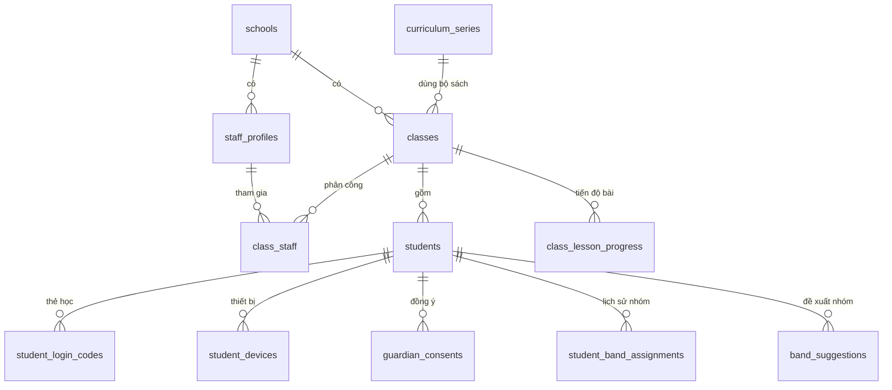
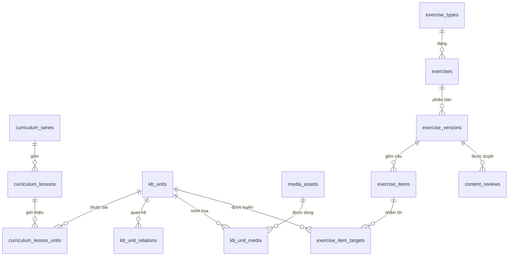
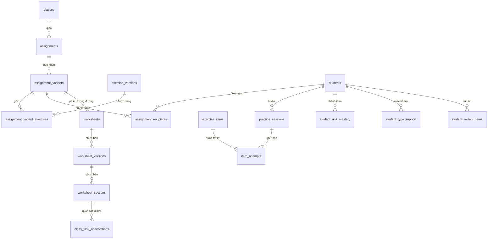
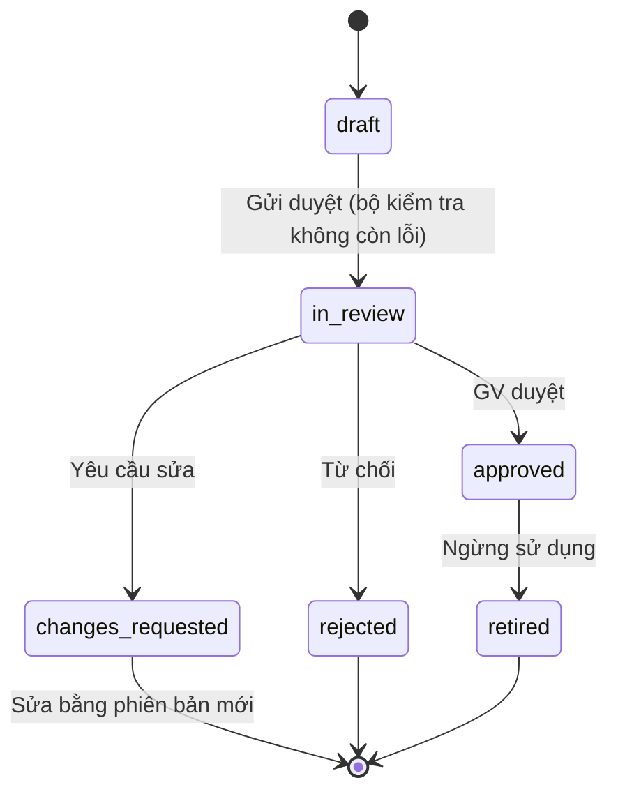

# ReadMate AI — Mô hình dữ liệu dự kiến

> **Phiên bản:** 0.1.1 — bản thiết kế của Giai đoạn 1 (chưa tạo migration); GĐ3 thêm ghi chú đối chiếu với `content/` ở §4.C
> **Ngày cập nhật:** 2026-10-14
> **CSDL:** PostgreSQL trên Supabase (schema `public` cho nghiệp vụ, `private` cho hàm trợ giúp RLS)
> **Tài liệu liên quan:** [PRD.md](PRD.md) · [ARCHITECTURE.md](ARCHITECTURE.md) · [TASKS.md](../TASKS.md)

## Mục lục

1. [Nguyên tắc](#1-nguyên-tắc)
2. [Quy ước chung](#2-quy-ước-chung)
3. [Sơ đồ quan hệ](#3-sơ-đồ-quan-hệ)
4. [Đặc tả bảng](#4-đặc-tả-bảng)
5. [Lược đồ nội dung bài tập](#5-lược-đồ-nội-dung-bài-tập)
6. [Trạng thái kiểm duyệt](#6-trạng-thái-kiểm-duyệt)
7. [Ma trận phân quyền (RLS)](#7-ma-trận-phân-quyền-rls)
8. [Phác thảo SQL: hàm trợ giúp, policy, trigger](#8-phác-thảo-sql-hàm-trợ-giúp-policy-trigger)
9. [Lưu trữ tệp (Storage)](#9-lưu-trữ-tệp-storage)
10. [Bảo vệ dữ liệu, lưu giữ và xóa](#10-bảo-vệ-dữ-liệu-lưu-giữ-và-xóa)
11. [Chỉ mục và hiệu năng](#11-chỉ-mục-và-hiệu-năng)
12. [Kế hoạch migration theo giai đoạn](#12-kế-hoạch-migration-theo-giai-đoạn)
13. [Đối chiếu yêu cầu với bảng dữ liệu](#13-đối-chiếu-yêu-cầu-với-bảng-dữ-liệu)

---

## 1. Nguyên tắc

| Mã | Nguyên tắc |
|---|---|
| DM-1 | **Tối thiểu hóa dữ liệu trẻ em:** chỉ biệt danh, số thứ tự, ảnh đại diện có sẵn; không họ tên đầy đủ, ngày sinh, giới tính, ảnh thật, liên hệ phụ huynh, giọng nói |
| DM-2 | **RLS trên 100% bảng** ở schema `public`; mặc định từ chối |
| DM-3 | **Học sinh chỉ đọc**; mọi thao tác ghi của học sinh đi qua student gateway phía server |
| DM-4 | **Nội dung bất biến theo phiên bản:** phiên bản bài/phiếu không đổi sau khi gửi duyệt; sửa = phiên bản mới |
| DM-5 | **Kết quả chỉ ghi thêm (append-only):** `item_attempts` không cập nhật/xóa, trừ tác vụ xóa theo thời hạn lưu giữ |
| DM-6 | **Dữ liệu dẫn xuất tách riêng:** mastery, hàng ôn, mức hỗ trợ có thể tính lại từ `item_attempts` |
| DM-7 | **Phi chuẩn hóa `class_id`** trên các bảng dữ liệu học sinh để policy RLS đơn giản và nhanh |
| DM-8 | **Văn bản tiếng Việt luôn ở dạng NFC**, có ràng buộc kiểm tra trong CSDL |
| DM-9 | **Không lưu dữ liệu nhóm năng lực ở nơi học sinh đọc được** |

## 2. Quy ước chung

- Tên bảng/cột: `snake_case`, tiếng Anh, bảng số nhiều. Giải thích bằng tiếng Việt trong tài liệu và `comment on`.
- Khóa chính: `uuid` mặc định `gen_random_uuid()`. Riêng `item_attempts.id` và `practice_sessions.id` **do client tạo** (UUID) để gửi lại không bị trùng.
- Thời gian: `timestamptz` (lưu UTC, hiển thị theo `Asia/Ho_Chi_Minh`); cột chuẩn `created_at`, `updated_at` (trigger cập nhật).
- Giá trị liệt kê: `text` + ràng buộc `check` (dễ mở rộng hơn enum của Postgres).
- Xóa: nội dung dùng `archived_at`/trạng thái `retired`; **dữ liệu cá nhân học sinh xóa cứng** khi hết hạn hoặc khi rút đồng ý.
- Văn bản tiếng Việt: `check (col is nfc normalized)` (Postgres ≥ 13, CSDL mã hóa UTF-8).
- Mỗi bảng có `comment on table` mô tả mục đích bằng tiếng Việt.

## 3. Sơ đồ quan hệ

### 3.1 Danh tính, lớp học, học sinh



### 3.2 Kho tri thức và bài tập



### 3.3 Giao bài, luyện tập, tiến bộ, phiếu



## 4. Đặc tả bảng

Cột **GĐ** cho biết giai đoạn tạo bảng (xem [§12](#12-kế-hoạch-migration-theo-giai-đoạn)). Cột chuẩn `created_at`/`updated_at` không liệt kê lại nếu không có gì đặc biệt.

### 4.A Danh tính, trường, lớp

**`schools`** — Trường học. *GĐ5*

| Cột | Kiểu | Ràng buộc | Ghi chú |
|---|---|---|---|
| `id` | uuid | PK | |
| `name` | text | not null | |

**`staff_profiles`** — Hồ sơ giáo viên/quản trị (email chỉ nằm trong `auth.users`). *GĐ5*

| Cột | Kiểu | Ràng buộc | Ghi chú |
|---|---|---|---|
| `id` | uuid | PK, FK → `auth.users(id)` on delete cascade | |
| `school_id` | uuid | FK → `schools`, not null | |
| `display_name` | text | not null | Ví dụ "Cô Lan" |
| `role` | text | check in (`teacher`, `admin`), default `teacher` | |
| `is_active` | boolean | default true | Vô hiệu hóa thay vì xóa |

**`classes`** — Lớp học. *GĐ5*

| Cột | Kiểu | Ràng buộc | Ghi chú |
|---|---|---|---|
| `id` | uuid | PK | |
| `school_id` | uuid | FK, not null | |
| `name` | text | not null | Ví dụ "1A2" |
| `school_year` | text | not null, check định dạng `YYYY-YYYY` | |
| `curriculum_series_id` | uuid | FK → `curriculum_series`, not null | Bộ sách lớp dùng |
| `current_lesson_id` | uuid | FK → `curriculum_lessons`, null | Vị trí hiện tại; lịch sử ở `class_lesson_progress` |
| `teacher_term` | text | check in (`cô`, `thầy`), default `cô` | Xưng hô trong lời đọc |
| `student_term` | text | check in (`con`, `em`), default `con` | |
| `settings` | jsonb | default `{}` | Ghi đè tham số phân hóa của lớp |
| `archived_at` | timestamptz | null | Lưu trữ cuối năm học |
| | | unique (`school_id`, `name`, `school_year`) | |

**`class_staff`** — Giáo viên thuộc lớp. *GĐ5*

| Cột | Kiểu | Ràng buộc | Ghi chú |
|---|---|---|---|
| `class_id` | uuid | PK (cùng `staff_id`), FK | |
| `staff_id` | uuid | FK → `staff_profiles` | |
| `role` | text | check in (`owner`, `co_teacher`) | Đồng chủ nhiệm: sau MVP |
| `added_at` / `removed_at` | timestamptz | | Gỡ quyền không xóa lịch sử |

### 4.B Học sinh và truy cập

**`students`** — Hồ sơ học sinh đã tối thiểu hóa. *GĐ5*

| Cột | Kiểu | Ràng buộc | Ghi chú |
|---|---|---|---|
| `id` | uuid | PK | |
| `class_id` | uuid | FK, not null | |
| `display_name` | text | not null, 1–30 ký tự, NFC | Biệt danh/tên gọi ở lớp — **không nhập họ tên đầy đủ** |
| `student_number` | smallint | null; unique (`class_id`, `student_number`) | Số thứ tự trong lớp |
| `avatar_key` | text | not null | Ảnh đại diện chọn từ bộ có sẵn (con vật, đồ vật) |
| `status` | text | check in (`active`, `archived`) | |
| `data_collection_enabled` | boolean | default false | Chỉ bật khi có đồng ý còn hiệu lực; gateway kiểm tra trước khi ghi kết quả |
| `archived_at` | timestamptz | null | |

Không có cột: họ tên đầy đủ, ngày sinh, giới tính, ảnh, địa chỉ, số điện thoại, thông tin phụ huynh, ghi chú sức khỏe.

**`student_login_codes`** — Thẻ học (mã QR + mã dự phòng). *GĐ5*

| Cột | Kiểu | Ràng buộc | Ghi chú |
|---|---|---|---|
| `id` | uuid | PK | |
| `student_id` | uuid | FK on delete cascade | |
| `class_id` | uuid | not null | Phi chuẩn hóa cho RLS |
| `token_hmac` | bytea | unique, not null | HMAC-SHA256(mã QR, pepper) — **không lưu mã gốc** |
| `backup_code_hmac` | bytea | unique, not null | HMAC của mã dự phòng 8 ký tự |
| `expires_at` | timestamptz | null | |
| `revoked_at` | timestamptz | null | Cấp lại = thu hồi mã cũ |
| `last_used_at` | timestamptz | null | |
| `created_by` | uuid | FK → `staff_profiles` | |
| | | unique một mã còn hiệu lực/học sinh (partial index `where revoked_at is null`) | |

**`student_devices`** — Liên kết thiết bị (người dùng ẩn danh) ↔ học sinh. *GĐ5*

| Cột | Kiểu | Ràng buộc | Ghi chú |
|---|---|---|---|
| `id` | uuid | PK | |
| `auth_user_id` | uuid | FK → `auth.users(id)` on delete cascade | Người dùng ẩn danh của thiết bị |
| `student_id` | uuid | FK on delete cascade | |
| `class_id` | uuid | not null | |
| `login_code_id` | uuid | FK → `student_login_codes` | Mã đã dùng để liên kết |
| `linked_at` / `last_seen_at` | timestamptz | | |
| `revoked_at` | timestamptz | null | RLS bỏ qua liên kết đã thu hồi |
| | | unique (`auth_user_id`, `student_id`) | Một thiết bị có thể liên kết nhiều anh/chị/em |

Không lưu IP, user-agent đầy đủ hay dấu vân tay thiết bị.

**`guardian_consents`** — Ghi nhận đồng ý của phụ huynh (phiếu giấy do trường lưu). *GĐ5*

| Cột | Kiểu | Ràng buộc | Ghi chú |
|---|---|---|---|
| `id` | uuid | PK | |
| `student_id` / `class_id` | uuid | FK / not null | |
| `status` | text | check in (`granted`, `withdrawn`) | |
| `notice_version` | text | not null | Phiên bản thông báo xử lý dữ liệu đã gửi phụ huynh |
| `method` | text | check in (`paper_form`, `other`) | |
| `recorded_by` | uuid | FK → `staff_profiles` | |
| `recorded_at` / `withdrawn_at` | timestamptz | | |
| `note` | text | ≤ 200 ký tự | Không ghi thông tin cá nhân của phụ huynh |

**`student_band_assignments`** — Lịch sử nhóm năng lực (chỉ GV thấy). *GĐ5*

| Cột | Kiểu | Ràng buộc | Ghi chú |
|---|---|---|---|
| `id` | uuid | PK | |
| `student_id` / `class_id` | uuid | | |
| `band` | text | check in (`foundation`, `developing`, `extending`) | Nhóm 3 / Nhóm 2 / Nhóm 1 |
| `source` | text | check in (`teacher`, `suggestion_accepted`) | |
| `reason` | text | null | |
| `valid_from` / `valid_to` | timestamptz | | Nhóm hiện tại: `valid_to is null` (partial unique theo học sinh) |
| `set_by` | uuid | FK → `staff_profiles` | |

**`band_suggestions`** — Đề xuất đổi nhóm do hệ thống tính, chờ GV quyết định. *GĐ7*

| Cột | Kiểu | Ràng buộc | Ghi chú |
|---|---|---|---|
| `id` | uuid | PK | |
| `student_id` / `class_id` | uuid | | |
| `from_band` / `to_band` | text | check như trên | |
| `evidence` | jsonb | not null | Chỉ số làm căn cứ (để GV đọc) |
| `engine_version` | text | | |
| `decision` | text | check in (`pending`, `accepted`, `dismissed`) | |
| `decided_by` / `decided_at` | uuid / timestamptz | | |

### 4.C Chương trình và kho tri thức

**`curriculum_series`** — Bộ sách. *GĐ5*

| Cột | Kiểu | Ràng buộc | Ghi chú |
|---|---|---|---|
| `id` | uuid | PK | |
| `code` | text | unique | Ví dụ mã bộ sách (cần GV xác nhận bộ sách của lớp) |
| `name` / `publisher` | text | | |
| `grade` | smallint | default 1 | |
| `is_active` | boolean | | |

**`curriculum_lessons`** — Bài học theo thứ tự (chỉ dữ kiện, không sao chép bài đọc). *GĐ5*

| Cột | Kiểu | Ràng buộc | Ghi chú |
|---|---|---|---|
| `id` | uuid | PK | |
| `series_id` | uuid | FK | |
| `ordinal` | int | unique (`series_id`, `ordinal`) | Thứ tự toàn năm |
| `code` / `title` | text | | Ví dụ "Bài 12" |
| `volume` | smallint | | Tập 1/2 |
| `lesson_type` | text | check in (`new_units`, `review`, `reading`, `other`) | |

**`curriculum_lesson_units`** — Đơn vị được giới thiệu/ôn trong bài. *GĐ5*

| Cột | Kiểu | Ràng buộc | Ghi chú |
|---|---|---|---|
| `lesson_id` / `unit_id` | uuid | PK kép, FK | |
| `role` | text | check in (`introduced`, `reviewed`) | `taught_set` tính từ `introduced` |

**`class_lesson_progress`** — Lịch sử vị trí bài học của lớp. *GĐ5*

| Cột | Kiểu | Ràng buộc | Ghi chú |
|---|---|---|---|
| `id` | uuid | PK | |
| `class_id` / `lesson_id` | uuid | FK | |
| `reached_at` | timestamptz | default now() | |
| `set_by` | uuid | FK → `staff_profiles` | |

**`kb_units`** — Đơn vị tri thức thống nhất. *GĐ5 (dữ liệu lõi nạp từ `content/kb` — soạn ở GĐ3)*

| Cột | Kiểu | Ràng buộc | Ghi chú |
|---|---|---|---|
| `id` | uuid | PK | |
| `kind` | text | check in (`letter`, `phoneme`, `rime`, `tone`, `syllable`, `word`, `sentence`, `passage`) | `phoneme` = "âm" theo cách dạy lớp 1, gắn chữ ghi âm (kể cả chữ ghép: ch, gh, gi, kh, ng, ngh, nh, ph, qu, th, tr) |
| `text` | text | not null, NFC | Ví dụ `ngh`, `oang`, `bà`, `quả na` |
| `key` | text | unique | `<kind>:<text>`; thanh dùng tên ASCII: `tone:huyen` |
| `spoken_label` | text | null | Cách gọi khi dạy, ví dụ "bờ", "ngờ kép" (GV xác nhận) |
| `structure` | jsonb | null | Kết quả phân tích tiếng: âm đầu, âm đệm, âm chính, âm cuối, thanh, vần |
| `component_unit_ids` | uuid[] | default `{}` | Các âm/vần/thanh cần biết để đọc được — do parser tính |
| `parser_version` | text | null | Để tính lại khi quy tắc đổi |
| `syllable_count` | smallint | null | |
| `topic_tags` | text[] | default `{}` | con vật, đồ vật, gia đình… |
| `meaning_note` | text | null | Giải nghĩa ngắn (mở rộng vốn từ — Nhóm 1) |
| `difficulty` | smallint | check 1–5 | |
| `is_child_safe` | boolean | default true | Đã rà soát phù hợp trẻ em |
| `status` | text | check in (`draft`, `in_review`, `approved`, `retired`) | |
| `source` | text | | `project_team`, `teacher`, `ai` |
| `created_by` / `approved_by` / `approved_at` | | | |

> **Ghi chú GĐ3 (2026-10-14) — đối chiếu với dữ liệu nguồn `content/`** ([VIETNAMESE_ENGINE.md](VIETNAMESE_ENGINE.md)):
> - Dữ liệu nguồn dùng trạng thái `draft` · `pending_review` · `approved` · `rejected` và ghi `reviewedBy`, `reviewedAt`, `contentHash` khi duyệt. Khi seed ở GĐ5: `pending_review` ↔ `in_review`; migration GĐ5 cần **thêm giá trị `rejected`** vào ràng buộc `status` của `kb_units` (bảng này hiện chỉ có `draft`, `in_review`, `approved`, `retired`).
> - `component_unit_ids` tương ứng kết quả `requiredUnitsOf()` (âm đầu, vần — hoặc âm nếu vần chỉ một nguyên âm —, thanh); `parser_version` nên ghi phiên bản dữ liệu (`content/manifest.json`).
> - `spoken_label` lấy từ `teachingLabel.proposed` của `content/kb/phonemes.json` — chỉ hiển thị cho học sinh sau khi GV xác nhận.
> - Quy ước của lớp (qu, gi, "i" dùng chung, kiểu đặt dấu) đang nằm ở hồ sơ `content/curriculum/profiles/*.json` → GĐ5 cần nơi lưu tương ứng (đề xuất: `classes.settings.language_conventions`, kèm người/ngày xác nhận).

**`kb_unit_relations`** — Quan hệ giữa các đơn vị. *GĐ5*

| Cột | Kiểu | Ràng buộc | Ghi chú |
|---|---|---|---|
| `from_unit_id` / `to_unit_id` | uuid | PK (cùng `relation`) | |
| `relation` | text | check in (`confusable_visual`, `confusable_sound`, `spelling_variant`, `contains`, `rhymes_with`, `synonym`, `antonym`) | Ví dụ b↔d (`confusable_visual`), l↔n (`confusable_sound`), c↔k (`spelling_variant`) |
| `weight` | smallint | | Mức hay nhầm |
| `note` | text | | |

**`kb_rules`** — Quy tắc chính tả, thanh điệu, cấu tạo tiếng (dạng máy đọc được). *GĐ5*

| Cột | Kiểu | Ràng buộc | Ghi chú |
|---|---|---|---|
| `id` | uuid | PK | |
| `code` | text | unique | Ví dụ `spelling.c_k_q`, `spelling.g_gh`, `spelling.ng_ngh`, `tone.stop_coda`, `tone.placement` |
| `rule_type` | text | check in (`spelling`, `tone`, `tone_placement`, `syllable_structure`, `pedagogy`) | |
| `title` / `description_vi` | text | | |
| `spec` | jsonb | not null | Đặc tả cho bộ kiểm tra; nguồn chuẩn nằm trong `content/kb/rules` |
| `examples` / `counter_examples` | jsonb | | |
| `version` | int | | |
| `status` | text | như `kb_units` | |

### 4.D Media

**`media_assets`** — Hình và âm thanh có nguồn gốc, giấy phép. *GĐ5*

| Cột | Kiểu | Ràng buộc | Ghi chú |
|---|---|---|---|
| `id` | uuid | PK | |
| `kind` | text | check in (`image`, `audio`) | |
| `bucket` / `storage_path` | text | unique (`bucket`, `storage_path`) | Đường dẫn dùng UUID, không chứa tên người |
| `mime_type`, `bytes`, `checksum_sha256` | | | |
| `duration_ms` / `width` / `height` | int | null | |
| `audio_purpose` | text | check in (`instruction`, `stimulus`, `model`, `feedback`, `ui`) | Bắt buộc với âm thanh |
| `spoken_text` | text | NFC; bắt buộc với âm thanh | Dùng cho kiểm tra chống lộ đáp án |
| `voice_source` | text | check in (`teacher`, `tts`, `licensed`) | |
| `tts_provider` / `tts_voice` | text | null | |
| `recorded_by` | uuid | null | GV ghi âm (cần GV đồng ý cho sử dụng) |
| `license` | text | not null | `original`, `CC-BY-4.0`, `Apache-2.0`, `MIT`, `teacher-consented`, … |
| `attribution` / `source_url` | text | null | |
| `alt_text_vi` | text | null | Mô tả hình (trợ năng) |
| `grayscale_ok` | boolean | null | In đen trắng vẫn rõ |
| `status` | text | check in (`draft`, `approved`, `retired`) | |

**`kb_unit_media`** — Gắn hình/âm thanh mẫu cho đơn vị tri thức. *GĐ5*

| Cột | Kiểu | Ràng buộc | Ghi chú |
|---|---|---|---|
| `unit_id` / `media_id` | uuid | PK (cùng `role`) | |
| `role` | text | check in (`image`, `model_audio`) | |
| `is_primary` | boolean | | |

### 4.E Bài tập và kiểm duyệt

**`exercise_types`** — Bảng tham chiếu các dạng bài (đồng bộ từ registry trong mã). *GĐ5*

| Cột | Kiểu | Ràng buộc | Ghi chú |
|---|---|---|---|
| `code` | text | PK | `letter_sound`, `build_syllable`, `identify_unit`, `fill_blank`, `word_picture`, `sentence_reading` |
| `name_vi` / `skill` | text | | |
| `icon_key` | text | | Biểu tượng hướng dẫn dùng chung app/phiếu |
| `instruction_vi` | text | | Câu lệnh chuẩn |
| `schema_version` | int | | |
| `is_active` | boolean | | |

**`exercises`** — Bài tập (định danh logic, không chứa nội dung). *GĐ6*

| Cột | Kiểu | Ràng buộc | Ghi chú |
|---|---|---|---|
| `id` | uuid | PK | |
| `type_code` | text | FK → `exercise_types` | |
| `title` | text | not null | Tên cho GV |
| `target_bands` | text[] | not null | Nhóm phù hợp |
| `origin` | text | check in (`library`, `teacher`, `rule_generator`, `ai`) | |
| `owner_school_id` | uuid | null | null = thư viện chung |
| `current_approved_version_id` | uuid | FK → `exercise_versions`, null | |
| `created_by` | uuid | | |
| `archived_at` | timestamptz | null | |

**`exercise_versions`** — Phiên bản nội dung (bất biến sau khi gửi duyệt). *GĐ6*

| Cột | Kiểu | Ràng buộc | Ghi chú |
|---|---|---|---|
| `id` | uuid | PK | |
| `exercise_id` | uuid | FK; unique (`exercise_id`, `version_no`) | |
| `version_no` | int | | |
| `status` | text | check in (`draft`, `in_review`, `changes_requested`, `approved`, `rejected`, `retired`) | **Trạng thái kiểm duyệt** |
| `schema_version` | int | | Phiên bản lược đồ của dạng bài |
| `settings` | jsonb | | Số lần thử tối đa, xáo trộn phương án… |
| `lesson_scope_id` | uuid | FK → `curriculum_lessons`, null | Mốc bài học dùng để kiểm tra "đã học" |
| `difficulty` | smallint | 1–5 | |
| `paper_ready` | boolean | | Có dạng phiếu |
| `validation_report` | jsonb | null | Kết quả chuỗi kiểm tra + phiên bản bộ kiểm tra |
| `content_hash` | text | null | Ghi khi gửi duyệt; mọi quyết định duyệt gắn với hash này |
| `ai_generation_run_id` | uuid | FK, null | Nếu do AI tạo nháp |
| `created_by`, `submitted_at`, `decided_by`, `decided_at` | | | |

**`exercise_items`** — Các câu trong một phiên bản (bất biến cùng phiên bản). *GĐ6*

| Cột | Kiểu | Ràng buộc | Ghi chú |
|---|---|---|---|
| `id` | uuid | PK | |
| `exercise_version_id` | uuid | FK on delete cascade; unique (`exercise_version_id`, `position`) | |
| `position` | smallint | | |
| `content` | jsonb | not null | Phần hiển thị — theo lược đồ ở [§5](#5-lược-đồ-nội-dung-bài-tập) |
| `answer` | jsonb | not null | Đáp án + thẻ lỗi của phương án nhiễu (tách cột để sau này ẩn ở chế độ kiểm tra) |
| `audio_refs` | jsonb | default `{}` | Vai trò → `media_assets.id` |
| `difficulty` | smallint | null | |

**`exercise_item_targets`** — Đơn vị tri thức mà câu luyện tập (phục vụ phân tích theo âm/vần). *GĐ6*

| Cột | Kiểu | Ràng buộc | Ghi chú |
|---|---|---|---|
| `item_id` / `unit_id` | uuid | PK kép, FK | |
| `role` | text | check in (`primary`, `secondary`) | |

**`content_reviews`** — Nhật ký kiểm duyệt (chỉ ghi thêm). *GĐ6*

| Cột | Kiểu | Ràng buộc | Ghi chú |
|---|---|---|---|
| `id` | uuid | PK | |
| `target_type` | text | check in (`exercise_version`, `kb_unit`, `worksheet_version`, `media_asset`) | |
| `target_id` | uuid | not null | |
| `action` | text | check in (`submit`, `approve`, `request_changes`, `reject`, `retire`) | |
| `reviewer_id` | uuid | FK → `staff_profiles` | |
| `checklist` | jsonb | | Các mục GV đã xác nhận (chính tả, đã học, hình phù hợp, âm thanh không lộ đáp án…) |
| `comment` | text | | |
| `content_hash` | text | | Nội dung tại thời điểm quyết định |

### 4.F Giao bài và luyện tập

**`assignments`** — Bài giao của lớp. *GĐ7*

| Cột | Kiểu | Ràng buộc | Ghi chú |
|---|---|---|---|
| `id` | uuid | PK | |
| `class_id` | uuid | FK | |
| `title` | text | | Ví dụ "Tuần 6 – vần an, at" |
| `lesson_id` | uuid | FK, null | |
| `status` | text | check in (`draft`, `published`, `closed`) | |
| `opens_at` / `due_at` | timestamptz | | |
| `created_by`, `published_at`, `closed_at` | | | |

**`assignment_variants`** — Biến thể theo nhóm. *GĐ7*

| Cột | Kiểu | Ràng buộc | Ghi chú |
|---|---|---|---|
| `id` | uuid | PK | |
| `assignment_id` | uuid | FK; unique (`assignment_id`, `band`) | |
| `band` | text | null hoặc 3 giá trị nhóm | null = chung cả lớp |
| `label` | text | | |

**`assignment_variant_exercises`** — Danh sách bài (theo thứ tự) trong biến thể. *GĐ7*

| Cột | Kiểu | Ràng buộc | Ghi chú |
|---|---|---|---|
| `variant_id` | uuid | PK (cùng `position`), FK | |
| `position` | smallint | | |
| `exercise_version_id` | uuid | FK | **Trigger chỉ cho phép phiên bản `approved`** |

**`assignment_recipients`** — Ảnh chụp danh sách người nhận lúc phát hành. *GĐ7*

| Cột | Kiểu | Ràng buộc | Ghi chú |
|---|---|---|---|
| `assignment_id` / `student_id` | uuid | PK kép | |
| `variant_id` | uuid | FK | Theo nhóm tại thời điểm giao |
| `class_id` | uuid | | |
| `assigned_at` | timestamptz | | |

**`practice_sessions`** — Phiên luyện tập. *GĐ7*

| Cột | Kiểu | Ràng buộc | Ghi chú |
|---|---|---|---|
| `id` | uuid | PK (client tạo) | Chống trùng khi gửi lại |
| `student_id` / `class_id` | uuid | | |
| `assignment_id` / `variant_id` | uuid | null | |
| `device_id` | uuid | FK → `student_devices`, null | |
| `mode` | text | check in (`assignment`, `review`, `classroom_like`) | |
| `plan` | jsonb | not null | **Lộ trình của buổi luyện**: danh sách câu + lý do (ôn tập/bài giao/bắc cầu/thử thách) |
| `adaptivity_config_version` | text | | |
| `status` | text | check in (`in_progress`, `completed`, `abandoned`) | |
| `started_at` / `ended_at` / `client_started_at` | timestamptz | | |

**`item_attempts`** — Kết quả từng lượt trả lời (chỉ ghi thêm). *GĐ7*

| Cột | Kiểu | Ràng buộc | Ghi chú |
|---|---|---|---|
| `id` | uuid | PK (client tạo) | `on conflict do nothing` khi gửi lại |
| `session_id` | uuid | FK | |
| `student_id` / `class_id` | uuid | | |
| `exercise_version_id` / `exercise_item_id` | uuid | FK | |
| `attempt_no` | smallint | | Lần thử trong câu |
| `response` | jsonb | not null | Phương án đã chọn |
| `is_correct` | boolean | not null | **Do server chấm lại** |
| `error_tags` | text[] | default `{}` | Ví dụ `confusion:b-d`, `spelling:c-k`, `tone:hoi-nga` |
| `support_level` | smallint | check 0–3 | Mức H0–H3 lúc làm |
| `hints_used` / `instruction_replays` / `stimulus_plays` | smallint | default 0 | Chỉ báo phụ thuộc hỗ trợ |
| `response_ms` | int | null | |
| `answered_at_client` / `received_at` | timestamptz | | |
| `grader_version` | text | | |

### 4.G Tiến bộ và ôn tập (dữ liệu dẫn xuất)

**`student_unit_mastery`** — Mức thành thạo theo đơn vị tri thức. *GĐ7*

| Cột | Kiểu | Ràng buộc | Ghi chú |
|---|---|---|---|
| `student_id` / `unit_id` | uuid | PK kép | |
| `class_id` | uuid | | |
| `score` | numeric(4,3) | 0–1 | Trung bình trượt có trọng số |
| `state` | text | check in (`new`, `learning`, `reviewing`, `mastered`) | |
| `attempts` / `correct` / `independent_correct` | int | | |
| `last_practiced_at` / `last_correct_at` | timestamptz | | |
| `engine_version` | text | | |

**`student_type_support`** — Mức hỗ trợ theo dạng bài. *GĐ7*

| Cột | Kiểu | Ràng buộc | Ghi chú |
|---|---|---|---|
| `student_id` / `type_code` | | PK kép | |
| `class_id` | uuid | | |
| `support_level` | smallint | check 0–3 | H0–H3 |
| `ready_for_class` | boolean | | "Sẵn sàng tự làm ở lớp" |
| `teacher_override` | boolean | default false | |
| `evidence` | jsonb | | Các phiên làm căn cứ |
| `engine_version` | text | | |

**`student_review_items`** — **Những kiến thức cần ôn tập**. *GĐ7*

| Cột | Kiểu | Ràng buộc | Ghi chú |
|---|---|---|---|
| `id` | uuid | PK | |
| `student_id` / `class_id` / `unit_id` | uuid | | |
| `reason` | text | check in (`error`, `spaced_review`, `teacher_flag`, `confusion_pair`) | |
| `related_unit_id` | uuid | null | Với cặp nhầm lẫn (ví dụ b–d) |
| `box` | smallint | check 1–5 | Hộp Leitner |
| `due_at` | timestamptz | | |
| `priority` | smallint | | |
| `status` | text | check in (`active`, `resolved`) | Unique (`student_id`, `unit_id`, `reason`) khi `active` |

### 4.H Phiếu học tập và quan sát tại lớp

**`worksheets`** — Phiếu học tập. *GĐ8*

| Cột | Kiểu | Ràng buộc | Ghi chú |
|---|---|---|---|
| `id` | uuid | PK | |
| `class_id` | uuid | FK | |
| `assignment_variant_id` | uuid | FK, null | Biến thể bài giao mà phiếu tương đương |
| `band` | text | null | |
| `title` | text | | |
| `created_by` | uuid | | |

**`worksheet_versions`** — Phiên bản phiếu (bất biến sau khi gửi duyệt). *GĐ8*

| Cột | Kiểu | Ràng buộc | Ghi chú |
|---|---|---|---|
| `id` | uuid | PK | |
| `worksheet_id` | uuid | FK; unique (`worksheet_id`, `version_no`) | |
| `version_no` | int | | |
| `status` | text | như `exercise_versions` | |
| `layout` | jsonb | | Khổ giấy, tiêu đề, tùy chọn bố cục |
| `content_hash` | text | | |
| `pdf_storage_path` / `pdf_sha256` | text | null | Bucket `worksheets` (riêng tư) |
| `renderer_version` | text | | |
| `generated_at`, `decided_by`, `decided_at` | | | |

**`worksheet_sections`** — Các phần của phiếu. *GĐ8*

| Cột | Kiểu | Ràng buộc | Ghi chú |
|---|---|---|---|
| `id` | uuid | PK | |
| `worksheet_version_id` | uuid | FK; unique (`worksheet_version_id`, `position`) | |
| `position` | smallint | | |
| `type_code` | text | FK → `exercise_types` | |
| `exercise_version_id` | uuid | FK | Bài "sinh đôi" dạng phiếu (đã duyệt) |
| `mirrors_exercise_version_id` | uuid | FK, null | Bài ở nhà mà phần này tương đương |

**`class_task_observations`** — GV ghi nhận mức tự lực khi làm phiếu tại lớp. *GĐ8*

| Cột | Kiểu | Ràng buộc | Ghi chú |
|---|---|---|---|
| `id` | uuid | PK | |
| `class_id` / `student_id` | uuid | | |
| `worksheet_section_id` | uuid | FK, null | |
| `type_code` | text | | |
| `observed_on` | date | | |
| `independence` | text | check in (`independent`, `prompted`, `guided`) | *Tự làm được* / *Cần nhắc 1–2 lần* / *Cần hướng dẫn riêng* |
| `correct_count` / `total_count` | smallint | null | Tùy chọn |
| `recorded_by` | uuid | | |

### 4.I AI và vận hành

**`ai_generation_runs`** — Nhật ký mỗi lần gọi AI tạo nháp. *GĐ11*

| Cột | Kiểu | Ràng buộc | Ghi chú |
|---|---|---|---|
| `id` | uuid | PK | |
| `requested_by` | uuid | FK → `staff_profiles` | |
| `provider` / `model` / `prompt_template_version` | text | | |
| `request_params` | jsonb | | Mục tiêu, dạng, nhóm — **không chứa dữ liệu học sinh** |
| `status` | text | check in (`queued`, `running`, `succeeded`, `failed`) | |
| `batch_id` | text | null | Khi dùng Batch API |
| `input_tokens` / `output_tokens` / `cache_read_tokens` | int | | |
| `estimated_cost_usd` | numeric(10,4) | | |
| `error` | text | null | |

**`audit_logs`** — Nhật ký thao tác nhạy cảm. *GĐ5*

| Cột | Kiểu | Ràng buộc | Ghi chú |
|---|---|---|---|
| `id` | bigint | identity PK | |
| `actor_id` | uuid | null | |
| `actor_kind` | text | check in (`staff`, `student_device`, `system`) | |
| `action` | text | | `student.create`, `consent.record`, `device.link`, `device.revoke`, `exercise.approve`, `data.export`, `student.delete`, … |
| `target_type` / `target_id` | text / uuid | | |
| `class_id` | uuid | null | |
| `metadata` | jsonb | | Không chứa nội dung nhạy cảm |

**`rate_limit_buckets`** — Đếm số lần thử theo cửa sổ thời gian (chỉ server). *GĐ5*

| Cột | Kiểu | Ràng buộc | Ghi chú |
|---|---|---|---|
| `key_hash` | text | PK (cùng `window_start`) | Băm của IP/lớp/loại thao tác |
| `window_start` | timestamptz | | |
| `count` | int | | |

**`background_jobs`** — Tác vụ nền cần thử lại (TTS, PDF, AI, lưu giữ). *GĐ6 khi cần*

| Cột | Kiểu | Ràng buộc | Ghi chú |
|---|---|---|---|
| `id` | uuid | PK | |
| `kind` | text | check in (`tts`, `pdf`, `ai_generation`, `retention`) | |
| `payload` | jsonb | | Không chứa dữ liệu học sinh ngoài UUID |
| `status`, `attempts`, `run_after`, `last_error` | | | |

## 5. Lược đồ nội dung bài tập

Lược đồ chuẩn được định nghĩa bằng **zod** trong `src/features/exercises/types/<code>/schema.ts` (nguồn sự thật); JSON dưới đây là ví dụ minh họa. Quy ước: `content` = phần hiển thị cho học sinh; `answer` = đáp án và thẻ lỗi của phương án nhiễu; `audio_refs` = vai trò âm thanh → `media_assets.id`. Mọi văn bản ở dạng NFC.

**Dạng 1 — `letter_sound`**

```json
{
  "content": {
    "mode": "picture_to_letter",
    "stimulus": { "imageId": "img-con-bo" },
    "options": [ { "id": "o1", "text": "b" }, { "id": "o2", "text": "d" }, { "id": "o3", "text": "p" } ]
  },
  "answer": { "optionId": "o1", "word": "bò", "distractorTags": { "o2": "confusion:b-d", "o3": "confusion:b-p" } },
  "audio_refs": { "instruction": "aud-hd-letter-sound", "stimulus": "aud-bo" }
}
```

Lưu ý: tên hình ("bò") nằm trong `answer` chứ **không** nằm trong `content` — nếu hiển thị chữ "bò" thì trẻ chỉ cần nhìn chữ cái đầu là biết đáp án. Bộ kiểm tra phải chặn trường hợp văn bản hiển thị chứa đáp án (mã lỗi `TEXT_LEAKS_ANSWER`, xem ARCHITECTURE §11.3).

**Dạng 2 — `build_syllable`**

```json
{
  "content": {
    "mode": "picture_to_syllable",
    "stimulus": { "imageId": "img-con-ca" },
    "tiles": { "onsets": ["c", "k", "g"], "rimes": ["a", "o"], "tones": ["ngang", "huyen", "sac"] }
  },
  "answer": {
    "onset": "c", "rime": "a", "tone": "sac", "result": "cá",
    "distractorTags": { "onset:k": "spelling:c-k", "tone:huyen": "tone:sac-huyen" }
  },
  "audio_refs": { "instruction": "aud-hd-build", "stimulus": "aud-ca", "model": "aud-ca" }
}
```

**Dạng 3 — `identify_unit`**

```json
{
  "content": {
    "mode": "which_rime",
    "stimulus": { "syllable": "bàn", "imageId": "img-cai-ban" },
    "options": [ { "id": "o1", "text": "an" }, { "id": "o2", "text": "ang" }, { "id": "o3", "text": "am" } ]
  },
  "answer": { "optionId": "o1", "distractorTags": { "o2": "confusion:an-ang", "o3": "confusion:an-am" } },
  "audio_refs": { "instruction": "aud-hd-which-rime" }
}
```

Biến thể `find_syllables_with_unit` dùng `"answer": { "optionIds": ["o1", "o3"] }` (chọn nhiều; đúng khi chọn đủ và không chọn thừa).

**Dạng 4 — `fill_blank`**

```json
{
  "content": {
    "stimulus": { "imageId": "img-ke-vach", "template": "_ẻ" },
    "options": [ { "id": "o1", "text": "c" }, { "id": "o2", "text": "k" } ]
  },
  "answer": { "optionId": "o2", "result": "kẻ", "distractorTags": { "o1": "spelling:c-k" } },
  "audio_refs": { "instruction": "aud-hd-fill", "stimulus": "aud-ke" }
}
```

**Dạng 5 — `word_picture`** (kiểm tra kỹ năng đọc: không có âm thanh `stimulus`)

```json
{
  "content": {
    "mode": "choose_picture",
    "stimulus": { "word": "quả na" },
    "options": [ { "id": "o1", "imageId": "img-qua-na" }, { "id": "o2", "imageId": "img-qua-le" }, { "id": "o3", "imageId": "img-con-ga" } ]
  },
  "answer": { "optionId": "o1", "distractorTags": { "o2": "confusion:onset-n-l" } },
  "audio_refs": { "instruction": "aud-hd-word-picture", "model": "aud-qua-na" }
}
```

**Dạng 6 — `sentence_reading`**

```json
{
  "content": {
    "mode": "arrange_words",
    "tokens": ["chợ", "Mẹ", "đi", "."],
    "imageId": "img-me-di-cho"
  },
  "answer": { "orders": [["Mẹ", "đi", "chợ", "."]] },
  "audio_refs": { "instruction": "aud-hd-arrange", "model": "aud-me-di-cho" }
}
```

Biến thể `choose_picture` và `true_false` dùng `stimulus.sentence` + `options` như dạng 5.

**Câu trả lời gửi lên server** (`item_attempts.response`): `{ "optionId": "o2" }`, `{ "optionIds": [...] }`, `{ "onset": "k", "rime": "a", "tone": "sac" }` hoặc `{ "order": [...] }` — kiểm tra bằng `responseSchema` của dạng bài.

## 6. Trạng thái kiểm duyệt

Áp dụng cho `exercise_versions` và `worksheet_versions` (tương tự cho `kb_units`, `media_assets` với tập trạng thái rút gọn).



- Chỉ `draft` được sửa; trigger chặn sửa `exercise_items`/nội dung khi phiên bản không còn là `draft`.
- `approved` là trạng thái duy nhất được gắn vào bài giao/phiếu (trigger kiểm tra).
- Mọi chuyển trạng thái ghi một dòng `content_reviews` kèm `content_hash`.
- Nội dung do AI tạo luôn bắt đầu ở `draft`; không có đường nào tự động tới `approved`.

## 7. Ma trận phân quyền (RLS)

Ký hiệu: **R** đọc · **C** tạo · **U** sửa · **D** xóa · **—** không có quyền. "Thiết bị HS" = người dùng ẩn danh có liên kết `student_devices` còn hiệu lực. "Khác" = khách và người dùng ẩn danh chưa liên kết. Server (khóa secret) bỏ qua RLS và chỉ được dùng trong các module đã nêu ở [ARCHITECTURE §7](ARCHITECTURE.md#7-backend-và-api).

| Bảng | Admin | GV (lớp mình) | Thiết bị HS | Khác |
|---|---|---|---|---|
| `schools` | CRUD | R (trường mình) | — | — |
| `staff_profiles` | CRUD | R (mình, đồng nghiệp cùng lớp); U tên hiển thị của mình | — | — |
| `classes`, `class_staff` | CRUD | R; U cài đặt lớp | — | — |
| `students` | CRUD | CRUD ¹ | R (hồ sơ của mình) | — |
| `student_login_codes` | R | R (trừ cột HMAC ²); cấp/thu hồi qua server | — | — |
| `student_devices` | R | R; U (thu hồi) | R (của mình) | — |
| `guardian_consents` | R | CRUD | — | — |
| `student_band_assignments`, `band_suggestions` | R | CRUD (đề xuất: U quyết định) | **—** | — |
| `curriculum_*`, `class_lesson_progress` | CRUD | R; CRUD `class_lesson_progress` của lớp mình | — | — |
| `kb_units`, `kb_unit_relations`, `kb_rules`, `kb_unit_media` | CRUD | R (đã duyệt + nháp của mình); C nháp | — | — |
| `media_assets` | CRUD | R; C qua server | — (tệp nội dung tải qua CDN) | — |
| `exercise_types` | CRUD | R | — | — |
| `exercises`, `exercise_versions`, `exercise_items`, `exercise_item_targets` | CRUD | R (thư viện đã duyệt + nháp cùng trường); CRUD nháp của mình | — (nội dung phiên luyện do student gateway cung cấp, chỉ `approved`) | — |
| `content_reviews` | R | R; C qua server | — | — |
| `assignments`, `assignment_variants`, `assignment_variant_exercises` | R | CRUD | R `assignments` đã phát hành được giao cho mình | — |
| `assignment_recipients` | R | CRUD | R (của mình) | — |
| `practice_sessions`, `item_attempts` | R | R | R (của mình); **ghi qua server** | — |
| `student_unit_mastery`, `student_review_items`, `student_type_support` | R | R; ghi đè mức hỗ trợ qua server | R (của mình) | — |
| `worksheets`, `worksheet_versions`, `worksheet_sections` | R | CRUD | — | — |
| `class_task_observations` | R | CRUD | — | — |
| `ai_generation_runs` | R | R (của mình) | — | — |
| `audit_logs` | R | — (MVP) | — | — |
| `rate_limit_buckets`, `background_jobs` | — | — | — | — (chỉ server) |

¹ "Xóa" học sinh là quy trình xóa dữ liệu có nhật ký, thực hiện qua server.
² Dùng phân quyền theo cột: `revoke select (token_hmac, backup_code_hmac) on student_login_codes from authenticated`.

**Bảo đảm then chốt (phải có kiểm thử tự động ở GĐ5/GĐ7):**

1. Thiết bị của học sinh A không đọc được bất kỳ dòng nào của học sinh B (kể cả cùng lớp).
2. GV lớp X không đọc được dữ liệu lớp Y.
3. Người dùng ẩn danh chưa liên kết, hoặc liên kết đã thu hồi, không đọc được gì.
4. Không vai trò nào ngoài server ghi được `item_attempts`, `practice_sessions`, các bảng dẫn xuất.
5. Học sinh không bao giờ đọc được nhóm năng lực, thẻ học, đồng ý, ghi nhận tại lớp.
6. Không thể gắn phiên bản chưa duyệt vào bài giao hoặc phiếu.

## 8. Phác thảo SQL: hàm trợ giúp, policy, trigger

> Phác thảo để thống nhất thiết kế — migration thật được viết và kiểm thử ở GĐ5–GĐ8.

```sql
-- Schema cho hàm trợ giúp; KHÔNG thêm vào "Exposed schemas" của Data API
create schema if not exists private;

-- Các lớp mà người dùng hiện tại là giáo viên đang hoạt động
create or replace function private.my_class_ids()
returns setof uuid
language sql stable security definer
set search_path = ''
as $$
  select cs.class_id
  from public.class_staff cs
  join public.staff_profiles s on s.id = cs.staff_id
  where cs.staff_id = (select auth.uid())
    and cs.removed_at is null
    and s.is_active;
$$;

-- Các học sinh mà thiết bị hiện tại đã liên kết (liên kết chưa thu hồi)
create or replace function private.my_student_ids()
returns setof uuid
language sql stable security definer
set search_path = ''
as $$
  select d.student_id
  from public.student_devices d
  where d.auth_user_id = (select auth.uid())
    and d.revoked_at is null;
$$;

create or replace function private.is_admin()
returns boolean
language sql stable security definer
set search_path = ''
as $$
  select exists (
    select 1 from public.staff_profiles s
    where s.id = (select auth.uid()) and s.role = 'admin' and s.is_active
  );
$$;

revoke all on schema private from public;
grant usage on schema private to authenticated;
revoke execute on all functions in schema private from public, anon;
grant execute on all functions in schema private to authenticated;

-- Ví dụ policy: kết quả từng câu (không có policy ghi ⇒ chỉ server ghi được)
alter table public.item_attempts enable row level security;

create policy item_attempts_staff_read on public.item_attempts
  for select to authenticated
  using ( class_id in (select private.my_class_ids()) );

create policy item_attempts_device_read on public.item_attempts
  for select to authenticated
  using ( student_id in (select private.my_student_ids()) );

create policy item_attempts_admin_read on public.item_attempts
  for select to authenticated
  using ( (select private.is_admin()) );

-- Ví dụ trigger: chỉ phiên bản đã duyệt mới được gắn vào bài giao
create or replace function private.ensure_version_approved()
returns trigger
language plpgsql security definer
set search_path = ''
as $$
begin
  if not exists (
    select 1 from public.exercise_versions v
    where v.id = new.exercise_version_id and v.status = 'approved'
  ) then
    raise exception 'exercise_version % chưa được duyệt', new.exercise_version_id;
  end if;
  return new;
end;
$$;

create trigger assignment_variant_exercises_require_approved
  before insert or update on public.assignment_variant_exercises
  for each row execute function private.ensure_version_approved();

-- Ví dụ ràng buộc NFC
alter table public.kb_units
  add constraint kb_units_text_nfc check (text is nfc normalized);
```

Ghi chú hiệu năng: dạng `col in (select private.fn())` cho phép Postgres tính tập kết quả một lần cho mỗi câu lệnh; cột trong policy (`class_id`, `student_id`) phải có chỉ mục.

## 9. Lưu trữ tệp (Storage)

| Bucket | Quyền đọc | Quyền ghi | Nội dung |
|---|---|---|---|
| `content-media` | Công khai (CDN) | Chỉ server | Hình, âm thanh nội dung **đã duyệt**; không chứa dữ liệu cá nhân học sinh; đường dẫn theo UUID |
| `teacher-recordings` | Riêng tư: GV sở hữu + admin | GV (thư mục của mình) | Bản ghi âm chờ duyệt; sau duyệt được sao chép sang `content-media` (cần GV đồng ý công khai giọng đọc trong ứng dụng) |
| `worksheets` | Riêng tư — signed URL do server cấp cho GV của lớp | Chỉ server | PDF phiếu học tập |

Học sinh không tải bất kỳ tệp nào lên hệ thống.

## 10. Bảo vệ dữ liệu, lưu giữ và xóa

**Tối thiểu hóa:** xem DM-1 và [PRD §17](PRD.md#17-quyền-riêng-tư-và-an-toàn-trẻ-em). Biệt danh nên là tên gọi ở lớp hoặc tên con vật — GV được nhắc trên giao diện không nhập họ tên đầy đủ.

**Điều kiện thu dữ liệu:** student gateway chỉ ghi `practice_sessions`/`item_attempts` khi `students.data_collection_enabled = true` (bật khi có `guardian_consents.status = 'granted'`). Khi chưa có đồng ý, học sinh vẫn luyện được ở chế độ không lưu.

**Thời hạn lưu giữ đề xuất** (cần nhà trường xác nhận; áp dụng bằng cron):

| Dữ liệu | Thời hạn đề xuất | Xử lý khi hết hạn |
|---|---|---|
| `item_attempts`, `practice_sessions` | Hết năm học + 6 tháng | Xóa; chỉ giữ thống kê tổng hợp ẩn danh (không định danh học sinh) |
| `student_unit_mastery`, `student_type_support`, `student_review_items`, `band_suggestions` | Như trên | Xóa |
| `students` và dữ liệu phụ thuộc | Khi lớp lưu trữ + 6 tháng, hoặc khi phụ huynh rút đồng ý | Xóa cứng (cascade) |
| `student_devices` | Tự thu hồi sau 180 ngày không dùng; xóa 30 ngày sau khi thu hồi | Xóa + xóa người dùng ẩn danh tương ứng |
| `student_login_codes` | Xóa 30 ngày sau khi thu hồi/hết hạn | Xóa |
| `guardian_consents` | Theo yêu cầu pháp lý (cần tư vấn) | |
| `class_task_observations` | Như `item_attempts` | Xóa |
| `audit_logs`, `ai_generation_runs` | 12 tháng | Xóa |
| Bản sao lưu (Supabase Pro) | 7 ngày | Dữ liệu đã xóa biến mất khỏi bản sao lưu sau tối đa 7 ngày |

**Rút đồng ý / yêu cầu xóa:** GV đánh dấu rút đồng ý → `data_collection_enabled = false` ngay lập tức → thu hồi mọi thiết bị → tác vụ xóa dữ liệu học sinh (ghi `audit_logs` không chứa nội dung cá nhân) → xác nhận cho GV.

**Xuất dữ liệu (sau MVP):** chỉ GV của lớp, định dạng CSV, có nhật ký; tệp xuất không được đưa vào repo (`.gitignore` đã chặn `exports/`, `*.dump`).

**Môi trường phát triển và Preview:** chỉ dùng dữ liệu giả (biệt danh giả); **không bao giờ** sao chép dữ liệu production về máy cá nhân hoặc vào repo (repo đang public).

## 11. Chỉ mục và hiệu năng

| Bảng | Chỉ mục |
|---|---|
| `students` | (`class_id`) |
| `student_devices` | (`auth_user_id`) where `revoked_at is null`; (`student_id`) |
| `student_login_codes` | unique (`token_hmac`); unique (`backup_code_hmac`) |
| `class_staff` | (`staff_id`) where `removed_at is null` |
| `kb_units` | unique (`key`); (`kind`, `status`); GIN (`component_unit_ids`); GIN (`topic_tags`) |
| `curriculum_lesson_units` | (`unit_id`) |
| `exercise_versions` | (`exercise_id`, `status`) |
| `exercise_items` | (`exercise_version_id`, `position`) |
| `exercise_item_targets` | (`unit_id`) |
| `assignment_recipients` | (`student_id`); (`variant_id`) |
| `practice_sessions` | (`student_id`, `started_at` desc); (`class_id`, `started_at` desc) |
| `item_attempts` | (`class_id`, `received_at` desc); (`student_id`, `received_at` desc); (`exercise_item_id`) |
| `student_review_items` | (`student_id`, `due_at`) where `status = 'active'` |
| `class_task_observations` | (`class_id`, `observed_on`) |

Ước lượng dữ liệu: một lớp 40 học sinh × khoảng 60 lượt trả lời/ngày × 180 ngày ≈ 430.000 dòng `item_attempts`/năm — nhỏ so với gói Free (500 MB).

## 12. Kế hoạch migration theo giai đoạn

| Giai đoạn | Bảng tạo mới | Kèm theo |
|---|---|---|
| GĐ5 | `schools`, `staff_profiles`, `classes`, `class_staff`, `students`, `student_login_codes`, `student_devices`, `guardian_consents`, `student_band_assignments`, `curriculum_series`, `curriculum_lessons`, `curriculum_lesson_units`, `class_lesson_progress`, `kb_units`, `kb_unit_relations`, `kb_rules`, `media_assets`, `kb_unit_media`, `exercise_types`, `audit_logs`, `rate_limit_buckets` | Schema `private` + hàm trợ giúp; RLS + kiểm thử RLS; buckets; seed kho tri thức từ `content/` |
| GĐ6 | `exercises`, `exercise_versions`, `exercise_items`, `exercise_item_targets`, `content_reviews`, (`background_jobs` nếu cần cho TTS) | Trigger bất biến phiên bản; RLS; kiểm thử "nội dung chưa duyệt không đến tay HS" |
| GĐ7 | `assignments`, `assignment_variants`, `assignment_variant_exercises`, `assignment_recipients`, `practice_sessions`, `item_attempts`, `student_unit_mastery`, `student_type_support`, `student_review_items`, `band_suggestions` | Trigger chỉ gắn bài đã duyệt; kiểm thử chống trùng, cách ly học sinh |
| GĐ8 | `worksheets`, `worksheet_versions`, `worksheet_sections`, `class_task_observations` | |
| GĐ9 | View/hàm tổng hợp cho dashboard (security invoker) | Kiểm thử số liệu với dữ liệu mẫu |
| GĐ10 | Cron lưu giữ/xóa dữ liệu | Diễn tập khôi phục từ sao lưu |
| GĐ11 | `ai_generation_runs` | |

Quy tắc: mỗi migration đi kèm policy RLS và kiểm thử của bảng mới trong **cùng** giai đoạn; không sửa migration đã áp dụng.

## 13. Đối chiếu yêu cầu với bảng dữ liệu

| Yêu cầu của Nhiệm vụ 3 | Bảng / cơ chế |
|---|---|
| Giáo viên | `staff_profiles` (+ `auth.users`), `class_staff` |
| Lớp học | `classes`, `class_lesson_progress` |
| Hồ sơ học sinh đã tối thiểu hóa | `students` (biệt danh, số thứ tự, ảnh đại diện có sẵn), `student_login_codes`, `student_devices`, `guardian_consents` |
| Kho kiến thức Tiếng Việt | `kb_units`, `kb_unit_relations`, `kb_rules`, `kb_unit_media`, `media_assets`, `curriculum_series`, `curriculum_lessons`, `curriculum_lesson_units` (+ dữ liệu lõi trong `content/`) |
| Dạng bài tập | `exercise_types` (+ registry trong mã) |
| Nội dung bài tập | `exercises`, `exercise_items`, `exercise_item_targets` |
| Các phiên bản bài tập | `exercise_versions` (bất biến sau khi gửi duyệt) |
| Lộ trình luyện tập | Lộ trình chung: `curriculum_lessons` + `class_lesson_progress`; lộ trình tuần theo nhóm: `assignments` + `assignment_variants` + `assignment_recipients`; lộ trình từng buổi của mỗi em: `practice_sessions.plan`; khung lộ trình theo nhóm (track) là cấu hình trong mã `features/adaptivity/config.ts` |
| Kết quả làm bài | `practice_sessions`, `item_attempts`, `class_task_observations` |
| Những kiến thức cần ôn tập | `student_review_items` (+ `student_unit_mastery`, `student_type_support`) |
| Trạng thái kiểm duyệt | `exercise_versions.status`, `worksheet_versions.status`, `kb_units.status`, `media_assets.status`, `content_reviews` |
| Phiếu học tập | `worksheets`, `worksheet_versions`, `worksheet_sections` |
| Phân nhóm linh hoạt | `student_band_assignments` (lịch sử), `band_suggestions` (GV quyết định) |
| Bảo vệ dữ liệu, phân quyền | RLS ([§7](#7-ma-trận-phân-quyền-rls)), `audit_logs`, thời hạn lưu giữ ([§10](#10-bảo-vệ-dữ-liệu-lưu-giữ-và-xóa)) |
