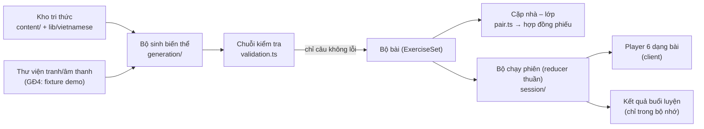

# ReadMate AI — Bộ máy bài tập (Exercise Engine)

> **Phiên bản:** 0.1 — Giai đoạn 4 (2026-10-15) · **Mã sinh bài:** `gd4.1`
> **Trạng thái:** mã nguồn, kiểm thử và bản chơi thử `/demo` hoàn tất; **toàn bộ nội dung vẫn chờ giáo viên duyệt**; hồ sơ lớp 1A2 **chưa xác nhận** → chế độ học thật hiện **không tạo được bài nào** (đúng thiết kế).
> **Tài liệu liên quan:** [PRD §9–§13](PRD.md#9-sáu-dạng-bài-tập-mvp) · [ARCHITECTURE §11](ARCHITECTURE.md#11-bộ-máy-bài-tập) · [VIETNAMESE_ENGINE.md](VIETNAMESE_ENGINE.md) · [DATA_MODEL §5](DATA_MODEL.md#5-lược-đồ-nội-dung-bài-tập)

Tài liệu này mô tả đúng những gì đã chạy được ở GĐ4. Phần dự kiến cho giai đoạn sau được ghi rõ "chưa làm".

## Mục lục

1. [Kiến trúc](#1-kiến-trúc)
2. [Sáu dạng bài đã xây dựng](#2-sáu-dạng-bài-đã-xây-dựng)
3. [Cấu trúc dữ liệu](#3-cấu-trúc-dữ-liệu)
4. [Hệ thống mức hỗ trợ H3 → H0](#4-hệ-thống-mức-hỗ-trợ-h3--h0)
5. [Chống lộ đáp án](#5-chống-lộ-đáp-án)
6. [Tạo biến thể bài tập](#6-tạo-biến-thể-bài-tập)
7. [Tích hợp Vietnamese Knowledge Engine](#7-tích-hợp-vietnamese-knowledge-engine)
8. [Quy tắc duyệt nội dung: chế độ demo và học thật](#8-quy-tắc-duyệt-nội-dung-chế-độ-demo-và-học-thật)
9. [Cách mở rộng dạng bài](#9-cách-mở-rộng-dạng-bài)
10. [Giới hạn hiện tại](#10-giới-hạn-hiện-tại)

---

## 1. Kiến trúc



Mỗi dạng bài là một **Exercise Type Module** (AD-06) gồm các phần tách rời:

| Thành phần | Tệp (trong `src/features/exercises/types/<dạng>/`) | Chạy ở đâu |
|---|---|---|
| Lược đồ zod (câu bài tập, có `superRefine` kiểm tra phương án/đáp án) | `schema.ts` | Máy chủ / lúc build |
| Định nghĩa biến thể: câu lệnh chuẩn, mục tiêu học tập, **chính sách âm thanh**, bản phiếu | `variants.ts` | Cả hai |
| **Runtime** — chấm (`grade`), câu trả lời đúng, kiểm tra đủ để chấm, **thang gợi ý**, phần hiện đáp án | `runtime.ts` | Trình duyệt **và** máy chủ (cùng một mã — server chấm lại ở GĐ7) |
| Module đầy đủ — **bộ kiểm tra riêng** (`validate`), chữ trẻ phải đọc, đơn vị hiển thị, khai báo chống lộ đáp án, **biểu diễn phiếu** | `module.ts` | Máy chủ / lúc build |
| Bộ sinh ứng viên | `generate.ts` | Máy chủ / lúc build |
| Giao diện (Player) | `Player.tsx` | Trình duyệt |

Tách `runtime` khỏi `module` để **zod và kho tri thức không lọt vào bundle của học sinh**: trang `/demo` tải ≈ 228 KB JS (gzip), trong đó phần bài tập ≈ 26 KB; trước khi tách là ≈ 270 KB.

Phần dùng chung (`src/features/exercises/core/`):

| Tệp | Nội dung |
|---|---|
| `primitives.ts` | Kiểu dùng chung (không import zod khi chạy): phương án, tranh, câu trả lời, kết quả chấm, gợi ý, mã lỗi kiểm tra |
| `schemas.ts` | Lược đồ zod dùng chung (`textOptionSchema`, `pictureRefSchema`, `itemBaseFields`, `responseSchema`, `refineOptions`) |
| `module.ts` | Giao diện `ExerciseTypeRuntime`, `ExerciseTypeModule`, `VariantDefinition`; 17 mã biến thể |
| `support.ts` | Bảng mức hỗ trợ H3 → H0 (nguồn duy nhất) |
| `audio.ts` | Chính sách âm thanh theo mục tiêu, `decideBeforeGrading` |
| `leaks.ts` | Bộ kiểm tra `TEXT_LEAKS_ANSWER`, `AUDIO_LEAKS_ANSWER` |
| `feedback.ts` | Lời phản hồi đúng/sai, chữ của gợi ý |
| `checks.ts` | Kiểm tra ngôn ngữ dùng chung, gọi bộ máy GĐ3 |
| `grading.ts`, `hints.ts`, `bands.ts`, `content-mode.ts`, `media.ts`, `worksheet.ts` | Chấm một/nhiều đáp án, gợi ý loại bớt, ràng buộc nhóm, chế độ nội dung, kiểu media, hợp đồng phiếu |

Ngoài ra: `items.ts` (hợp 6 lược đồ), `registry.ts` (module đầy đủ), `runtime-registry.ts` (phần chạy trên trình duyệt), `validation.ts` (chuỗi kiểm tra), `generation/` (bộ sinh), `session/` (bộ chạy phiên, kết quả), `ui/` (bộ chạy trên giao diện, lưới phương án, xem trước phiếu). Thành phần giao diện cho trẻ: `src/components/kid/` (thẻ chọn ≥ 64 px, tranh, dấu thanh SVG, nút âm thanh, phản hồi, tiến độ).

## 2. Sáu dạng bài đã xây dựng

Giữ đúng **sáu dạng bài đã phê duyệt** trong PRD §9 (D-008). Yêu cầu GĐ4 dùng các tên A–F; bảng đối chiếu:

| Yêu cầu GĐ4 | Dạng bài trong dự án (PRD) | Biến thể đã làm | Điều chỉnh |
|---|---|---|---|
| A — Nhận diện chữ | 1 `letter_sound` | `picture_onset` (nhìn tranh, chọn chữ ghi âm đầu), **`visual_match`** (tìm chữ giống chữ mẫu) | `visual_match` là biến thể bổ sung **trong** dạng 1 để phân biệt chữ dễ nhầm hình dạng (b/d/p, m/n/u, o/ô/ơ…) — không thêm dạng mới |
| B — Liên hệ chữ và âm | 1 `letter_sound` | `listen_letter` (nghe âm, chọn chữ) | Chưa có bản ghi âm GV đã duyệt → **chỉ xem giao diện**, không chấm được (§5.4) |
| C — Ghép tiếng | 2 `build_syllable` | `picture_build`, `parts_to_syllable` | — |
| (PRD dạng 3) | 3 `identify_unit` | `which_onset`, `which_rime`, `which_tone`, `find_with_unit` (nhiều đáp án) | Không có tên riêng trong A–F nhưng là dạng đã duyệt — giữ nguyên |
| D — Điền thành phần còn thiếu | 4 `fill_blank` | `missing_onset` (c/k, g/gh, ng/ngh), `missing_rime`, `missing_tone` | — |
| E — Ghép nối / tìm từ phù hợp | 5 `word_picture` | `choose_picture`, `match_pairs` (nối 3 từ – 3 tranh bằng chạm) | — |
| F — Đọc hiểu và vận dụng | 6 `sentence_reading` | `sentence_picture`, `comprehension_question`, `arrange_words` | Biến thể "Đọc câu – chọn Đúng/Sai" của PRD **chưa làm** |

| Dạng | Lộ trình phù hợp | Tương tác | Cách chấm |
|---|---|---|---|
| 1 Nhận diện chữ – âm | Khởi động (Vững bước ôn) | Chạm 1 trong 3 thẻ chữ | Đúng khi chọn đúng thẻ; thẻ lỗi theo cặp dễ nhầm (`confusion:c-k`, `shape:b-d`…) |
| 2 Ghép tiếng | Khởi động, Vững bước | Chạm thẻ âm đầu → vần → dấu (tiếng hiện dần); hoặc chọn tiếng đúng | Đúng khi cả ba nhóm thẻ đúng; đánh dấu đúng/sai **từng nhóm đã chọn** |
| 3 Tìm âm, vần, thanh | Vững bước (Khởi động: âm đầu) | Chọn 1 thẻ; hoặc chọn **nhiều** tiếng | Một đáp án; hoặc đúng khi chọn **đủ và không thừa** (thiếu → `selection:missed`) |
| 4 Điền phần còn thiếu | Vững bước, Tăng tốc | Chọn chữ/vần/dấu, chữ hiện vào chỗ trống | Một đáp án, **duy nhất nhờ quy tắc chính tả** (c/k…) hoặc nhờ tranh |
| 5 Đọc từ – chọn/nối hình | Cả ba (Khởi động: từ 1 tiếng) | Chọn tranh; hoặc chạm từ rồi chạm tranh (cặp được **đánh số**) | Một đáp án; hoặc đúng khi mọi cặp đúng |
| 6 Đọc câu – hiểu câu | Tăng tốc (Vững bước: câu ≤ 5 tiếng) | Chọn tranh / câu trả lời; hoặc chạm thẻ từ theo thứ tự | Một đáp án; hoặc thứ tự khớp một thứ tự được khai báo |

Trạng thái thực tế: 16/17 biến thể chơi được trong `/demo`; `listen_letter` chỉ xem giao diện. Mọi biến thể có bản phiếu tương đương, trừ `listen_letter` (PRD: chỉ có trên ứng dụng).

## 3. Cấu trúc dữ liệu

### 3.1 Một câu bài tập

```jsonc
{
  "id": "missing_onset.1x9k2a",          // ổn định theo seed, không chứa đáp án
  "type": "fill_blank", "variant": "missing_onset", "schemaVersion": 1,
  "objective": { "code": "apply_spelling_rule", "focusUnits": ["phoneme:c", "phoneme:k"], "ruleIds": ["spelling.c_k"] },
  "difficulty": 2,                         // ƯỚC LƯỢNG theo cấu tạo (estimateDifficulty)
  "requiredUnits": ["phoneme:k", "phoneme:e", "tone:hoi", "phoneme:c"],
  "source": { "corpusIds": ["syllable:kẻ"], "pictureIds": [], "fixtureIds": [] },
  "audio": { "instruction": { "spokenText": "Con chọn chữ còn thiếu để viết đúng tiếng nhé.", "assetId": null }, "stimulus": { … }, "model": { … } },
  "content": { "picture": null, "template": { "wordPrefix": "", "before": "", "after": "ẻ", "wordSuffix": "" }, "options": [ { "id": "o1", "text": "k", "unit": "phoneme:k" }, { "id": "o2", "text": "c", "unit": "phoneme:c" } ] },
  "answer": { "optionId": "o1", "result": "kẻ", "pictureName": null, "distractorTags": { "o2": "confusion:c-k" } }
}
```

- `content` là phần học sinh nhìn thấy — **giao diện chỉ nhận `content`** (qua `ItemView`), không có đáp án. Lược đồ `strictObject` từ chối mọi trường lạ, nên không thể vô tình thêm tên tranh vào `content`.
- `answer` là đáp án và thẻ lỗi; đáp án chỉ đến giao diện qua `reveal` **sau khi** câu đã chấm xong.
- `audio`: lời đọc dự kiến của từng khe + `assetId` (tệp đã có trong thư viện media; GĐ4 chưa có tệp nào → `null`).
- `source`: ngữ liệu, tranh, nội dung fixture mà câu dùng — để chặn nội dung chưa duyệt.

### 3.2 Câu trả lời của học sinh

`{ kind: "choice", optionId }` · `{ kind: "multi", optionIds }` · `{ kind: "build", onset, rime, tone }` · `{ kind: "match", pairs }` · `{ kind: "order", tokenIds }` — kiểm bằng `responseSchema` (khớp DATA_MODEL §5).

### 3.3 Kết quả chấm

`grade(item, response)` là hàm thuần: `{ correct, errorTags, marks }`. `marks` chỉ đánh dấu những gì trẻ **đã chọn** — không bao giờ đánh dấu phương án chưa chọn khi còn lượt (tránh lộ đáp án).

### 3.4 Hợp đồng dữ liệu bài tập (ở nhà ↔ phiếu ở lớp)

`ExerciseTaskContract` (`core/worksheet.ts`, dựng bằng `buildTaskContract`) có đủ 8 thông tin:

| Thông tin | Trường |
|---|---|
| Learning objective | `learningObjective` (mã, mô tả, đơn vị trọng tâm, quy tắc) |
| Exercise type | `exerciseType`, `variant` |
| Difficulty level | `difficulty` (bậc, trung bình, `basis: "structural_estimate"`, **lưu ý chưa kiểm chứng**) |
| Required knowledge | `requiredKnowledge` |
| Support level | `supportLevel` (ở nhà: theo lộ trình; ở lớp: **luôn H0**) |
| Answer key | `answerKey` (cho GV, in riêng) |
| Worksheet representation | `worksheet` (biểu tượng + câu lệnh **giống hệt ứng dụng**, các câu dạng in: tranh, chữ để khoanh, dòng viết) |
| Variant metadata | `variantMetadata` (seed, phiên bản bộ sinh, chế độ, hồ sơ, nhóm, bài, mã câu, nguồn) |

Chưa dựng PDF (GĐ8); `/demo` hiện **bản xem trước dạng trang web** của phiếu ở lớp sau khi làm xong một dạng bài.

### 3.5 Kết quả buổi luyện

`summarizeSession` (`session/results.ts`): số câu đã làm/đúng/đúng độc lập (lần đầu, không gợi ý), số câu phải xem đáp án, số lượt thử lại, số lần dùng gợi ý, số lần bấm Trợ giúp, mức hỗ trợ đã dùng, tỉ lệ hoàn thành, thời gian (ước lượng: đã trừ lúc trang bị ẩn). **Chỉ trong bộ nhớ của trang** — không lưu server, không `localStorage` (E2E kiểm tra).

Chỉ số nghiên cứu được ghi rõ nguồn:

| Câu hỏi nghiên cứu | Nguồn | GĐ4 |
|---|---|---|
| Học sinh có tự bắt đầu nhiệm vụ không? | Ứng dụng | Đếm câu trẻ chọn phương án **trước** khi bấm Gợi ý/Trợ giúp (không biết người lớn có nhắc hay không) |
| Có hoàn thành mà không cần gợi ý không? | Ứng dụng | Đếm câu xong mà không dùng gợi ý/trợ giúp (chưa đo được việc nghe lại hướng dẫn vì chưa có âm thanh) |
| Có làm đúng dạng bài tương tự trên phiếu giấy không? | **GV ghi nhận ở lớp** | Để trống — không suy ra từ điểm ở nhà (GĐ8) |
| GV cần hướng dẫn lại bao nhiêu lần? | **GV ghi nhận ở lớp** | Để trống (GĐ8) |

## 4. Hệ thống mức hỗ trợ H3 → H0

Nguồn duy nhất: `SUPPORT_POLICIES` (`core/support.ts`), đúng định nghĩa PRD §11.

| Mức | Câu lệnh | Cô làm mẫu | Gợi ý | Số lượt / câu | Bố cục |
|---|---|---|---|---|---|
| **H3** Hỗ trợ đầy đủ | Tự phát (khi có âm thanh) | Có — câu ví dụ đã giải trước dạng bài | **Tự hiện** sau mỗi lần sai + bấm được | 3 | Có hướng dẫn |
| **H2** Hỗ trợ một phần | Chạm loa | Không | Khi bấm "Gợi ý" | 3 | Có hướng dẫn |
| **H1** Hỗ trợ tối thiểu | Chỉ qua "Trợ giúp" (**tính là gợi ý**) | Không | Khi bấm "Gợi ý" | 2 | **Giống phiếu** (khung đen trắng) |
| **H0** Tự lực – Thử như ở lớp | Không phát | Không | **Không có** | 1 | Giống phiếu |

- Hết lượt → hiện đáp án kèm giải thích (A5); câu được ghi nhận "phải xem đáp án".
- Thang gợi ý mỗi dạng (`hints()` trong `runtime.ts`): ưu tiên gợi ý **bằng hình** — phóng to tranh, tô màu âm đầu/phần còn lại, tách tiếng bằng dấu chấm giữa, nêu quy tắc chính tả (nêu **cả hai** chữ c và k), đặt sẵn thẻ đầu câu và dấu chấm (bài sắp xếp), **loại bớt một phương án sai** (chỉ khi vẫn còn ≥ 2 phương án).
- Chống bấm nhiều lần: reducer bỏ qua hành động không hợp lệ; sau khi sai, phải chọn lại (hoặc bấm "Thử lại") mới kiểm tra được — bấm "Kiểm tra" hai lần không làm mất lượt (lỗi này được kiểm thử bắt và sửa trong GĐ4).
- Ở `/demo`, mức hỗ trợ do người lớn chọn (mặc định: Khởi động H3, Vững bước H2, Tăng tốc H1; phần "Thử như ở lớp" của buổi luyện mẫu luôn H0). **Chưa có** luật tự lên/xuống bậc (GĐ7).

## 5. Chống lộ đáp án

### 5.1 Chính sách âm thanh theo mục tiêu học tập

Không áp dụng máy móc một quy tắc cho mọi dạng bài: mỗi biến thể khai báo `audioPolicy` (`variants.ts`) — với mỗi khe `instruction` / `stimulus` / `options`, ở mỗi mức H3–H0: `allowed` · `hint` (chỉ khi bấm, tính là gợi ý) · `forbidden`; cùng `modelAfterGrading` (A4) và `required`.

| Nhóm mục tiêu | Biến thể | Khe kích thích (stimulus) | Lý do |
|---|---|---|---|
| **Nghe** | `listen_letter` | Phát ở **mọi mức**, kể cả H0 | Âm mục tiêu chính là nhiệm vụ — không phải lộ đáp án; âm đơn lẻ bắt buộc bản ghi âm GV (A7) |
| **Mã hóa / chính tả** | `picture_onset`, `picture_build`, `missing_*` | H3–H2 phát tên tranh/từ, H1 khi bấm (gợi ý), H0 không | Không phải kỹ năng đọc; ở lớp trẻ tự gọi tên tranh |
| **Phân tích** | `which_*` | Đọc tiếng chỉ là gợi ý ở H3–H2, tắt ở H1–H0 | PRD dạng 3 |
| **Đọc** | `parts_to_syllable`, `choose_picture`, `match_pairs`, `sentence_*`, `comprehension_question`, `arrange_words`, `find_with_unit`, `visual_match` | **Không bao giờ** trước khi chấm | A3: không đọc hộ chữ/từ/câu cần đọc; bài nhìn hình dạng chữ không biến thành bài nghe |

Không dạng nào đọc các phương án trước khi chấm. Câu lệnh: H3 tự phát, H2 chạm loa, H1 chỉ qua "Trợ giúp", H0 không.

### 5.2 Bộ kiểm tra `TEXT_LEAKS_ANSWER` và `AUDIO_LEAKS_ANSWER`

Mỗi module khai báo **chữ nào được hiển thị/đọc ở trường nào** và **dạng đáp án nào bị cấm ở đâu** (`textExposure`, `audioExposure`); bộ kiểm tra (`core/leaks.ts`) so khớp theo **chuỗi tiếng** (NFC, không phân biệt hoa thường, bỏ dấu câu): "c" không khớp "cá", "cá" khớp "Con cá bơi.".

- Chữ được soát gồm: câu lệnh, chữ kích thích, nhãn phương án, **nhãn tranh cho trình đọc màn hình** (luôn trung tính "Hình 1, 2, 3" trước khi chấm), mọi câu gợi ý, mọi lời phản hồi khi còn lượt.
- Ví dụ khác nhau theo mục tiêu: tên tranh "cá" bị cấm ở mọi trường của bài nhìn tranh; từ "ba lô" được phép ở chữ kích thích và gợi ý của bài đọc từ nhưng bị cấm ở nhãn tranh; câu hỏi đọc hiểu không được chứa câu trả lời; thẻ từ chưa xáo thứ tự là lộ đáp án; khuôn điền dấu với tiếng thanh ngang (khuôn = đáp án) bị chặn.
- Âm thanh: khe nào có thể phát **trước khi chấm** ở bất kỳ mức nào thì lời đọc bị soát; khe bị cấm ở mọi mức mà câu vẫn khai báo lời đọc → `AUDIO_ROLE_FORBIDDEN`; với bài đọc câu, lời đọc không được chứa bất kỳ cụm ≥ 2 tiếng liên tiếp nào của câu. Âm thanh mẫu sau khi chấm không bị soát (A4).

| Quy tắc PRD | Hiện thực |
|---|---|
| A1 | Câu lệnh chuẩn chỉ mô tả việc cần làm; bộ kiểm tra soát lời đọc câu lệnh |
| A2 | `audioPolicy` theo vai trò × mức × trước/sau chấm |
| A3 | Bài đọc: `stimulus`/`options` = `forbidden` ở mọi mức; soát cụm từ của câu |
| A4 | `modelAfterGrading`; giao diện chỉ hiện đáp án và tên tranh sau khi chấm |
| A5 | Phản hồi khi còn lượt không có đáp án; hết lượt mới hiện |
| A6 | `checkTextLeaks` / `checkAudioLeaks` **chặn** (lỗi) — câu không qua được bộ sinh |
| A7 | `listen_letter` bắt buộc khe `stimulus` có tệp đã duyệt; thiếu → `MISSING_AUDIO` |

### 5.3 Âm thanh ở GĐ4

**Chưa có tệp âm thanh nào** (GĐ6). Mọi nút loa là điểm tích hợp `AudioSlot` **bị khóa**, ghi rõ "Chưa có âm thanh"; chỉ hiện khi chính sách cho phép khe đó ở mức hiện tại. Không giả lập phát âm thanh; **không dùng giọng đọc của trình duyệt** (Web Speech API) dù PRD §12.2 cho phép ở `/demo` — vì giọng tiếng Việt trên Chrome có thể gửi chữ ra máy chủ bên ngoài và chất lượng chưa xác minh (quyết định D-040). Bộ sinh gắn `assetId` khi thư viện media có tệp cùng vai trò + cùng lời đọc.

### 5.4 Bài "Nghe âm – chọn chữ"

Thiếu âm thanh bắt buộc → lỗi `MISSING_AUDIO`. Chỉ khi nơi gọi cho phép rõ (`allowMissingRequiredAudio`, **chỉ ở chế độ demo**) câu mới được đánh dấu `previewOnly`: hiện giao diện, nút "Kiểm tra" bị khóa, ghi chú rõ lý do.

## 6. Tạo biến thể bài tập

`generateExerciseSet(request)` (`generation/generate.ts`):

1. **Chặn theo chế độ** (§8) → `PROFILE_NOT_CONFIRMED` / `DEMO_REQUIRES_ILLUSTRATIVE_PROFILE`; hồ sơ không có tiến độ → `PROFILE_NOT_USABLE`.
2. **Bối cảnh** (`buildContext`): từ, câu, tiếng có thật trong ngữ liệu (lọc theo trạng thái duyệt của chế độ), đọc được bằng kiến thức đã học của nhóm; tranh có trong thư viện; danh sách âm/vần/thanh đã học.
3. **Ứng viên hữu hạn** theo từng dạng bài (một tranh, một tiếng, một câu, một vần…) — không sinh tổ hợp ngẫu nhiên vô hạn.
4. Xáo thứ tự ứng viên bằng **seed**; mỗi ứng viên dựng bằng rng riêng (seed + khóa ứng viên) → thêm/bớt ứng viên khác không làm đổi câu đã sinh. RNG: FNV-1a + mulberry32 (`generation/rng.ts`); không dùng `Math.random()`.
5. **Phương án nhiễu** (`rankedAlternatives`): cặp dễ nhầm trong `confusions.json` trước (c/k, g/gh, ng/ngh, b/d, an/ang, hỏi/ngã…), rồi nhóm "giống" (cùng chữ đầu, chứa nhau, cùng âm chính/âm cuối, nhóm hình dạng chữ), rồi phần còn lại — chỉ trong đơn vị **đã học**. Vị trí đáp án được xáo; mã phương án (o1, o2…) gán theo vị trí sau khi xáo.
6. **Mỗi câu qua toàn bộ chuỗi kiểm tra** (§7); câu lỗi bị loại và ghi lý do (`diagnostics.rejected`, `rejectedByCode`).
7. Thiếu câu → `INSUFFICIENT_CONTENT` kèm `shortfall` ("Chỉ tạo được 2/6 câu…") — không nới quy tắc.

Nguyên tắc của từng dạng: bài "chọn tiếng đúng" chỉ lấy phương án nhiễu từ **tiếng có thật trong ngữ liệu** (không tự tạo tiếng vô nghĩa); bài điền vần tránh ghép ra tiếng xưng hô thiếu lịch sự ("tao", "mày"); bài sắp xếp câu loại câu có dấu phẩy hoặc từ lặp (có thể có nhiều thứ tự đúng chưa khai báo); câu hỏi đọc hiểu **chỉ lấy từ fixture khai báo sẵn**, bộ máy không tự đặt câu hỏi.

### Cặp bài ở nhà – bài ở lớp

`generateHomeClassPair` (`generation/pair.ts`) ghép **"bài sinh đôi"**: sinh một kho câu hợp lệ, rồi với mỗi câu ở nhà tìm một câu **khác mục tiêu cụ thể** nhưng **cùng nhóm đơn vị trọng tâm** và độ khó ước lượng chênh ≤ 1. Nhóm trọng tâm được định nghĩa theo sư phạm: âm đầu (nhìn tranh chọn chữ), cả nhóm chữ dễ nhầm hình dạng (b/d/p…), vần của tiếng (ghép tiếng), cặp quy tắc (c/k), nhóm vần dễ nhầm hoặc cùng âm chính (tìm tiếng có vần), thanh (điền dấu); bài đọc dùng mục tiêu kỹ năng chung. Nếu dãy đáp án ở lớp trùng y hệt ở nhà thì đổi thứ tự. Trả về `equivalence` (cùng mục tiêu, danh sách cặp sinh đôi, độ khó hai bên, mục tiêu trùng = rỗng, đáp án có trùng y hệt không) và **lưu ý: độ khó tương đương chỉ là ước lượng, chưa kiểm chứng bằng dữ liệu thật**. Không đủ cặp → `INSUFFICIENT_CONTENT_FOR_PAIR` kèm lý do; bài ở nhà vẫn dùng được.

## 7. Tích hợp Vietnamese Knowledge Engine

| Bước của chuỗi kiểm tra (`validation.ts`) | Dùng gì của GĐ3 | Mã lỗi |
|---|---|---|
| 1. Lược đồ | zod | `SCHEMA_INVALID` |
| 2. Hồ sơ hợp với chế độ | `resolveKnowledgeState` | `PROFILE_NOT_CONFIRMED` |
| 3. Unicode | `inspectText` | `NOT_NFC`, `TEXT_ISSUE` |
| 4. Chỉ dùng điều đã học | `checkReadability` (cho mọi chữ trẻ phải đọc), tập `allowedForPractice` (cho thẻ chữ/vần/dấu); **`unknown` luôn là lỗi** | `CONTENT_NOT_TAUGHT`, `CONTENT_UNVERIFIED`, `CONTENT_INVALID`, `UNIT_NOT_TAUGHT` |
| 5. Kiểm tra riêng của dạng | `diagnoseSyllable`, `analyzeSyllable`, `composeSyllable` (mới, `lib/vietnamese/compose.ts`), quy ước của hồ sơ (qu, gi, kiểu đặt dấu) | `AMBIGUOUS_ANSWER`, `ANSWER_MISMATCH`, `DISTRACTOR_IS_CORRECT`, `ANSWER_NOT_IN_TEXT`, `DISTRACTOR_IN_TEXT`, `ORDER_MAY_HAVE_ALTERNATIVES`, `SPELLING_INVALID`, `CONVENTION_REQUIRED` |
| 6. Chống lộ đáp án | `tokenize`, `toLowerVi` | `TEXT_LEAKS_ANSWER`, `AUDIO_LEAKS_ANSWER`, `AUDIO_ROLE_FORBIDDEN` |
| 7. Tranh, âm thanh | Thư viện media | `MISSING_IMAGE`, `MISSING_AUDIO`, `AUDIO_NOT_AVAILABLE` (cảnh báo) |
| 8. Trạng thái duyệt | Trạng thái ngữ liệu, tranh, fixture, **dữ liệu tham chiếu** (chữ, âm, thanh, vần, quy tắc) | `CONTENT_NOT_APPROVED`, `DEMO_UNREVIEWED_CONTENT` (cảnh báo) |
| 9. Ràng buộc nhóm | `BAND_CONSTRAINTS`: Nhóm 3 ≤ 3 phương án, từ 1 tiếng, câu ≤ 4 tiếng; Nhóm 2 ≤ 4, từ ≤ 2 tiếng, câu ≤ 5; Nhóm 1 ≤ 4, từ ≤ 3, câu ≤ 8 | `BAND_CONSTRAINT` |

Ví dụ đáp án duy nhất: bài điền chữ không tranh chỉ hợp lệ khi **đúng một** phương án ghép ra tiếng viết đúng (`_ẻ` + c/k → chỉ "kẻ"); "_à" + b/d (cả "bà", "dà" đều viết đúng) bị chặn `AMBIGUOUS_ANSWER`. Bài ghép tiếng duyệt **mọi tổ hợp thẻ** để chắc chỉ một tổ hợp ra tên tranh. Bài "chọn các tiếng có vần…" tính lại tập đáp án bằng bộ phân tích và so với tập khai báo.

`composeSyllable` ghép âm đầu + vần + thanh rồi **phân tích lại** (khứ hồi): phép ghép bị đọc khác đi ("g" + "ia" → "gi" + "a") bị coi là mơ hồ; vần phụ thuộc kiểu đặt dấu (oa, oe, uy không âm cuối) cần kiểu đặt dấu của hồ sơ, không tự quyết.

## 8. Quy tắc duyệt nội dung: chế độ demo và học thật

| | `demo` — Bản chơi thử | `production` — Học thật |
|---|---|---|
| Hồ sơ lớp | **Chỉ hồ sơ minh họa** (`status: "illustrative"`); hồ sơ lớp thật bị từ chối | **Bắt buộc `confirmed`** |
| Ngữ liệu, tranh, câu hỏi fixture, dữ liệu tham chiếu | `approved` hoặc `pending_review` (kèm cảnh báo); `draft`/`rejected` bị chặn | **Chỉ `approved`**; tranh `demo_fixture` luôn bị chặn |
| Âm thanh bắt buộc | Thiếu câu lệnh → cảnh báo; thiếu âm bắt buộc → chặn (chỉ xem giao diện nếu cho phép rõ) | Thiếu tệp đã duyệt → **chặn** |
| Lưu dữ liệu | Không (chỉ bộ nhớ trang) | GĐ7 |
| Tài khoản, AI, dữ liệu cá nhân | Không | Không có trong GĐ4 |

- Không bao giờ tự chuyển `pending_review` → `approved`; bộ máy không có đường nào ghi trạng thái duyệt.
- Với dữ liệu thật hiện nay (0 mục đã duyệt, hồ sơ 1A2 chưa xác nhận), chế độ học thật trả **"không có bài hợp lệ"** — có kiểm thử. Kiểm thử chế độ học thật dùng hồ sơ và kho "đã duyệt" **giả lập trong bộ nhớ** để chứng minh cổng chặn chỉ cho nội dung đã duyệt đi qua; không sửa `content/`.
- **Fixture của bản chơi thử** (`src/features/demo/practice-fixture.ts`) khai báo riêng 22 tranh minh họa và 8 câu hỏi đọc hiểu, tất cả `pending_review`, có nguồn/giấy phép và ghi chú cách gọi dễ nhầm — **không** làm thay đổi trạng thái duyệt của kho tri thức chính.
- Tranh minh họa: biểu tượng của **lucide-react 1.55.0** (ISC; một phần gốc Feather — MIT), đã là phụ thuộc của dự án, tự host. Mỗi tranh có `clarityNote` (ví dụ "quả cam" có thể bị gọi là "quả chanh") để GV xem khi duyệt.
- `/demo` dùng hồ sơ minh họa ở **bài MH16** của chuỗi minh họa (Khởi động tính đến MH15) — ghi rõ trên trang.

## 9. Cách mở rộng dạng bài

1. Tạo `src/features/exercises/types/<dạng>/` với `schema.ts` (lược đồ `strictObject` + `superRefine` dùng `refineOptions`), `variants.ts` (câu lệnh chuẩn, mục tiêu, **chính sách âm thanh có lý do**, bản phiếu), `runtime.ts` (không import zod/kho tri thức), `module.ts` (`validate` dùng `core/checks.ts`; `textExposure`/`audioExposure` khai báo theo mục tiêu; `worksheet`), `generate.ts` (ứng viên hữu hạn), `Player.tsx` (chỉ dùng `view.content`, vùng chạm ≥ 64 px, không truyền tin chỉ bằng màu).
2. Thêm mã vào `ExerciseTypeCode` (`src/types/learning.ts`), `VARIANT_IDS`, `OBJECTIVE_CODES` nếu cần; đăng ký ở `items.ts`, `registry.ts`, `runtime-registry.ts`, `generation/generate.ts` (`BUILDERS`), `ui/item-player.tsx`; thêm vào `catalog.ts`.
3. Câu chữ giao diện (gợi ý, phản hồi) vào `src/strings/vi.ts` — bộ kiểm tra chống lộ đáp án soát cả các câu này.
4. Viết test: lược đồ (hợp lệ/thiếu phương án/đáp án không tồn tại/trùng), chấm (mọi câu sinh ra: đúng → đúng, mọi câu sai → sai), kiểm tra riêng, chống lộ đáp án, chính sách âm thanh; thêm biến thể vào E2E nếu có Player mới.
5. Chạy đủ: `format:check`, `lint`, `typecheck`, `content:check`, `test:run`, `build`, `test:e2e`.

## 10. Giới hạn hiện tại

1. **Toàn bộ nội dung chưa được GV duyệt**; hồ sơ 1A2 chưa xác nhận → chế độ học thật chưa tạo được bài nào. `/demo` chỉ là bản chơi thử với dữ liệu minh họa.
2. **Chưa có âm thanh** (GĐ6): không có câu lệnh đọc, không có âm mẫu; `listen_letter` chỉ xem giao diện. Học sinh chưa biết đọc cần người lớn đọc câu lệnh khi thử.
3. **Tranh** là biểu tượng minh họa tạm (22 tranh), chưa được GV xác nhận rõ nghĩa; số tranh ít làm giới hạn bài có tranh (ví dụ bài điền vần chỉ có 9 ứng viên ở Nhóm 2).
4. **Độ khó** là ước lượng theo cấu tạo; "tương đương" giữa bài ở nhà và ở lớp chưa được kiểm chứng bằng dữ liệu thử nghiệm.
5. Bộ so khớp chống lộ đáp án **thận trọng hơn cần thiết**: tiếng trùng với lời xưng hô "con" hay động từ "đọc" trong câu lệnh/phản hồi bị loại khỏi một số bài (ví dụ tìm thanh của tiếng "con"). Xem lại khi GV chọn cách xưng hô (Q-08).
6. Nhóm chữ dễ nhầm hình dạng (`SHAPE_GROUPS`: o/ô/ơ, a/ă/â, e/ê, u/ư, d/đ, h/k, l/t) là heuristic của bộ sinh, **chưa có trong `confusions.json`** và chưa được GV duyệt.
7. Câu hỏi đọc hiểu chỉ có 8 câu trong fixture demo; bộ máy không tự đặt câu hỏi. Bài sắp xếp câu chỉ chấp nhận thứ tự của câu gốc (câu có thể có nhiều thứ tự bị loại).
8. Chưa có: luật tự điều chỉnh mức hỗ trợ, ôn tập Leitner, câu bắc cầu, "Thử thách" (GĐ7); lưu kết quả, server chấm lại (GĐ7); PDF (GĐ8); bộ biểu tượng hướng dẫn SVG riêng (đang dùng biểu tượng lucide — in đen trắng vẫn rõ); danh sách chặn từ ngữ đầy đủ (GĐ6); biến thể Đúng/Sai của dạng 6.
9. Thời gian làm bài chỉ là ước lượng (gồm lúc trẻ nghỉ hoặc người lớn giải thích).
