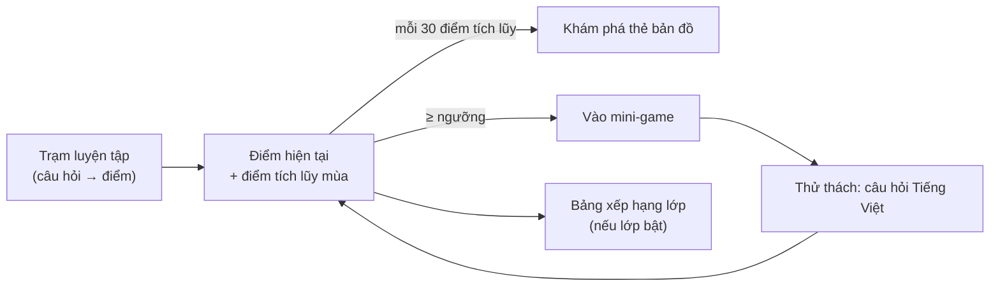
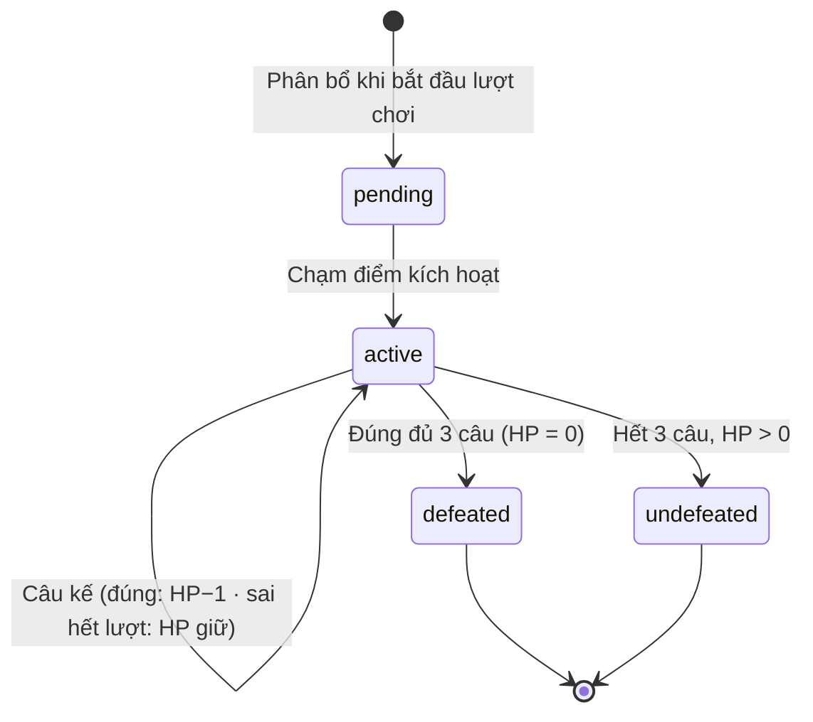

# ReadMate AI — Thiết kế trò chơi và Game Engine

> **Trạng thái:** thiết kế R01 (2026-10-16). **R02 (2026-10-20) đã hiện thực phần hình ảnh và giao diện Game World với dữ liệu minh họa** — bản đồ, 4 thẻ khu vực, mốc khám phá, nhân vật/quái vật/avatar SVG (bản phác thảo chờ GV duyệt), xem [§15](#15-biểu-diễn-hình-ảnh-r02). **Chưa có game chơi được, chưa có Game Engine.** Hiện thực dự kiến: R02 (Game World, giao diện), R07 (Mê cung kho báu, điều khiển nhân vật), R08 (quái vật, chạm trán bằng câu hỏi), R09 (ba game còn lại).
> Mọi con số điểm, HP, ngưỡng vào game lấy từ [GAMIFICATION_SPEC.md §1](GAMIFICATION_SPEC.md#1-hằng-số-chính-thức) — tài liệu này không định nghĩa lại.
> **Tài liệu liên quan:** [PRODUCT_REDESIGN.md](PRODUCT_REDESIGN.md) · [REDESIGN_ARCHITECTURE.md](REDESIGN_ARCHITECTURE.md) · [EXERCISE_ENGINE.md](EXERCISE_ENGINE.md) · [PRIVACY_AND_SECURITY.md](PRIVACY_AND_SECURITY.md)

## Mục lục

1. [Định hướng hình ảnh và cảm xúc](#1-định-hướng-hình-ảnh-và-cảm-xúc)
2. [Thế giới phiêu lưu (Game World)](#2-thế-giới-phiêu-lưu-game-world)
3. [Quy tắc chung của thử thách](#3-quy-tắc-chung-của-thử-thách)
4. [Mini-game 1 — Mê cung kho báu](#4-mini-game-1--mê-cung-kho-báu)
5. [Quái vật thân thiện](#5-quái-vật-thân-thiện)
6. [Ba mini-game tiếp theo](#6-ba-mini-game-tiếp-theo)
7. [Câu hỏi trong game](#7-câu-hỏi-trong-game)
8. [Trợ năng, giảm chuyển động và an toàn cảm xúc](#8-trợ-năng-giảm-chuyển-động-và-an-toàn-cảm-xúc)
9. [Bố cục theo thiết bị](#9-bố-cục-theo-thiết-bị)
10. [Lựa chọn công nghệ](#10-lựa-chọn-công-nghệ)
11. [Kiến trúc Game Engine](#11-kiến-trúc-game-engine)
12. [Asset, âm thanh và giấy phép](#12-asset-âm-thanh-và-giấy-phép)
13. [Kiểm thử](#13-kiểm-thử)
14. [Câu hỏi mở](#14-câu-hỏi-mở)
15. [Biểu diễn hình ảnh (R02)](#15-biểu-diễn-hình-ảnh-r02)

---

## 1. Định hướng hình ảnh và cảm xúc

**Modern 2D Educational Adventure – Colorful, Friendly, Premium EdTech.**

| Khía cạnh | Định hướng |
|---|---|
| Phong cách | Minh họa 2D phẳng có chiều sâu nhẹ (bóng mềm, lớp cảnh trước/sau), nét bo tròn, bảng màu tươi nhưng không chói; nhân vật hoạt hình hình người với tỉ lệ đầu lớn, biểu cảm rõ |
| Bản sắc | Bối cảnh gần gũi Việt Nam (lũy tre, cánh đồng, mái ngói, đảo biển, lâu đài cổ tích) — không sao chép hình từ SGK hay thương hiệu khác |
| Không chỉ là thẻ màu | Mỗi khu vực có **cảnh minh họa** riêng, nhân vật dẫn đường, hoạt cảnh chuyển cảnh; biểu tượng lucide chỉ còn dùng cho điều khiển phụ (cài đặt, âm lượng), không làm nội dung chính |
| Cảm xúc mục tiêu | Tò mò, tự hào, an toàn. Không gay cấn, không sợ hãi, không áp lực thời gian |
| Nhất quán | Một bộ token thiết kế (màu, bo góc, bóng, chuyển động) dùng chung cho trang học sinh, game và trang GV; khu vực GV dùng phiên bản trầm, nhiều thông tin hơn |
| Chữ cần đọc | Font Andika (giữ AD-21), cỡ lớn, nền tương phản cao; không chữ cách điệu cho nội dung học |

## 2. Thế giới phiêu lưu (Game World)

- Trang chủ của học sinh (`/learn`) là **bản đồ thế giới** cuộn được, gồm các **thẻ bản đồ** (ô cảnh) phủ sương mù. Đề xuất bản đồ mùa đầu: **24 thẻ** (tham số theo bản đồ; mùa sau có thể đổi bản đồ).
- Trên bản đồ có:
  - **Trạm luyện tập** (luôn mở): vào buổi luyện tập hằng ngày — nguồn điểm chính.
  - **Lối vào 4 mini-game**: luôn hiện, có ổ khóa và ngưỡng điểm ([GAMIFICATION_SPEC §7](GAMIFICATION_SPEC.md#7-điều-kiện-vào-mini-game)).
  - **Ô điểm** và **số thẻ có thể khám phá** (ví dụ "Con có 1 ô bản đồ mới để khám phá!").
  - Lối tới **bảng xếp hạng lớp** (khi lớp bật) và **góc của con** (avatar, hình dán).
- Khám phá thẻ: chạm một ô sương mù kề vùng đã mở → hoạt cảnh mây tan → lộ cảnh, nhân vật phụ hoặc hình dán. Không có phần thưởng ngẫu nhiên kiểu "hộp quà may rủi".
- Học sinh **không** thấy tên nhóm năng lực hay lộ trình (Khởi động / Vững bước / Tăng tốc chỉ GV và phụ huynh thấy — D-025).



## 3. Quy tắc chung của thử thách

Áp dụng cho cả bốn mini-game:

| Quy tắc | Nội dung |
|---|---|
| Số thử thách mỗi màn | Mê cung: **đúng 7**; các game khác: **tối đa 7** |
| Câu hỏi mỗi thử thách | **Đúng 3 câu riêng biệt** (khác nội dung câu, khác `exercise_item_id`); 21 câu của một màn đôi một khác nhau |
| Điểm | Đúng +10, sai −5 (sàn 0) — theo [GAMIFICATION_SPEC](GAMIFICATION_SPEC.md) |
| Không điểm vô hạn | Câu của màn được **phát hành một lần** khi bắt đầu lượt chơi; không sinh câu thay thế; mỗi màn chỉ một lượt **tính điểm** mỗi mùa |
| Nội dung | Từ bộ máy bài tập GĐ4 ở chế độ `production`: chỉ nội dung `approved`, chỉ âm/vần/thanh đã học, theo nhóm năng lực (server quyết, học sinh không thấy) |
| Tạm dừng | Có nút Tạm dừng lớn ở mọi màn; thoát giữa chừng không bị trừ điểm |
| Thời gian | Không đồng hồ đếm ngược, không giới hạn thời gian trả lời |

## 4. Mini-game 1 — Mê cung kho báu

### 4.1 Bản đồ màn chơi

- Mê cung dạng **lưới ô** (đề xuất 9×9 đến 13×13 ô tùy màn), gồm: tường, đường đi, điểm xuất phát, **kho báu** và đúng **7 điểm kích hoạt** ẩn trên đường đi.
- Dữ liệu màn là **dữ liệu khai báo** (JSON có lược đồ zod) trong repo: `content/games/treasure-maze/levels/*.json` (dự kiến). Bộ kiểm tra màn chơi (chạy trong CI) chứng minh: mọi ô đường đi liên thông; 7 điểm kích hoạt nằm trên đường đi, đôi một khác nhau, không trùng xuất phát/kho báu; kho báu tới được.
- Điểm kích hoạt **không hiển thị** trước (để có bất ngờ), nhưng đường đến kho báu buộc đi qua đủ 7 điểm (thiết kế màn) hoặc kho báu chỉ mở khi đã giải quyết đủ 7 cuộc chạm trán (luật — xem §4.6). Luật là bảo đảm chính; thiết kế màn chỉ là hỗ trợ.

### 4.2 Điều khiển nhân vật

| Thiết bị | Cách điều khiển |
|---|---|
| Điện thoại, máy tính bảng | **Bốn nút mũi tên lớn** trên màn hình (mỗi nút ≥ 64 px, khoảng cách ≥ 12 px), giữ để đi liên tục (lặp có giới hạn tốc độ) |
| Máy tính | Phím **mũi tên** (và W A S D); nút mũi tên trên màn hình vẫn bấm được bằng chuột |
| Trình đọc màn hình | Nút có nhãn "Đi lên/xuống/sang trái/sang phải"; thông báo ngắn sau mỗi bước ("Có tường bên phải") qua vùng `aria-live` lịch sự |

- Đi theo **từng ô**; va tường → nhân vật khựng nhẹ (không âm thanh chói, không rung mạnh). Không bắt buộc kéo–thả hay vuốt (AD-16).
- Chuyển động mỗi bước 160–220 ms (nội suy vị trí bằng `transform`), có hoạt cảnh bước chân; chế độ giảm chuyển động: nhảy ô tức thì, không nội suy.

### 4.3 Kích hoạt chạm trán

1. Nhân vật bước vào một điểm kích hoạt **chưa dùng** → client gửi sự kiện kích hoạt (mã điểm kích hoạt + vị trí) tới server.
2. Server kiểm tra: lượt chơi của học sinh, đang `in_progress`, điểm kích hoạt thuộc màn và chưa được dùng, số cuộc chạm trán đã mở < 7 → mở cuộc chạm trán kế tiếp (đã được phân bổ sẵn khi bắt đầu lượt chơi — §4.7) và lưu **vị trí quay lại**.
3. Hiệu ứng **phép thuật**: lấp lánh xoáy, quái vật hiện dần từ làn sáng (≤ 1,2 giây, không nhấp nháy, không tiếng động giật mình) → chuyển sang **màn thử thách**.

Quái vật **không có sẵn** trên bản đồ; chỉ xuất hiện khi kích hoạt.

### 4.4 Màn thử thách

```text
┌────────────────────────────────────────┐
│  [Tạm dừng]                 ⭐ 120 điểm │
│                                        │
│        (quái vật dễ thương)            │
│           ❤ ❤ ❤   (3 HP)               │
│                                        │
│   Câu 1/3 — Player của dạng bài        │
│   (dùng lại Player GĐ4: thẻ ≥ 64 px)    │
│                                        │
│          [ Kiểm tra ]                  │
└────────────────────────────────────────┘
```

- Mỗi cuộc chạm trán có **đúng 3 câu riêng biệt**, làm lần lượt. Câu dùng lại **Player của 6 dạng bài** (GĐ4) bên trong khung thử thách — cùng câu lệnh, cùng chính sách âm thanh chống lộ đáp án.
- **Đúng**: +10 điểm, quái vật **mất 1 HP** (một trái tim chuyển sang viền rỗng kèm hoạt cảnh nhẹ), sang câu kế.
- **Sai**: −5 điểm (sàn 0), **HP không đổi**, được thử lại trong giới hạn số lượt của câu ([GAMIFICATION_SPEC §4.3](GAMIFICATION_SPEC.md#43-số-lượt-tối-đa-mỗi-câu)); gợi ý theo mức hỗ trợ của học sinh (H3 tự hiện, H2/H1 khi bấm, H0 không có; không có "Cô làm mẫu" trong game).
- Câu hết lượt mà chưa đúng: hiện đáp án và âm thanh mẫu (nếu được phép), HP không đổi, sang câu kế. **Không sinh câu thay thế.**
- Trái tim không truyền tin chỉ bằng màu: trái tim đầy / viền rỗng + nhãn "Quái vật còn 2 trái tim".

### 4.5 Kết thúc cuộc chạm trán



| Kết quả | Hoạt cảnh | Hệ quả |
|---|---|---|
| **Đánh bại** (đúng cả 3 câu) | Quái vật cười, xoay một vòng rồi **biến thành các ngôi sao** bay lên; lời khen | Cuộc chạm trán `defeated`; hình dán quái vật vào bộ sưu tập |
| **Chưa đánh bại** | Quái vật ngáp, vẫy tay rồi **bay đi ngủ** ("Hẹn gặp lại nhé!") — không có hình ảnh thua cuộc | Cuộc chạm trán `undefeated`; **không** sinh thêm câu hỏi |

Sau cả hai kết quả: chuyển cảnh ngược → nhân vật **đứng đúng vị trí đã lưu** trong mê cung; điểm kích hoạt đó đã dùng, không kích hoạt lại.

### 4.6 Kho báu

- Kho báu **chỉ mở** khi **đủ 7 cuộc chạm trán đã kết thúc** (đánh bại hoặc chưa đánh bại). Server kiểm tra khi client gửi "mở kho báu".
- Nếu nhân vật tới kho báu sớm: rương khóa, hiện "Còn 3 bạn quái vật đang chờ con" (đếm cuộc chạm trán chưa diễn ra, không chỉ chỗ).
- Mở kho báu: hoạt cảnh rương mở, hình dán/vật trang trí cho bản đồ. **Không cộng điểm** (điểm chỉ đến từ câu hỏi).
- Màn kết thúc: tóm tắt nhẹ nhàng "Con đã gặp 7 bạn quái vật, đánh bại 5 bạn" — không so sánh với bạn khác.

### 4.7 Lưu tiến độ, tạm dừng và tiếp tục

- **Bắt đầu lượt chơi**: server tạo `game_runs` + đúng **7** `game_encounters` (`encounter_no` 1–7) + **21** câu phát hành (3 câu × 7, đôi một khác nhau). Nếu không đủ nội dung đã duyệt để có 21 câu hợp lệ → **không** tạo lượt chơi, trả `INSUFFICIENT_CONTENT` ("Màn này đang được chuẩn bị") — không nới quy tắc (CLAUDE.md §9.3.3).
- Ràng buộc CSDL: `check (encounter_no between 1 and 7)`, `unique (run_id, encounter_no)` → **không thể có cuộc chạm trán thứ tám** ([REDESIGN_ARCHITECTURE §5.3](REDESIGN_ARCHITECTURE.md#53-game)).
- Lưu tự động: sau **mỗi câu trả lời** (trong giao dịch ghi điểm), khi kích hoạt chạm trán, và vị trí nhân vật theo điểm lưu (mỗi 5 bước hoặc 3 giây, khi tạm dừng, khi trang bị ẩn).
- **Tạm dừng**: phủ mờ màn, nút "Chơi tiếp" / "Về bản đồ"; không trừ điểm, không đếm giờ.
- **Thoát / tải lại / mất mạng**: vào lại màn → server trả trạng thái lượt chơi (vị trí, cuộc chạm trán đang dở, câu đang mở và số lượt đã dùng). Đang ở giữa cuộc chạm trán thì quay lại đúng câu đó.
- Mất mạng lúc nộp đáp án: client giữ `client_attempt_id` và gửi lại khi có mạng; server trả cùng kết quả (không trừ hai lần).

### 4.8 Chơi lại màn đã hoàn thành

- Mỗi màn có **một lượt chơi tính điểm mỗi mùa**. Sau khi hoàn thành (hoặc khi mùa mới bắt đầu), học sinh có thể **chơi lại để vui**: câu hỏi vẫn chấm và có phản hồi nhưng **không tính điểm** ("Chơi lại — không tính điểm" hiển thị rõ trước khi vào).
- Màn kế tiếp mở khi hoàn thành màn trước (đề xuất 3 màn mỗi game ở bản đầu).

### 4.9 Hiện thực giao diện (R08.4)

- **Dừng → lưu → kích hoạt.** Bản đồ đóng gói (`content/games/treasure-maze`) chỉ dùng để *dừng* nhân vật tại điểm kích hoạt. Ở điểm kích hoạt chưa dùng, `EncounterGate` buộc bộ tự lưu gửi hết bước (`flushAndWait`) và **chỉ khi máy chủ xác nhận** mới gọi `POST …/encounters/activate` (không gửi tọa độ/mã điểm). Lưu hỏng → không kích hoạt, hiện "Thử lại"; nhân vật vẫn bị chặn đi tiếp. Mọi quyết định (chạm trán nào, đã xong chưa, HP, điểm, 7/7) vẫn do máy chủ; `ENCOUNTER_FINISHED`/`NOT_AT_TRIGGER` chỉ gỡ chặn.
- **Điểm đã dùng.** `GET …/encounter` trả thêm `resolvedTriggerKeys` (mã điểm kích hoạt của chạm trán **đã kết thúc** — không tọa độ, không chạm trán chưa gặp) để sau khi tải lại nhân vật không bị dừng lại ở điểm cũ. Bản đồ không vẽ trước/đánh dấu điểm kích hoạt nào.
- **Màn quái vật** là hộp thoại toàn màn hình (`role="dialog" aria-modal`, bàn chơi phía sau `inert`, giữ Tab trong hộp thoại, Esc không đóng): quái vật (SVG `FriendlyMonster` đổi màu theo `monsterKey`, tên từ danh mục an toàn `vi.monsters`), `HeartIndicator` với nhãn chữ "Bạn quái vật còn n trong 3 trái tim.", điểm hiện có của máy chủ, "Câu hỏi n / 3", `ViewPlayer` (sáu dạng bài GĐ4), gợi ý, phản hồi, "+10/−5" trung tính. HP/điểm luôn là số máy chủ trả trong phản hồi nộp bài; mỗi lần bấm "Kiểm tra" có `clientAttemptId` riêng, nút khóa trong lúc gửi (cả khi hai lần bấm rơi cùng một lô cập nhật), mất mạng → "Gửi lại" dùng đúng lượt cũ.
- **Kết thúc** (theo `encounter.status` của máy chủ): `defeated` → quái vật mỉm cười, xoay nhẹ, thu nhỏ thành năm ngôi sao + "Giỏi quá! Bạn ấy biến thành những ngôi sao!"; `undefeated` → vẫy tay, bay đi ngủ "Zzz" + "Hẹn gặp lại nhé!". Tiến độ "Con đã gặp n/7 bạn quái vật!" lấy từ `GET …/encounter`. Trạng thái gốc của mỗi phần tử là trạng thái cuối nên giảm chuyển động (OS hoặc công tắc) vẫn đủ thông tin, không xoay.
- **Tải lại giữa chạm trán**: trang nạp `GET …/encounter` ngay sau khi mở lượt; có chạm trán đang diễn ra → mở thẳng đúng câu/HP/điểm (không lưu/kích hoạt lại); đứng ở điểm chưa dùng (máy chủ không cho rời) → mở cổng và kích hoạt.
- **Kho báu**: đứng ở ô rương → lưu vị trí rồi `POST …/treasure/open`; chưa đủ 7/7 → "Rương kho báu đang khóa… còn n bạn đang chờ con"; đủ → hoạt cảnh rương + "Con đã khám phá xong Mê cung kho báu!" + số liệu máy chủ, khóa điều khiển, không cộng điểm; gọi lại → `replayed`.
- R08.5: soát kỹ thuật tên/hình/lời thoại và giấy phép xong; **GV duyệt còn chờ** (hồ sơ [reviews/R08_MONSTER_REVIEW.md](reviews/R08_MONSTER_REVIEW.md)). Chưa làm (đúng phạm vi): chơi lại không tính điểm (R08.6), âm thanh (R10).

## 5. Quái vật thân thiện

- Hình dáng tròn trịa, mắt to, màu pastel, **không răng nhọn, không móng vuốt, không máu**; mỗi quái vật có tên dễ thương và tính cách (ví dụ "Bé Mây Bông" thích vần *ông*). **Từ R08.5**: tên quái vật chạm trán là chuỗi bịa trung tính (Pu Pu, Tum Tum …) và mã là `mon-01`…`mon-10`, để tên/mã/nhãn trợ năng không thể trùng chữ, từ hay con vật mà câu đang hỏi; bộ soát `src/features/game-runs/monster-audit.ts` chạy trong unit test; không gắn quái vật với chủ đề kiến thức (sẽ lộ đáp án).
- Bảy quái vật mỗi màn **khác nhau**; có thể gắn chủ đề với kiến thức (quái vật vần, quái vật dấu thanh) để tạo liên tưởng.
- Xuất hiện bằng phép thuật lấp lánh, không nhảy bổ ra, không âm thanh giật mình. Không bao giờ "tấn công" nhân vật; trừ HP chỉ áp dụng cho quái vật.
- Bản phác thảo nhân vật phải được GV (và nếu được, một nhóm phụ huynh) xem trước khi sản xuất asset — xác nhận không gây sợ cho trẻ 6 tuổi (RQ-M1).

## 6. Ba mini-game tiếp theo

Cùng khung thử thách (tối đa 7 thử thách × 3 câu, +10/−5), khác cơ chế di chuyển và nội dung trọng tâm. Ngưỡng điểm: [GAMIFICATION_SPEC §1](GAMIFICATION_SPEC.md#1-hằng-số-chính-thức).

| Game | Cơ chế khám phá (đề xuất) | Nội dung câu hỏi ưu tiên (dạng bài GĐ4) |
|---|---|---|
| **Rừng chữ kỳ diệu** | Đi theo lối mòn rẽ nhánh (chọn ngả bằng nút lớn); mỗi trạm là một "cây chữ" | Dạng 1 `letter_sound` (nhìn tranh – chọn chữ, tìm chữ giống mẫu), dạng 3 `identify_unit` (âm đầu, vần) |
| **Đảo dấu thanh** | Chèo thuyền giữa các đảo nhỏ (bấm nút chọn đảo kế); mỗi đảo một thử thách | Biến thể về thanh: `which_tone`, `missing_tone`; ghép tiếng có thanh (`picture_build`) |
| **Lâu đài ghép vần** | Leo các tầng lâu đài (mỗi tầng một thử thách) | Dạng 2 `build_syllable`, dạng 4 `fill_blank` (vần), dạng 5–6 cho Nhóm đọc tốt |

- Mỗi game dùng chung Game Engine (§11): bản đồ khai báo, điểm kích hoạt, cuộc chạm trán, lưu tiến độ. Khác biệt nằm ở bộ dựng cảnh và luật di chuyển (lưới / đồ thị lối mòn / danh sách đảo / tầng).
- Nếu một màn chỉ dựng được < 7 thử thách hợp lệ với nội dung đã duyệt, màn có thể dùng **ít hơn 7** thử thách (vẫn đúng 3 câu mỗi thử thách) — trừ Mê cung (luôn đúng 7). Số thử thách được chốt khi tạo lượt chơi và không đổi.

## 7. Câu hỏi trong game

- Nguồn: bộ sinh và chuỗi kiểm tra 9 bước của GĐ4 (`generateExerciseSet`, `validateExerciseItem`) ở chế độ `production` — câu đã duyệt, đọc được bằng kiến thức đã học, đúng ràng buộc nhóm (`BAND_CONSTRAINTS`). Server chọn theo nhóm năng lực và mức hỗ trợ; học sinh không thấy nhóm.
- Phân bổ: trong một cuộc chạm trán, 3 câu cùng chủ đề của quái vật nhưng khác nội dung; độ khó tăng nhẹ (ước lượng theo cấu tạo — chỉ là ước lượng, EXERCISE_ENGINE §10.4).
- Chống lộ đáp án: giữ nguyên AD-32 (Player chỉ nhận `view`), chính sách âm thanh theo mục tiêu (AD-35) và bộ soát `TEXT_LEAKS_ANSWER`/`AUDIO_LEAKS_ANSWER`. Tên quái vật, lời thoại, hiệu ứng **cũng** đi qua bộ soát (không được chứa đáp án — ví dụ quái vật vần *ông* không được tên "Ông").
- Chấm ở server ([GAMIFICATION_SPEC §9](GAMIFICATION_SPEC.md#9-luồng-xử-lý-một-câu-trả-lời-ở-server)); đáp án chỉ tới client sau khi câu đóng.
- Hiện **chưa có nội dung đã duyệt nào** và hồ sơ 1A2 chưa xác nhận → ở chế độ học thật chưa tạo được lượt chơi nào; bản chơi thử dùng hồ sơ minh họa, không lưu, không điểm.

## 8. Trợ năng, giảm chuyển động và an toàn cảm xúc

| Yêu cầu | Thiết kế |
|---|---|
| Giảm chuyển động | Tôn trọng `prefers-reduced-motion`; thêm công tắc "Giảm chuyển động" trong cài đặt của trẻ (lưu ở hồ sơ học sinh phía server — không dùng `localStorage` ở khu vực học sinh). Khi bật: không nội suy di chuyển, không lấp lánh, chuyển cảnh bằng mờ dần ≤ 200 ms |
| Không nhấp nháy | Không hiệu ứng nhấp nháy quá 3 lần/giây (WCAG 2.3.1), không vùng sáng lớn đổi màu nhanh, không rung màn hình |
| Tạm nghỉ | Nút Tạm dừng luôn hiển thị; gợi ý nghỉ mắt nhẹ nhàng sau khoảng 15 phút (theo PRD — thời lượng buổi luyện) — không khóa máy |
| Âm thanh | Nút tắt nhạc/hiệu ứng riêng với lời đọc câu lệnh; âm lượng hiệu ứng thấp hơn lời đọc; không âm thanh giật mình |
| Điều khiển | Vùng chạm ≥ 64 px; bàn phím đầy đủ trên máy tính; focus rõ; một nhiệm vụ trên màn hình |
| Màu | Không truyền tin chỉ bằng màu (HP có hình dạng + chữ; khóa có biểu tượng ổ khóa + chữ) |
| Thiết bị | Không cần webcam, microphone, định vị; `Permissions-Policy` hiện tại giữ nguyên |
| Cảm xúc | Không thua cuộc, không "game over", không mất mạng chơi, không quái vật tấn công, không ngôn ngữ chê bai |
| Giao dịch | Không mua bán, không quảng cáo, không phần thưởng may rủi (loot box), không chuỗi ngày gây áp lực |

## 9. Bố cục theo thiết bị

| Thiết bị | Bố cục màn mê cung |
|---|---|
| Điện thoại dọc (≥ 360 px) | Mê cung vuông chiếm phần trên (co giãn theo chiều rộng, giữ tỉ lệ ô); cụm 4 nút mũi tên hình chữ thập ở dưới; thanh trên: Tạm dừng · điểm |
| Điện thoại ngang | Mê cung giữa; nút trái/phải ở cạnh trái, lên/xuống ở cạnh phải (hai tay cầm máy) |
| Máy tính bảng (iPad) | Mê cung lớn ở giữa; cụm mũi tên góc dưới phải (có thể đổi sang trái trong cài đặt) |
| Máy tính | Mê cung giữa; hướng dẫn phím mũi tên; nút mũi tên nhỏ hơn ở góc |

- Màn thử thách dùng bố cục của Player GĐ4 (đã kiểm ở 360 px, iPhone, iPad, desktop) trong khung quái vật; quái vật thu nhỏ trên điện thoại dọc để câu hỏi không bị đẩy xuống quá màn hình.
- Kiểm thử E2E bố cục: Pixel, iPhone, iPad, desktop (cấu hình Playwright hiện có) — không cuộn ngang, nút ≥ 64 px.

## 10. Lựa chọn công nghệ

Phiên bản tra bằng `npm view` ngày 2026-10-16 (chỉ tra cứu, **chưa cài**; kiểm tra lại `version engines peerDependencies` trước khi cài theo CLAUDE.md §2.5). Kích thước bundle **chưa đo** — sẽ đo bằng POC ở R07; ngân sách hiện tại của route học sinh ≈ 200 KB gzip và khung Next + React đã ≈ 192 KB (T-16).

| Phương án | Phiên bản | Ưu điểm | Nhược điểm với ReadMate |
|---|---|---|---|
| **React + SVG/CSS** (DOM) + Web Animations API | — (đã có React 19.3) | Không thêm phụ thuộc; dùng lại trực tiếp Player GĐ4, design tokens, focus, trình đọc màn hình; `prefers-reduced-motion` tự nhiên; test bằng Testing Library + Playwright như hiện tại; SSR không vướng | Không hợp với hàng trăm vật thể chuyển động hay hiệu ứng hạt dày; cần tự viết vòng lặp hoạt cảnh nhỏ |
| **Canvas 2D tự viết** | — | Nhẹ, toàn quyền điều khiển, vẽ nhanh | Mất ngữ nghĩa trợ năng (phải dựng lớp DOM song song); tự lo HiDPI, co giãn, nhập liệu |
| **PixiJS** (+ `@pixi/react`) | 8.22.0 (+ 8.0.5), MIT | Kết xuất WebGL/WebGPU nhanh, sprite sheet, bộ lọc; tích hợp React | Thêm phụ thuộc lớn cho route game; canvas cần lớp trợ năng riêng; thêm một mô hình kết xuất cần học |
| **Phaser** | 4.2.1, MIT | Engine đầy đủ: scene, tilemap, vật lý, âm thanh, input | Rất nặng so với ngân sách; hệ thống scene/input/UI riêng **trùng lặp** với React và Player GĐ4; trợ năng kém; phải nạp phía client tách biệt khỏi App Router; vật lý không cần cho đi theo ô |
| **Kaplay** | 3001.0.19, MIT | API gọn cho game 2D nhỏ | Hệ sinh thái nhỏ hơn; vẫn là canvas, cùng vấn đề trợ năng; trùng lặp UI |
| **Motion** (thư viện hoạt cảnh React) | 14.3.0, MIT | Hoạt cảnh khai báo, hỗ trợ giảm chuyển động | Thêm phụ thuộc cho thứ CSS/WAAPI làm được; chỉ dùng nếu POC cho thấy cần |
| Lottie (`lottie-web`) / Rive (`@rive-app/react-canvas`) | 5.13.0 / 4.36.0, MIT | Hoạt cảnh nhân vật do họa sĩ dựng | Lottie runtime nặng; Rive tải runtime WebAssembly; phụ thuộc công cụ thiết kế riêng — chỉ cân nhắc cho hoạt cảnh vinh danh/quái vật nếu sprite không đủ |

**Quyết định (AD-47, PLANNED):**

1. **Lõi game thuần TypeScript** (`src/features/game-engine/core/`): trạng thái + reducer **xác định** (như bộ chạy phiên GĐ4), không phụ thuộc giao diện, có unit test — di chuyển theo ô, va tường, điểm kích hoạt, trạng thái cuộc chạm trán. Không `Math.random()`/`Date.now()` trong lõi (CLAUDE.md §9.3.5).
2. **Kết xuất bằng React + SVG/CSS** cho bản đồ thế giới, mê cung theo ô và màn thử thách; hoạt cảnh bằng CSS transform + Web Animations API; nhân vật/quái vật dạng **sprite sheet** (WebP/AVIF) hoặc SVG nhiều lớp.
3. Bộ kết xuất nằm sau một giao diện `GameRenderer` → nếu POC R07/R09 cho thấy DOM/SVG không đủ mượt trên Android phổ thông (2–3 GB RAM), thay riêng bộ kết xuất bằng **PixiJS** nạp động (`next/dynamic`, `ssr: false`) **chỉ ở route game**, không đụng lõi và Player.
4. **Không dùng Phaser** ở thời điểm này (lý do ở bảng). Xem lại nếu sau này cần vật lý hoặc thế giới cuộn lớn.
5. Route game tách mã (dynamic import) để không làm nặng `/learn` và trang luyện tập; đo bundle ở mỗi giai đoạn game.

## 11. Kiến trúc Game Engine

```text
src/features/game-engine/          (PLANNED — R07)
├── core/
│   ├── types.ts          # Level, Cell, Position, Trigger, RunState, EncounterState (không zod)
│   ├── grid.ts           # di chuyển theo ô, va tường, liên thông
│   ├── reducer.ts        # move, trigger, encounterResolved, pause, resume (thuần)
│   └── level-validate.ts # kiểm tra màn: liên thông, đúng 7 điểm kích hoạt, tới được kho báu (dùng ở CI)
├── levels/schema.ts      # lược đồ zod của tệp màn (máy chủ / lúc build)
├── renderer/             # GameRenderer (SVG/CSS); sau POC có thể thêm pixi/
├── input/                # nút mũi tên, bàn phím, lặp khi giữ, chặn bấm dồn
├── encounter/            # khung thử thách: quái vật, 3 trái tim, nhúng Player GĐ4
└── games/
    ├── treasure-maze/    # luật + cảnh riêng
    ├── wonder-forest/    # (R09)
    ├── tone-island/      # (R09)
    └── rhyme-castle/     # (R09)
content/games/<game>/levels/*.json   # dữ liệu màn (kiểm bằng content:check mở rộng)
```

- Trạng thái **có thẩm quyền** (điểm, HP, cuộc chạm trán, câu, kho báu) nằm ở **server**; lõi client chỉ giữ trạng thái trình bày (vị trí đang vẽ, hoạt cảnh) và đồng bộ với server tại các điểm lưu.
- Vị trí nhân vật không ảnh hưởng điểm → không cần server xác thực từng bước; server chỉ xác thực **điểm kích hoạt** (thuộc màn, chưa dùng, số cuộc chạm trán ≤ 7) và **mở kho báu** (đủ 7 cuộc chạm trán đã kết thúc).
- API và bảng dữ liệu: [REDESIGN_ARCHITECTURE §5.3](REDESIGN_ARCHITECTURE.md#53-game) và [§6](REDESIGN_ARCHITECTURE.md#6-bề-mặt-api-dự-kiến).

## 12. Asset, âm thanh và giấy phép

- Chỉ dùng asset **tự sản xuất / đặt vẽ có hợp đồng chuyển giao** hoặc giấy phép rõ ràng cho phép dùng trong sản phẩm công khai (CC0, CC BY có ghi công). Mỗi tệp có dòng trong `content/media/licenses.json` (dự kiến): nguồn, tác giả, giấy phép, ngày, người kiểm tra (CLAUDE.md §7.9). Repo đang **public** → không commit asset chưa rõ quyền.
- Không dùng ảnh/nhân vật của SGK, phim hoạt hình, thương hiệu khác; avatar không mô phỏng trẻ thật.
- Âm thanh game (nhạc nền, hiệu ứng) cũng phải có giấy phép; lời đọc câu lệnh/nội dung theo chính sách âm thanh hiện hành (AD-09, AD-39 — chưa có âm thanh nào; R10).
- Định dạng: sprite sheet WebP/AVIF có kích thước cố định, SVG cho cảnh đơn giản; tải trước asset của màn kế; tổng asset một màn mục tiêu ≤ 1,5 MB.

## 13. Kiểm thử

| Tầng | Nội dung |
|---|---|
| Unit (lõi) | Di chuyển, va tường, lặp khi giữ phím có giới hạn, kích hoạt mỗi điểm một lần, không có chạm trán thứ 8, trạng thái cuộc chạm trán (3 đúng → `defeated`; hết câu, HP > 0 → `undefeated`), kho báu chỉ mở khi đủ 7 |
| Dữ liệu màn | `level-validate` trên mọi tệp màn trong CI: liên thông, đúng 7 điểm kích hoạt, tới được kho báu, kích thước hợp lệ |
| Tích hợp server/CSDL | Bắt đầu lượt chơi tạo đúng 7 cuộc chạm trán + 21 câu khác nhau; thiếu nội dung → `INSUFFICIENT_CONTENT`; kích hoạt điểm lạ/đã dùng bị từ chối; tải lại giữ nguyên trạng thái; reset mùa đóng lượt chơi dở |
| Component | Khung thử thách hiển thị 3 trái tim có nhãn chữ; Player nhúng không nhận đáp án |
| E2E | Đi mê cung bằng nút và bằng phím; gặp quái vật; trả lời đúng/sai; quay lại đúng vị trí; tạm dừng/tiếp tục; tải lại giữa cuộc chạm trán; giảm chuyển động; 360 px, iPad, desktop; axe không lỗi critical/serious |
| Hiệu năng | POC đo FPS trên thiết bị Android phổ thông giả lập (CPU throttling) và bundle route game |

## 14. Câu hỏi mở

| Mã | Câu hỏi |
|---|---|
| RQ-M1 | Phác thảo quái vật, nhân vật, avatar có phù hợp và không gây sợ với trẻ 6 tuổi không? (GV duyệt trước khi sản xuất asset) |
| RQ-M2 | Ai vẽ / sản xuất asset; ngân sách; hình thức chuyển giao quyền? |
| RQ-M3 | Số màn mỗi game, số thẻ bản đồ mỗi mùa (đề xuất 3 màn/game, 24 thẻ) |
| RQ-M4 | Nhạc nền có cần không (có thể gây xao nhãng khi học)? Đề xuất: mặc định tắt trong màn thử thách |
| RQ-M5 | Tên gọi các game, quái vật, nhân vật dẫn đường — GV góp ý |

## 15. Biểu diễn hình ảnh (R02)

- **Kỹ thuật:** SVG vẽ bằng mã trong `src/components/art/` (Server Components — không vào bundle JS), nhiều lớp, gradient, bóng mềm; hoạt cảnh bằng CSS (`animate-float/bob/sway/twinkle/drift/glow`), tắt khi giảm chuyển động. Đây là hướng §10 (React + SVG/CSS) áp dụng cho cảnh tĩnh; sprite sheet/PixiJS vẫn để POC R07.
- **Bản đồ thế giới** (`world-map.tsx`): đảo lớn có trạm luyện tập ở giữa, Mê cung (tây nam), Rừng chữ (tây bắc), Lâu đài (đông bắc), Đảo dấu thanh (đảo riêng phía đông nam, nối cầu gỗ); đường phiêu lưu nét đứt theo thứ tự ngưỡng; vùng chưa đủ điểm **phủ mây**. Ghim tên bằng HTML theo `WORLD_MAP_SPOTS` (%).
- **Bốn cảnh game** (`scenes.tsx`, khung 320×200): mê cung hàng rào cây + rương; rừng có cây cổ thụ mang "lá chữ"; biển với 5 phao dấu thanh (vẽ bằng nét, không dùng ký tự tổ hợp); lâu đài mái tím + khối chữ bay. Chế độ `dimmed` (giảm bão hòa + sương) cho trạng thái khóa, luôn kèm ổ khóa + chữ.
- **Nhân vật:** Bạn nhỏ thám hiểm (học sinh), Cú Bông (hướng dẫn), Bé Mây Bông (quái vật thân thiện — không răng, không móng, má hồng), 5 avatar hình người, rương kho báu, bục vinh danh, 8 ô mốc bản đồ (đồi hoa, ao sen, lũy tre, ruộng lúa, cầu gỗ, đồi thả diều, làng đèn lồng, đài ngắm sao).
- **Trạng thái:** tất cả `pending_review` trong `content/media/licenses.json`; GV xem ở `/teacher#duyet-hoc-lieu`. Tên gọi là tạm (RQ-M5).
- **Giới hạn:** chưa có hoạt cảnh nhiều khung (đi bộ, biểu cảm), chưa có chuyển cảnh "phép thuật" của chạm trán; chất lượng mỹ thuật ở mức phác thảo trình diễn — nên có họa sĩ chỉnh sửa trước khi đưa vào game thật.
