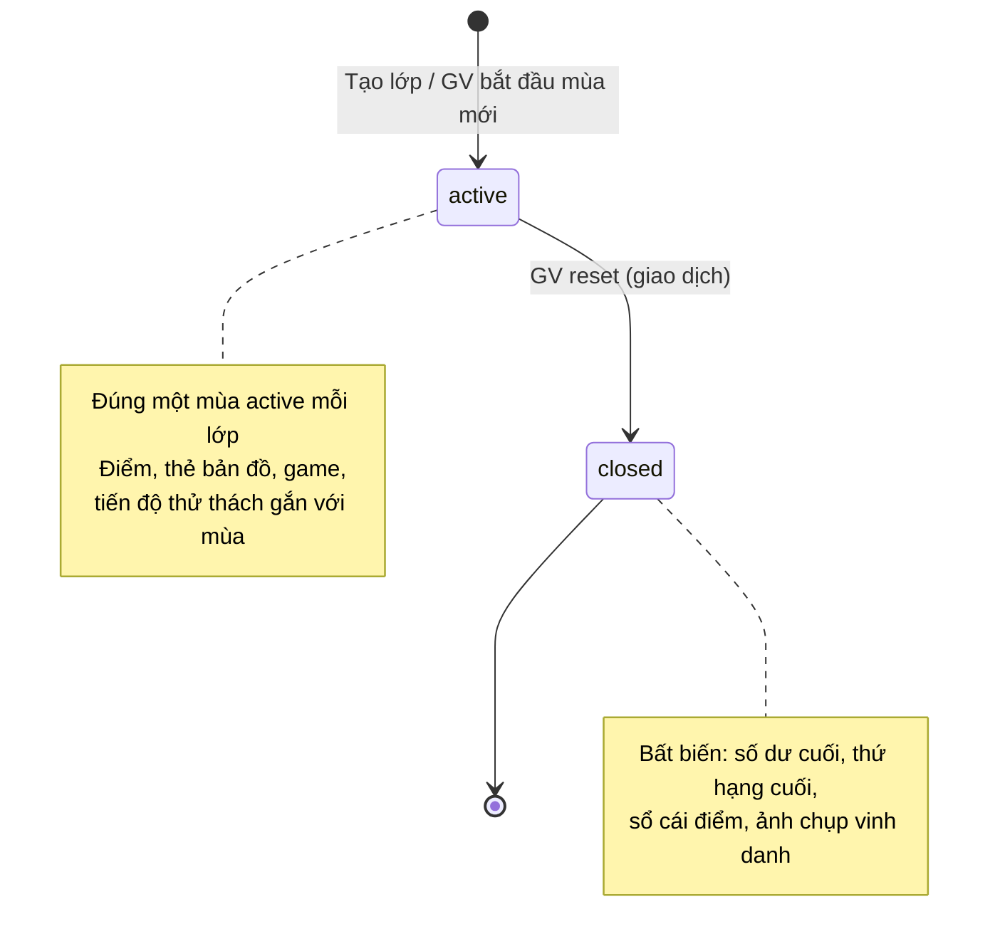

# ReadMate AI — Đặc tả điểm thưởng, mở khóa và mùa thi đua

> **Trạng thái: PLANNED** — thiết kế của Giai đoạn R01 (2026-10-16). **Chưa có dòng mã nào** hiện thực tài liệu này; dự kiến hiện thực ở R04 (điểm, mở khóa), R06 (mùa giải) và R08 (điểm trong cuộc chạm trán).
> **Nguồn duy nhất** cho mọi hằng số điểm. Tài liệu khác chỉ tham chiếu tới đây, không chép lại con số.
> **Tài liệu liên quan:** [PRODUCT_REDESIGN.md](PRODUCT_REDESIGN.md) · [GAME_DESIGN.md](GAME_DESIGN.md) · [LEADERBOARD_SPEC.md](LEADERBOARD_SPEC.md) · [REDESIGN_ARCHITECTURE.md](REDESIGN_ARCHITECTURE.md) · [PRIVACY_AND_SECURITY.md](PRIVACY_AND_SECURITY.md)

## Mục lục

1. [Hằng số chính thức](#1-hằng-số-chính-thức)
2. [Định nghĩa](#2-định-nghĩa)
3. [Công thức tính điểm](#3-công-thức-tính-điểm)
4. [Lượt hợp lệ và câu tính điểm](#4-lượt-hợp-lệ-và-câu-tính-điểm)
5. [Chống cộng điểm trùng và chống cày điểm](#5-chống-cộng-điểm-trùng-và-chống-cày-điểm)
6. [Mở khóa thẻ bản đồ](#6-mở-khóa-thẻ-bản-đồ)
7. [Điều kiện vào mini-game](#7-điều-kiện-vào-mini-game)
8. [Mùa thi đua](#8-mùa-thi-đua)
9. [Luồng xử lý một câu trả lời ở server](#9-luồng-xử-lý-một-câu-trả-lời-ở-server)
10. [Trình bày điểm cho trẻ](#10-trình-bày-điểm-cho-trẻ)
11. [Quan hệ với đồng ý của phụ huynh](#11-quan-hệ-với-đồng-ý-của-phụ-huynh)
12. [Tham số cấu hình](#12-tham-số-cấu-hình)
13. [Kiểm thử bắt buộc khi hiện thực](#13-kiểm-thử-bắt-buộc-khi-hiện-thực)
14. [Câu hỏi mở](#14-câu-hỏi-mở)

---

## 1. Hằng số chính thức

Do người điều phối quy định trong yêu cầu R01. Trong mã (R04) các hằng số này nằm ở **một tệp duy nhất** `src/features/gamification/rules.ts`, kèm `SCORING_RULES_VERSION = "r1"` được ghi vào mọi sự kiện điểm.

| Mã | Quy tắc | Giá trị |
|---|---|---|
| `POINTS_CORRECT` | Trả lời đúng một câu tính điểm | **+10** |
| `POINTS_INCORRECT` | Trả lời sai một lượt hợp lệ | **−5** |
| `BALANCE_FLOOR` | Điểm hiện tại tối thiểu | **0** |
| `MAP_TILE_STEP` | Mỗi khi điểm tích lũy trong mùa đạt thêm mốc | **30** điểm → được khám phá thêm **1** thẻ bản đồ |
| `GAME_MIN_BALANCE.treasure_maze` | Mê cung kho báu | **50** |
| `GAME_MIN_BALANCE.wonder_forest` | Rừng chữ kỳ diệu | **120** |
| `GAME_MIN_BALANCE.tone_island` | Đảo dấu thanh | **200** |
| `GAME_MIN_BALANCE.rhyme_castle` | Lâu đài ghép vần | **300** |
| `ENCOUNTERS_PER_LEVEL` | Số cuộc chạm trán (thử thách) mỗi màn | **đúng 7** ở Mê cung kho báu; **tối đa 7** ở ba game còn lại |
| `MONSTER_HP` | Máu của một quái vật | **3** (3 trái tim) |
| `QUESTIONS_PER_ENCOUNTER` | Số câu hỏi riêng biệt mỗi cuộc chạm trán | **đúng 3** |
| Chi phí mở khóa / vào chơi | — | **0** — không bao giờ tiêu điểm |

Tham số do thiết kế R01 đề xuất (không nằm trong yêu cầu gốc, **chờ hiệu chỉnh khi thí điểm**) ở [§12](#12-tham-số-cấu-hình).

## 2. Định nghĩa

| Thuật ngữ | Trong mã (dự kiến) | Định nghĩa |
|---|---|---|
| **Điểm thưởng** | `reward points` | Điểm của trò chơi, tách bạch với kết quả học tập chuyên môn (`item_attempts`, mức thành thạo). Không dùng để đánh giá học sinh |
| **Điểm hiện tại** | `season_scores.balance` | Số dư điểm của học sinh trong **mùa đang diễn ra**; luôn ≥ 0. Dùng để **xếp hạng** và **xét điều kiện vào game** |
| **Điểm tích lũy trong mùa** | `season_scores.earned_total` | Tổng **điểm được cộng** (+10) trong mùa, **không trừ** phần bị trừ; chỉ tăng. Dùng cho **thẻ bản đồ**. Cách hiểu này theo đúng chữ của yêu cầu: game xét "điểm hiện tại", bản đồ xét "điểm tích lũy" — hai đại lượng khác nhau (xác nhận lại ở RQ-G1) |
| **Tổng điểm đã trừ** | `season_scores.deducted_total` | Tổng phần thực sự bị trừ (sau sàn 0) — chỉ để GV đối soát, không hiển thị trên bảng xếp hạng |
| **Sự kiện điểm** | `point_events` | Một dòng sổ cái **chỉ ghi thêm**: mỗi lượt trả lời tính điểm tạo đúng một dòng |
| **Câu phát hành** | `question_instances` | Một câu do server phát cho một học sinh trong một ngữ cảnh (buổi luyện hoặc cuộc chạm trán), giữ số lượt đã dùng, trạng thái và việc đã được cộng điểm hay chưa |
| **Câu tính điểm** | `question_instances.scorable = true` | Câu phát hành đủ điều kiện ở [§4.2](#42-câu-tính-điểm) |
| **Mùa** | `seasons` | Một giai đoạn thi đua của **một lớp**; tại mỗi thời điểm lớp có đúng một mùa đang diễn ra |

## 3. Công thức tính điểm

Với mỗi lượt hợp lệ của một câu tính điểm:

```text
nominal_delta  = +10 nếu đúng, −5 nếu sai
balance_after  = max(0, balance_before + nominal_delta)
applied_delta  = balance_after − balance_before        (−5 ≤ applied_delta ≤ +10)
earned_total  += (nominal_delta > 0 ? nominal_delta : 0)
deducted_total += (applied_delta < 0 ? −applied_delta : 0)
tiles_allowed  = floor(earned_total / 30)
```

- Sàn 0 áp dụng **tại từng sự kiện**, không áp dụng cho tổng cuối: sai khi đang có 0 điểm thì vẫn 0 (sổ cái ghi `nominal_delta = −5`, `applied_delta = 0`); đúng ngay sau đó → 10.
- Một câu chỉ được cộng +10 **một lần** (lượt đúng đầu tiên kết thúc câu).
- Các trường số dư chỉ là **dữ liệu dẫn xuất**: tính lại được hoàn toàn từ sổ cái `point_events` của mùa (kiểm thử bắt buộc ở [§13](#13-kiểm-thử-bắt-buộc-khi-hiện-thực)).

**Ví dụ** (một câu có tối đa 3 lượt, bắt đầu từ 0 điểm):

| Diễn biến | Sự kiện | Điểm hiện tại | Tích lũy | Thẻ bản đồ được mở |
|---|---|---|---|---|
| Đúng ngay | +10 | 10 | 10 | 0 |
| Sai → đúng | −5 (áp dụng 0) → +10 | 10 | 10 | 0 |
| Từ 20: sai → sai → đúng | −5 → −5 → +10 | 20 | +10 | — |
| Ba câu đúng liên tiếp từ 0 | +10 ×3 | 30 | 30 | **1** |
| Từ 48 điểm, đúng 1 câu | +10 | 58 | — | Đủ vào Mê cung kho báu (≥ 50) |
| Từ 52 điểm, sai 1 lượt | −5 | 47 | — | Tạm chưa vào được Mê cung (xem [§7](#7-điều-kiện-vào-mini-game)) |

## 4. Lượt hợp lệ và câu tính điểm

### 4.1 Lượt hợp lệ

Một lần nộp đáp án là **lượt hợp lệ** khi **tất cả** điều kiện sau đúng (server kiểm tra trong cùng giao dịch ghi điểm):

1. Thiết bị đang liên kết với học sinh (liên kết chưa thu hồi); `student_id` suy ra từ phiên, **không** lấy từ dữ liệu gửi lên.
2. Câu phát hành thuộc học sinh đó, đang ở trạng thái `open`, thuộc **mùa đang diễn ra** của lớp.
3. Số lượt đã dùng < số lượt tối đa của câu.
4. Câu trả lời qua lược đồ zod và **khác mọi câu trả lời trước đó của cùng câu** (giữ quy tắc của bộ chạy phiên GĐ4: phải đổi lựa chọn mới được kiểm tra lại). Gửi lại đúng câu trả lời cũ → từ chối `DUPLICATE_RESPONSE`, **không** trừ điểm, **không** tốn lượt.
5. `client_attempt_id` (UUID do client tạo) chưa từng được ghi. Nếu đã ghi → trả lại **kết quả cũ**, không tạo sự kiện mới (xem [§5](#5-chống-cộng-điểm-trùng-và-chống-cày-điểm)).
6. Không vượt giới hạn tần suất nộp của thiết bị ([§12](#12-tham-số-cấu-hình)).

Lượt không hợp lệ không làm thay đổi điểm, lượt hay HP; server trả mã lỗi có kiểu (`{ ok: false, code }`).

### 4.2 Câu tính điểm

Câu phát hành chỉ **tính điểm** khi:

- Học sinh có ghi nhận đồng ý thu dữ liệu học tập (`data_collection_enabled = true`) — xem [§11](#11-quan-hệ-với-đồng-ý-của-phụ-huynh).
- Nội dung ở chế độ `production`: hồ sơ lớp `confirmed`, mọi nội dung `approved` (AD-38). Chế độ `demo` **không bao giờ** ghi điểm.
- Không phải câu "Cô làm mẫu", câu chỉ xem giao diện (`previewOnly`), câu bắc cầu chèn tự động do sai liên tiếp (để không thưởng/phạt việc hệ thống tự điều chỉnh độ khó — xem RQ-G3).
- **Nội dung câu (`exercise_item_id`) chưa từng được phát hành dạng tính điểm cho học sinh này trong mùa này** (dù lần đó đúng hay hết lượt) — chống làm lại cùng câu để lấy điểm ([§5](#5-chống-cộng-điểm-trùng-và-chống-cày-điểm)).
- Ngữ cảnh còn quyền tính điểm: buổi luyện chưa vượt giới hạn câu tính điểm/ngày (nếu GV bật), lượt chơi màn game là lượt **tính điểm** của màn trong mùa ([GAME_DESIGN §4.8](GAME_DESIGN.md#48-chơi-lại-màn-đã-hoàn-thành)).

Câu không tính điểm vẫn được chấm, có phản hồi, gợi ý và lưu vào lịch sử học tập (nếu có đồng ý) — chỉ **không** tạo sự kiện điểm, cả +10 lẫn −5. Giao diện ghi rõ "Câu luyện thêm — không tính điểm".

### 4.3 Số lượt tối đa mỗi câu

| Ngữ cảnh | Số lượt | Nguồn |
|---|---|---|
| Buổi luyện tập | Theo mức hỗ trợ của học sinh với dạng bài: H3/H2 = 3, H1 = 2, H0 = 1 | `SUPPORT_POLICIES` (GĐ4, D-045) — giữ nguyên |
| Câu hỏi trong cuộc chạm trán | **2** (tham số 1–3, mặc định 2) | Đề xuất R01 — với 3 phương án, 3 lượt cho phép đoán mò chắc chắn hạ được quái vật; chờ hiệu chỉnh (RQ-G2) |

Hết lượt mà chưa đúng: câu đóng ở trạng thái `exhausted`, hiện đáp án và âm thanh mẫu (nếu chính sách âm thanh cho phép, A4–A5); **không** sinh câu thay thế.

## 5. Chống cộng điểm trùng và chống cày điểm

Bảo vệ nhiều lớp, mọi lớp đều nằm ở **server/CSDL** — không lớp nào dựa vào trình duyệt.

| # | Mối nguy | Biện pháp | Bảo đảm bằng |
|---|---|---|---|
| 1 | Bấm "Kiểm tra" hai lần, mạng chập chờn gửi lại | `client_attempt_id` duy nhất → lần gửi sau nhận lại kết quả cũ | `unique (client_attempt_id)` trên `item_attempts` |
| 2 | Hai request song song cho cùng câu | Khóa dòng câu phát hành (`select … for update`) trong giao dịch; số lượt phải bằng `attempts_used + 1` | `unique (question_instance_id, attempt_no)`; hàm CSDL ghi nguyên tử |
| 3 | Sự kiện điểm bị ghi hai lần | Khóa bất biến `idempotency_key = question_instance_id:attempt_no` | `unique (idempotency_key)` trên `point_events` |
| 4 | Tải lại trang để "đổi câu khó" | Câu phát hành được tạo **một lần** khi lập buổi luyện / lượt chơi; tải lại nhận **đúng câu cũ** (cùng trạng thái, cùng số lượt đã dùng) | Kế hoạch buổi luyện lưu ở server; `unique (context_id, position)` |
| 5 | Làm lại cùng câu vô hạn | Mỗi nội dung câu chỉ được phát hành dạng tính điểm **một lần mỗi mùa** cho mỗi học sinh; lặp lại = câu luyện thêm không tính điểm | Chỉ mục duy nhất từng phần `(season_id, student_id, exercise_item_id) where scorable` trên `question_instances` |
| 6 | Chơi lại màn game để lấy điểm | Mỗi màn chỉ có **một lượt chơi tính điểm mỗi mùa**; chơi lại không tính điểm | `unique (season_id, student_id, game_key, level_key) where scored` trên `game_runs` |
| 7 | Gửi đáp án tự chế / sửa điểm từ trình duyệt | Client chỉ gửi **câu trả lời**; server tự chấm bằng `grade()` (cùng `runtime.ts` của GĐ4); mọi trường `is_correct`, `points`, `balance` từ client bị bỏ qua | Lược đồ zod `strictObject` của request không có các trường đó |
| 8 | Lộ đáp án qua dữ liệu tải về | Client chỉ nhận `view` (`type`, `variant`, `content`); đáp án chỉ trả về **sau khi** câu đóng (`reveal`) | AD-32; kiểm thử "payload trước khi chấm không chứa đáp án" |
| 9 | Kịch bản tự động đoán hàng loạt | Giới hạn tần suất nộp theo thiết bị; số lượt mỗi câu có hạn; đoán sai bị −5 | `rate_limit_buckets` |
| 10 | Nộp vào mùa vừa reset | Hàm ghi điểm khóa dòng mùa ở chế độ chia sẻ và kiểm tra `status = 'active'`; reset khóa độc quyền | `SEASON_CLOSED` → client tải lại trạng thái |

Do số câu đã duyệt là hữu hạn và mỗi câu chỉ được cộng điểm một lần mỗi mùa, **tổng điểm tối đa một mùa bị chặn trên** bởi kho câu đã duyệt — không có nguồn điểm vô hạn. Kho báu, thẻ bản đồ và hoạt cảnh **không** cộng điểm.

## 6. Mở khóa thẻ bản đồ

- Mỗi mùa có một **bản đồ thế giới** gồm một số thẻ (ô) có sẵn do thiết kế game quy định ([GAME_DESIGN §2](GAME_DESIGN.md#2-thế-giới-phiêu-lưu-game-world)), ban đầu bị sương mù che.
- Số thẻ được phép mở: `tiles_allowed = min(số thẻ của bản đồ, floor(earned_total / 30))`.
- Khi `tiles_allowed` > số thẻ đã mở, học sinh **tự chạm** chọn một thẻ còn che **kề** vùng đã mở để khám phá (hoạt cảnh mở sương). Server kiểm tra số lượng và tính kề nhau; ghi `map_tile_reveals`.
- Vì `earned_total` chỉ tăng, thẻ đã mở **không bao giờ bị che lại** trong mùa, kể cả khi điểm hiện tại giảm.
- Thẻ bản đồ là phần thưởng khám phá (cảnh, nhân vật phụ, hình dán); **không** quyết định quyền vào game (game chỉ xét điểm hiện tại — [§7](#7-điều-kiện-vào-mini-game)).
- Mở thẻ **không tiêu điểm**.

## 7. Điều kiện vào mini-game

- Lối vào của cả bốn game luôn **hiển thị** trên bản đồ ngay từ đầu mùa, kèm ổ khóa và câu "Cần 50 điểm để vào" — trẻ biết mục tiêu, không bị giấu.
- **Vào chơi** (bắt đầu hoặc tiếp tục một màn) khi `balance ≥ GAME_MIN_BALANCE[game]` tại thời điểm vào. Server kiểm tra; client chỉ hiển thị.
- **Đã khám phá** (`game_unlocks`): lần đầu điểm hiện tại đạt ngưỡng, server ghi thời điểm để hiện hoạt cảnh "Mở khóa!" một lần và để GV theo dõi. Bản ghi này **không** cấp quyền vào chơi vĩnh viễn.
- Nếu điểm hiện tại giảm xuống dưới ngưỡng **trong khi đang chơi** một màn: **được chơi tiếp đến hết màn** (không bị đẩy ra giữa chừng). Lần vào sau phải đủ ngưỡng; giao diện ghi tích cực: "Con cần thêm 5 điểm để vào. Mình cùng luyện tập nhé!".
- Tạm dừng hoặc thoát giữa màn **không bị trừ điểm**; quay lại tiếp tục được nếu đủ ngưỡng — hoặc trong vòng 24 giờ kể từ lần chơi gần nhất của lượt đó dù chưa đủ ngưỡng (để trẻ không mất lượt đang dở vì một câu sai ở buổi luyện; tham số, RQ-G4).
- Vào chơi **không tiêu điểm**. Không có mua, đổi, hay "mở nhanh" bằng bất cứ thứ gì.

## 8. Mùa thi đua

### 8.1 Vòng đời



- Mùa đầu tiên được tạo cùng lớp. Mùa có `seq_no` tăng dần trong lớp, `rules_version` và `config` (tham số §12 áp dụng cho mùa).
- **Không tự động kết thúc mùa.** GV có thể đặt "ngày dự kiến kết thúc" để hiển thị, nhưng chỉ thao tác reset của GV mới đóng mùa.
- Học sinh vào lớp giữa mùa bắt đầu từ 0 điểm (dòng `season_scores` tạo lần đầu có sự kiện).

### 8.2 Reset điểm (bắt đầu mùa mới)

Chỉ GV có quyền quản lý lớp (vai trò `owner` trong `class_staff`). Giao diện: xác nhận **hai bước** ([LEADERBOARD_SPEC §9](LEADERBOARD_SPEC.md#9-reset-điểm--bắt-đầu-mùa-mới)). Server thực hiện **trong một giao dịch** (hàm CSDL `private.reset_class_season` — [REDESIGN_ARCHITECTURE §7.3](REDESIGN_ARCHITECTURE.md#73-reset-mùa-trong-một-giao-dịch)):

1. Kiểm tra lại quyền GV với lớp (không tin `class_id` từ client ngoài vai trò khóa tra cứu; kiểm tra `class_staff`), khóa ý định `request_id` (gửi lại không reset hai lần).
2. Khóa dòng mùa đang diễn ra (`for update`).
3. Tính và lưu thứ hạng cuối (`season_scores.final_rank`) theo quy tắc xếp hạng; đóng mùa (`status = 'closed'`, `ended_at`, `closed_by`).
4. Đóng mọi lượt chơi đang dở của mùa cũ (`game_runs.status = 'void_season_reset'`), đóng câu phát hành còn mở (`void`) — không trừ điểm.
5. Tạo mùa mới `active` (`seq_no + 1`).
6. Ghi `season_resets` + `audit_logs` (chỉ UUID).

Hệ quả: điểm hiện tại và tích lũy của mọi học sinh trong lớp về 0 (vì dòng điểm gắn với mùa mới), thẻ bản đồ che lại, game khóa lại, tiến độ thử thách của mùa cũ đóng; bảng xếp hạng hiển thị mùa mới; học sinh tích điểm lại ngay.

**Không** xóa tài khoản, **không** xóa hay sửa `item_attempts`, mức thành thạo, hàng ôn tập, mức hỗ trợ (dữ liệu học tập chuyên môn); **không** ảnh hưởng lớp khác; **không** xóa ảnh chụp vinh danh hay sổ cái của mùa cũ (lưu theo thời hạn ở [PRIVACY_AND_SECURITY §8](PRIVACY_AND_SECURITY.md#8-lưu-giữ-và-xóa-dữ-liệu-mới)).

## 9. Luồng xử lý một câu trả lời ở server

```mermaid
sequenceDiagram
    participant C as Trình duyệt (học sinh)
    participant G as Student gateway (Next.js, Node)
    participant DB as Postgres (Supabase)
    C->>G: POST /api/student/question-instances/{id}/attempts<br/>{ clientAttemptId, response }
    G->>G: Xác thực phiên → student_id từ student_devices; zod; giới hạn tần suất
    G->>DB: Đọc câu phát hành + nội dung câu (đáp án chỉ ở server)
    G->>G: grade(item, response) — runtime.ts của GĐ4
    G->>DB: private.record_graded_attempt(...) — MỘT giao dịch
    Note over DB: khóa câu phát hành + mùa (chia sẻ)<br/>kiểm tra lượt hợp lệ (§4.1)<br/>ghi item_attempts (on conflict: trả kết quả cũ)<br/>nếu tính điểm: ghi point_events, cập nhật season_scores (sàn 0)<br/>nếu là chạm trán: cập nhật HP / trạng thái
    DB-->>G: kết quả có kiểu
    G-->>C: { correct, marks, reveal?, pointsApplied, balance, earnedTotal, encounter? }
```

- Chấm chạy bằng TypeScript ở server (cùng mã `runtime.ts` với trình duyệt); phần khóa, kiểm tra lượt và ghi điểm chạy **trong** CSDL để nguyên tử.
- Thời gian phản hồi mục tiêu ≤ 400 ms trên 4G (Vercel `sin1` ↔ Supabase Singapore). Trong khi chờ, giao diện hiện "Cô đang xem…" — **không** chấm trước ở trình duyệt cho câu tính điểm (tránh hiện "Đúng rồi!" rồi server bác bỏ). Chế độ demo vẫn chấm tại máy như GĐ4.
- `reveal` (đáp án) chỉ có khi câu đã đóng (đúng hoặc hết lượt).

## 10. Trình bày điểm cho trẻ

Áp dụng ngoại lệ có chủ đích của CLAUDE.md §7.10 (quyết định của người điều phối, 2026-10-16):

- Trừ điểm **chỉ là con số thay đổi**. Không âm thanh "thất bại", không rung, không màu đỏ nhấp nháy, không mặt buồn, không lời nói mang tính phạt.
- Khi sai: lời phản hồi vẫn tích cực, khuyến khích thử lại ("Mình thử lại nhé!") như GĐ4; con số "−5" hiện nhỏ, màu trung tính, cạnh số điểm mới; không đọc to phần trừ điểm.
- Khi đúng: "+10" kèm hoạt cảnh nhẹ (ngôi sao bay vào ô điểm); tôn trọng chế độ giảm chuyển động.
- Không hiển thị "tổng điểm đã bị trừ" cho học sinh; không có lịch sử "những lần con sai" trong giao diện học sinh.
- Điểm 0 không bao giờ được gọi là "thua", "kém", "cuối bảng".
- Không đếm ngược thời gian, không phạt vì chậm, không chuỗi ngày ("streak") gây áp lực.

## 11. Quan hệ với đồng ý của phụ huynh

| Trạng thái | Luyện tập / chơi | Điểm thưởng | Bảng xếp hạng |
|---|---|---|---|
| Chưa có đồng ý thu dữ liệu học tập | Chỉ chế độ **chơi thử** với nội dung minh họa, không lưu | Hiển thị tạm trong trang, **không lưu**, không vào sổ cái | Không xuất hiện |
| Có đồng ý thu dữ liệu học tập, **chưa** có đồng ý hiển thị | Học thật, lưu kết quả | Tính và lưu; học sinh thấy điểm của mình | **Không** xuất hiện (vẫn xem được bảng của lớp nếu lớp bật) |
| Có cả hai đồng ý + tên hiển thị đã được GV duyệt | Học thật | Tính và lưu | Xuất hiện |

Chi tiết phạm vi đồng ý: [PRIVACY_AND_SECURITY §4](PRIVACY_AND_SECURITY.md#4-đồng-ý-theo-phạm-vi).

## 12. Tham số cấu hình

Lưu trong `seasons.config` (chụp khi tạo mùa → đổi tham số giữa mùa không làm sai lịch sử). Giá trị mặc định là **đề xuất R01, chờ hiệu chỉnh khi thí điểm**.

| Tham số | Mặc định | Phạm vi | Ai đổi |
|---|---|---|---|
| `encounterMaxAttemptsPerQuestion` | 2 | 1–3 | GV (mùa mới) |
| `dailyScorableQuestionCap` | không giới hạn | null hoặc 10–200 | GV — khuyến nghị cân nhắc vì thời gian dùng màn hình của trẻ |
| `resumeGraceHours` | 24 | 0–72 | Hệ thống |
| `attemptRateLimit` | 30 lượt/phút/thiết bị | — | Hệ thống |
| `leaderboardEnabled`, `honorsEnabled` | **false** | — | GV, chỉ bật được khi đủ điều kiện ở [PRIVACY_AND_SECURITY §5](PRIVACY_AND_SECURITY.md#5-bảng-xếp-hạng-điều-kiện-bật-và-kiểm-soát-hiển-thị) |

Các hằng số ở [§1](#1-hằng-số-chính-thức) **không** phải tham số của GV — muốn đổi phải có quyết định mới của người điều phối và tăng `SCORING_RULES_VERSION`.

## 13. Kiểm thử bắt buộc khi hiện thực

Hàm tính điểm, mở khóa, xếp hạng là **hàm thuần** có unit test (CLAUDE.md §9); phần CSDL có kiểm thử tích hợp/RLS.

1. Bảng ví dụ §3 (sàn 0 tại từng sự kiện; +10 một lần mỗi câu; mốc 30 → 1 thẻ; 29 → 0 thẻ; 60 → 2 thẻ).
2. Thuộc tính: với mọi chuỗi sự kiện ngẫu nhiên có seed, `balance ≥ 0`, `earned_total` không giảm, số dư tính lại từ sổ cái **bằng** số dư lưu.
3. Gửi lại cùng `client_attempt_id` 2–10 lần (tuần tự và song song) → đúng **1** dòng `item_attempts`, **1** dòng `point_events`.
4. Hai câu trả lời khác nhau gửi song song cho câu còn 1 lượt → đúng một lượt được ghi; lượt kia bị từ chối.
5. Tải lại buổi luyện / lượt chơi → cùng câu phát hành, cùng số lượt đã dùng.
6. Câu đã phát hành dạng tính điểm trong mùa (đúng hoặc hết lượt) → lần sau không tính điểm (cả +10 lẫn −5); mùa mới → tính lại.
7. Request chứa `is_correct`, `points`, `balance`, `student_id`, `class_id` → bị lược đồ từ chối hoặc bỏ qua; không ảnh hưởng điểm.
8. Payload câu trước khi đóng không chứa đáp án (so với `answer` của câu).
9. Điều kiện vào game ở biên: 49 → không vào, 50 → vào; giảm dưới ngưỡng giữa màn → chơi tiếp được.
10. Reset: điểm lớp A về 0, lớp B giữ nguyên; `item_attempts` không đổi; nộp vào mùa cũ → `SEASON_CLOSED`; gửi lại `request_id` → không tạo mùa thứ ba.
11. Chế độ demo và học sinh chưa có đồng ý → 0 dòng sổ cái.

## 14. Câu hỏi mở

| Mã | Câu hỏi | Mặc định tạm của thiết kế |
|---|---|---|
| RQ-G1 | "Điểm tích lũy" để mở thẻ bản đồ là tổng điểm được cộng (không trừ) hay đỉnh cao nhất của điểm hiện tại? | Tổng điểm được cộng (`earned_total`) |
| RQ-G2 | Số lượt mỗi câu trong cuộc chạm trán (1, 2 hay 3)? | 2 |
| RQ-G3 | Câu bắc cầu (dễ hơn, chèn khi sai liên tiếp) có tính điểm không? | Không |
| RQ-G4 | Có cho tiếp tục lượt chơi đang dở khi điểm hiện tại đã xuống dưới ngưỡng? | Có, trong 24 giờ |
| RQ-G5 | Có giới hạn số câu tính điểm mỗi ngày để bảo vệ thời gian dùng màn hình của trẻ? | Không giới hạn; GV có thể bật |
| RQ-G6 | Học sinh dùng gợi ý vẫn được +10 khi đúng? | Có — không làm trẻ ngại xin gợi ý (gợi ý vẫn được ghi trong dữ liệu học tập) |
