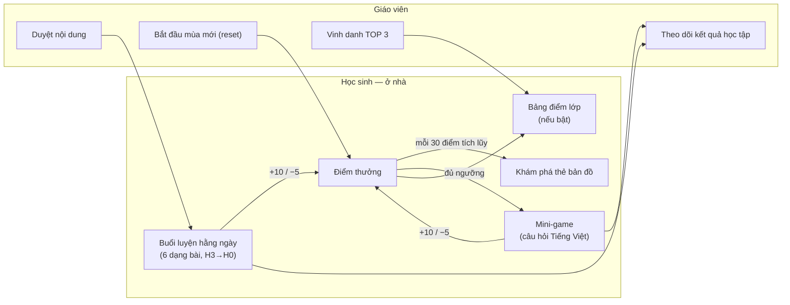

# ReadMate AI — Định hướng sản phẩm mới (tái thiết kế R01)

> **Phiên bản:** 1.0 — Giai đoạn R01 (2026-10-16)
> **Trạng thái (cập nhật R02, 2026-10-20):** định hướng đã được người điều phối quyết định. **Giao diện đã chuyển sang định hướng mới ở R02** (trang chủ, `/learn`, `/demo`, sidebar GV — dữ liệu minh họa, xem [§10](#10-trạng-thái-sau-r02)); điểm thưởng thật, tài khoản, game chơi được vẫn **PLANNED** (R03–R09).
> Tài liệu này **thay thế** các phần định hướng "học ở nhà → tự làm ở lớp" của [PRD.md](PRD.md) (xem [§4](#4-giữ--thay-đổi--loại-khỏi-luồng-chính)); các phần PRD không bị nêu tên vẫn còn hiệu lực.
> **Tài liệu liên quan:** [GAMIFICATION_SPEC.md](GAMIFICATION_SPEC.md) · [GAME_DESIGN.md](GAME_DESIGN.md) · [LEADERBOARD_SPEC.md](LEADERBOARD_SPEC.md) · [REDESIGN_ARCHITECTURE.md](REDESIGN_ARCHITECTURE.md) · [PRIVACY_AND_SECURITY.md](PRIVACY_AND_SECURITY.md) · [REDESIGN_TASKS.md](../REDESIGN_TASKS.md) · [REDESIGN_PROGRESS.md](../REDESIGN_PROGRESS.md)

## Mục lục

1. [Tuyên bố định hướng](#1-tuyên-bố-định-hướng)
2. [Người dùng và bối cảnh sử dụng](#2-người-dùng-và-bối-cảnh-sử-dụng)
3. [Vòng lặp sản phẩm](#3-vòng-lặp-sản-phẩm)
4. [Giữ / thay đổi / loại khỏi luồng chính](#4-giữ--thay-đổi--loại-khỏi-luồng-chính)
5. [Kiểm kê mã cũ và phương án loại bỏ an toàn](#5-kiểm-kê-mã-cũ-và-phương-án-loại-bỏ-an-toàn)
6. [Quyết định đã chốt ở R01](#6-quyết-định-đã-chốt-ở-r01)
7. [Phi mục tiêu](#7-phi-mục-tiêu)
8. [Chỉ số thành công đề xuất](#8-chỉ-số-thành-công-đề-xuất)
9. [Câu hỏi mở](#9-câu-hỏi-mở)
10. [Trạng thái sau R02](#10-trạng-thái-sau-r02)

---

## 1. Tuyên bố định hướng

**ReadMate AI — Nền tảng tự luyện Tiếng Việt tại nhà kết hợp trò chơi phiêu lưu, điểm thưởng và bảng xếp hạng lớp học.**

- **Học sinh lớp 1** dùng website **ở nhà** để luyện chữ, âm, vần, đánh vần, đọc trơn, vốn từ với âm thanh, hình ảnh, gợi ý và phản hồi; mỗi câu đúng được điểm thưởng; điểm mở thẻ bản đồ và các mini-game phiêu lưu; câu hỏi trong game vẫn là câu hỏi Tiếng Việt từ cùng bộ máy bài tập.
- **Giáo viên** dùng website để quản lý và duyệt nội dung, theo dõi kết quả, **vinh danh TOP 3** và **tổ chức các mùa thi đua** (reset điểm).
- **Không còn** thiết kế việc học sinh dùng website trong giờ học trên lớp, không còn quy trình chuyển bài ở nhà sang phiếu giấy ở lớp.

Tên sản phẩm giữ nguyên. Ba nhóm năng lực (Nhóm 1 `extending`, Nhóm 2 `developing`, Nhóm 3 `foundation`) và ba lộ trình (Tăng tốc, Vững bước, Khởi động) **giữ nguyên** làm cơ chế cá nhân hóa — chỉ GV và phụ huynh thấy; học sinh không bao giờ thấy.

## 2. Người dùng và bối cảnh sử dụng

| Vai trò | Ở đâu | Làm gì | Thiết bị |
|---|---|---|---|
| Học sinh lớp 1 (6–7 tuổi) | **Ở nhà** | Buổi luyện hằng ngày, khám phá bản đồ, chơi mini-game, xem điểm và bảng điểm lớp (nếu lớp bật) | Điện thoại Android/iPhone, máy tính bảng, máy tính của gia đình |
| Phụ huynh | Ở nhà, ngồi cạnh khi cần | Liên kết thiết bị bằng thẻ học, ký đồng ý (hai phạm vi), đọc góc phụ huynh | Điện thoại |
| Giáo viên | Ở trường hoặc ở nhà | Duyệt nội dung, theo dõi kết quả, duyệt tên hiển thị, vinh danh (có thể trình chiếu cho lớp xem), bắt đầu mùa mới | Máy tính, điện thoại |
| Quản trị | — | Cấp tài khoản GV, vận hành | Máy tính |

GV có thể trình chiếu màn vinh danh trên lớp — đó là thao tác của GV, không phải học sinh dùng website trên lớp.

## 3. Vòng lặp sản phẩm

- **Vòng học sinh (mỗi ngày, khoảng 10–15 phút):** mở bản đồ → buổi luyện → nhận điểm → mở thẻ / vào game → câu hỏi trong game → xem điểm.
- **Vòng GV (mỗi tuần/mùa):** cập nhật bài đã học, duyệt nội dung → xem kết quả học tập và lỗi phổ biến → vinh danh → khi kết thúc đợt thi đua: bắt đầu mùa mới.
- Điểm thưởng là **động lực**, không phải thước đo học tập: GV đánh giá học sinh qua dữ liệu học tập (tỉ lệ đúng độc lập, mức thành thạo, mức hỗ trợ), không qua thứ hạng.

## 4. Giữ / thay đổi / loại khỏi luồng chính

### 4.1 Giữ

| Thành phần | Hiện trạng | Vai trò mới |
|---|---|---|
| Kho tri thức Tiếng Việt lớp 1 + Vietnamese Engine | ✅ GĐ3 | Không đổi — nguồn kiểm tra cho mọi câu hỏi |
| Sáu dạng bài, 17 biến thể, bộ sinh + chuỗi kiểm tra | ✅ GĐ4 | Nguồn câu hỏi cho buổi luyện **và** game |
| Ba lộ trình Khởi động / Vững bước / Tăng tốc | ✅ GĐ2–GĐ4 | Cá nhân hóa ẩn với học sinh |
| Mức hỗ trợ H3 → H0 | ✅ GĐ4 | Giữ cơ chế giảm dần; H0 đổi tên hiển thị (§4.2) |
| Chống lộ đáp án (văn bản + âm thanh) | ✅ GĐ4 | Mở rộng: đáp án ở server cho chế độ có điểm (AD-41) |
| Kiểm duyệt học liệu, chế độ `demo`/`production` | ✅ GĐ3–GĐ4 | Mở rộng cho asset game, avatar, quái vật |
| Âm thanh hướng dẫn (chính sách, `AudioSlot`) | Chính sách ✅; tệp âm thanh: chưa có | Hoàn thiện ở R10 |
| Hệ thống kiểm thử, CI, cấu trúc Next.js | ✅ | Giữ nguyên quy trình |

### 4.2 Thay đổi

| Điểm | Cũ | Mới |
|---|---|---|
| Triết lý | Học có hướng dẫn ở nhà → tự thực hiện ở lớp | Tự luyện tại nhà có hướng dẫn, khích lệ bằng phiêu lưu, điểm thưởng và thi đua lớp |
| Mức H0 | "Tự lực — Thử như ở lớp", bố cục giống phiếu | "**Tự làm**" (tên chờ GV góp ý) — vẫn không gợi ý, một lượt; bố cục bình thường của ứng dụng |
| Buổi luyện mẫu | Ôn bài cũ → luyện tập → thử như ở lớp | Ôn bài cũ → luyện tập → thử thách tự làm (H0) |
| Trang chủ học sinh `/learn` | Khung "Nhiệm vụ hôm nay" | Bản đồ thế giới phiêu lưu ([GAME_DESIGN §2](GAME_DESIGN.md#2-thế-giới-phiêu-lưu-game-world)) |
| Avatar | Con vật/đồ vật có sẵn | Nhân vật hoạt hình hình người có sẵn (giữ lựa chọn con vật) |
| Xếp hạng | Cấm hoàn toàn | Bảng xếp hạng **trong lớp**, có điều kiện, mặc định tắt ([LEADERBOARD_SPEC](LEADERBOARD_SPEC.md)) |
| Phản hồi khi sai | Không phạt | −5 điểm thưởng, trình bày trung tính; lời phản hồi vẫn tích cực ([GAMIFICATION_SPEC §10](GAMIFICATION_SPEC.md#10-trình-bày-điểm-cho-trẻ)) |
| Chấm điểm | Chấm tại máy, server chấm lại | Chế độ có điểm: chấm ở server, đáp án không xuống client trước khi nộp |
| Chỉ số chính | Tỉ lệ "Tự làm được" khi làm phiếu tại lớp | Chỉ số học tập ở nhà (§8) |

### 4.3 Loại khỏi luồng chính (chưa xóa mã)

| Thành phần | Lý do | Xử lý |
|---|---|---|
| Học sinh dùng website trên lớp | Không còn thiết kế | Không xây màn hình nào cho bối cảnh này |
| Chuyển bài ở nhà → phiếu giấy ở lớp ("bài sinh đôi", hợp đồng phiếu 8 thông tin) | Không còn mục tiêu | Đánh dấu ngừng dùng (§5) |
| "Thử như ở lớp" | Không còn bối cảnh lớp | Đổi thành "Tự làm" (H0) |
| Phiếu học tập PDF bắt buộc (GĐ8 cũ), ghi nhận tự lực tại lớp | Không còn mục tiêu | Không làm; có thể xem lại như tính năng tùy chọn cho GV sau này |
| Thông điệp giới thiệu theo định hướng cũ (trang chủ, metadata, `package.json`) | Sai định hướng | Viết lại ở R02 |

## 5. Kiểm kê mã cũ và phương án loại bỏ an toàn

Nguyên tắc (AD-51): **không xóa module đang chạy và có kiểm thử ở R01**. R02 gỡ khỏi giao diện học sinh; R11 xóa mã có kiểm soát (xóa test tương ứng cùng lúc, chạy đủ bộ kiểm tra, không để mã chết).

| Tệp / thành phần | Gắn với định hướng cũ | Trạng thái R01 | Kế hoạch |
|---|---|---|---|
| `src/features/exercises/generation/pair.ts` (`generateHomeClassPair`) | Cặp bài ở nhà – ở lớp | **DEPRECATED** (giữ, còn test) | R11: xóa cùng `tests/unit/exercises/generation.test.ts` phần cặp nhà–lớp |
| `src/features/exercises/core/worksheet.ts` (`ExerciseTaskContract`, `buildTaskContract`) | Hợp đồng phiếu | **DEPRECATED** | R11: xóa; gỡ trường `worksheet()` khỏi `ExerciseTypeModule` |
| `worksheet()` trong `types/*/module.ts`, `worksheet` trong `variants.ts` | Biểu diễn phiếu của từng dạng | **DEPRECATED** | R11 cùng mục trên |
| `src/features/exercises/ui/worksheet-preview.tsx` | Xem trước phiếu ở lớp trong `/demo` | **DEPRECATED** — ✅ R02 đã gỡ khỏi `/demo` (không còn nơi nào import) | R11: xóa |
| `src/features/demo/practice-data.ts` — bước `classroom_like` | "Thử như ở lớp" | ✅ **ĐÃ ĐỔI (R02)**: bước `independent` "Thử thách tự làm" (H0); bỏ gọi `generateHomeClassPair` | — |
| `src/app/(site)/demo/demo-practice.tsx` | Dùng `classroom_like`, xem trước phiếu | ✅ **ĐÃ ĐỔI (R02)**: màn kết quả hiện lời nhắc điểm minh họa + "Về Game World" | — |
| `src/features/exercises/core/support.ts` (nhãn H0, `paperLike`) | "Giống phiếu ở lớp" | ✅ **ĐÃ ĐỔI (R02)**: H0 = "Tự làm"; `layout` `paper_like` → `focused`; bỏ prop `paperLike` khỏi Player — logic số lượt/gợi ý giữ nguyên | — |
| `src/features/exercises/session/results.ts` — chỉ số "Cần GV ghi nhận ở lớp" | Chỉ số đo ở lớp | **DEPRECATED** — ✅ R02: `results-panel.tsx` chỉ hiện chỉ số `source: "app"` | R11: xóa |
| `src/strings/vi.ts` — các chuỗi "ở lớp", "phiếu", "Thử như ở lớp", mô tả trang chủ | Thông điệp cũ | ✅ **ĐÃ VIẾT LẠI (R02)**; chỉ còn nhánh `practice.worksheet` (dùng bởi `worksheet-preview.tsx`, ngừng dùng) — `tests/unit/redesign-copy.test.tsx` chặn tái xuất hiện | R11: xóa nhánh |
| `src/app/(site)/page.tsx`, `src/config/site.ts`, `package.json` (`description`) | Thông điệp cũ | ✅ **ĐÃ ĐỔI (R02)** + Open Graph | — |
| `src/components/layout/teacher-sidebar.tsx` — mục "Phiếu học tập" | Phiếu PDF | ✅ **ĐÃ ĐỔI (R02)**: 9 mục (Tổng quan … Cài đặt), mục chưa xây dựng ghi "Sắp có" | — |
| `src/components/learning/visuals.tsx` — biểu tượng hướng dẫn "dùng chung app và phiếu" | Phiếu | **GIỮ** (biểu tượng vẫn dùng cho app) | Bỏ nhắc tới phiếu ở R02 |
| `PRD §13`, `ARCHITECTURE §16`, `DATA_MODEL §4.H`, TASKS GĐ8 | Phiếu PDF | **SUPERSEDED** (đã ghi chú trong tài liệu ở R01) | Không hiện thực |
| `tests/e2e/demo-practice.spec.ts` — bước thử như ở lớp, xem trước phiếu | Kiểm thử luồng cũ | ✅ **ĐÃ ĐỔI (R02)**: kiểm không còn chữ "ở lớp/phiếu", có lời nhắc điểm minh họa và nút về Game World | — |

## 6. Quyết định đã chốt ở R01

| Mã | Quyết định | Nguồn |
|---|---|---|
| PD-01 | Định hướng mới như §1; học sinh chỉ dùng ở nhà | Yêu cầu R01 |
| PD-02 | Quy tắc điểm, mở khóa, mini-game, mùa giải theo [GAMIFICATION_SPEC §1](GAMIFICATION_SPEC.md#1-hằng-số-chính-thức) | Yêu cầu R01 |
| PD-03 | Bảng xếp hạng trong lớp là **ngoại lệ có điều kiện** của CLAUDE.md §6.4: chỉ lớp mình, chỉ alias đã duyệt + avatar có sẵn + điểm, chỉ học sinh có đồng ý hiển thị, không lộ nhóm năng lực, bật theo lớp và **mặc định tắt** tới khi có đồng ý và rà soát pháp lý | Người điều phối chọn ngày 2026-10-16 |
| PD-04 | Giữ −5 điểm khi sai; sửa CLAUDE.md §7.10 thành ngoại lệ có chủ đích: chỉ là con số, trình bày trung tính, không âm thanh/hình ảnh/lời nói mang tính phạt, không trừ ở câu không tính điểm | Người điều phối chọn ngày 2026-10-16 |
| PD-05 | Không xóa mã cũ ở R01; đánh dấu và loại bỏ theo §5 | Yêu cầu R01 |
| PD-06 | Game Engine: lõi TS thuần + React/SVG/CSS; không Phaser lúc này (AD-47) | Thiết kế R01 |
| PD-07 | Phụ thuộc: R03 (Supabase) phải xong trước R04; nội dung đã duyệt và âm thanh câu lệnh là điều kiện trước khi cho học sinh thật dùng | Thiết kế R01 ([REDESIGN_TASKS](../REDESIGN_TASKS.md)) |

## 7. Phi mục tiêu

- Không có chatbot hay AI tạo sinh tương tác với học sinh (giữ nguyên).
- Không ghi âm, không nhận dạng giọng nói, không camera.
- Không mua bán trong ứng dụng, không quảng cáo, không phần thưởng may rủi, không tiền tệ ảo mua được.
- Không bảng xếp hạng toàn trường/toàn hệ thống, không so sánh giữa các lớp, không trang công khai.
- Không dùng điểm thưởng hay thứ hạng để đánh giá, phân nhóm hay báo cáo năng lực học sinh.
- Không thiết kế cho học sinh dùng trên lớp; không phiếu PDF bắt buộc.
- Không tài khoản phụ huynh riêng, không nhắn tin (giữ nguyên MVP cũ).

## 8. Chỉ số thành công đề xuất

Ngưỡng là đề xuất, thống nhất với GV trước khi thí điểm.

| Chỉ số | Định nghĩa | Ngưỡng đề xuất (4 tuần) |
|---|---|---|
| **Chỉ số chính:** tỉ lệ đúng độc lập tăng | Câu đúng lần đầu, không gợi ý / tổng câu — so tuần 1 với tuần 4, theo nhóm | Tăng ≥ 10 điểm phần trăm |
| Thói quen luyện ở nhà | Học sinh có ≥ 3 buổi luyện/tuần / học sinh tham gia | ≥ 60% |
| Nhóm 3: số âm/vần thành thạo tăng | Theo `student_unit_mastery` | Do GV đặt theo tiến độ bài |
| Học sinh tự thao tác được | Tỉ lệ buổi luyện hoàn thành không cần dừng giữa chừng | ≥ 70% |
| Không tăng áp lực | Phản hồi GV/phụ huynh về căng thẳng, so bì do bảng xếp hạng | Không có phản ánh nghiêm trọng; nếu có → tắt bảng cho lớp |
| Nội dung chưa duyệt đến tay học sinh | | 0 |
| Sự cố lộ dữ liệu / điểm bị gian lận được phát hiện | | 0 |

## 9. Câu hỏi mở

| Mã | Câu hỏi | Ảnh hưởng |
|---|---|---|
| RQ-01 | Nhà trường có chấp thuận bảng xếp hạng nội bộ lớp và vinh danh không (Luật 91/2025 Điều 24)? | Bật R05–R06 cho lớp thật |
| RQ-02 | Tên hiển thị cho mức H0 thay cho "Thử như ở lớp"? Đề xuất "Tự làm" | R02 |
| RQ-03 | Các câu hỏi về điểm: [GAMIFICATION_SPEC §14](GAMIFICATION_SPEC.md#14-câu-hỏi-mở) | R04 |
| RQ-04 | Các câu hỏi về game, asset: [GAME_DESIGN §14](GAME_DESIGN.md#14-câu-hỏi-mở) | R02, R07–R09 |
| RQ-05 | Các câu hỏi về bảng xếp hạng: [LEADERBOARD_SPEC §11](LEADERBOARD_SPEC.md#11-kiểm-thử-bắt-buộc) (bảng RQ-L) | R05–R06 |
| RQ-06 | Công việc "Prompt 05" (âm thanh + Vercel) bị gián đoạn **không tìm thấy** trong thư mục này hay trên GitHub — nếu nằm ở máy/phiên khác, người điều phối cần cung cấp để hợp nhất | R10, R11 |
| — | Các câu hỏi cũ Q-01 → Q-20 ([PROGRESS §5](../PROGRESS.md#5-câu-hỏi-mở)) vẫn mở, nhất là Q-01, Q-02 (bộ sách, quy ước) — chưa có thì chế độ học thật không tạo được câu nào, kể cả cho game | Mọi giai đoạn có học thật |

## 10. Trạng thái sau R02

| Phần | Trạng thái R02 (2026-10-20) |
|---|---|
| Trang chủ `/` | ✅ Viết lại: "ReadMate AI – Học Tiếng Việt, khám phá thế giới kỳ diệu"; ba bước, ba lộ trình, bốn mini-game, công cụ GV (dự kiến), an toàn dữ liệu |
| `/learn` | ✅ Student Adventure Dashboard — **bản chơi thử, dữ liệu minh họa** (hồ sơ hư cấu "Mây", 135 điểm): avatar, điểm, huy hiệu, Game World, mốc khám phá. Không đăng nhập, không lưu |
| `/demo` | ✅ Sáu dạng bài giữ nguyên; H0 "Tự làm"; bỏ phiếu ở lớp; thêm xem trước Game World + bảng xếp hạng hư cấu |
| `/teacher` | ✅ Menu 9 mục; các phần mới "Sắp có – Đang phát triển"; không có nút đặt lại điểm/bật bảng xếp hạng |
| Điểm, mở khóa, bảng xếp hạng, game | Chỉ giao diện + dữ liệu minh họa; hằng số ở `src/features/gamification/rules.ts` (khớp GAMIFICATION_SPEC §1). Tính/lưu thật: R04–R09 |

Lựa chọn mặc định đã dùng (chưa phải phê duyệt cuối cùng): **RQ-02** — H0 tạm gọi "Tự làm"; **RQ-M1** — nhân vật/quái vật là bản phác thảo thân thiện, trạng thái chờ GV duyệt; **RQ-M2** — SVG/vector tự vẽ, không phát sinh chi phí. Chi tiết: [DESIGN_SYSTEM.md](DESIGN_SYSTEM.md), [ASSET_MANIFEST.md](ASSET_MANIFEST.md).
