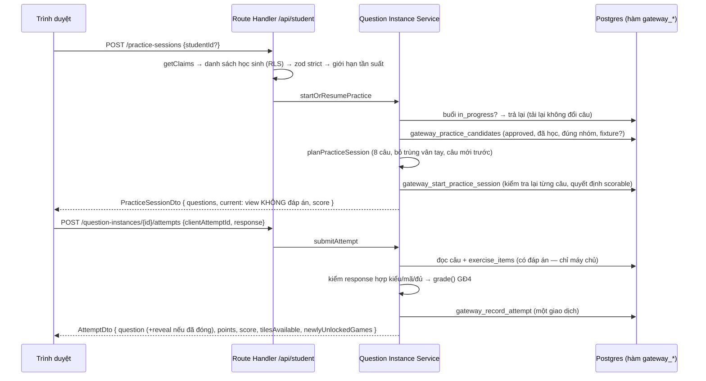

# ReadMate AI — Question Instance Service (phát câu, chấm ở máy chủ)

> **Trạng thái:** ✅ hiện thực ở **R04 (2026-10-20)** trên Supabase LOCAL. Thay thế cách "chấm tại máy" của GĐ4 **cho chế độ có điểm** (AD-41); `/demo` vẫn chấm tại máy, không lưu.
> **Liên quan:** [SCORING_ENGINE.md](SCORING_ENGINE.md) · [EXERCISE_ENGINE.md](EXERCISE_ENGINE.md) · [GAMIFICATION_SPEC.md](GAMIFICATION_SPEC.md) · [STUDENT_ACCESS.md](STUDENT_ACCESS.md)

## 1. Hai chế độ (không trộn)

| | Chơi thử `/demo`, `/learn` | Học thật có điểm `/learn/me/practice` |
|---|---|---|
| Đăng nhập | Không | Thiết bị đã liên kết thẻ học |
| Nội dung | Hồ sơ minh họa, `pending_review` | Phiên bản `approved` trong CSDL, đúng chuỗi bài **đã xác nhận** của lớp, đã học |
| Đáp án trên trình duyệt | Có (bộ máy GĐ4 sinh lúc build) | **Không** trước khi câu đóng |
| Chấm | Trình duyệt | Máy chủ (`runtime.ts` GĐ4) |
| Ghi dữ liệu | Không | `item_attempts`, `point_events`… (cần đồng ý `learning_data`) |

## 2. Luồng

## 3. Payload an toàn (AD-41, GAMIFICATION_SPEC §5.8)

`PublicQuestion` (`src/features/scored-practice/types.ts`) chỉ gồm: `id`, `position/total`, `view` (`type`, `variant`, `content`), `status`, `attemptsUsed/maxAttempts`, `supportLevel`, `scorable`, `lastResponse`, `marks` (chỉ phương án **đã chọn**), `feedback` (lời nhắc khi còn lượt **không** có đáp án), `hint`, `hintMode`, `reveal` (**null** cho tới khi câu `correct`/`exhausted`).

- `question_instances.view` được CSDL dựng từ `exercise_items.content` (trigger kiểm `view` khớp đúng nội dung) và có ràng buộc `not (view ? 'answer')`, `not (view ? 'reveal')`.
- Học sinh **không** có policy đọc `question_instances`, `exercise_items`, `exercises` (kiểm thử RLS).
- Trang `/learn/me/practice` chỉ dựng khung; câu đến bằng `fetch` sau khi hiển thị → không có đáp án trong HTML/RSC props (E2E kiểm `page.content()` và mọi phản hồi phiên luyện không chứa `"answer"`, `"correctIds"`, `"distractorTags"`, `"pictureNames"`).
- Unit test: 10 biến thể của 6 dạng bài — câu mở và sau lượt sai không chứa khóa đáp án hay tên tranh bí mật; câu đóng mới có `reveal`.

## 4. Chấm ở máy chủ

`submitAttempt` (`src/server/question-instances/service.ts`):

1. Câu phải thuộc một học sinh của thiết bị (không có thì `NOT_FOUND` — không phân biệt "không tồn tại" với "của người khác").
2. Đọc `exercise_items` → dựng `ExerciseItem` → **kiểm lược đồ zod** của GĐ4.
3. Câu trả lời: đúng `responseKind` của biến thể, chỉ nhắc mã có trong câu, `isComplete` → nếu không, `INVALID_INPUT`.
4. `runtimeOf(item).grade(item, response)` — **cùng mã** với trình duyệt GĐ4 (không có bộ chấm thứ hai).
5. `responseKey` (chuẩn hóa: chọn nhiều/nối cặp không phụ thuộc thứ tự) + `request_hash = sha256(câu|khóa)` → `gateway_record_attempt`.
6. Phản hồi, gợi ý, đáp án tính ở máy chủ bằng `feedbackFor`, `runtime.hints`, `runtime.reveal` của GĐ4.

**Gợi ý ở chế độ có điểm (đề xuất R04):** chỉ có **sau lượt sai**; H3 tự hiện, H2/H1 bấm "Xem gợi ý", H0 không có. Chưa có "Cô làm mẫu", chưa có gợi ý trước lượt đầu và chưa áp `adjustForHint` (đặt sẵn thẻ đầu câu) — ghi ở §8.

## 5. Bộ lập buổi luyện (`src/features/scored-practice/planner.ts`, hàm thuần)

- Ứng viên do CSDL trả (`gateway_practice_candidates` → `private.eligible_items`: phiên bản `approved`, bài tập chưa lưu trữ, `series_id` = chuỗi đã xác nhận của lớp, `lesson_ordinal ≤ bài hiện tại` — **Nhóm 3: ≤ bài trước** (CLAUDE.md §7.2), hợp `target_bands`, fixture chỉ khi môi trường kiểm thử cho phép).
- Bỏ trùng theo **vân tay**; câu chưa tính điểm trong mùa trước (ưu tiên bài gần nhất, xáo bằng seed `studentId:ngày VN`); thiếu thì thêm câu đã tính điểm làm "luyện thêm"; không có ứng viên → `INSUFFICIENT_CONTENT`.
- 8 câu/buổi (`PRACTICE_SESSION_SIZE`). Mức hỗ trợ mặc định theo nhóm (đề xuất R04, chờ GV): Nhóm 3 → H3 (3 lượt), Nhóm 2 → H2 (3 lượt), Nhóm 1 → H1 (2 lượt) — số lượt lấy từ `SUPPORT_POLICIES` GĐ4.
- CSDL **kiểm tra lại** từng câu (`CONTENT_NOT_ELIGIBLE`) và quyết định `scorable` cuối cùng.

## 6. Vân tay nội dung (`src/features/exercises/fingerprint.ts`)

Bộ sinh GĐ4 đặt mã câu theo seed và mã phương án `o1, o2…` theo vị trí sau khi xáo. Vân tay chuẩn hóa NFC, **sắp xếp mọi nhóm phương án theo nội dung, đánh lại mã**, thay mã trong đáp án, rồi băm SHA-256 `{type, variant, content, answer}`. Unit test: 9 biến thể với hai seed khác nhau → cùng vân tay khi cùng chất liệu; đổi đáp án/chữ mẫu → khác vân tay. `exercise_items.content_fingerprint` lưu sẵn; `question_instances` sao chép để áp chỉ mục chống tính điểm trùng.

## 7. API (`src/app/api/student/**`)

Mọi handler: `getClaims` (qua `getDeviceSession`) → quyền (danh sách RLS của thiết bị) → zod `strictObject` → giới hạn tần suất (theo thiết bị, khóa HMAC) → nghiệp vụ → `{ ok, data } | { ok: false, code }`, `Cache-Control: private, no-store`. POST chỉ nhận `application/json`, ≤ 8 KB, **cùng nguồn** (Origin so với Host; Sec-Fetch-Site).

| Phương thức + đường dẫn | Vào | Ra | Giới hạn |
|---|---|---|---|
| `GET /api/student/home?studentId=` | `studentId` tùy chọn (bắt buộc khi thiết bị có nhiều hồ sơ) | `StudentHomeDto` | 120/phút |
| `POST /api/student/practice-sessions` | `{ studentId? }` | `PracticeSessionDto` | 30/phút |
| `GET /api/student/practice-sessions/{id}` | — | `PracticeSessionDto` | 120/phút |
| `GET /api/student/question-instances/{id}` | — | `PublicQuestion` | 120/phút |
| `POST /api/student/question-instances/{id}/attempts` | `{ clientAttemptId, response }` | `AttemptDto` | 30/phút |
| `POST /api/student/map-tiles` | `{ studentId?, tileKey }` | `RevealTileDto` | 30/phút |

Mã HTTP: 400 `INVALID_INPUT`, 401 `UNAUTHENTICATED`, 403 `FORBIDDEN`/`CONSENT_REQUIRED`, 404 `NOT_FOUND`, 409 các mã nghiệp vụ (`DUPLICATE_RESPONSE`, `QUESTION_CLOSED`, `INSUFFICIENT_CONTENT`, `NO_TILE_AVAILABLE`…), 429, 503. **Không có endpoint cộng điểm** nào ngoài nộp câu trả lời.

## 8. Tải lại, mất mạng, giới hạn

- Tải lại: `POST /practice-sessions` trả đúng buổi đang dở; câu hiện tại = câu `open` đầu tiên, kèm lượt đã dùng, dấu đúng/sai và phản hồi của lượt gần nhất (E2E).
- Mất mạng khi nộp: giao diện giữ `clientAttemptId` trong bộ nhớ trang (không `localStorage`) và nút "Gửi lại" gửi **đúng mã cũ**.
- Giới hạn: gợi ý chỉ sau lượt sai; chưa "Cô làm mẫu"/âm thanh (R10); chưa mức hỗ trợ tự điều chỉnh (R10); thanh điều hướng đáy không giữ `?student=` (thiết bị nhiều hồ sơ sẽ được hỏi chọn hồ sơ); không có nội dung thật đã duyệt → học thật trả `INSUFFICIENT_CONTENT`.
