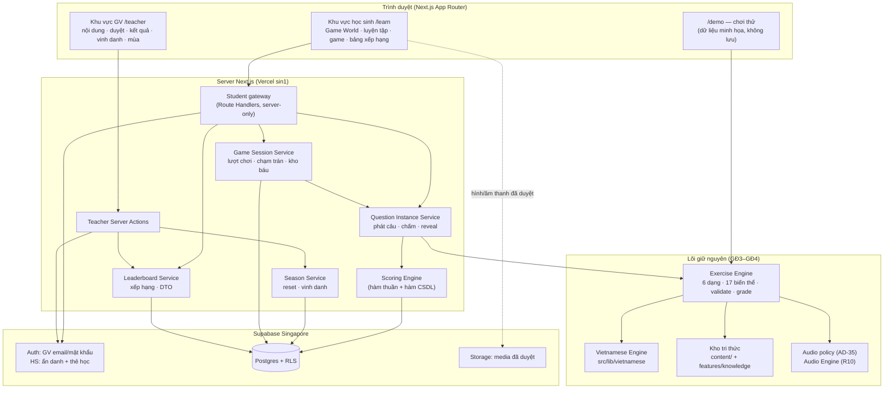
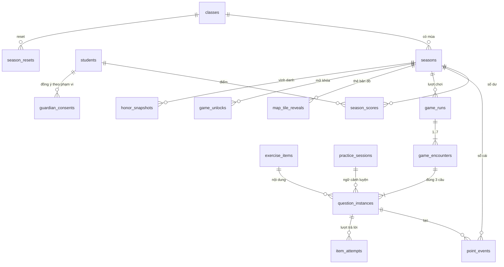

# ReadMate AI — Kiến trúc tái thiết kế (học tại nhà + phiêu lưu + thi đua lớp)

> **Trạng thái:** thiết kế R01 (2026-10-16). R02 hiện thực giao diện với dữ liệu minh họa ([§4.1](#41-đã-hiện-thực-ở-r02-2026-10-20--chỉ-giao-diện-dữ-liệu-minh-họa)). **R03 (2026-10-20) hiện thực Identity & Access trên Supabase LOCAL** ([§4.2](#42-đã-hiện-thực-ở-r03-2026-10-20--supabase-local)): migration, RLS, đăng nhập GV, thẻ học + thiết bị, quản lý lớp, đồng ý hai phạm vi, mùa 1. Phần điểm thưởng, câu phát hành, game, bảng xếp hạng vẫn **PLANNED** (R04+). Chưa có dự án Supabase Cloud, chưa liên kết Vercel.
> Tài liệu này **bổ sung** [ARCHITECTURE.md](ARCHITECTURE.md) (v0.4): giữ nguyên AD-01 → AD-39 trừ chỗ ghi rõ "thay thế"; quyết định mới đánh số tiếp **AD-40 → AD-53** ([§9](#9-quyết-định-kiến-trúc-mới-ad-40--ad-53)). Mô hình dữ liệu GĐ1 ([DATA_MODEL.md](DATA_MODEL.md)) vẫn là nền; mục [§5](#5-mô-hình-dữ-liệu-dự-kiến) chỉ mô tả phần **thêm/đổi**.
> **Tài liệu liên quan:** [PRODUCT_REDESIGN.md](PRODUCT_REDESIGN.md) · [GAMIFICATION_SPEC.md](GAMIFICATION_SPEC.md) · [GAME_DESIGN.md](GAME_DESIGN.md) · [LEADERBOARD_SPEC.md](LEADERBOARD_SPEC.md) · [PRIVACY_AND_SECURITY.md](PRIVACY_AND_SECURITY.md) · [REDESIGN_TASKS.md](../REDESIGN_TASKS.md)

## Mục lục

1. [Nguyên tắc](#1-nguyên-tắc)
2. [Các phân hệ](#2-các-phân-hệ)
3. [Cơ chế liên kết giữa các phân hệ](#3-cơ-chế-liên-kết-giữa-các-phân-hệ)
4. [Cấu trúc thư mục dự kiến](#4-cấu-trúc-thư-mục-dự-kiến)
5. [Mô hình dữ liệu dự kiến](#5-mô-hình-dữ-liệu-dự-kiến)
6. [Bề mặt API dự kiến](#6-bề-mặt-api-dự-kiến)
7. [Các luồng chính](#7-các-luồng-chính)
8. [Phân quyền và RLS](#8-phân-quyền-và-rls)
9. [Quyết định kiến trúc mới (AD-40 → AD-53)](#9-quyết-định-kiến-trúc-mới-ad-40--ad-53)
10. [Hiệu năng và kích thước bundle](#10-hiệu-năng-và-kích-thước-bundle)
11. [Chiến lược kiểm thử](#11-chiến-lược-kiểm-thử)
12. [Kế hoạch migration theo giai đoạn R](#12-kế-hoạch-migration-theo-giai-đoạn-r)
13. [Rủi ro kỹ thuật và POC](#13-rủi-ro-kỹ-thuật-và-poc)

---

## 1. Nguyên tắc

| Nguyên tắc | Ý nghĩa trong thiết kế mới |
|---|---|
| **Giữ lõi đã kiểm chứng** | Bộ máy tiếng Việt (GĐ3) và bộ máy bài tập (GĐ4) là nguồn duy nhất của câu hỏi — cho cả buổi luyện lẫn game. Không viết bộ câu hỏi riêng cho game |
| **Server có thẩm quyền** | Điểm, HP, mở khóa, thứ hạng, kết quả chạm trán chỉ do server tính và lưu. Client chỉ hiển thị |
| **Đáp án không rời server trước khi chấm** | Client nhận `view`; đáp án chỉ trả về qua `reveal` sau khi câu đóng (AD-32 mở rộng sang chế độ có điểm) |
| **Sổ cái chỉ ghi thêm** | Mọi thay đổi điểm là một dòng `point_events`; số dư là dữ liệu dẫn xuất, tính lại được |
| **Một mùa = một phạm vi** | Điểm, mở khóa, tiến độ game gắn với `season_id`; reset là đóng mùa + mở mùa mới trong một giao dịch, không xóa dữ liệu |
| **Dữ liệu học tập tách khỏi điểm thưởng** | `item_attempts`, mức thành thạo, hàng ôn tập không bao giờ bị reset hay dùng để xếp hạng |
| **Mặc định riêng tư** | Bảng xếp hạng, vinh danh tắt theo lớp cho tới khi đủ đồng ý; không có trang công khai nào chứa dữ liệu trẻ |
| **Hoạt động không cần AI** | Không phân hệ mới nào cần AI; `AI_PROVIDER=none` vẫn chạy đầy đủ |

## 2. Các phân hệ



| Phân hệ | Trách nhiệm | Trạng thái |
|---|---|---|
| Vietnamese Engine + Kho tri thức | Phân tích tiếng, chính tả, "đọc được bằng kiến thức đã học", dữ liệu ngôn ngữ | ✅ Có (GĐ3) — giữ |
| Exercise Engine | 6 dạng/17 biến thể, sinh câu có seed, chuỗi kiểm tra 9 bước, `grade()`, gợi ý, chính sách âm thanh, H3→H0 | ✅ Có (GĐ4) — giữ; bỏ cặp nhà–lớp khỏi luồng chính (AD-51) |
| Kiểm duyệt học liệu | Trạng thái duyệt, băm nội dung (AD-30), chế độ `demo`/`production` (AD-38) | ✅ Có ở tầng tệp; giao diện duyệt: R10 |
| Identity & Access | GV, HS (ẩn danh + thẻ học), lớp, đồng ý theo phạm vi | ✅ R03 (Supabase local — §4.2) |
| Question Instance Service | Phát câu cho một ngữ cảnh, giữ lượt, chấm ở server, `reveal` | PLANNED — R04 |
| Scoring Engine | +10/−5, sàn 0, sổ cái, chống trùng, mở thẻ bản đồ, điều kiện vào game | PLANNED — R04 |
| Season Service | Mùa của lớp, reset trong giao dịch, thứ hạng cuối | PLANNED — R06 |
| Leaderboard Service | Xếp hạng đồng hạng, DTO không định danh, điều kiện hiển thị | **ĐÃ CÓ (R05, local)** — [RANKING_ENGINE](RANKING_ENGINE.md), [LEADERBOARD_API](LEADERBOARD_API.md) |
| Honors | Ảnh chụp bất biến, hoạt cảnh TOP 3 → 1 | PLANNED — R06 |
| Game Engine + Game Session Service | Lõi game thuần TS, kết xuất React/SVG, lượt chơi, 7 chạm trán, kho báu, lưu tiến độ | PLANNED — R07–R09 |
| Audio Engine | Tệp âm thanh đã duyệt, phát theo chính sách | PLANNED — R10 (chưa có âm thanh nào) |

## 3. Cơ chế liên kết giữa các phân hệ

- **Gọi hàm trực tiếp trong cùng ứng dụng** (modular monolith, AD-01) — không hàng đợi, không dịch vụ riêng.
- **Exercise Engine → Question Instance Service:** khi lập buổi luyện / lượt chơi, server gọi bộ sinh ở chế độ `production` với hồ sơ lớp (`confirmed`), nhóm và mức hỗ trợ của học sinh, lấy các câu **đã duyệt** (phiên bản `approved` trong `exercise_versions`/`exercise_items`), rồi tạo `question_instances` trỏ tới `exercise_item_id`. Đáp án đọc từ `exercise_items` (học sinh không có quyền đọc bảng này).
- **Question Instance Service → Scoring Engine:** sau khi `grade()` ở TypeScript, gọi **một** hàm CSDL `private.record_graded_attempt(...)` để khóa, kiểm tra lượt hợp lệ, ghi `item_attempts`, ghi `point_events`, cập nhật `season_scores` và — nếu câu thuộc cuộc chạm trán — cập nhật HP/trạng thái `game_encounters`, tất cả trong một giao dịch.
- **Scoring Engine → Game / bản đồ:** quyền vào game và số thẻ được mở **tính từ** `season_scores` khi cần (không lưu cờ dư thừa ngoài `game_unlocks` để hiển thị "Mở khóa!" một lần).
- **Season Service ↔ mọi bảng có `season_id`:** reset chỉ đổi trạng thái mùa và đóng lượt chơi/câu đang mở; các bảng còn lại tự "về 0" vì truy vấn luôn lọc theo mùa đang diễn ra.
- **Leaderboard ← `season_scores`** + điều kiện hiển thị (đồng ý, alias đã duyệt, cờ của lớp).
- **Hàm thuần dùng chung client/server** (không zod, đặt trong `src/features/gamification/`): `applyPointEvent`, `tilesAllowed`, `canEnterGame`, `rankScores` — cùng một mã cho hiển thị dự kiến và cho kiểm thử; **server luôn tính lại**.

## 4. Cấu trúc thư mục dự kiến

Chỉ tạo thư mục khi có mã thật (quy ước GĐ2). Tên tệp là dự kiến.

```text
src/
├── app/
│   ├── learn/                         # R02: Game World (bản đồ) làm trang chủ học sinh
│   │   ├── practice/                  # buổi luyện hằng ngày
│   │   ├── games/[gameKey]/[levelKey]/ # màn chơi (tách mã)
│   │   ├── leaderboard/               # R05
│   │   └── me/                        # avatar, hình dán, cài đặt (giảm chuyển động, âm lượng)
│   ├── teacher/classes/[classId]/
│   │   ├── leaderboard/ · honors/ · season/   # R05–R06
│   │   └── students/                  # R03: học sinh, thẻ học, đồng ý, alias
│   └── api/student/                   # R03–R08: Route Handlers của student gateway
├── proxy.ts                           # R03: làm mới phiên Supabase (getClaims)
├── server/                            # import 'server-only'
│   ├── student-gateway/               # xác thực thiết bị → student_id
│   ├── question-instances/            # phát câu, chấm, reveal
│   ├── scoring/                       # gọi hàm CSDL ghi điểm
│   ├── seasons/ · honors/ · leaderboard/
│   └── games/                         # lượt chơi, chạm trán, kho báu
├── features/
│   ├── gamification/                  # R04: rules.ts (hằng số), apply.ts, unlocks.ts, ranking.ts — hàm thuần
│   ├── game-engine/                   # R07: core/, renderer/, input/, encounter/, games/ (GAME_DESIGN §11)
│   ├── avatars/catalog.ts             # R05: bộ avatar có sẵn + giấy phép
│   ├── exercises/ · knowledge/        # giữ nguyên (GĐ3–GĐ4)
│   └── demo/                          # mở rộng: dữ liệu game/bảng xếp hạng HƯ CẤU cho /demo
├── lib/supabase/                      # browser.ts, server.ts, admin.ts (server-only)
supabase/
├── migrations/                        # R03+
└── tests/                             # kiểm thử RLS (pgTAP hoặc Vitest nhiều người dùng)
content/games/<game>/levels/*.json     # R07+: dữ liệu màn (lược đồ + level-validate)
```

### 4.1 Đã hiện thực ở R02 (2026-10-20) — chỉ giao diện, dữ liệu minh họa

```text
src/
├── app/learn/                      # Student Adventure Dashboard + Game World (Server Component, dữ liệu minh họa)
├── components/adventure/           # Design system phiêu lưu (docs/DESIGN_SYSTEM.md); client: adventure-dialog, motion
├── components/art/                 # SVG tự vẽ: characters, avatars, treasure, scenes, world-map, map-tiles, hero-landscape
├── features/gamification/          # rules.ts (hằng số GAMIFICATION_SPEC §1, SCORING_RULES_VERSION "r1"), unlocks.ts (hàm thuần)
├── features/game-world/catalog.ts  # 4 game (ngưỡng lấy từ rules.ts), 8 mốc bản đồ
├── features/avatars/catalog.ts     # 5 avatar (pending_review, licenseRef)
├── features/media/license-validation.ts  # kiểm content/media/licenses.json trong content:check
└── features/demo/adventure-data.ts # DEMO_PLAYER "Mây" 135 điểm, huy hiệu, bảng xếp hạng hư cấu
content/media/licenses.json          # giấy phép mọi asset
```

- `rules.ts`/`unlocks.ts` được tạo sớm (kế hoạch ban đầu: R04) để giao diện R02 không chép con số; `apply.ts` (ghi điểm) vẫn thuộc R04 và chạy ở server.
- AD-50 (giảm chuyển động): R02 hiện thực phần `prefers-reduced-motion` + công tắc trong trang (React state của phiên, **không** localStorage); lưu ở `students.preferences` từ R03.
- Không route game nào được tạo (`/learn/games/*` chưa tồn tại); nút "Vào chơi" luôn khóa.

### 4.2 Đã hiện thực ở R03 (2026-10-20) — Supabase local

```text
supabase/
├── config.toml                      # auto_expose_new_tables=false, ẩn danh bật, hook before_user_created
├── migrations/20261020090000_r03_foundation.sql   # bảng, helper RLS, trigger bất biến, policy SELECT, GRANT
├── migrations/20261020090100_r03_functions.sql    # teacher_* (JWT GV), gateway_* (service_role)
├── migrations/20261020090200_r03_signup_guard.sql # Auth Hook chặn tự đăng ký
└── tests/database/*.test.sql        # pgTAP
src/
├── proxy.ts                         # làm mới phiên (getClaims), chuyển hướng thô /teacher → /login
├── lib/supabase/                    # env.ts, cookie-options.ts, server.ts, admin.ts (server-only), proxy.ts, database.types.ts
├── server/auth/                     # DAL GV (teacher.ts), Server Actions đăng nhập/đăng xuất
├── server/teacher/                  # queries.ts (RLS), actions.ts (gọi teacher_*), qr.ts
├── server/student-gateway/          # session.ts (phiên thiết bị), actions.ts (/join, cài đặt), learning-profile.ts (điểm nối R04)
├── features/{students,login-codes,consent}/   # hàm thuần: biệt danh, mã thẻ/HMAC, trạng thái đồng ý
└── app/(site)/login · (site)/join · learn/me · teacher/classes/**
scripts/db-env.ts · db-seed.ts · db-sync-content.ts · check-bundle-secrets.ts · lib/
tests/db/ (tích hợp, JWT thật) · tests/e2e-db/ (Playwright + CSDL)
```

Bảng đã tạo: `schools`, `staff_profiles`, `classes` (+ cờ bảng xếp hạng/vinh danh, tiến độ chương trình), `class_staff`, `students` (+ alias, cài đặt trợ năng), `student_band_assignments`, `student_login_codes`, `student_devices`, `guardian_consents` (+ `scope`), `seasons`, `audit_logs`, `rate_limit_buckets`, `content_releases`, `curriculum_series`, `curriculum_lessons`, `kb_units`. Không tạo ở R03 (theo yêu cầu R03 "không triển khai toàn bộ bảng cũ"): `kb_unit_relations`, `kb_rules`, `kb_unit_media`, `media_assets`, `exercise_types`, `class_lesson_progress` (lịch sử tiến độ ghi qua `audit_logs` `curriculum.set`), `band_suggestions`. Chi tiết và lệch so với thiết kế: [DATA_MODEL — ghi chú R03](DATA_MODEL.md), [RLS_SECURITY.md](RLS_SECURITY.md).

## 5. Mô hình dữ liệu dự kiến

Quy ước giữ như [DATA_MODEL §2](DATA_MODEL.md#2-quy-ước-chung): `snake_case`, `uuid`, `timestamptz`, `text + check` thay enum, NFC, `comment on`, **RLS bật cho mọi bảng**, phi chuẩn hóa `class_id` trên dữ liệu học sinh (DM-7).

### 5.1 Tài khoản, lớp, học sinh (thay đổi so với DATA_MODEL GĐ1)

| Bảng | Thay đổi | Giai đoạn |
|---|---|---|
| `staff_profiles`, `classes`, `class_staff`, `students`, `student_login_codes`, `student_devices` | Giữ như DATA_MODEL §4.A–4.B (GV email/mật khẩu do admin tạo; HS là người dùng **ẩn danh** + liên kết thiết bị bằng thẻ học — không cần email riêng, AD-05) | R03 |
| `classes` | Thêm `leaderboard_enabled boolean default false`, `honors_enabled boolean default false`, `leaderboard_student_view text check in ('top10_and_me','full') default 'top10_and_me'` | R03 |
| `class_staff` | Thêm `can_honor boolean default false` cho `co_teacher` (owner luôn có quyền); reset mùa chỉ `owner` | R03 |
| `students` | Thêm `leaderboard_alias text null` (1–20 ký tự, NFC, unique trong lớp khi khác null), `leaderboard_alias_approved_by uuid`, `leaderboard_alias_approved_at timestamptz`, `preferences jsonb default '{}'` (giảm chuyển động, âm lượng — không dữ liệu cá nhân). `avatar_key` trỏ tới bộ avatar mới (hình người) | R03 / R05 |
| `guardian_consents` | Thêm `scope text check in ('learning_data','leaderboard_display') not null`; unique bản ghi còn hiệu lực theo (`student_id`, `scope`). `students.data_collection_enabled` suy ra từ `learning_data` | R03 |
| `avatar_options` (mới) | `key` PK, `kind` (`human`/`animal`), `asset_path`, `license_ref`, `status` (`draft`/`approved`), `sort_order` — seed từ `src/features/avatars/catalog.ts`; `students.avatar_key` FK | R05 |

### 5.2 Điểm thưởng và mùa

**`seasons`** — Mùa thi đua của lớp.

| Cột | Kiểu | Ràng buộc |
|---|---|---|
| `id` | uuid | PK |
| `class_id` | uuid | FK `classes`, not null |
| `seq_no` | int | not null; unique (`class_id`, `seq_no`) |
| `status` | text | check in (`active`, `closed`) |
| `rules_version` | text | not null (ví dụ `r1`) |
| `config` | jsonb | tham số [GAMIFICATION_SPEC §12](GAMIFICATION_SPEC.md#12-tham-số-cấu-hình) chụp lúc tạo |
| `planned_end_on` | date | null — chỉ để hiển thị |
| `started_at` / `ended_at` | timestamptz | |
| `started_by` / `closed_by` | uuid | FK `staff_profiles`, null cho mùa đầu tạo cùng lớp |
| | | **unique (`class_id`) where `status = 'active'`** — đúng một mùa đang diễn ra |

**`season_scores`** — Số dư của học sinh trong mùa (dữ liệu dẫn xuất từ sổ cái).

| Cột | Kiểu | Ràng buộc |
|---|---|---|
| `season_id` / `student_id` | uuid | PK kép |
| `class_id` | uuid | not null |
| `balance` | int | not null default 0, **check (`balance >= 0`)** |
| `earned_total` / `deducted_total` | int | not null default 0, check ≥ 0 |
| `balance_updated_at` | timestamptz | dùng cho thứ tự hiển thị khi đồng hạng |
| `final_rank` | int | null; ghi khi đóng mùa |

**`point_events`** — Sổ cái điểm, **chỉ ghi thêm** (không policy UPDATE/DELETE cho ai; trigger chặn sửa).

| Cột | Kiểu | Ràng buộc |
|---|---|---|
| `id` | uuid | PK |
| `season_id` / `student_id` / `class_id` | uuid | not null |
| `question_instance_id` | uuid | FK, not null |
| `attempt_no` | smallint | not null |
| `item_attempt_id` | uuid | FK `item_attempts` |
| `outcome` | text | check in (`correct`, `incorrect`) |
| `nominal_delta` | smallint | check in (10, −5) |
| `applied_delta` | smallint | check between −5 and 10 |
| `balance_after` | int | check ≥ 0 |
| `idempotency_key` | text | **unique** — `"{question_instance_id}:{attempt_no}"` |
| `rules_version` | text | not null |
| `created_at` | timestamptz | |

**`question_instances`** — Câu do server phát cho một học sinh trong một ngữ cảnh.

| Cột | Kiểu | Ràng buộc / ghi chú |
|---|---|---|
| `id` | uuid | PK |
| `student_id` / `class_id` / `season_id` | uuid | not null |
| `context_kind` | text | check in (`practice_session`, `game_encounter`) |
| `context_id` | uuid | `practice_sessions.id` hoặc `game_encounters.id` |
| `position` | smallint | unique (`context_kind`, `context_id`, `position`); với chạm trán: 1–3 |
| `exercise_item_id` / `exercise_version_id` | uuid | FK — trigger chỉ cho phiên bản `approved` |
| `view` | jsonb | **chỉ** `{type, variant, content}` + khe âm thanh đã duyệt — không đáp án |
| `support_level` | smallint | check 0–3 |
| `max_attempts` / `attempts_used` | smallint | check `attempts_used <= max_attempts` |
| `scorable` | boolean | quyết định khi phát ([GAMIFICATION_SPEC §4.2](GAMIFICATION_SPEC.md#42-câu-tính-điểm)) |
| `status` | text | check in (`open`, `correct`, `exhausted`, `void`) |
| `opened_at` / `closed_at` | timestamptz | |
| | | **unique (`season_id`, `student_id`, `exercise_item_id`) where `scorable`** — mỗi câu tính điểm một lần mỗi mùa |

**`item_attempts`** (DATA_MODEL §4.F) — giữ, **thêm** `question_instance_id uuid` và `client_attempt_id uuid unique`; unique (`question_instance_id`, `attempt_no`). Bảng này là **lịch sử trả lời** chung cho luyện tập và game; không bị reset.

**`practice_sessions`** (DATA_MODEL §4.F) — giữ; `mode` đổi thành check in (`daily_practice`, `review`, `challenge`) — bỏ `classroom_like` (AD-51); thêm `season_id`.

**`map_tile_reveals`** — Thẻ bản đồ đã khám phá.

| Cột | Kiểu | Ràng buộc |
|---|---|---|
| `season_id` / `student_id` / `tile_key` | | PK ba cột |
| `class_id` | uuid | |
| `map_key` | text | bản đồ của mùa |
| `revealed_at` | timestamptz | |

Server kiểm tra trong giao dịch: `count(reveals) < tiles_allowed(earned_total)` và ô kề vùng đã mở.

### 5.3 Game

**`game_unlocks`** — Lần đầu đủ ngưỡng (chỉ để hiển thị "Mở khóa!" một lần; không cấp quyền vào chơi).

| Cột | Kiểu | Ràng buộc |
|---|---|---|
| `season_id` / `student_id` / `game_key` | | PK ba cột; `game_key` check in (`treasure_maze`, `wonder_forest`, `tone_island`, `rhyme_castle`) |
| `class_id` | uuid | |
| `first_reached_at` / `celebrated_at` | timestamptz | |

**`game_runs`** — Một lượt chơi một màn.

| Cột | Kiểu | Ràng buộc |
|---|---|---|
| `id` | uuid | PK |
| `season_id` / `student_id` / `class_id` | uuid | not null |
| `game_key` / `level_key` | text | not null |
| `level_version` | text | băm tệp màn — tải lại dùng đúng phiên bản màn |
| `scored` | boolean | **unique (`season_id`, `student_id`, `game_key`, `level_key`) where `scored`** — một lượt tính điểm mỗi màn mỗi mùa |
| `status` | text | check in (`in_progress`, `completed`, `abandoned`, `void_season_reset`) |
| `encounter_count` | smallint | check between 1 and 7; Mê cung: check = 7 |
| `position` | jsonb | `{x, y}` hoặc nút đồ thị — vị trí lưu gần nhất |
| `state_version` | int | tăng mỗi lần ghi — chống ghi đè trạng thái cũ (optimistic concurrency) |
| `treasure_opened_at` | timestamptz | chỉ ghi khi mọi cuộc chạm trán đã kết thúc |
| `started_at` / `last_active_at` / `completed_at` | timestamptz | |
| | | unique (`student_id`, `game_key`, `level_key`) where `status = 'in_progress'` — một lượt dở mỗi màn |

**`game_encounters`** — Cuộc chạm trán (phân bổ sẵn khi tạo lượt chơi).

| Cột | Kiểu | Ràng buộc |
|---|---|---|
| `id` | uuid | PK |
| `run_id` | uuid | FK `game_runs` on delete cascade |
| `student_id` / `class_id` / `season_id` | uuid | phi chuẩn hóa cho RLS |
| `encounter_no` | smallint | **check (`encounter_no between 1 and 7`)**; **unique (`run_id`, `encounter_no`)** |
| `trigger_key` | text | unique (`run_id`, `trigger_key`) — mỗi điểm kích hoạt một lần |
| `monster_key` | text | unique (`run_id`, `monster_key`) — 7 quái vật khác nhau |
| `hp_remaining` | smallint | check between 0 and 3, default 3 |
| `status` | text | check in (`pending`, `active`, `defeated`, `undefeated`, `void`) |
| `return_position` | jsonb | vị trí quay lại mê cung |
| `activated_at` / `resolved_at` | timestamptz | |

Bảo đảm "không bao giờ có cuộc chạm trán thứ tám": ràng buộc `check` + `unique (run_id, encounter_no)` + hàm tạo lượt chơi chỉ chèn đúng `encounter_count` dòng + trigger `before insert` từ chối khi lượt chơi đã đủ `encounter_count`. Bảo đảm "đúng 3 câu riêng biệt": `question_instances.position` 1–3, unique theo ngữ cảnh, và unique (`run_id`, `exercise_item_id`) qua bảng nối hoặc chỉ mục trên cột phi chuẩn hóa `run_id` của `question_instances` (chốt khi viết migration R08).

### 5.4 Vinh danh và reset

**`honor_snapshots`** — Ảnh chụp bất biến.

| Cột | Kiểu | Ghi chú |
|---|---|---|
| `id` | uuid | PK |
| `class_id` / `season_id` | uuid | |
| `created_by` | uuid | FK `staff_profiles` |
| `created_at` | timestamptz | |
| `entries` | jsonb | `[{rank, alias, avatarKey, points}]` — chỉ hàng đủ điều kiện, `rank ≤ 3`, `points > 0`; không `student_id` |
| `rules_version` | text | |

Không policy UPDATE/DELETE; trigger chặn sửa. Xóa theo thời hạn lưu giữ bằng tác vụ server.

**`season_resets`** — Nhật ký reset + khóa ý định.

| Cột | Kiểu | Ghi chú |
|---|---|---|
| `request_id` | uuid | PK — gửi lại cùng `request_id` không reset lần hai |
| `class_id` | uuid | |
| `old_season_id` / `new_season_id` | uuid | |
| `performed_by` | uuid | |
| `performed_at` | timestamptz | |

### 5.5 Sơ đồ quan hệ phần mới



### 5.6 Học liệu và trạng thái kiểm duyệt

Giữ nguyên thiết kế DATA_MODEL §4.C–4.E và §6 (`kb_units`, `media_assets`, `exercises`, `exercise_versions` bất biến sau khi gửi duyệt, `content_reviews`) cùng cơ chế tệp đã hiện thực ở GĐ3–GĐ4 (AD-30, AD-38). Thêm: dữ liệu màn game (`content/games/...`), tên/lời thoại quái vật và bộ avatar cũng có trạng thái duyệt + giấy phép; chế độ `production` chặn màn/avatar/quái vật chưa `approved`. Bảng worksheet (`worksheets`, `worksheet_versions`, `worksheet_sections`, `class_task_observations` — DATA_MODEL §4.H) **không tạo** trong lộ trình mới (AD-51).

## 6. Bề mặt API dự kiến

Mọi Route Handler/Server Action: **xác thực → kiểm tra quyền → zod (`strictObject`) → nghiệp vụ → `{ ok, data } | { ok: false, code }`** (CLAUDE.md §9). `student_id`/`class_id` luôn suy ra từ phiên; tham số đường dẫn chỉ là khóa tra cứu và luôn được kiểm tra thuộc về người gọi.

| Phương thức + đường dẫn | Ai | Mục đích | Giai đoạn |
|---|---|---|---|
| `POST /api/join` | Phụ huynh | Liên kết thiết bị bằng thẻ học (thiết kế GĐ1) | R03 |
| `GET /api/student/home` | HS | Điểm hiện tại, điểm tích lũy, số thẻ được mở, trạng thái khóa 4 game, lượt chơi dở | R04 |
| `POST /api/student/practice-sessions` | HS | Tạo hoặc tiếp tục buổi luyện hôm nay (kế hoạch + câu phát hành cố định) | R04 |
| `GET /api/student/question-instances/{id}` | HS | `view` + số lượt đã dùng + trạng thái (+ `reveal` nếu đã đóng) | R04 |
| `POST /api/student/question-instances/{id}/attempts` | HS | `{ clientAttemptId, response }` → chấm + điểm ([GAMIFICATION_SPEC §9](GAMIFICATION_SPEC.md#9-luồng-xử-lý-một-câu-trả-lời-ở-server)) | R04 |
| `POST /api/student/map-tiles` | HS | `{ tileKey }` khám phá thẻ | R04 |
| `GET /api/student/leaderboard` | HS | DTO bảng xếp hạng ([LEADERBOARD_SPEC §10](LEADERBOARD_SPEC.md#10-dữ-liệu-trả-về-và-bảo-mật)) | R05 |
| `GET /api/student/honors/latest` | HS | Ảnh chụp vinh danh gần nhất của lớp (nếu bật) | R06 |
| `POST /api/student/game-runs` | HS | `{ gameKey, levelKey }` bắt đầu/tiếp tục (kiểm tra ngưỡng; phân bổ 7 chạm trán + 21 câu) | R07–R08 |
| `PATCH /api/student/game-runs/{id}/position` | HS | `{ position, stateVersion }` lưu vị trí | R07 |
| `POST /api/student/game-runs/{id}/encounters` | HS | `{ triggerKey, position }` kích hoạt chạm trán kế tiếp | R08 |
| `POST /api/student/game-runs/{id}/treasure` | HS | Mở kho báu (chỉ khi 7/7 đã kết thúc) | R08 |
| Server Actions GV | GV | `approveLeaderboardAlias`, `setClassLeaderboard`, `recordConsent(scope)`, `createHonorSnapshot`, `resetSeason` | R03–R06 |

Giới hạn tần suất (`rate_limit_buckets`, thiết kế GĐ1) cho mọi route `POST/PATCH` của học sinh. Header `Cache-Control: private, no-store` cho mọi phản hồi chứa dữ liệu học sinh.

## 7. Các luồng chính

### 7.1 Buổi luyện hằng ngày

1. `POST /api/student/practice-sessions` → gateway xác định học sinh, mùa đang diễn ra, đồng ý.
2. Nếu đã có buổi `in_progress` hôm nay → trả lại buổi đó (tải lại không đổi câu).
3. Nếu chưa: lập kế hoạch (ôn tập đến hạn + câu mới theo nhóm/mức hỗ trợ — luật phân hóa AD-11), lấy câu `approved`, tạo `question_instances` với `scorable` theo [GAMIFICATION_SPEC §4.2](GAMIFICATION_SPEC.md#42-câu-tính-điểm). Thiếu nội dung → `INSUFFICIENT_CONTENT` (không nới quy tắc).
4. Client làm từng câu qua API attempts; mỗi phản hồi trả điểm mới.

### 7.2 Cuộc chạm trán

```mermaid
sequenceDiagram
    participant C as Client (game)
    participant G as Gateway
    participant DB as Postgres
    C->>G: POST game-runs/{id}/encounters { triggerKey, position }
    G->>DB: Khóa game_runs; kiểm tra in_progress, triggerKey thuộc màn & chưa dùng,<br/>còn encounter pending (≤ 7)
    DB-->>G: encounter (encounter_no, monster_key, hp=3) + câu 1/3
    G-->>C: view câu 1 (không đáp án)
    loop Tối đa 3 câu
        C->>G: POST question-instances/{id}/attempts
        G->>DB: record_graded_attempt → điểm ±, HP−1 nếu đúng
        G-->>C: kết quả + HP + câu kế (nếu có)
    end
    Note over DB: HP = 0 → defeated · hết 3 câu, HP > 0 → undefeated<br/>không bao giờ tạo câu thứ 4 hay chạm trán thứ 8
    G-->>C: kết quả cuộc chạm trán + return_position
```

### 7.3 Reset mùa trong một giao dịch

Phác thảo — migration thật viết và kiểm thử ở R06. Hàm `security definer`, `set search_path = ''`, chỉ được gọi từ server sau khi Server Action đã kiểm tra quyền; hàm **kiểm tra lại** quyền bằng `auth.uid()` (phòng thủ nhiều lớp).

```sql
-- PLANNED (R06) — phác thảo, chưa chạy
create or replace function private.reset_class_season(p_class_id uuid, p_request_id uuid)
returns uuid
language plpgsql security definer
set search_path = ''
as $$
declare
  v_old public.seasons;
  v_new_id uuid;
begin
  if not exists (
    select 1 from public.class_staff cs
    where cs.class_id = p_class_id and cs.staff_id = (select auth.uid())
      and cs.role = 'owner' and cs.removed_at is null
  ) then
    raise exception 'FORBIDDEN' using errcode = '42501';
  end if;

  -- Gửi lại cùng request_id: trả mùa đã tạo, không reset lần hai
  select new_season_id into v_new_id from public.season_resets where request_id = p_request_id;
  if found then return v_new_id; end if;

  select * into v_old from public.seasons
  where class_id = p_class_id and status = 'active'
  for update;                              -- chặn ghi điểm song song (ghi điểm khóa FOR SHARE)

  update public.season_scores s set final_rank = r.rank
  from (select student_id,
               rank() over (order by balance desc) as rank   -- đồng hạng kiểu 1-2-2-4
        from public.season_scores where season_id = v_old.id) r
  where s.season_id = v_old.id and s.student_id = r.student_id;

  update public.question_instances set status = 'void', closed_at = now()
  where season_id = v_old.id and status = 'open';
  update public.game_encounters set status = 'void'
  where season_id = v_old.id and status in ('pending', 'active');
  update public.game_runs set status = 'void_season_reset'
  where season_id = v_old.id and status = 'in_progress';

  update public.seasons set status = 'closed', ended_at = now(), closed_by = (select auth.uid())
  where id = v_old.id;

  insert into public.seasons (class_id, seq_no, status, rules_version, config, started_at, started_by)
  values (p_class_id, v_old.seq_no + 1, 'active', v_old.rules_version, v_old.config, now(), (select auth.uid()))
  returning id into v_new_id;

  insert into public.season_resets (request_id, class_id, old_season_id, new_season_id, performed_by, performed_at)
  values (p_request_id, p_class_id, v_old.id, v_new_id, (select auth.uid()), now());

  insert into public.audit_logs (actor_id, action, entity_id, metadata)
  values ((select auth.uid()), 'season.reset', p_class_id,
          jsonb_build_object('old', v_old.id, 'new', v_new_id));
  return v_new_id;
end;
$$;
```

Không có câu lệnh nào chạm `item_attempts`, `student_unit_mastery`, `student_review_items`, `student_type_support`, `students`, `student_devices` hay dữ liệu lớp khác. (Tên cột `audit_logs` chốt theo DATA_MODEL §4.I khi viết migration.)

### 7.4 Vinh danh

Server Action `createHonorSnapshot({ classId })` → kiểm tra quyền (`owner` hoặc `co_teacher` có `can_honor`) và `honors_enabled` → đọc `season_scores` mùa hiện tại + điều kiện hiển thị → `rankScores` → lọc `rank ≤ 3`, `points > 0` → chèn `honor_snapshots` → trả `snapshotId`. Trang `/teacher/classes/[classId]/honors/[snapshotId]` phát hoạt cảnh **chỉ từ dữ liệu ảnh chụp** (xem lại cho kết quả giống hệt).

### 7.5 Lưu và khôi phục tiến độ

| Sự kiện | Lưu gì | Ở đâu |
|---|---|---|
| Mỗi lượt trả lời | Lượt, điểm, HP, trạng thái câu/chạm trán | Giao dịch `record_graded_attempt` |
| Kích hoạt chạm trán | `return_position`, trạng thái `active` | `game_encounters` |
| Di chuyển | Vị trí (mỗi 5 bước / 3 giây / khi tạm dừng / `visibilitychange`) | `game_runs.position` kèm `state_version` |
| Tải lại / thiết bị khác | — | `GET` trạng thái → client dựng lại đúng màn, vị trí, câu đang mở |
| Mất mạng khi nộp | Client giữ `clientAttemptId` trong bộ nhớ trang (không `localStorage`) và gửi lại | Server trả kết quả cũ nếu đã ghi |

## 8. Phân quyền và RLS

Mở rộng ma trận [DATA_MODEL §7](DATA_MODEL.md#7-ma-trận-phân-quyền-rls). **R** đọc · **C/U/D** · **—** không. "Thiết bị HS" = người dùng ẩn danh có liên kết còn hiệu lực. Mọi ghi của học sinh đi qua server (AD-04).

| Bảng | Admin | GV (lớp mình) | Thiết bị HS | Khác |
|---|---|---|---|---|
| `seasons` | R | R (lớp mình); thay đổi **chỉ** qua hàm reset | R (mùa của lớp mình: `seq_no`, `status` — qua gateway) | — |
| `season_scores` | R | R (lớp mình, mọi cột) | R **chỉ dòng của mình** | — |
| `point_events` | R | R (lớp mình) | R (của mình) | — |
| `question_instances` | R | R (lớp mình) | **—** (đọc qua gateway, chỉ cột `view` + trạng thái) | — |
| `item_attempts` | R | R | R (của mình) | — |
| `map_tile_reveals`, `game_unlocks`, `game_runs`, `game_encounters` | R | R (lớp mình) | R (của mình) | — |
| `honor_snapshots` | R | R; C qua server | — (qua gateway nếu lớp bật) | — |
| `season_resets` | R | R (lớp mình) | — | — |
| `avatar_options` | CRUD | R | R (`approved`) | — |
| `guardian_consents` | R | CRUD (lớp mình) | — | — |

Bảo đảm then chốt bổ sung (kiểm thử RLS bắt buộc ở R03–R06):

1. Không vai trò nào ngoài server ghi được `point_events`, `season_scores`, `question_instances`, `game_*`, `honor_snapshots`, `season_resets`.
2. Thiết bị học sinh A không đọc được điểm, lượt chơi, câu, sổ cái của học sinh B — kể cả cùng lớp; bảng xếp hạng chỉ đến qua DTO không định danh.
3. GV lớp X không đọc/reset/vinh danh được lớp Y.
4. Không cột nào học sinh đọc được chứa đáp án trước khi câu đóng.
5. `point_events`, `honor_snapshots` không sửa/xóa được (trừ tác vụ lưu giữ của server).

## 9. Quyết định kiến trúc mới (AD-40 → AD-53)

Trạng thái: **PLANNED** (chốt hướng ở R01, hiện thực và kiểm chứng ở giai đoạn ghi trong bảng).

| Mã | Quyết định | Lý do | Phương án đã cân nhắc | Giai đoạn |
|---|---|---|---|---|
| AD-40 | Phân hệ điểm thưởng riêng (`features/gamification` + `server/scoring`) trên **sổ cái chỉ ghi thêm**; số dư là dữ liệu dẫn xuất | Truy vết, tính lại, đối soát được; chống sửa điểm | Chỉ lưu một cột tổng điểm (mất lịch sử, khó chống trùng) | R04 |
| AD-41 | Chế độ có điểm **chấm ở server**; client nhận `view`, đáp án qua `reveal` sau khi đóng câu; chỉ `/demo` chấm tại máy | Yêu cầu "không tin điểm từ frontend", "không gửi đáp án trước khi nộp" | Chấm tại máy rồi server chấm lại (vẫn phải gửi đáp án xuống client) — thay thế ghi chú "chấm tại máy" của ARCHITECTURE §6.2 cho chế độ có điểm | R04 |
| AD-42 | Chống trùng bằng `client_attempt_id` + unique (`question_instance_id`, `attempt_no`) + `idempotency_key` của sổ cái; ghi trong **một hàm CSDL** có khóa dòng | Bấm lại, tải lại, request lặp, song song | Khóa ở tầng ứng dụng (không an toàn khi nhiều instance hàm) | R04 |
| AD-43 | Mỗi nội dung câu **tính điểm một lần mỗi mùa** cho mỗi học sinh; mỗi màn game **một lượt tính điểm mỗi mùa** | Không làm lại vô hạn để lấy điểm; tổng điểm bị chặn trên bởi kho câu đã duyệt | Giới hạn theo ngày (vẫn cày được mỗi ngày) | R04, R08 |
| AD-44 | Mùa theo **lớp**; reset = hàm `private.reset_class_season` trong một giao dịch; dữ liệu học tập không bị chạm | Cô lập lớp; không mất lịch sử; không trạng thái nửa vời | Xóa điểm (mất lịch sử); reset bằng nhiều request (không nguyên tử) | R06 |
| AD-45 | Bảng xếp hạng qua **gateway + DTO không định danh**; xếp hạng đồng hạng 1-2-2-4; thứ tự hiển thị trong đồng hạng theo `balance_updated_at` | Không lộ `student_id`; công bằng khi bằng điểm | Cho HS đọc `season_scores` của cả lớp qua RLS (lộ cột thừa) | R05 |
| AD-46 | Vinh danh là **ảnh chụp bất biến**; hoạt cảnh phát từ ảnh chụp | Xem lại giống hệt; không đổi khi điểm thay đổi sau đó | Tính trực tiếp mỗi lần phát | R06 |
| AD-47 | Game Engine: **lõi TS thuần, xác định** + kết xuất **React/SVG/CSS** sau giao diện `GameRenderer`; PixiJS là phương án nâng cấp sau POC; **không Phaser** lúc này | Dùng lại Player GĐ4, trợ năng, bundle nhỏ, kiểm thử như hiện tại ([GAME_DESIGN §10](GAME_DESIGN.md#10-lựa-chọn-công-nghệ)) | Phaser 4, Kaplay, Canvas tự viết | R07 |
| AD-48 | Lượt chơi phân bổ **sẵn** 7 chạm trán × 3 câu khi bắt đầu; ràng buộc CSDL chặn chạm trán thứ 8 | Không sinh câu thay thế; tải lại không đổi câu | Sinh câu khi kích hoạt (dễ "đổi câu" bằng tải lại) | R08 |
| AD-49 | Trạng thái game có thẩm quyền ở server; vị trí lưu theo điểm lưu với `state_version`; server chỉ xác thực điểm kích hoạt và kho báu | Không cần gửi từng bước; vẫn không bỏ qua được chạm trán | Xác thực từng bước di chuyển (tốn request, không cần thiết) | R07–R08 |
| AD-50 | Giảm chuyển động theo `prefers-reduced-motion` **và** cài đặt lưu ở hồ sơ học sinh (server); không hiệu ứng nhấp nháy > 3 lần/giây | An toàn cho trẻ; nhất quán giữa thiết bị; không dùng `localStorage` ở khu vực HS | Chỉ dựa vào cài đặt hệ điều hành | R02 |
| AD-51 | Luồng "ở lớp" (cặp bài nhà–lớp, hợp đồng phiếu, xem trước phiếu, `classroom_like`, PDF) **ngừng khỏi luồng chính**: giữ mã, gỡ khỏi giao diện học sinh ở R02, xóa mã có kiểm soát ở R11 | Không xóa module đang chạy và có test; loại bỏ an toàn ([PRODUCT_REDESIGN §5](PRODUCT_REDESIGN.md#5-kiểm-kê-mã-cũ-và-phương-án-loại-bỏ-an-toàn)) | Xóa ngay (mất test, rủi ro hồi quy) | R02, R11 |
| AD-52 | Cờ theo lớp `leaderboard_enabled`, `honors_enabled` **mặc định false**; chỉ bật khi đủ điều kiện đồng ý | Ngoại lệ có điều kiện của CLAUDE.md §6.4; Luật 91/2025 Điều 24 | Bật mặc định | R03, R05 |
| AD-53 | Mở khóa gắn với mùa; **không tiêu điểm**; thẻ bản đồ theo điểm tích lũy, game theo điểm hiện tại | Đúng quy tắc chính thức; không có cơ chế mua game | Điểm làm tiền tệ | R04 |
| AD-54 | Chặn tự đăng ký bằng **Auth Hook `before_user_created`** (từ chối mọi đăng ký không ẩn danh); giữ signup + email provider bật | Đã kiểm chứng: tắt signup chặn cả người dùng ẩn danh; tắt email signup tắt cả đăng nhập email | Tắt signup trong cấu hình (làm hỏng thiết bị học sinh hoặc đăng nhập GV) | R03 ✅ |
| AD-55 | **Không có client Supabase ở trình duyệt**: mọi lời gọi qua máy chủ; cookie phiên httpOnly | CSP `connect-src 'self'` giữ nguyên; token không đọc được bằng JS; bundle không chứa URL/khóa | `createBrowserClient` (cần mở CSP, cookie đọc được bằng JS) | R03 ✅ |
| AD-56 | Bảng chỉ có policy **SELECT**; mọi thao tác ghi qua hàm `teacher_*` (JWT GV, tự kiểm tra quyền, ghi audit cùng giao dịch) hoặc `gateway_*` (chỉ service_role) | Một chỗ kiểm soát quyền + nhật ký nguyên tử; không ghi tắt được qua PostgREST | Policy INSERT/UPDATE theo lớp (audit dễ bị bỏ qua, khó bảo đảm nguyên tử) | R03 ✅ |
| AD-57 | Thẻ học: QR 32 byte trong fragment + mã dự phòng 8 ký tự Crockford; HMAC có tách miền; tối đa 1–5 thiết bị/thẻ, hạn 1 giờ–90 ngày; cấp lại thu hồi thẻ cũ | Phụ huynh có nhiều máy; mã sai/hết hạn trả một lỗi chung | Mã dùng một lần (bất tiện khi hai phụ huynh) | R03 ✅ |

## 10. Hiệu năng và kích thước bundle

- Route học sinh giữ ngân sách ≈ 200 KB JS gzip cho trang bản đồ và luyện tập (T-16); route game **tách mã** và đo riêng (mục tiêu ≤ 120 KB gzip thêm cho lõi game + kết xuất, chưa gồm asset hình).
- Asset một màn ≤ 1,5 MB, tải trước khi vào màn; ảnh WebP/AVIF đã định cỡ.
- Phản hồi chấm ≤ 400 ms (p95) trên 4G — một vòng gateway + một lời gọi hàm CSDL; đo ở R04.
- Chỉ mục: `season_scores (season_id, balance desc)`, `point_events (season_id, student_id, created_at)`, `question_instances (context_kind, context_id, position)`, `game_runs (student_id, status)`, `game_encounters (run_id, encounter_no)`; cột trong policy RLS đều có chỉ mục.
- Quy mô: một lớp ≈ 40 học sinh → bảng xếp hạng tính trực tiếp, không cần bảng tổng hợp.

## 11. Chiến lược kiểm thử

| Tầng | Phạm vi mới |
|---|---|
| Unit (hàm thuần) | `applyPointEvent`, `tilesAllowed`, `canEnterGame`, `rankScores`, lõi game (grid, reducer, level-validate) — ví dụ trong [GAMIFICATION_SPEC §13](GAMIFICATION_SPEC.md#13-kiểm-thử-bắt-buộc-khi-hiện-thực), [GAME_DESIGN §13](GAME_DESIGN.md#13-kiểm-thử), [LEADERBOARD_SPEC §11](LEADERBOARD_SPEC.md#11-kiểm-thử-bắt-buộc) |
| CSDL / RLS | Ma trận §8 với ≥ 2 lớp × 2 GV × 3 HS; thiết bị thu hồi; ẩn danh chưa liên kết; song song/gửi lại cho `record_graded_attempt`; reset nguyên tử |
| Tích hợp gateway | Payload không có đáp án; trường lạ bị từ chối; `student_id` giả bị bỏ qua |
| E2E | Luyện → điểm → mở thẻ → vào Mê cung → chạm trán → kho báu; bảng xếp hạng; vinh danh; reset hai bước; 5 cấu hình Playwright hiện có; axe |
| Dữ liệu | `content:check` mở rộng cho màn game, avatar, tên quái vật (NFC, giấy phép, trạng thái duyệt, soát lộ đáp án) |
| Vệ sinh repo | Giữ `repo-hygiene.test.ts`; thêm quét bundle không chứa khóa secret (TASKS GĐ5.11 cũ) |

## 12. Kế hoạch migration theo giai đoạn R

| Giai đoạn | Bảng tạo mới / thay đổi | Kèm theo |
|---|---|---|
| R03 | Nền DATA_MODEL GĐ5 (`schools`, `staff_profiles`, `classes`, `class_staff`, `students`, `student_login_codes`, `student_devices`, `guardian_consents` có `scope`, `student_band_assignments`, `curriculum_*`, `kb_*`, `media_assets`, `exercise_types`, `audit_logs`, `rate_limit_buckets`) + cột mới §5.1 + `seasons` (mùa đầu tạo cùng lớp) | Schema `private`, hàm trợ giúp, RLS + kiểm thử, seed kho tri thức |
| R04 | `exercises`, `exercise_versions`, `exercise_items`, `content_reviews` (cần để phát câu đã duyệt), `practice_sessions`, `item_attempts` (cột mới), `question_instances`, `season_scores`, `point_events`, `map_tile_reveals`, `game_unlocks`; hàm `private.record_graded_attempt` | Kiểm thử chống trùng/song song, RLS |
| R05 | **Không bảng mới**; 1 migration `20261022090000_r05_leaderboard` (4 hàm: `private.leaderboard_rows`, `gateway_class_leaderboard`, `teacher_set_leaderboard_settings`, `teacher_leaderboard_overview/display`). Cột alias đã duyệt có từ R03; `avatar_options` **hoãn** (danh mục avatar nằm trong mã, RD-34) | RLS/quyền hàm, pgTAP `04_leaderboard`, kiểm thử tích hợp + DTO |
| R06 | `honor_snapshots`, `season_resets`, hàm `private.reset_class_season`, cột `final_rank` | Kiểm thử nguyên tử, cô lập lớp |
| R07–R08 | `game_runs`, `game_encounters`, cột `run_id` của `question_instances` | Trigger chặn chạm trán thứ 8; kiểm thử |
| R10 | Bảng âm thanh/duyệt bổ sung nếu cần (`background_jobs` cho TTS) | |

Quy tắc giữ nguyên: chỉ thêm migration mới, không sửa migration đã áp dụng; mỗi bảng mới có policy + kiểm thử trong cùng thay đổi (CLAUDE.md §6.2, §9). R01 **không** tạo migration nào.

## 13. Rủi ro kỹ thuật và POC

| Mã | Rủi ro | Hành động | Giai đoạn |
|---|---|---|---|
| T-20 | Độ trễ chấm ở server làm phản hồi chậm hơn GĐ4 (chấm tại máy) | Đo p95; giao diện "Cô đang xem…"; tải trước câu kế | R04 |
| T-21 | Hàm CSDL ghi điểm phức tạp, khó kiểm thử | Kiểm thử tích hợp với Supabase local (cần Docker daemon chạy — R-11) | R04 |
| T-22 | DOM/SVG không đủ mượt trên Android phổ thông | POC đo FPS có CPU throttling; phương án PixiJS sau `GameRenderer` | R07 |
| T-23 | Không đủ nội dung **đã duyệt** để dựng 21 câu khác nhau mỗi màn | Chế độ học thật trả `INSUFFICIENT_CONTENT`; ưu tiên GV duyệt kho câu (R10); game chỉ mở cho học thật khi đủ | R08, R10 |
| T-24 | Đồng hồ thiết bị sai làm thứ tự đồng hạng sai | Mọi thời điểm dùng `now()` của CSDL | R04 |
| T-25 | Reset trùng lúc học sinh đang nộp đáp án | Khóa `FOR UPDATE` (reset) / `FOR SHARE` (ghi điểm); `SEASON_CLOSED` | R06 |
| T-26 | Bundle route game vượt ngân sách | Tách mã, đo mỗi giai đoạn | R07–R09 |
