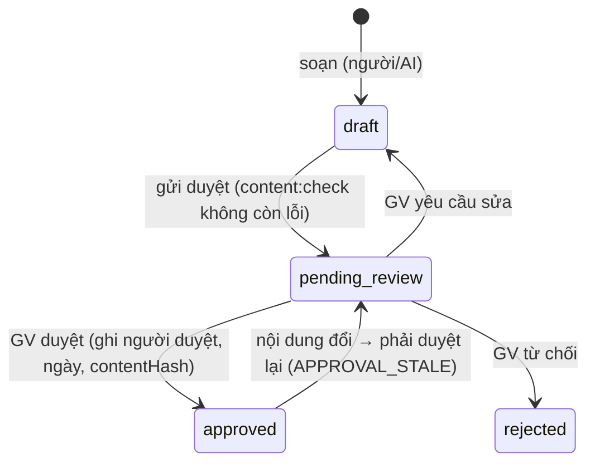

# ReadMate AI — Vietnamese Knowledge Engine

> **Phiên bản:** 0.1 — Giai đoạn 3 (2026-10-14) · **Phiên bản dữ liệu:** `content/manifest.json` → `0.1.0`
> **Trạng thái:** mã nguồn và kiểm thử hoàn tất; **toàn bộ dữ liệu đang chờ giáo viên duyệt**; hồ sơ lớp 1A2 **chưa được xác nhận**.
> **Tài liệu liên quan:** [ARCHITECTURE §10](ARCHITECTURE.md#10-kho-tri-thức-tiếng-việt) · [TEACHER_REVIEW_CHECKLIST.md](TEACHER_REVIEW_CHECKLIST.md) · [DATA_MODEL](DATA_MODEL.md) · [CLAUDE.md §7](../CLAUDE.md)

Bộ máy gồm hai phần tách bạch:

- **Thư viện ngôn ngữ** `src/lib/vietnamese/` — hàm thuần, xác định, không phụ thuộc giao diện hay CSDL.
- **Kho tri thức + tiến độ học tập** `content/` (dữ liệu JSON) và `src/features/knowledge/` (nạp, kiểm tra, suy luận theo hồ sơ lớp).

Không có mô hình học máy, không gọi AI. Mọi kết luận đều giải thích được bằng quy tắc và dữ liệu đã khai báo.

## Mục lục

1. [Cách mô hình hóa kiến thức](#1-cách-mô-hình-hóa-kiến-thức)
2. [Cấu trúc bộ dữ liệu](#2-cấu-trúc-bộ-dữ-liệu)
3. [Các hàm xử lý quan trọng](#3-các-hàm-xử-lý-quan-trọng)
4. [Giới hạn của bộ máy](#4-giới-hạn-của-bộ-máy)
5. [Những trường hợp chưa hỗ trợ](#5-những-trường-hợp-chưa-hỗ-trợ)
6. [Cách cập nhật tiến độ học tập](#6-cách-cập-nhật-tiến-độ-học-tập)
7. [Cách thêm từ vựng và học liệu mới](#7-cách-thêm-từ-vựng-và-học-liệu-mới)
8. [Quy trình kiểm duyệt của giáo viên](#8-quy-trình-kiểm-duyệt-của-giáo-viên)
9. [Ví dụ đầu vào/đầu ra](#9-ví-dụ-đầu-vàođầu-ra)
10. [Hướng phát triển trong Giai đoạn 4](#10-hướng-phát-triển-trong-giai-đoạn-4)

---

## 1. Cách mô hình hóa kiến thức

### 1.1 Hai lớp

| Lớp | Nội dung | Nơi lưu | Thay đổi khi |
|---|---|---|---|
| **1 — Kiến thức ngôn ngữ nền tảng** | Chữ cái, âm (chữ ghi âm), thanh, vần, quy tắc chính tả, cặp dễ nhầm, quan hệ tiên quyết, ngân hàng tiếng/từ/câu | `content/kb/*.json` | Bổ sung học liệu, GV sửa cách gọi |
| **2 — Tiến độ học tập** | Bộ bài (thứ tự bài, đơn vị được giới thiệu), hồ sơ lớp (bộ sách, vị trí bài, điều chỉnh của GV, quy ước) | `content/curriculum/series/`, `content/curriculum/profiles/` | Mỗi tuần (vị trí bài), khi GV xác nhận quy ước |

Bộ máy xử lý (lớp 1) không biết gì về bộ sách; muốn hỗ trợ bộ sách khác chỉ cần thêm một tệp bộ bài — không sửa mã.

### 1.2 Đơn vị kiến thức

Mỗi đơn vị có mã ổn định dạng `<loại>:<nội dung>` (NFC):

| Loại | Ví dụ mã | Ghi chú |
|---|---|---|
| Chữ cái | `letter:đ` | 29 chữ; **tên chữ cái** (“đê”) là trường riêng, khác **cách gọi âm** khi đánh vần (“đờ”) |
| Âm (chữ ghi âm) | `phoneme:ngh` | 39 âm: 16 phụ âm một chữ, 11 tổ hợp chữ (ch, gh, gi, kh, ng, ngh, nh, ph, qu, th, tr), 12 nguyên âm. Chữ q không có âm riêng — chỉ có `phoneme:qu` |
| Thanh | `tone:huyen` | 6 thanh, mã ASCII; thanh ngang không có dấu |
| Vần | `rime:oan` | 153 vần, mỗi vần khai báo tường minh âm đệm / âm chính / âm cuối |
| Tiếng, từ, câu | `syllable:bà`, `word:quả-na`, `sentence:005` | Ngữ liệu, mỗi mục có trạng thái duyệt riêng |

**Kiến thức cần biết để giải mã một tiếng** = âm đầu (nếu có) + vần + thanh:

- `bàn` → `phoneme:b` + `rime:an` + `tone:huyen`
- Vần chỉ gồm **một nguyên âm đơn** được tính là âm: `ba` → `phoneme:b` + `phoneme:a` + `tone:ngang`
- `ăn` (không có âm đầu) → `rime:ăn` + `tone:ngang`

**Không tự ghép vần**: biết chữ a và n chưa có nghĩa đọc được vần *an* — vần phải được giới thiệu như một đơn vị (đúng cách dạy lớp 1). Tương tự, `gh` và `g` là hai đơn vị khác nhau.

### 1.3 Cấu tạo tiếng

Tiếng = **âm đầu** + **vần** (= **âm đệm** o/u + **âm chính** + **âm cuối**) + **thanh**. Âm chính có thể là nguyên âm đôi: `ia`/`ya`/`ua`/`ưa` (không có âm cuối), `iê`/`yê`/`uô`/`ươ` (có âm cuối), và `oo` (o dài: *xoong*, *soóc*).

### 1.4 Quy ước nhà trường — tham số, không mã hóa thành kết luận

Bốn điểm phụ thuộc bộ sách/nhà trường (Q-02) được ghi rõ trong kết quả phân tích (`conventionDependencies`) và trong hồ sơ lớp (`conventions`):

| Quy ước | Ví dụ | Giá trị tạm của bộ máy | Khi hồ sơ chưa khai báo |
|---|---|---|---|
| `quAnalysis` | quả = **qu** + a | `qu_onset` | tiếng có qu → `unknown` |
| `giAnalysis` | giỏ = **gi** + o | `gi_onset` | tiếng có gi → `unknown` |
| `giSharedI` | gì = gi + **i**; giếng = gi + **iêng** (chữ i dùng chung) | `shared_i` | gì, gìn, giếng → `unknown` |
| `tonePlacement` | hoà/hòa, khoẻ/khỏe, thuỷ/thủy | — | chỉ là lưu ý, không đổi kết luận |

Riêng **qu + y** (quý, quýt, quyển, quỳnh) có hai cách phân tích hợp lý (qu + y… hay qu + uy… với u dùng chung) → bộ phân tích luôn trả `ambiguous` kèm các phương án, không đoán.

### 1.5 Ba khía cạnh tách bạch

| Khía cạnh | Bộ máy làm gì | Bộ máy KHÔNG làm gì |
|---|---|---|
| **Giải mã** (chữ–âm) | Kiểm tra mọi đơn vị cần biết đã có trong danh sách “đã học” của hồ sơ | Không khẳng định học sinh thực tế đọc được |
| **Từ vựng** | Đối chiếu với ngân hàng từ (độ quen thuộc *ước lượng* cho lứa tuổi) | Không suy ra trẻ hiểu nghĩa; không ảnh hưởng kết luận giải mã |
| **Đọc hiểu** | Nêu yêu cầu (nghĩa từ / nghĩa câu) và câu hỏi gợi ý cho GV nếu có | Không đánh giá (`assessed: false`) |

### 1.6 Bốn kết luận

| Kết luận | Ý nghĩa |
|---|---|
| `readable` | Mọi tiếng giải mã được bằng đơn vị **đã khai báo** là đã học (kèm lưu ý: không khẳng định trẻ đọc được) |
| `not_yet_learned` | Chắc chắn còn đơn vị chưa học — liệt kê cụ thể |
| `unknown` | Chưa thể xác minh: hồ sơ chưa có tiến độ, quy ước chưa xác nhận, vần ngoài danh mục, phân tích mơ hồ, chữ số… — **không bao giờ được coi là hợp lệ** |
| `invalid` | Sai chắc chắn: lỗi chính tả theo quy tắc, dấu thanh sai vị trí, ký tự lạ |

Thứ tự ưu tiên khi gộp nhiều tiếng: `invalid` > `not_yet_learned` > `unknown` > `readable`.

## 2. Cấu trúc bộ dữ liệu

```text
content/
├── manifest.json                       # phiên bản dữ liệu
├── kb/                                 # LỚP 1 — kiến thức ngôn ngữ
│   ├── letters.json        (29)        # chữ cái: chữ thường/hoa, thứ tự, tên chữ (đề xuất)
│   ├── phonemes.json       (39)        # âm: chữ cái tạo thành, vị trí, cách gọi khi dạy (đề xuất), nhóm cùng âm
│   ├── tones.json          (6)         # thanh: dấu Unicode, vị trí dấu, đi với âm cuối p/t/c/ch
│   ├── rimes.json          (153)       # vần: âm đệm, âm chính, âm cuối khai báo tường minh
│   ├── rules.json          (13)        # quy tắc: established/convention, spec máy đọc, ví dụ đúng/sai
│   ├── confusions.json     (17)        # cặp dễ nhầm: hình chữ, âm (phương ngữ), chính tả, thanh
│   ├── prerequisites.json  (18 mục)    # 25 cạnh tiên quyết khai báo (+ 404 cạnh suy ra theo cấu tạo)
│   ├── topics.json         (14)        # chủ đề ngữ nghĩa
│   ├── syllables.json      (58)        # ngân hàng tiếng + phân tích mong đợi
│   ├── words.json          (60)        # ngân hàng từ
│   └── sentences.json      (31)        # ngân hàng câu
└── curriculum/                         # LỚP 2 — tiến độ học tập
    ├── series/illustrative-v1.json     # chuỗi 17 bài MINH HỌA (không phải bộ sách thật)
    └── profiles/
        ├── class-1a2.json              # lớp 1A2 — unconfirmed, chưa có tiến độ
        └── illustrative-demo.json      # hồ sơ hư cấu cho kiểm thử/demo
```

**Quy ước chung của mọi tệp** (kiểm bằng zod `strictObject` — trường lạ bị từ chối):

- Tiêu đề tệp: `kind`, `description`, `review` (trạng thái duyệt cấp tệp), `provenance` (nguồn gốc), `items`.
- Mục ngữ liệu (tiếng/từ/câu): `id`, `text`, `difficulty` (1–5, dự kiến), `review` (riêng từng mục), `version`, `provenance?` (ghi đè), `note?`.
  - Tiếng: `expected` (âm đầu, vần, thanh do người soạn khai báo; `null` nếu chưa phân tích chắc chắn).
  - Từ: `topics`, `familiarity` (`everyday`/`common`/`less_common` — ước lượng), `imageable`, `meaningNote?`.
  - Câu: `topics`, `comprehensionFocus?` (câu hỏi gợi ý cho GV), `properNouns?` (tên nhân vật hư cấu).
- `review`: `status` ∈ `draft` · `pending_review` · `approved` · `rejected`; khi `approved` bắt buộc `reviewedBy`, `reviewedAt`, `contentHash`.
- `provenance.origin` ∈ `ai_assisted` · `project_team` · `teacher` · `standard_reference`.
- Mọi chuỗi ở dạng NFC; ID khớp nội dung (`word:quả-na` ↔ “quả na”).

Lược đồ: [src/features/knowledge/schema.ts](../src/features/knowledge/schema.ts).

## 3. Các hàm xử lý quan trọng

### 3.1 `src/lib/vietnamese/` (thuần, có unit test)

| Module | Hàm chính | Việc làm |
|---|---|---|
| `normalize.ts` | `toNFC`, `isNFC`, `equalsNFC`, `toLowerVi`, `normalizeWhitespace`, `inspectText`, `prepareText`, `detectLegacyEncoding` | NFC; soát ký tự ẩn, dấu sót, khoảng trắng, chữ Kirin giả dạng, dấu hiệu TCVN3/VNI. `prepareText` chỉ áp dụng NFC + khoảng trắng và **ghi lại** đã đổi gì; mọi vấn đề khác chỉ báo cáo |
| `characters.ts` | `VIETNAMESE_ALPHABET`, `isVowelLetter` | 29 chữ cái, 12 nguyên âm, f/j/w/z là chữ ngoại |
| `tone.ts` | `extractTone`, `stripTones`, `applyTone` | Tách/đặt dấu thanh, chịu được đầu vào NFC lẫn NFD; báo lỗi hai dấu thanh, dấu trên phụ âm, dấu lạ |
| `syllable.ts` | `analyzeSyllable(text, inventory)` | Phân tích tiếng: âm đầu khớp dài nhất (`ngh` trước `ng`), xử lý riêng `qu`, `gi`; phần vần phải **khớp chính xác** một vần trong danh mục. Trả `ok` / `invalid` / `unrecognized` / `ambiguous` |
| `spelling-rules.ts` | `checkSpelling`, `SPELLING_RULE_SPECS` | c/k, g/gh, ng/ngh, qu, iê/yê, âm cuối p/t/c/ch chỉ với sắc/nặng — kèm gợi ý sửa (không tự áp dụng) |
| `tone-placement.ts` | `checkTonePlacement`, `expectedToneIndex` | `ok` / `style_dependent` (hoà/hòa) / `misplaced` (muà, qủa, gìa) |
| `diagnostics.ts` | `diagnoseSyllable` | Gộp mọi kiểm tra của một tiếng thành danh sách `error`/`warning` có mã quy tắc |
| `decodability.ts` | `requiredUnitsOf`, `checkDecodability(text, { inventory, taughtUnits, conventions })` | Kết luận giải mã cho tiếng/từ/câu, liệt kê đơn vị đã biết/còn thiếu/chưa xác minh, lý do và lưu ý |
| `difficulty.ts` | `estimateDifficulty`, `syllableComplexity` | Độ khó giải mã 1–5 theo cấu tạo (âm đầu ghép, âm đệm, nguyên âm đôi, âm cuối, hỏi/ngã, số tiếng) — liệt kê từng yếu tố |
| `tokenize.ts` | `tokenize`, `syllableTokens` | Tách chữ, dấu câu, số, ký hiệu |

### 3.2 `src/features/knowledge/`

| Module | Hàm chính | Việc làm |
|---|---|---|
| `load.ts` | `loadKnowledgeBase(raw)` | Kiểm lược đồ, dựng `KnowledgeBase` + `inventory` cho bộ phân tích |
| `default-kb.ts` | `KNOWLEDGE_BASE` | Kho tri thức đóng gói sẵn (import JSON qua bundler) cho ứng dụng và Vitest |
| `curriculum.ts` | `resolveKnowledgeState(kb, profile, { band, lessonOrdinal })` | Tập đã học / được phép luyện / cần ôn; Nhóm 3 lùi một bài; Nhóm 1 thêm đơn vị GV cho phép |
| `readability.ts` | `checkReadability(kb, text, { profile, band?, lessonOrdinal? })`, `analyzeVocabulary` | **API nội bộ kiểm tra ngữ liệu theo hồ sơ** — giải mã + từ vựng + đọc hiểu |
| `selection.ts` | `selectCorpusItems(kb, { profile, purpose, kind, … })` | Chặn: `assignment` chỉ khi hồ sơ **confirmed** và chỉ trả mục **approved**; `preview` trả mục chưa bị từ chối kèm trạng thái |
| `prerequisites.ts` | `buildPrerequisiteGraph`, `findCycle` | Đồ thị tiên quyết (suy ra + khai báo), phát hiện vòng |
| `content-validation.ts` | `validateContent(files)`, `computeContentHash` | Toàn bộ `npm run content:check` (chỉ chạy trong Node) |

### 3.3 `npm run content:check`

`scripts/content-check.ts` chạy trực tiếp bằng Node 24 (bỏ kiểu TypeScript gốc) nên mọi import trong chuỗi phụ thuộc dùng **đường dẫn tương đối có đuôi `.ts`**, không dùng alias `@/`. Mức độ:

- **Lỗi** (thoát mã 1, chặn CI): JSON/lược đồ; ID trùng hoặc lệch nội dung; nội dung trùng; không NFC, BOM, ký tự ẩn, nghi bảng mã cũ; tham chiếu hỏng; vòng tiên quyết; dữ liệu tham chiếu lệch bộ máy (bảng chữ cái, thanh, cấu tạo vần, spec quy tắc, ví dụ đúng/sai); lỗi chính tả chắc chắn trong ngữ liệu; phân tích khai báo lệch bộ máy; duyệt không hợp lệ (thiếu người duyệt, AI/hệ thống duyệt, ngày sai, **nội dung đổi sau khi duyệt** — so `contentHash`); hồ sơ đã xác nhận dùng chuỗi bài minh họa/chưa duyệt; mẫu email/số điện thoại/số định danh, trường dữ liệu cá nhân.
- **Cảnh báo** (cần GV rà soát, không chặn): nội dung chờ duyệt; hồ sơ chưa xác nhận; tiếng phụ thuộc quy ước; tiếng chưa phân tích chắc chắn; kiểu đặt dấu; độ khó dự kiến lệch ≥ 2 mức so với ước lượng; tên riêng chưa khai báo; định dạng câu; mục đã duyệt dựa vào mục chưa duyệt; thứ tự tiên quyết trong bộ bài.
- **Thông tin**: thống kê, tiếng chưa có trong ngân hàng tiếng, chuỗi/hồ sơ minh họa.

Kết quả hiện tại: **ĐẠT — 0 lỗi, 33 cảnh báo** (toàn bộ là việc chờ GV).

## 4. Giới hạn của bộ máy

1. **Chỉ là kiểm tra theo dữ liệu khai báo.** `readable` không có nghĩa học sinh đọc được; độ chính xác phụ thuộc hồ sơ lớp (bộ sách, vị trí bài) do GV cập nhật.
2. **Phân tích theo chữ viết**, không theo ngữ âm: không mô hình hóa phát âm vùng miền (d/gi/r, l/n, s/x, hỏi/ngã…) — chỉ ghi nhận các cặp dễ nhầm.
3. **Danh mục vần là giới hạn cứng**: vần ngoài 153 vần (ví dụ *ưm*, *oao*, *uêch*) → `unknown`.
4. **Ranh giới từ** chỉ xác định được khi từ có trong ngân hàng từ (khớp dài nhất ≤ 3 tiếng); không tách từ tự do.
5. **Độ khó** là ước lượng có trọng số giả định; cần hiệu chỉnh bằng dữ liệu thí điểm.
6. **Chữ hoa**: chỉ nhắc GV (lưu ý), chưa mô hình hóa việc học chữ hoa như một đơn vị.
7. **Phát hiện bảng mã cũ** chỉ là phỏng đoán (TCVN3/VNI) và có thể báo nhầm các ký hiệu như “µ” dính liền chữ; không chuyển mã.
8. **Ngân hàng ngữ liệu nhỏ** (149 mục minh họa) và **chưa có mục nào được duyệt** → chưa dùng được để giao bài thật.
9. **Đọc hiểu** không được đánh giá tự động.

## 5. Những trường hợp chưa hỗ trợ

| Trường hợp | Hành vi hiện tại |
|---|---|
| qu + y (quý, quýt, quyển, quỳnh) | `ambiguous` + các phương án — chờ GV chọn quy ước |
| Phân tích “qu” theo ngữ âm học (q + âm đệm u) | Chưa hỗ trợ; chỉ có quy ước `qu_onset` |
| Từ mượn, chữ f/j/w/z, cụm phụ âm (blog, pi-a-nô có gạch nối) | `invalid` (chữ ngoại, ký tự lạ) hoặc `unrecognized` (cụm phụ âm) |
| Chữ số, ký hiệu | `unknown` |
| Chuyển mã TCVN3/VNI → Unicode | Không hỗ trợ (chỉ phát hiện) |
| Chính tả i/y sau phụ âm (lí/lý, kĩ/kỹ) | Coi cả hai là hợp lệ; chưa áp quy ước chọn i hay y |
| Từ đồng âm khác nghĩa trong ngân hàng từ | Chưa có (ID dựa trên nội dung) |
| Đoạn văn nhiều câu, xuống dòng | Chưa kiểm tra riêng (xem như văn bản một dòng) |
| Gộp tiếng thành từ ngoài ngân hàng | Không đoán |

## 6. Cách cập nhật tiến độ học tập

Tiến độ là **dữ liệu**, không phải mã. Ở GĐ3 sửa tệp JSON; từ GĐ5 các trường tương ứng nằm trong CSDL (`classes`, `class_lesson_progress`, `curriculum_*`).

1. **Khi GV xác nhận bộ sách (Q-01):** thêm `content/curriculum/series/<mã-bộ-sách>.json` với `seriesKind: "textbook"`, `source` (tên sách, NXB, năm), danh sách bài với `introduces` — chỉ ghi **thứ tự bài và đơn vị kiến thức** (dữ kiện), không chép bài đọc/hình. Đăng ký tệp trong `src/features/knowledge/default-kb.ts` (unit test báo nếu quên).
2. **Hồ sơ lớp** `content/curriculum/profiles/class-1a2.json`:
   - `seriesId`, `currentLessonOrdinal` — cập nhật hằng tuần.
   - `additionalTaughtUnits` / `excludedUnits` — GV thêm/bớt so với bộ sách.
   - `reviewFocusUnits` — đơn vị cần ôn; `extendingAllowedUnits` — đơn vị chưa học mà Nhóm 1 được dùng.
   - `conventions` — bốn quy ước ở §1.4.
   - Khi GV xác nhận: `status: "confirmed"`, `confirmation: { confirmedBy, confirmedAt }`. `content:check` chặn hồ sơ đã xác nhận dùng chuỗi minh họa hoặc bộ bài chưa duyệt.
3. Chạy `npm run content:check` rồi `npm run test:run`.

## 7. Cách thêm từ vựng và học liệu mới

1. Thêm mục vào `content/kb/words.json` (hoặc `sentences.json`, `syllables.json`):
   ```json
   { "id": "word:quả-bưởi", "text": "quả bưởi", "topics": ["topic:plants"], "familiarity": "everyday",
     "imageable": true, "difficulty": 3, "review": { "status": "pending_review" }, "version": 1 }
   ```
   - `id` = `word:` + nội dung, dấu cách → `-`; chữ thường; NFC.
   - Nội dung mới **luôn** bắt đầu ở `draft` hoặc `pending_review`.
   - Ghi `provenance` riêng nếu nguồn khác nguồn của tệp (ví dụ GV soạn: `origin: "teacher"`).
2. Với tiếng mới quan trọng, thêm vào `syllables.json` kèm `expected` để bộ kiểm tra đối chiếu.
3. Nếu bộ kiểm tra báo `RIME_NOT_IN_CATALOG`: chỉ thêm vần vào `rimes.json` khi chắc chắn về cấu tạo (âm đệm, âm chính, âm cuối) — bộ kiểm tra sẽ soát cấu tạo.
4. Chạy `npm run content:check`: sửa mọi **lỗi**; đưa **cảnh báo** vào danh sách rà soát của GV.
5. Không sao chép bài đọc, câu, hình từ SGK/vở bài tập; câu có tên nhân vật phải khai báo `properNouns` và là tên hư cấu.

## 8. Quy trình kiểm duyệt của giáo viên



1. GV dùng [TEACHER_REVIEW_CHECKLIST.md](TEACHER_REVIEW_CHECKLIST.md) để rà soát danh mục, quy ước, ngữ liệu.
2. Khi duyệt một mục: `review = { status: "approved", reviewedBy: "<tên GV>", reviewedAt: "YYYY-MM-DD", contentHash: "<sha256>" }`. Giá trị hash do bộ kiểm tra tính (`computeContentHash` — SHA-256 của mục, bỏ trường `review`); nếu sai, `content:check` in ra hash đúng.
3. **AI và hệ thống không bao giờ được duyệt** (`APPROVAL_BY_AI`). Mọi mục do trợ lý AI soạn ở GĐ3 có `origin: "ai_assisted"`.
4. Sửa nội dung đã duyệt (kể cả một dấu) làm hash lệch → `APPROVAL_STALE`, mục phải duyệt lại.
5. Chỉ mục `approved` và hồ sơ `confirmed` mới qua được `selectCorpusItems({ purpose: "assignment" })`.
6. Từ GĐ6, quy trình này có giao diện (`/teacher/review`) và nhật ký `content_reviews` trong CSDL; dữ liệu JSON hiện tại sẽ được nạp vào `kb_units` với cùng trạng thái.

## 9. Ví dụ đầu vào/đầu ra

Kết quả thật khi chạy bộ máy trên dữ liệu hiện tại (2026-10-14).

### 9.1 Phân tích tiếng — `diagnoseSyllable`

| Đầu vào | Kết quả |
|---|---|
| `nghiêng` | `ok` · âm đầu `ngh` · âm chính `iê` · âm cuối `ng` · vần `iêng` · thanh ngang |
| `quả` | `ok` · `qu` + `a` + hỏi · phụ thuộc quy ước `qu_onset` → cảnh báo `CONVENTION_DEPENDENT` |
| `giếng` | `ok` · `gi` + `iêng` + sắc · phụ thuộc `gi_onset`, `gi_shared_i` |
| `khoẻ` | `ok` · `kh` + âm đệm `o` + `e` + hỏi · cảnh báo `TONE_PLACEMENT_CONVENTION` (kiểu hoà) |
| `quýt` | `unverified` · `AMBIGUOUS_QU_Y` → phương án “qu + uyt (u dùng chung)” |
| `kà` | `error` · `SPELLING_C_K` → gợi ý `cà` |
| `muà` | `error` · `TONE_MARK_MISPLACED` |
| `mian` | `error` · `RIME_FORM_INVALID` → gợi ý `iên` |

### 9.2 Kiểm tra theo hồ sơ — `checkReadability`

| Đầu vào | Hồ sơ / mốc | Kết luận | Chi tiết |
|---|---|---|---|
| `Bé đi bộ.` | minh họa, bài 6 | `readable` | đã biết: b, e, sắc, đ, i, ngang, ô, nặng · từ vựng: một phần có trong ngân hàng · đọc hiểu: nghĩa câu, không đánh giá |
| `Mẹ bế bé.` | minh họa, bài 5 | `not_yet_learned` | thiếu `phoneme:m` |
| `quả` | minh họa, bài 10, Nhóm 3 | `not_yet_learned` | Nhóm 3 tính đến bài 9 → thiếu `phoneme:qu` |
| `mía` | minh họa, bài 10, Nhóm 1 | `readable` | `rime:ia` nằm trong đơn vị GV cho phép Nhóm 1 |
| `Thuyền đi trên sông.` | minh họa, bài 17 | `not_yet_learned` | thiếu `rime:uyên`, `rime:ên` |
| `quả quýt` | minh họa, bài 17 | `unknown` | `PARSE_AMBIGUOUS: quýt` |
| `bà` | lớp 1A2 | `unknown` | `PROFILE_HAS_NO_PROGRESS` — hồ sơ chưa xác nhận |
| `kà` | lớp 1A2 | `invalid` | lỗi chính tả được phát hiện độc lập với hồ sơ |

### 9.3 Ngữ liệu đọc được ở ba mốc bài (hồ sơ minh họa, Nhóm 2)

| Mốc | Từ | Câu |
|---|---|---|
| Bài 5 | 14: bà, bé, bò, bố, cá, cò, cỏ, cô, cờ, đò, lá, lê, ba lô, lá cờ | 4: Bà có cá. · Bố có bơ. · Cô có cờ đỏ. · Bé có lá cờ. |
| Bài 10 | 34 (thêm mẹ, nơ, gà, ghế, thỏ, nhà, khế, nghé, nho, chó, tre, vở, chữ, quê, giỏ, xe, phố, đu đủ, quả na, su su) | 16 (thêm Bé đi bộ. · Mẹ bế bé. · Bé nghỉ hè ở nhà bà. · Bố đi xe ra phố. · Bé vẽ gì? …) |
| Bài 16 | 56 | 28 |

Ở bài cuối (17), toàn bộ 149 mục ngữ liệu: 136 `readable`, 11 `not_yet_learned` (cố ý dùng vần ngoài chuỗi bài: uyên, iêng, uya, yêu, ươi, ây, ên, ep…), 2 `unknown` (quýt). Danh sách này **chờ GV xem và xác nhận hợp lý** (TASKS GĐ3).

## 10. Hướng phát triển trong Giai đoạn 4

1. **Dùng trực tiếp bộ máy trong `validate()` của 6 dạng bài**: `NOT_DECODABLE` = `checkReadability(...).verdict !== "readable"`; `SPELLING_RULE_VIOLATION`/`TONE_RULE_VIOLATION` = `diagnoseSyllable`; `TEXT_LEAKS_ANSWER`/`AUDIO_LEAKS_ANSWER` dùng `toLowerVi` + `tokenize` để so khớp theo ranh giới tiếng.
2. **Sinh bài theo quy tắc**: lấy ngữ liệu bằng `selectCorpusItems` (chỉ `preview` cho `/demo`), chọn phương án nhiễu từ `confusions.json` (b–d, an–ang, c–k…), gắn thẻ lỗi.
3. **Dạng 2–4** (ghép tiếng, tìm vần, điền c/k…) dùng `analyzeSyllable` để tách âm đầu/vần/thanh và `applyTone` để dựng tiếng.
4. **Ràng buộc theo nhóm**: `resolveKnowledgeState` với `band` (Nhóm 3 lùi một bài, Nhóm 1 thêm đơn vị cho phép); độ khó từ `estimateDifficulty`.
5. **Mở rộng dữ liệu** khi GV trả lời Q-01/Q-02: thêm thứ tự bài của bộ sách thật, xác nhận quy ước, duyệt ngữ liệu, gắn hình có giấy phép.
6. (Tùy chọn) trang tra cứu kho tri thức tĩnh cho GV rà soát (TASKS 3.9 — chưa làm ở GĐ3).
