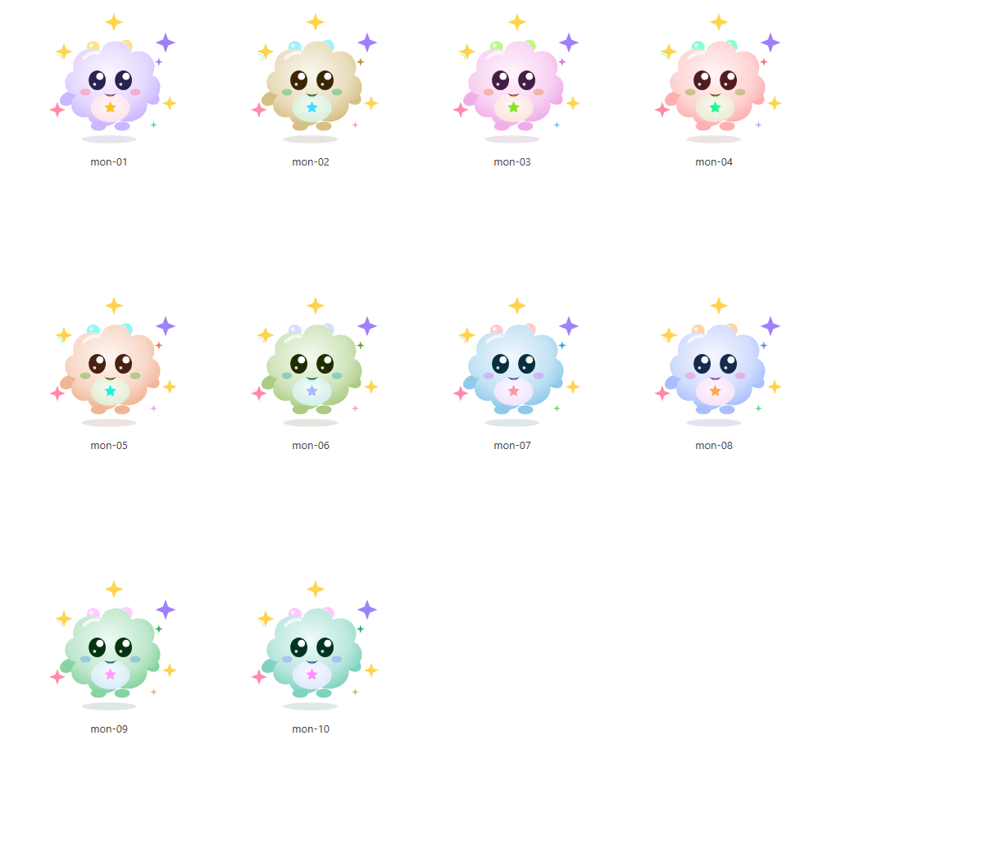
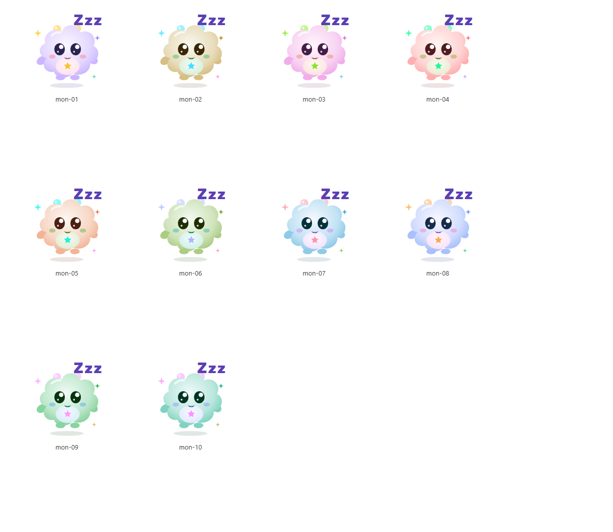

# R08 — Hồ sơ giáo viên xem xét quái vật của Mê cung kho báu

> **Trạng thái: CHỜ GIÁO VIÊN XEM XÉT.** Phần kỹ thuật (soát chống lộ đáp án, soát giấy phép) đã xong ở R08.5 (2026-10-23).
> Chưa có giáo viên nào xem hay duyệt. Mọi ô đánh giá bên dưới đang là "Chưa đánh giá"; mọi tài nguyên trong
> `content/media/licenses.json` vẫn `pending_review`. Hồ sơ này **không** thay thế quyết định của giáo viên.

## 1. Mê cung kho báu — tóm tắt cho giáo viên

Học sinh ở nhà điều khiển bạn nhỏ đi trong mê cung. Gần mỗi "ô thử thách" (tối đa **7** ô mỗi màn) sẽ gặp một bạn quái vật thân thiện.
Mỗi bạn hỏi **3 câu Tiếng Việt** (cùng sáu dạng bài và cùng khuôn câu hỏi như phần luyện tập thường ngày). Quái vật có **3 trái tim**:
mỗi câu trả lời đúng làm một trái tim bay lên. Đủ ba trái tim thì bạn quái vật **biến thành những ngôi sao**; nếu chưa đủ
thì bạn quái vật **vẫy tay rồi bay đi ngủ** ("Hẹn gặp lại nhé!"). Không có cảnh tấn công, không đếm giờ, không âm thanh hay hình
ảnh mang tính phạt. Gặp đủ 7 bạn thì rương kho báu mở (mở rương không cộng điểm).

## 2. Danh sách quái vật (10 bạn; mỗi màn chọn 7 bạn khác nhau)

Cả 10 bạn dùng **chung một hình** (đám mây bông tròn trịa, mắt to, miệng cười, không sừng nhọn, không răng, không móng), chỉ **khác màu**.
Mã quái vật là số thứ tự trung tính (`mon-01` … `mon-10`); tên là **tên bịa** (không là từ, tiếng hay con vật của bài học).

| Mã | Tên hiển thị | Nhãn cho trình đọc màn hình |
|---|---|---|
| mon-01 | Pu Pu | Bạn quái vật Pu Pu |
| mon-02 | Tum Tum | Bạn quái vật Tum Tum |
| mon-03 | Lu Lu | Bạn quái vật Lu Lu |
| mon-04 | Pom Pom | Bạn quái vật Pom Pom |
| mon-05 | Bun Bun | Bạn quái vật Bun Bun |
| mon-06 | Mum Mum | Bạn quái vật Mum Mum |
| mon-07 | Nin Nin | Bạn quái vật Nin Nin |
| mon-08 | Xu Xu | Bạn quái vật Xu Xu |
| mon-09 | Tin Tin | Bạn quái vật Tin Tin |
| mon-10 | Gu Gu | Bạn quái vật Gu Gu |

### Hình khi xuất hiện (hiện ra từ từ, có vầng sáng)

### Hình khi trả lời đúng cả ba câu — bạn quái vật biến thành sao

(Ảnh chụp trạng thái cuối khi tắt hoạt cảnh: bạn quái vật và các ngôi sao. Khi chạy thật, bạn xoay nhẹ rồi thu nhỏ thành sao, một lần, ~1,8 giây.)

### Hình khi chưa hoàn thành thử thách — bạn quái vật vẫy tay, bay đi ngủ

(Chữ "Zzz" hiện ra chậm; khi chạy thật bạn bay đi ngủ một lần, ~2,8 giây.)

> Ảnh được dựng từ chính mã giao diện (`MonsterView`) bằng dữ liệu giả; không có dữ liệu học sinh. Khi ở trong ứng dụng, mỗi bạn
> còn nhún nhẹ một lần khi mất một trái tim.

## 3. Tên và lời thoại học sinh nhìn thấy trước khi trả lời xong

| Vị trí | Nội dung |
|---|---|
| Tên dưới hình | _Pu Pu_, _Tum Tum_ … (bảng trên) |
| Nhãn hình (trình đọc màn hình) | "Bạn quái vật {tên}" |
| Nhãn hộp thoại | "Gặp {tên}" |
| Chờ vào màn | "Có một bạn quái vật đang chờ con…" |
| Trái tim | "Bạn quái vật còn {n} trong 3 trái tim." |
| Mất mạng | "…Con kiểm tra mạng rồi bấm Thử lại nhé. Bạn quái vật sẽ đợi con!" |
| Tạm dừng | "Mọi thứ vẫn được giữ nguyên, không bị trừ điểm. …" |
| Giới thiệu ở Game World | "Các bạn quái vật thân thiện sẽ hỏi con những câu thật vui!" |

Sau khi bạn quái vật kết thúc:

- Đủ 3 trái tim: **"Giỏi quá! Bạn ấy biến thành những ngôi sao!"** — "Cả ba trái tim đã bay lên trời. Con thật tuyệt!"
- Chưa đủ: **"Hẹn gặp lại nhé!"** — "Bạn quái vật vẫy tay rồi bay đi ngủ. Lần sau mình gặp lại nhé!"

Quái vật **không nói** nội dung câu hỏi, không đọc to chữ/từ cần đọc, không đưa gợi ý. Gợi ý (nếu có) là của bài tập, theo mức hỗ trợ.

## 4. Kết quả soát chống lộ đáp án (kỹ thuật)

Thay đổi ở R08.5:

- **Đổi tên quái vật.** Bản R08.4 dùng tên như "Bé Cá Vàng", "Bé Mèo Ngủ", "Bé Ốc Sên", "Bé Ếch Con", "Bé Sao Nhỏ", "Bé Nấm Tròn". Đó là
  chữ/từ có thể là đáp án của bài nhìn tranh, nhận chữ hay tìm tiếng; tiền tố "Bé" cũng là từ của kho học liệu; và hình luôn là đám
  mây nên tên con vật còn không khớp hình. Bộ soát mới gắn cờ các tên này (có test hồi quy). Tên mới là chuỗi bịa trung tính.
- **Đổi mã quái vật** thành `mon-01`…`mon-10`. Mã cũ (như `mon-sao-nho`, có tiếng "sao", "nho") nằm trong thuộc tính HTML
  `data-monster` và dữ liệu trang; mã mới không chứa tiếng nào. Lượt chơi đang dở đã lưu mã cũ vẫn chạy bình thường (bảng đổi mã).

Bộ soát tự động (`src/features/game-runs/monster-audit.ts`, test `tests/unit/game-runs/monster-audit.test.tsx`):

1. Đối chiếu **tên, nhãn trợ năng và lời dẫn** của quái vật (sau chuẩn hóa NFC + khoảng trắng, theo ranh giới tiếng) với dạng đáp án
   bị cấm của **toàn bộ câu minh họa** (10 dạng biến thể × 3 nhóm) → **lỗi** nếu trùng.
2. Đối chiếu **tên** với mọi tiếng của kho học liệu (từ, tiếng, câu, vần, âm, chữ; kể cả chỉ khác thanh) → **cảnh báo cho GV** (chưa lộ câu
   nào hôm nay nhưng có thể lộ khi kho lớn thêm). Không áp dụng cho lời dẫn chung vì "con", "bạn" … có ở khắp giao diện.
3. Quét **mọi thuộc tính HTML** (`aria-label`, `title`, `alt`, `data-*`) và chữ của hình quái vật ở 3 trạng thái × 20 mã (mới + cũ).
4. Kiểm tra câu trong chạm trán: câu chưa đóng không có `answer`/`reveal`/tên tranh; câu đóng mới có `reveal` (dùng lại cơ chế R04/R08.3).
5. Kết quả hiện tại: **0 lỗi, 0 cảnh báo** với kho học liệu minh họa hiện có.

**Giới hạn:** so khớp chữ chỉ bắt được trùng/gần giống rõ ràng; không biết nghĩa. Kết quả "không lỗi" **không** có nghĩa tuyệt đối an toàn —
cần GV xem, và cần chạy lại bộ soát mỗi khi thêm học liệu hay đổi tên.

## 5. Kết quả soát bản quyền hình ảnh

| Tài nguyên | Đường dẫn | Tác giả / nguồn | Quyền sử dụng | Mục đích | GV duyệt |
|---|---|---|---|---|---|
| `art.character.friendly-monster` | `src/components/art/characters.tsx#FriendlyMonster` | Dự án ReadMate AI — tự vẽ bằng mã SVG (R02), không dựa trên nhân vật có bản quyền, không dùng công cụ tạo ảnh | Tác phẩm gốc của dự án, dùng trong ứng dụng | Hình chung của 10 quái vật (đổi màu) | Chờ |
| `art.animation.monster-encounter` | `…/encounter/monster-view.tsx#MonsterView`, `src/styles/tokens.css` | Dự án ReadMate AI — vầng sáng, sao, "Zzz", hoạt cảnh CSS tự viết (R08.4) | Tác phẩm gốc của dự án | Hiện ra / thành sao / bay đi ngủ | Chờ |

- Không có hình ảnh, âm thanh, phông chữ hay hoạt cảnh của bên thứ ba trong màn quái vật; không dùng hình tìm trên mạng hay nhân vật thương mại.
- "Tác phẩm gốc của dự án" là **tuyên bố của dự án**, chưa qua rà soát pháp lý độc lập; chủ dự án cần xác nhận nếu muốn công bố rộng.
- Chưa có tài nguyên nào có nguồn/quyền không rõ. Mọi dòng giấy phép đều `pending_review`, `teacherReviewed: false`.

## 6. Tiêu chí phù hợp học sinh lớp 1 (tự soát kỹ thuật — GV xác nhận)

| Tiêu chí | Kết quả tự soát |
|---|---|
| Dễ thương, thân thiện | Đám mây tròn, mắt to, má hồng, miệng cười |
| Không đáng sợ | Không răng nanh, móng vuốt, sừng nhọn; sừng tròn mềm; màu pastel |
| Không bạo lực | Không có cảnh tấn công; kết thúc là "thành sao" hoặc "đi ngủ" |
| Dễ nhận trên điện thoại | Hình lớn (160–192 px), hình khối đơn giản |
| Hoạt cảnh nhẹ | Mỗi hoạt cảnh chạy một lần, không lặp, không nhấp nháy, không giật mình |
| Giảm chuyển động | Dừng khi hệ điều hành bật giảm chuyển động hoặc công tắc "Giảm chuyển động" của trang |
| Ngôn ngữ | Tích cực; không "thua/thất bại"; không trừ điểm hiển thị bằng hình/âm đáng sợ |

Chưa chụp được hoạt cảnh chuyển động trong tài liệu này — GV có thể xem trực tiếp khi trình diễn.

## 7. Điểm cần giáo viên xác nhận

1. Hình đám mây bông có phù hợp và không gây sợ với trẻ 6–7 tuổi? Dùng chung một hình đổi màu có ổn không, hay cần nhiều hình khác nhau?
2. Tên bịa (Pu Pu, Tum Tum …) có dễ đọc, dễ nhớ? Có tiếng nào trùng với từ địa phương hay khiến trẻ hiểu nhầm không? (Lưu ý: Bun, Tin, Mum… giống chữ không dấu của từ khác.)
3. Lời dẫn và lời kết ("biến thành những ngôi sao", "bay đi ngủ") có thân thiện, không gây áp lực?
4. Có chữ/từ nào trong danh sách tên mà GV muốn tránh vì sắp dạy?
5. Hoạt cảnh có đủ nhẹ nhàng? Thời lượng 1 / 1,8 / 2,8 giây ổn không?
6. Kết luận chung: có thể đưa cho học sinh dùng thật hay cần chỉnh sửa?

## 8. Phiếu góp ý của giáo viên

| Tiêu chí | Đánh giá của GV |
|---|---|
| Hình ảnh phù hợp học sinh lớp 1 | Chưa đánh giá |
| Quái vật không gây sợ hãi | Chưa đánh giá |
| Tên gọi dễ hiểu | Chưa đánh giá |
| Lời thoại thân thiện | Chưa đánh giá |
| Không vô tình gợi đáp án | Chưa đánh giá |
| Hoạt cảnh nhẹ nhàng | Chưa đánh giá |
| Có thể đưa vào sử dụng thật | Chưa đánh giá |

Họ tên giáo viên: ______________________________

Ngày xem xét: ______________________________

Ý kiến góp ý: ______________________________

Nội dung cần chỉnh sửa: ______________________________

Kết luận: ☐ Đồng ý  ☐ Cần chỉnh sửa  ☐ Chưa đồng ý

> Chỉ sau khi giáo viên thực sự điền phiếu này, người điều phối mới cập nhật `content/media/licenses.json`
> (`reviewedBy`, `reviewedAt`, trạng thái). Không ai khác được tự đổi trạng thái.
